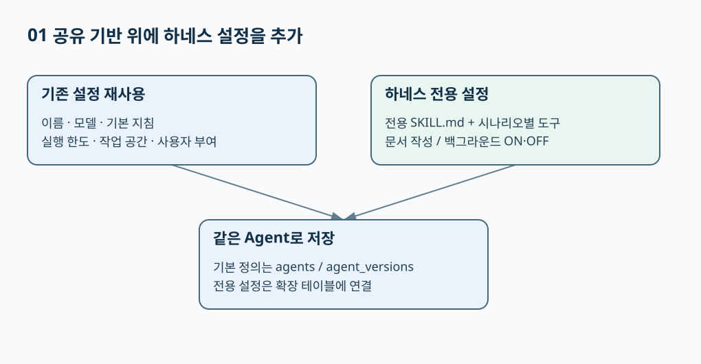
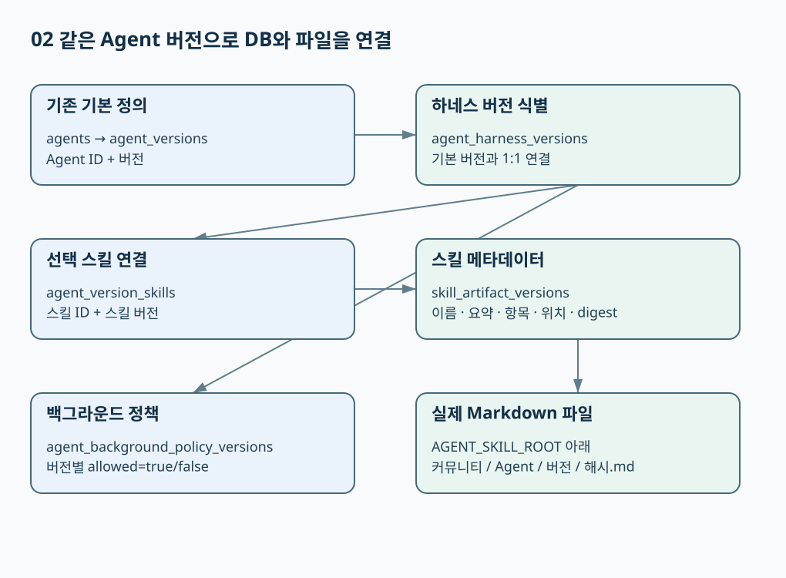
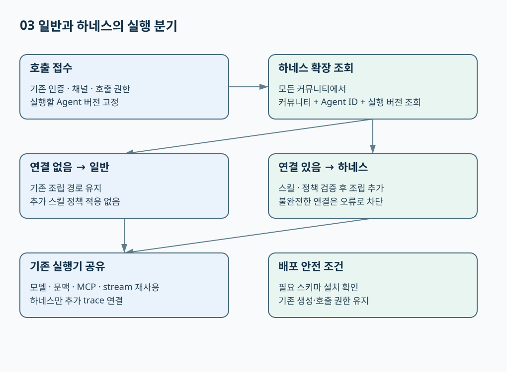
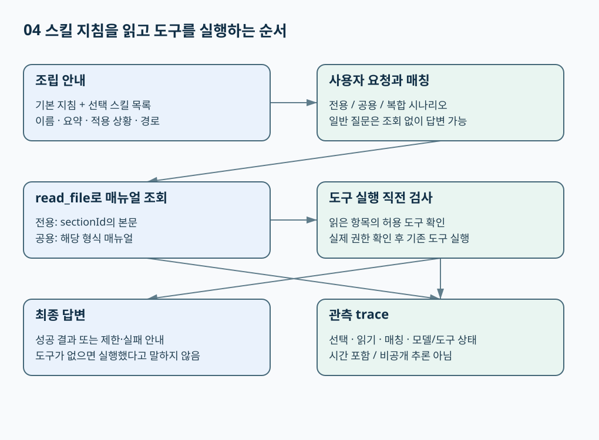
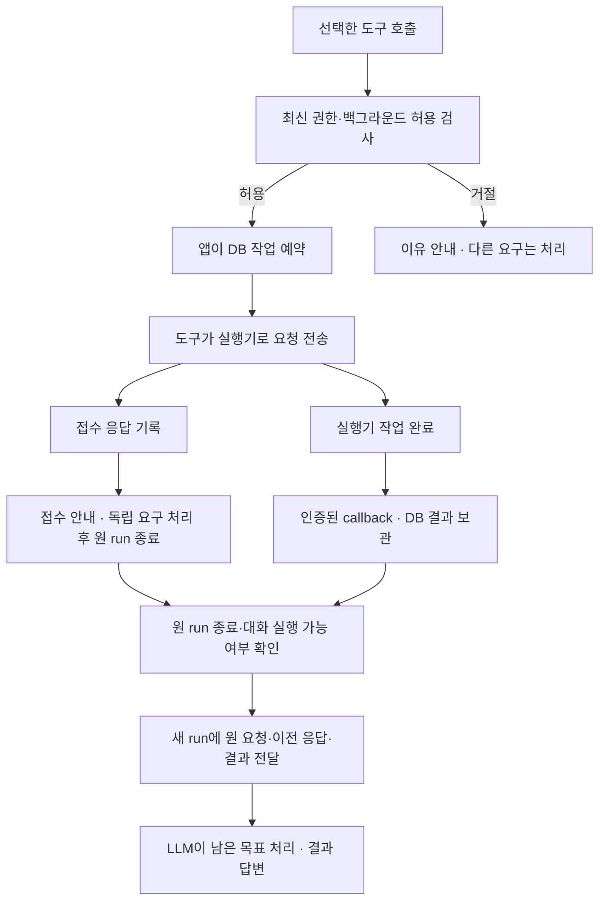

# 하네스 에이전트 설정·저장·실행 명세

**기준: 2026-10-13 최종 커밋 `ddce9e6`. 운영 배포 완료를 뜻하지 않는다.** 여기서 ‘일반’은 기존 **에이전트 만들기**, ‘하네스’는 같은 만들기 화면에서 **하네스 토글**을 선택한 경우다. Builtin과 생성 하네스는 설정·신원 어댑터를 구분하되, 백그라운드 접수·완료 후 지침은 공유한다.

> **기존 에이전트를 새 테이블로 옮기는 방식이 아니다.** 기본 정의·버전·권한·실행 기반은 공유하고, 하네스 버전에만 스킬 및 정책을 추가 연결한다.

## 1. 무엇을 설정할 수 있나

| 설정 | 일반과의 관계 | 현재 하네스 화면·동작 |
| --- | --- | --- |
| 이름·호출 이름·설명·기본 지침 | **기존 정의 재사용** | 호출 이름은 생성 후 편집 불가 |
| 기본·허용 모델 | 기존 정책 재사용 | 기본 모델 및 사용자가 선택 가능한 모델 지정 |
| 기본·최대 추론 강도 | 기존 정책 재사용 | 모델 지원 여부에 따라 선택 제한. **추론 텍스트 출력 보장은 아님** |
| 최대 출력 토큰·컨텍스트·라운드 | 기존 정책 재사용 | 최대 라운드 0은 라운드 수 제한 없음; 다른 실행 제한까지 해제하지 않음 |
| 작업 공간·파일·되묻기 | 기존 도구 기반 재사용 | OFF여도 **선택된 스킬 조회**는 가능 |
| 사용자/전체 부여 | 기존 권한 재사용 | 기존 `agent_grants` 사용. 스킬 선택이 호출 권한을 대신하지 않음 |
| MCP 도구 | 기존 서버·도구 선택 기능 재사용 | **전용 지침 항목별** 허용 도구를 체크. 실패 서버는 안내하고 정상 서버 도구를 제공 |
| **재사용 스킬** | 하네스 전용 설정 | ‘문서 작성’ 체크 **1개** → PPTX·XLSX·DOCX·PDF **4종** 조회 가능 |
| **에이전트 전용 SKILL.md** | 하네스 전용 설정 | 이름·요약 + 지침 1~20개. 각 지침에 ID·제목·적용 상황·본문·허용 도구 |
| **백그라운드 허용** | 하네스 버전별 정책 | ON/OFF 저장 가능. 도구 선택과 별개이며, OFF는 새 백그라운드 접수를 차단 |

**모든 커뮤니티에서 일반/하네스를 선택**할 수 있다. 기존 에이전트 생성·관리 권한은 유지한다. 재사용 스킬·전용 스킬·백그라운드는 각각 구분된 설정 영역이며, Builtin에도 스킬과 백그라운드 허용 설정을 제공한다. **실행기 URL·API 키 입력란은 없다.** 연결 정보는 도구 서버/로컬 도구 환경에서 관리한다.

**일반 에이전트에도 기존 workspace 스킬 로직이 있다.** 하네스가 새로 제공하는 것은 개발자가 체크·작성한 스킬을 **특정 에이전트 버전에 고정하고, 상황별 조회와 도구 연결을 설정하는 기능**이다.


[Excalidraw 원본](Excalidraw/harness-spec-settings.excalidraw)

## 2. 어떤 DB에 저장하나

**새 DB 서버가 아니라 기존 PostgreSQL의 설정 확장 4개 + 백그라운드 작업 원장**이다. `agents`에 일반/하네스를 구분하는 `execution_mode` 컬럼을 추가한 방식이 아니다.

| 기존 테이블                           | 공유 역할                              |
| -------------------------------- | ---------------------------------- |
| `agents`                         | 에이전트 식별자·현재 정의·현재 버전               |
| `agent_versions`                 | 기본 지침·모델 등 버전별 정의. **하네스도 반드시 사용** |
| `agent_allowed_models`           | 허용 모델                              |
| `agent_grants`                   | 사용자·전체 호출 권한                       |
| `mcp_servers`, `agent_mcp_tools` | 기존 MCP 연결·선택 도구 권한                 |
| `agent_runs`, 채널·이벤트 등           | 기존 실행·대화 기반 재사용                    |

| 추가 테이블 | 저장 내용 | 연결 기준 |
| --- | --- | --- |
| **`agent_harness_versions`** | 하네스 버전 존재, 계약 버전, 생성 트랜잭션 ID | `community_id + agent_id + agent_version` |
| **`skill_artifact_versions`** | 이름·요약·종류·파일 위치·SHA-256·항목 메타데이터 | 스킬 ID/버전 + 소유 Agent/커뮤니티 |
| **`agent_version_skills`** | 해당 Agent 버전이 사용할 스킬 버전 | Agent 버전 ↔ 스킬 버전 |
| **`agent_background_policy_versions`** | 해당 버전의 백그라운드 허용 ON/OFF | 하네스 버전과 연결 |
| **`agent_background_tasks`** | 생성 하네스의 예약·접수·완료 결과·전달 상태 | 원 실행/Agent 버전 및 완료 전달 run 연결 |

별도로 내부 회의 도구 상태는 `agent_harness_meeting_states`, Builtin 스킬 설정은 `builtin_instance_skill_versions`를 사용한다. **Builtin 작업은 기존 `builtin_background_tasks`에 유지**한다. 공통화는 두 원장을 합치거나 기존 데이터를 옮기는 작업이 아니다.

`skill_artifact_versions.sections`에는 **ID·제목·적용 상황·허용 도구 참조**를 저장한다. **매뉴얼 본문은 DB가 아니라 서버의 Markdown 파일**에 저장한다.


[Excalidraw 원본](Excalidraw/harness-spec-storage.excalidraw)

### 파일 위치와 버전 고정

```text
src/lib/agent-workspace/skills.ts          # 기존 일반 경로 유지
src/lib/agent-harness/skills/
  catalog.ts                             # 화면의 공용 묶음 목록
  reusable/skills.ts                     # 현재 공용 4종 원본
  agent-specific/manual.ts               # 입력 검증·SKILL.md 조립
  agent-specific/storage.ts              # 파일 저장·무결성 확인

AGENT_SKILL_ROOT/
  <communityId>/<agentId>/<agentVersion>/<sha256>.md
```

**공용 원본은 현재 TypeScript 카탈로그**에 있다. 임의 폴더의 SKILL.md를 자동 탐색하는 구조는 아니다. 체크한 공용 4종도 저장 시 해당 Agent 버전의 Markdown 산출물로 고정한다. 따라서 원본 변경이 이미 저장된 버전의 내용을 자동 변경하지 않는다.

LLM에 안내하는 `/skills/<name>/SKILL.md`는 **가상 조회 경로**다. 물리 파일 경로를 그대로 노출하지 않는다.

## 3. 저장은 어떤 순서인가

1. 인증·커뮤니티 범위·기존 관리 권한·입력 형식을 검증한다.
2. 기존 `createAgent`/`updateAgent`로 기본 정의와 버전을 저장한다.
3. 지침별 MCP 참조를 기존 도구 권한 저장 로직에 전달한다.
4. 전용 매뉴얼 및 체크한 공용 매뉴얼 파일을 생성하고, **같은 Agent 버전**에 추가 테이블을 연결한다.
5. 기존 부여 권한을 반영하고 DB 트랜잭션을 커밋한다. 편집은 `expectedVersion`으로 오래된 화면의 덮어쓰기를 막는다.

**DB 저장은 한 트랜잭션이지만 파일 시스템까지 함께 롤백되지는 않는다.** 파일 생성 후 DB가 실패하면 미연결 파일이 남을 수 있다. DB 연결이 없는 파일을 실행 대상으로 삼지는 않는다.

추가 테이블에는 **커뮤니티 RLS·복합 FK·버전 완결성·연결 봉인**이 적용된다. 기존 `agent_versions`에도 하네스 버전 완결성 검사 트리거가 연결되므로 ‘기존 테이블을 전혀 건드리지 않았다’는 표현은 부정확하다. **하네스 이력이 없는 일반 Agent는 해당 검사의 추가 조건에서 제외**된다.

관련 마이그레이션: `0096` 확장 생성 → `0097` 연결 불변성 → `0098` 명칭 변경 → `0099` 내부 회의 도구 → `0100` 회의 상태 → `0102` Builtin 스킬 → **`0103` 하네스 백그라운드**. 과거 `agent_template_versions`는 현재 `agent_harness_versions`로 **rename**됐으며 별도 병행 저장 테이블이 아니다. 운영 적용 여부는 별도 확인해야 한다.

## 4. 호출 시 일반/하네스는 어떻게 구분하나

**Agent 이름이나 최신 버전만으로 판단하지 않는다.** 실행에 고정된 `(communityId, agentId, agentVersion)`에 하네스 연결이 있는지를 확인한다.


[Excalidraw 원본](Excalidraw/harness-spec-routing.excalidraw)

- 진입 시 기존 인증·채널·Agent 호출 권한을 확인한다. 하네스 제공 여부와 사용자 호출 권한은 별개다.
- worker는 기존 Agent 버전과 하네스 확장을 조회한다. **연결 없음 → 기존 일반 경로**, **연결 있음 → 스킬·정책 조립을 추가**한다.
- 하네스 연결이 있는데 스킬·정책이 불완전하면 오류로 차단한다. 정상 일반 Agent인 것처럼 처리하지 않는다.
- 하네스도 기존 모델·문맥·MCP·`startAgentStream` 실행기를 재사용한다. 별도 LLM 서비스나 Builtin 회의 엔진으로 일괄 우회하지 않는다.

### 운영 전환 조건

**과거 커뮤니티별 환경변수 allowlist는 현재 제공 조건이 아니다.** 모든 유효한 커뮤니티에 제공하며 기존 권한 검사를 유지한다. 배포 전에는 필요한 테이블·마이그레이션과 스킬 파일 저장소를 준비해야 한다. `checkHarnessRollout`은 스키마 설치·조회 가능 여부 등을 검사한다. **일반 Agent의 기존 경로를 유지했다는 것이 운영 무오류를 절대 보장한다는 뜻은 아니다.**

## 5. 스킬과 도구는 어떻게 실행되나


[Excalidraw 원본](Excalidraw/harness-spec-execution.excalidraw)

조립 시 **기본 지침 + 선택된 스킬 이름·요약·가상 경로 + 항목별 적용 상황**을 LLM에 안내한다. 전체 매뉴얼을 시스템 지침에 무조건 붙이지 않는다.

- **전용 시나리오:** `read_file({path: '/skills/manual/SKILL.md', sectionId: '...'})` → 해당 지침 본문 반환.
- **문서 요청:** 선택된 공용 스킬 전체 본문 조회. 문서 도구가 없어도 매뉴얼을 읽을 수 있으며, 실제 생성은 도구·권한이 있어야 한다.
- **복합 요청:** 관련 지침 여러 개를 읽고 처리. Builtin도 도구 결과를 LLM으로 돌려 남은 요구를 판단하며, 녹음 도구라는 이유만으로 즉시 종료하지 않는다. **무관한 단순 질문:** 스킬 조회 없이 답변 가능.
- **도구 실행:** 현재 실행에서 읽은 지침의 허용 도구와 실제 권한을 확인한다. 매뉴얼에 도구 이름을 적는 것만으로 권한이 생기지 않는다.
- **Trace:** 읽은 공용 스킬 이름·항목 조회·도구 매칭 + 모델/도구 시작·완료·실패·시간. 이는 **실제 호출 관측값이지 LLM의 비공개 추론이 아니다.** 실시간 화면 trace와 별도의 모델 실행 이력 저장은 구분한다.

공용 문서 스킬은 제한된 플랫폼 도구와 연결된다. **Builtin의 `read_skill`과 하네스의 `read_file`은 서로 다른 구현**이다. 회의 검색·녹음 기능은 해당 도구와 지침을 구성해야 하며, 하네스를 만들었다고 자동으로 모두 탑재되는 것은 아니다.

**HITL 선택·취소:** 고정 취소 문구만 비교하지 않고, LLM이 대기 상태와 사람의 응답을 해석한다. 실제 선택 검증·이어하기는 기존 도구가 맡는다. 백그라운드 완료는 사람의 선택 응답으로 취급하지 않는다.

## 6. 백그라운드는 어떤 구조로 바뀌었나

| 이전 설명 | 현재 구조 |
| --- | --- |
| 생성 하네스는 백그라운드 비활성 | Builtin·생성 하네스 모두 허용 체크 저장·접수·완료 재개 연결 |
| 도구별로 종료/후속 행동을 고정 | 공통 접수·재개 정책 + 도구별 입력/접속 어댑터 |
| 접수 후 계속 실행 중인 LLM | **접수 후 원 run 종료 → DB 대기 → 완료 시 새 run** |



**역할 분리:** 앱은 권한·예약·대기·완료 전달을, **도구는 실행기 접속과 접수 요청**을 맡는다. 실행기 URL·키는 모델이나 화면 trace에 전달하지 않는다. 최소 재개 문맥에는 작업/도구 식별자·상태·원 요청·이전 응답·결과가 포함되며, LLM이 메모리에서 계속 기다리는 구조가 아니다.

| 상황 | 처리 원칙 |
| --- | --- |
| 도구 미선택 | 사용할 도구가 없다고 안내; 체크만으로 도구 권한을 부여하지 않음 |
| 도구 선택 + 백그라운드 OFF | 새 접수 차단; 일반 질문 등 독립 요구는 처리 |
| 둘 다 ON | 예약 → 도구 접수 → 완료 후 재개; 완료 전 결과를 계산·추측해 확정하지 않음 |
| 접수 실패 / 상태 불명 | 확인된 상태대로 안내; `unknown`을 실패로 단정하거나 무조건 재접수하지 않음 |
| 접수 후 OFF | 이미 접수된 결과는 현재 사용자 권한 확인 후 전달; 새 접수는 차단 |
| 중복·조기 완료 | 원장으로 중복 전달을 방지하고 원 실행 종료 후 재개 |

공통 코드는 `agents/background-submission.ts`와 `agents/background-continuation.ts`다. **Builtin과 생성 하네스의 모든 코드·테이블이 같아진 것은 아니다.** 신원·DB·스킬 조회 어댑터는 구분한다. Builtin의 이전 작업은 v0 호환 경로, 신규 예약은 v1 후속 실행 경로를 사용하며 기존 X 동작은 유지한다.

현재 실제 연결 검증은 **로컬 시험 도구 `slow_sum`·로컬 실행기** 기준이다. 공통 수명주기를 특정 도구명에 묶지는 않지만, 임의 MCP 도구에 “백그라운드 사용”이라는 설명만 적으면 연결되는 것은 아니다. 향후 MCP 서버가 접수 응답·완료 인증 규약을 구현한 뒤 원격 E2E가 필요하다.

## 7. 검증과 범위

**2026-10-13 기존 검증 기록 기준이며, 이번 문서 수정에서 테스트를 재실행하지 않았다.**

| 검증 | 결과·한계 |
| --- | --- |
| check / lint / knip | 통과. lint 기존 경고 27개 |
| 전체 Vitest | **5,016 통과 / 34 실패 / 27 건너뜀**, 별도 오류 1건. 전체 통과 아님 |
| 양쪽 브라우저·실제 모델 | 복합 요청, 도구 미선택, OFF+일반 질문, 접수→완료 답변 및 접수 후 OFF 결과 전달 확인 |
| OFF→ON 재활성화 | DB 완료·1회 전달 확인. **마지막 최종 답변·trace 화면 재확인은 사용자 동의로 생략** |

임시 테스트 설정은 원복했다. **원격 MCP/Oracle, 실제 마이크·전사 환경, 문서 생성 도구, 운영 배포는 검증 범위 밖**이다. 모든 자연어 조합을 전수 검증했다거나 운영 무오류를 보장하지 않는다.

## 코드 근거

아래 로컬 링크는 **`ddce9e6` 구현이 포함된 체크아웃**을 기준으로 한다. 다른 브랜치에서는 파일이 없거나 내용이 다를 수 있다.

- [저장 서비스](C:/Users/염정운/project/zen-ai/src/lib/agent-harness/service.ts) · [추가 테이블](C:/Users/염정운/project/zen-ai/src/lib/db/schema.ts) · [버전 조회](C:/Users/염정운/project/zen-ai/src/lib/agent-harness/repository.ts)
- [호출 분기](C:/Users/염정운/project/zen-ai/src/lib/agent-harness/routing.ts) · [조립/조회/도구 검사](C:/Users/염정운/project/zen-ai/src/lib/agent-harness/assembly.ts) · [운영 전환 조건](C:/Users/염정운/project/zen-ai/src/lib/agent-harness/rollout.ts)
- [공통 접수](C:/Users/염정운/project/zen-ai/src/lib/agents/background-submission.ts) · [완료 후 지침](C:/Users/염정운/project/zen-ai/src/lib/agents/background-continuation.ts) · [생성 하네스 백그라운드](C:/Users/염정운/project/zen-ai/src/lib/agent-harness/background.ts)
- [최종 계획·검증 현황](C:/Users/염정운/project/zen-ai/docs/superpowers/plans/2026-10-13-common-harness-background.md)
