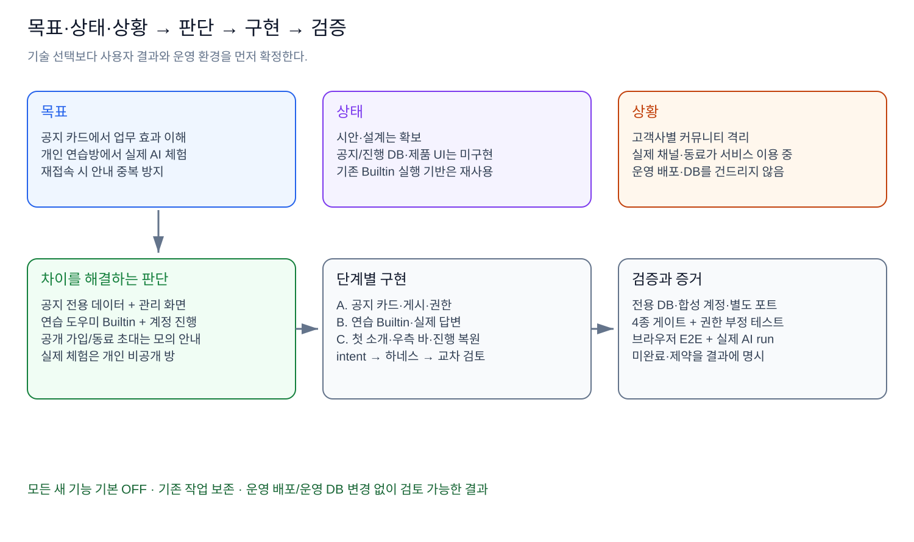

# 공지사항·튜토리얼 구현 행동 플랜

> **목표:** 사용자가 새 에이전트의 업무 효과를 이해하고, 실제 AI 답변을 안전하게 체험한다.
> **상태(2026-10-22):** 튜토리얼·연습 Builtin은 PR #276, 전용 활성화 제한 제거는 PR #277로 main에 반영됐다. 공지사항은 구현·격리 검증 후 이번 배포 범위에서 제외해 로컬 보관 중이다. 최종 운영 화면 재확인은 별도다.
> **상황:** 고객사별 커뮤니티가 분리된 서비스가 운영 중이므로, 기존 채팅·회의·에이전트와 운영 데이터를 보존해야 한다.

## 목차

1. [목표](#1-목표)
2. [현재 상태](#2-현재-상태)
3. [제품과 운영 상황](#3-제품과-운영-상황)
4. [차이와 판단](#4-차이와-판단)
5. [행동 플랜](#5-행동-플랜)
6. [다음 문서](#6-다음-문서)

## 1. 목표

| 항목     | 완료 기준                                                                                  |
| -------- | ------------------------------------------------------------------------------------------ |
| 공지사항 | **업무 효과·질문·결과 예시를 카드 첫 화면에서 확인**하고 관리자가 배포 없이 게시·회수      |
| 튜토리얼 | **우측 체크리스트와 초록 강조**를 따라 개인 연습방에서 실제 AI 답변·후속 질문 체험         |
| 재접속   | 서버의 계정별 진행을 사용해 **이미 소개를 본 계정에 자동 소개를 반복하지 않음**            |
| 안전     | 검증은 **격리된 로컬 앱·DB·합성 계정**에서 수행하고 기존 권한·진행 기록·업무 데이터를 보존 |
| 검증     | 기준↔테스트 매핑·자동 검사·실제 Chrome E2E를 구분하고, 수행한 버전과 미확인 범위를 기록    |

보존할 것은 커뮤니티 격리·권한, 기존 채팅·회의/SAP 에이전트, Builtin 실행의 취소·기한·중복 방지다. 초기 구현은 운영 배포·main 병합 없이 검증했으며, 이후 사용자의 별도 요청에 따라 커밋·push하고 사용자가 PR을 머지했다. 실제 동료 초대·실제 업무 데이터 사용은 검증에 포함하지 않았다. 이번 문서 갱신에서는 코드·DB·배포를 변경하지 않는다.

## 2. 현재 상태

| 대상                     | 현재 상태                                                                                                          | 남은 확인                                                    |
| ------------------------ | ------------------------------------------------------------------------------------------------------------------ | ------------------------------------------------------------ |
| 공지사항                 | 카드·관리·DB/RLS·API 구현 및 격리 검증. 발표·Jira 공유와 의견 수렴을 먼저 하려고 **이번 배포에서 제외**, 로컬 보관 | 별도 재개 승인, 최신 migration 재편성, 복원 후 재검증        |
| 튜토리얼·연습 Builtin    | 소개·개인 방·실제 첫/후속 답변·진행 복원 구현. **PR #276으로 main 반영**                                           | 후속 활성화 수정이 반영된 최종 운영 화면 확인                |
| 튜토리얼 노출 정책       | 운영에서 안내·재진입 UI가 안 보인 뒤 **전용 활성화 제한 제거, PR #277 main 반영**                                  | owner/admin/member 재진입·첫 방문·완료 계정의 운영 화면 확인 |
| 회의 runtime 테스트      | CI의 연쇄 실패 4건에 대해 타이머·fixture 정리 수정, 관련 회귀 통과                                                 | 모든 환경을 포함한 최종 전체 green은 별도 확인               |
| 모바일·실제 timeout 경계 | 모바일 수정 후 실화면 재확인 보류. timeout 원인 표시 경계 1건은 사용자 승인 후순위                                 | 완료로 간주하지 않고 후속 검증으로 유지                      |

초기 구현 기준은 **3376d89**, main 통합 재검증 기준은 **37f5148**, 현재 문서 기준 main은 **989f601(PR #277 머지)**이다. PR #276에는 튜토리얼과 별도 세션의 LiteLLM·추론 연결·실행 제한 변경이 함께 반영됐다. 각 버전의 통과 기록은 해당 버전의 이력이며 최신 버전의 전체 성공 근거로 자동 승계하지 않는다.

## 3. 제품과 운영 상황

| 상황                                           | 구현에 주는 제약                                                                                    |
| ---------------------------------------------- | --------------------------------------------------------------------------------------------------- |
| 사용자: SAP 고객사·임직원, AI 지식이 많지 않음 | 기술 용어보다 **도움받는 업무와 결과** 중심                                                         |
| 커뮤니티별 고객사 데이터 격리                  | 모든 공지와 연습방의 커뮤니티를 서버가 확인                                                         |
| 공개 채널과 실제 동료가 이미 사용 중           | 가입·직원 초대는 **모의 안내**, 실제 데이터 변경 없음                                               |
| 에이전트 사용에는 설치·부여·채널 초대가 필요   | 기존 권한 사용, 사용자 요청으로 관리자 권한 우회 금지                                               |
| 동일 계정이 여러 기기·커뮤니티 이용            | 계정 공통 소개/진행과 커뮤니티별 연습방을 분리                                                      |
| 운영 서버가 계속 서비스 중                     | 격리 검증과 운영 변경을 구분. 튜토리얼은 별도 ON 설정 없이 제공하되 인증·멤버십·개인 기록 보호 유지 |

## 4. 차이와 판단

_위 그림은 2026-10-20 초기 설계 이력이다. 그림의 ‘미구현·모든 새 기능 기본 OFF·머지 전’은 현재 상태가 아니다. 최신 상태는 2절과 결과 문서를 따른다._

| 차이                                       | 판단                                   | 이유                                                                              |
| ------------------------------------------ | -------------------------------------- | --------------------------------------------------------------------------------- |
| 시안은 고정 데이터, 제품은 지속 운영 필요  | 공지 전용 테이블과 관리 화면 추가      | 게시할 때마다 코드 배포하지 않기 위해                                             |
| 시안 답변은 샘플, 실제 AI 경험 필요        | Builtin 연습 도우미 추가               | 기존 실행 기반을 쓰면서 실제 모델 응답 체험                                       |
| 로그인 기록만으로 경험 여부 판정 불가      | 소개 확인·진행·완료를 서버 저장        | 재로그인·다른 PC에서도 동일하게 판단                                              |
| 실채널 가입·동료 초대가 부담               | 모의 안내와 사용자 전용 비공개 방      | 타인과 기존 업무에 영향을 주지 않기 위해                                          |
| 초기에는 새 기능의 운영 영향 검증이 없었음 | 당시 기본 OFF + 별도 작업 공간·DB·포트 | 검증 전 노출·데이터 혼입 차단. 이후 튜토리얼의 전용 OFF 조건은 사용자 요구로 제거 |

**1회차의 실제 답변과 같은 스레드 후속 질문을 기본 완료 조건으로 구현했다. 2회차는 ‘한 번 더 연습’으로 제공하고 초록 강조를 다시 표시한다.** 건너뛰기·나중에 하기·다시 열기를 제공하되, 건너뛰기를 실제 체험 완료로 기록하지 않는다. 기존 완료 계정에 자동 소개를 반복하지 않으며 메뉴로 재진입한다.

## 5. 행동 플랜

진행 이력은 **초기 설계 → 공지 구현 → 연습 Builtin·튜토리얼 통합 → main 충돌 결합·HTML 시안 복원 → 공지 분리 → 통합 Chrome/자동 검증 → 리뷰·CI 수정 → PR #276 머지 → 운영 노출 문제 확인·PR #277 머지** 순서다. 상세 맥락은 결과 문서 7절 이후에 기록한다.

| 후속 순서 | 행동                                      | 통과 조건                                                                                                    |
| --------- | ----------------------------------------- | ------------------------------------------------------------------------------------------------------------ |
| 1         | 최신 배포 버전의 튜토리얼 운영 화면 확인  | owner/admin/member 모두 재진입 가능. 신규 계정 소개·완료 계정 기록 보존. 도우미 미준비 안내와 실제 성공 분리 |
| 2         | 준비된 DB·CI 환경에서 전체 회귀 결과 확인 | 관련 테스트 통과와 전체 green을 구분. 환경 오류·의도적 skip·제품 실패를 각각 기록                            |
| 3         | 후순위 문제 재검증                        | 실제 timeout 원인 표시 경계와 모바일 표시·접기·입력·재개를 각각 확인                                         |
| 4         | 공지 재개 여부 결정                       | 발표·의견 수렴 후 보관 delta를 결합하고, 공지 테이블 유무가 다른 DB 모두 migration·E2E 재검증                |

초기 소스 구현은 **intent → 테스트 매핑 → 저장소 하네스 → 게이트·evaluator** 경로를 따랐다. 이후 일부 통합·리뷰·CI·활성화 보완은 사용자의 직접 수정 예외 승인으로 진행하고 검증 범위를 기록했다. 초기 ACCEPT를 후속 직접 수정의 새 교차 모델 판정으로 표현하지 않는다. 향후 소스 수정도 저장소 규칙과 별도 승인 범위를 따른다.

## 6. 다음 문서

- [02. 운영 보호 조건과 구체 설계](02.%20운영%20보호%20조건과%20구체%20설계.md)
- [03. 구현 순서와 E2E 검증 기준](03.%20구현%20순서와%20E2E%20검증%20기준.md)
- [04. 구현 및 테스트 결과](04.%20구현%20및%20테스트%20결과.md)

작성 근거: Obsidian `98. 설계 문서 작성 방법/1. 목표·상태·상황 기반 행동 플랜 수립 방법.md`. 먼저 목표·상태·상황을 정의하고 그 차이를 해소하는 행동과 산출물로 연결했다.
