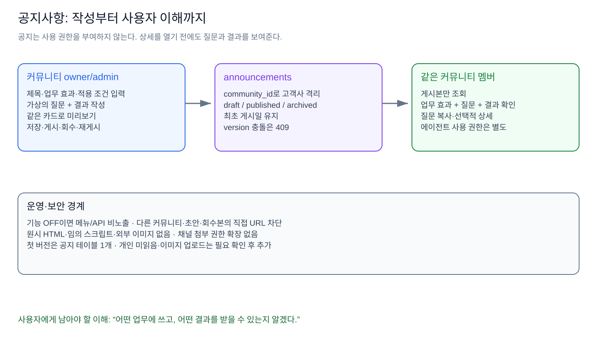
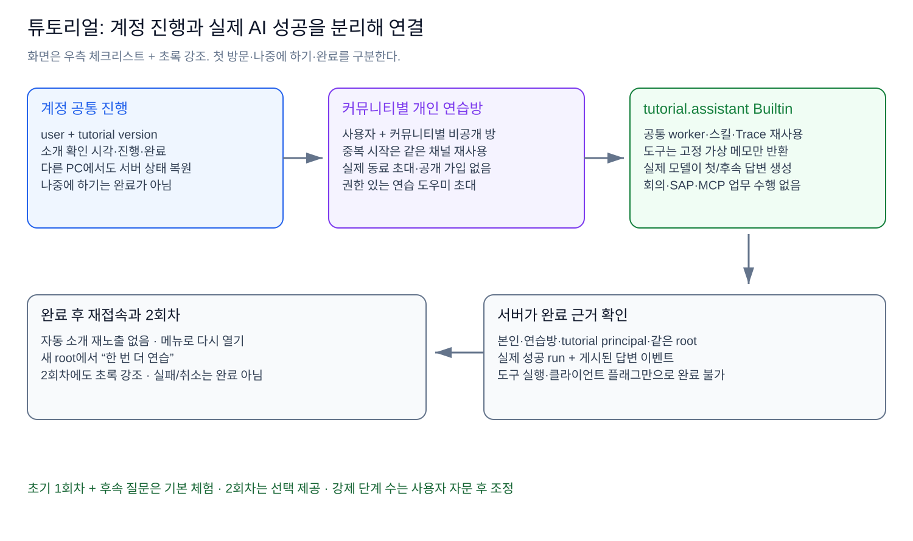

# 운영 보호 조건과 구체 설계

이 문서는 [행동 플랜](01.%20목표·상태·상황과%20행동%20플랜.md)의 판단을 실제 저장·권한·화면 구조로 연결한다.

## 목차

1. [운영 보호 조건](#1-운영-보호-조건)
2. [공지사항](#2-공지사항)
3. [튜토리얼](#3-튜토리얼)
4. [실패·재시도·권한](#4-실패재시도권한)
5. [구현 연결](#5-구현-연결)

## 1. 운영 보호 조건

| 조건                        | 구체적인 방법                                                      | 확인 근거                                       |
| --------------------------- | ------------------------------------------------------------------ | ----------------------------------------------- |
| **운영 서버 무변경**        | main 병합·배포·SSM·운영 migrate 실행 금지                          | 실행 명령·PR·검증 환경 기록                     |
| **운영 DB 무접속**          | 별도 로컬 PostgreSQL 컨테이너, 새 포트/DB, 합성 fixture            | DB hostname/port/name만 기록, 비밀값 비노출     |
| **기존 작업 보존**          | 기준 커밋에서 별도 worktree, 기존 dirty 파일 미복사                | 시작/종료 상태 비교                             |
| **배포 후에도 기본 비노출** | `ANNOUNCEMENTS_ENABLED`, `TUTORIAL_ENABLED`는 서버 전용·기본 false | OFF 시 메뉴/조회/쓰기/자동 튜토리얼 모두 비활성 |
| **기존 데이터 보존**        | 새 테이블·새 함수 중심의 additive migration, 과거 SQL 변경 금지    | 이전 앱 버전과의 호환·롤백 검사                 |
| **커뮤니티 경계 유지**      | 요청의 실제 멤버십·RLS·복합 관계 검증                              | A/B 커뮤니티 교차 접근 부정 테스트              |
| **기존 Agent 회귀 방지**    | 공통 부분만 재사용, 회의/SAP 정의 digest·동작 보존                 | 기존 회의·SAP·Builtin 테스트                    |

기능 flag는 기존 커뮤니티 gate를 대신하지 않는다. 기능이 꺼져 있으면 새 테이블 조회도 시작하지 않는다. 새 feature의 문제로 커뮤니티 전체를 끄거나 기존 채팅을 막지 않는다. 운영 적용은 이 작업에서 실행하지 않고, 향후 **마이그레이션 → OFF 상태 확인 → Builtin 설치/설정 → 제한된 커뮤니티 검증 → 노출** 순서로 한다.

## 2. 공지사항

### 2.1 사용자가 먼저 보는 것

**업무 효과 카드형**을 선택한다. 기존 ZEN AI 쉘과 메뉴를 재사용하고, 카드에 다음 정보를 넣는다.

| 순서 | 요소                       | 의도                                     |
| ---- | -------------------------- | ---------------------------------------- |
| 1    | 종류·게시일·업무 효과 제목 | 나와 관련된 새 소식인지 판단             |
| 2    | 짧은 업무 설명             | 어떤 에이전트인지 이해                   |
| 3    | **질문 + 결과 예시**       | 자세히 보기를 누르기 전 사용 결과 예상   |
| 4    | 적용 조건·권한 안내        | 읽을 수 있는 것과 사용할 수 있는 것 구분 |
| 5    | 선택적 상세·질문 복사      | 필요한 사용자만 더 확인                  |

예시는 가상 자료로 작성한 **설명용 결과**다. 공지에서 자동으로 AI를 호출하지 않는다. 기본 초대·멘션·스레드 조작은 튜토리얼이 담당한다.

### 2.2 저장과 게시

| 저장 단위       | 내용                                                                                             | 첫 버전                                   |
| --------------- | ------------------------------------------------------------------------------------------------ | ----------------------------------------- |
| `announcements` | 커뮤니티, 종류, 제목/요약, 에이전트 표시명, 질문/결과, 적용 조건, 상세, 상태/시각/작성자/version | **필수 1개 테이블**                       |
| 개인 읽음       | 사용자별 읽은 시각/버전                                                                          | 미읽음 배지가 실제로 필요할 때 추가       |
| 이미지 asset    | 공지 소유의 파일과 접근 권한                                                                     | 초기에는 텍스트 예시를 UI로 그리므로 생략 |

**active owner/admin만 작성·게시**, active 멤버는 게시본만 열람한다. 초안 저장 → 같은 카드로 미리보기 → 게시 → 수정 즉시 반영 또는 게시 회수 → 재게시 흐름이다. 최초 게시일은 유지한다. version 충돌은 409로 거절하고 입력을 보존한다. 공지는 해당 커뮤니티 전체 대상이며 에이전트 사용 권한을 자동 부여하지 않는다.

상세에는 임의 HTML·스크립트·iframe·외부 이미지를 실행하지 않는다. 채널용 첨부파일 권한을 공지 전체로 넓히지 않는다. 캐시는 다른 사용자·커뮤니티 사이에 공유하지 않는다.

## 3. 튜토리얼

### 3.1 화면과 실제 체험

| 단계           | 사용자 경험                                         | 실제 시스템 변경                                  |
| -------------- | --------------------------------------------------- | ------------------------------------------------- |
| 첫 방문        | 짧은 소개·지금 시작/나중에 하기                     | 소개를 본 시각을 서버 저장                        |
| 기본 개념      | 공개 채널 가입·비공개 채널/사람 초대를 모의 안내    | **실제 공개 채널 가입·동료 초대 없음**            |
| 연습방 시작    | 자기만의 연습방으로 이동                            | 사용자·커뮤니티별 비공개 방을 한 번만 생성/재사용 |
| 초대·호출      | 우측 체크리스트·초록 강조로 연습 도우미 초대와 멘션 | 기존 채널 멤버/멘션 경로로 호출                   |
| 결과·후속 질문 | 실제 AI 답변을 읽고 같은 스레드에서 추가 질문       | 실제 run과 게시 이벤트 확인                       |
| 완료·재연습    | 진행 저장·자동 소개 재노출 방지·2회차 선택          | 새 루트에서 재연습, 초록 강조 다시 표시           |

**소개를 봄, 나중에 함, 실제 체험 완료는 서로 다른 상태**다. 소개를 닫은 계정에 로그인마다 강제로 띄우지 않고 메뉴에서 재개한다. 기존 사용자도 새 튜토리얼 버전의 기록이 없다면 첫 방문 대상으로 본다. 기존 로그인 이력을 경험 이력으로 추정하지 않는다.

### 3.2 저장과 완료 판정

| 데이터                          | 범위                                 | 핵심 규칙                                                         |
| ------------------------------- | ------------------------------------ | ----------------------------------------------------------------- |
| `tutorial_progress`             | 계정 + tutorial version              | 소개 확인·기본 진행·완료. **본인 행만 접근**, 다른 PC에서도 복원  |
| `tutorial_practice_channels`    | 커뮤니티 + 사용자 + tutorial version | 비공개 연습 채널 연결. 중복 요청에도 같은 방                      |
| 기존 `agent_runs`·메시지 이벤트 | 해당 채널·루트·실행                  | 실제 AI 성공의 증거로 재사용. 별도 답변 성공 테이블을 만들지 않음 |

첫 답변과 후속 질문은 **현재 사용자·연습방·tutorial principal·같은 루트의 성공 run과 실제 답변 게시**로 서버가 확인한다. 클라이언트의 완료 버튼, SSE 수신, “완료했어요”라는 모델 문구, tool 실행만으로 완료하지 않는다. 2회차는 새 루트에서 진행하고 첫 회차 증거를 중복 집계하지 않는다.

계정 공통 진행 테이블은 tenant 데이터와 구분한 본인 전용 정책을 둔다. 연습방 매핑에는 community_id를 두고 실제 채널의 커뮤니티·비공개 유형·본인 멤버십을 확인한다. 공유 계정 진행에 타 커뮤니티의 대화 본문이나 내부 실행 상세를 복사하지 않는다.

### 3.3 연습 Builtin

| 공통 기반                                              | 연습 전용 차이                                         |
| ------------------------------------------------------ | ------------------------------------------------------ |
| 기존 worker·claim/lease·취소·기한·Trace·도구 대화 루프 | `tutorial.assistant` 정의·`tutorial-agent-v1` 어댑터   |
| 기존 모델 연결과 스킬 읽기 보호                        | 짧은 한국어 시스템 프롬프트·`tutorial-operations` 스킬 |
| 기존 권한 재검사·원자적 답변 게시                      | strict `{}`의 `read_practice_memo` 도구                |

연습 도구는 **코드의 가상 업무 메모만 반환**한다. 실제 회의·SAP·MCP·파일·사람 초대·진행 완료 기능을 노출하지 않는다. 정의는 코드에 하나, 인스턴스는 커뮤니티마다 하나이며 사용자별 대화는 개인 방·스레드로 나뉜다. 기존 회의 Builtin을 그대로 복제하지 않는다.

## 4. 실패·재시도·권한

| 상황                                 | 처리                                                        |
| ------------------------------------ | ----------------------------------------------------------- |
| 연습 Builtin 미설치/비활성·권한 없음 | 관리자 확인 안내, 사용자 API로 자동 관리자 설치 금지        |
| 모델 장애·빈 답변·취소·기한 초과     | 완료 처리하지 않고 재시도 제공                              |
| 실행 중 권한/설정/claim 변경         | 늦은 답변 게시 거부                                         |
| 중복 시작·새로고침                   | 같은 연습방과 서버 진행 복원                                |
| 두 관리자 동시 공지 수정             | 한 요청만 성공, 나머지는 충돌 안내                          |
| 다른 커뮤니티 ID·초안 직접 URL       | 데이터 존재 여부를 노출하지 않고 거부                       |
| 우측 패널·스레드 공간 부족           | 좁은 화면에서는 접을 수 있는 안내 패널, 현재 과제 강조 유지 |

## 5. 구현 연결

공지 intent 이후, **Builtin → 튜토리얼 UI를 하나의 tutorial-experience intent에서 순서대로** 구현한다. 두 부분이 연결된 실제 체험을 함께 검증하며 수용 기준은 줄이지 않는다. 각 intent의 테스트 매핑이 완료 기준이며, 상세한 파일/함수 계약은 저장소의 기존 공지 설계·계획과 튜토리얼 Builtin 설계·계획을 따른다. 이번 문서는 첫 방문·진행·운영 보호 조건을 추가한 상위 연결 문서다.

다음: [03. 구현 순서와 E2E 검증 기준](03.%20구현%20순서와%20E2E%20검증%20기준.md).
