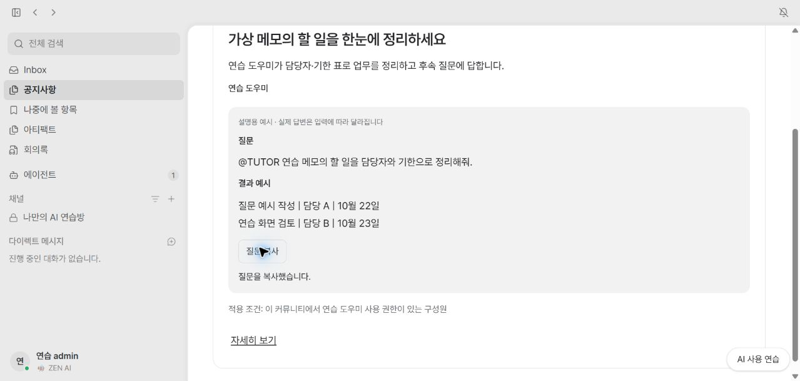
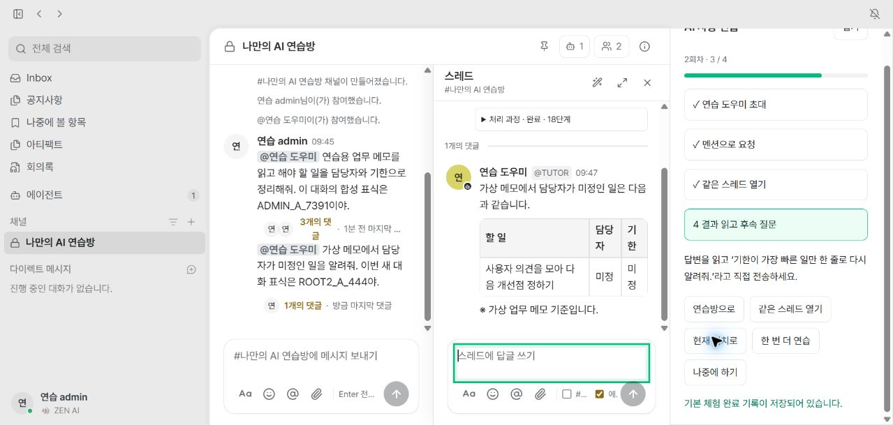
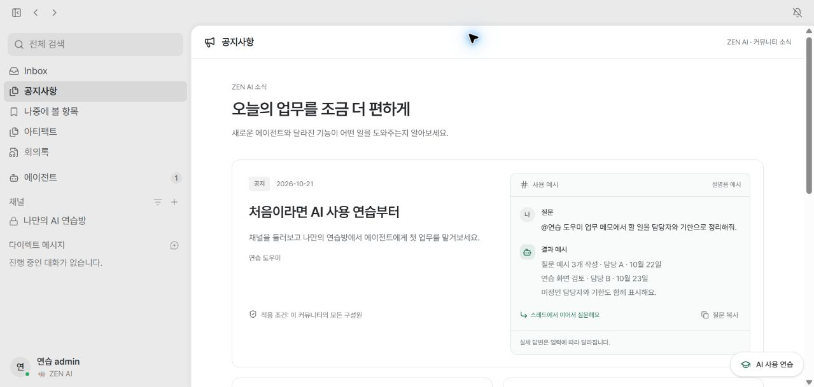
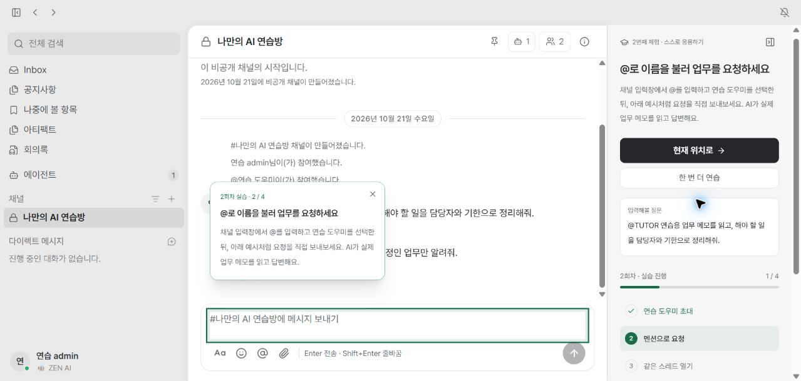

# 구현 및 테스트 결과

**최신 정리: 2026-10-22, main `989f601` 기준. 튜토리얼·연습 Builtin과 전용 활성화 제한 제거는 main 반영 완료다. 공지는 구현·격리 검증했지만 이번 배포에서 제외해 로컬 보관 중이다.**

> **1–6절은 10월 20–21일 당시 상태·검증 이력으로 보존한다. 최신 판단은 7–10절을 우선한다.** 과거의 ‘기본 OFF·미머지·서버 실행 유지·남은 4건’은 현재 상태를 뜻하지 않는다. PR #277 이후 최종 운영 화면과 모든 환경의 전체 테스트 green은 아직 확인하지 않았다.

| 대상                  | 현재 판정                                                                                                     |
| --------------------- | ------------------------------------------------------------------------------------------------------------- |
| 공지사항              | 구현·합성 환경 E2E 완료 이력. **PR #276·#277 및 이번 배포 범위에서 제외**, 로컬 보관. flag ON만으로 복원 불가 |
| 튜토리얼·연습 Builtin | PR #276(`6d2e5ff`) main 반영. 개인 연습·실제 답변·진행 저장을 검증한 이력 보유                                |
| 튜토리얼 노출 수정    | PR #277(`989f601`) main 반영. 관련 29개 통과. **최종 배포·운영 Chrome 화면은 재확인 전**                      |
| 회의 runtime CI 4건   | 원인 재현 후 테스트 안정화(`9f4fb7b`), 관련 82개 통과·기존 skip 1개. 실제 제품 timeout 경계 문제와 구분       |
| 보류                  | 모바일 수정 후 실화면, 사용자 승인 후순위 timeout 원인 표시 1건, 환경 준비가 필요한 전체 회귀                 |

## 목차

1. 구현 결과
2. 실제 사용 검증
3. 자동 검사와 독립 검토
4. 남은 확인과 운영 적용 조건
5. 2026-10-21 main 통합 후 재검증
6. 2026-10-21 HTML 시안 기준 UI 복원과 데스크톱 재검증
7. 인계 이후의 결정·수정·머지 맥락
8. 후속 테스트 결과와 남은 문제
9. 스크린샷의 버전·용도와 최신 증거의 한계
10. 다음 확인과 공지 재개 조건

## 1. 구현 결과

**2026-10-20 초기 구현 이력. 아래 ‘기본 OFF’는 이후 튜토리얼 정책 변경 이전의 내용이다.**

| 항목      | 구현한 내용                                                                                                                              |
| --------- | ---------------------------------------------------------------------------------------------------------------------------------------- |
| 공지사항  | 커뮤니티별 DB·RLS·API. 관리자 초안/게시/회수/재게시. 사용자 첫 화면에 **업무 효과·질문·결과 예시·적용 조건** 표시, 질문 복사와 상세 제공 |
| 튜토리얼  | 첫 방문 소개·나중에 하기·메뉴 재개. **우측 체크리스트와 현재 대상 초록 강조**, 첫 실습·선택2회차 지원                                    |
| 실제 연습 | 본인 비공개 연습방에 `tutorial.assistant`를 초대. 기존 Builtin worker·모델·스킬·도구 대화·스레드 문맥을 공유                             |
| 가상 자료 | strict `{}`의 `read_practice_memo`만 제공. 실제 SAP·회의·직원 자료에 접근하지 않음                                                       |
| 완료 저장 | **첫 실제 성공 답변 뒤 같은 root에 보낸 후속 질문의 실제 성공 답변**을 서버 run/event로 확인. 소개 확인과 완료를 구별                    |
| 기본 OFF  | 서버 전용 `ANNOUNCEMENTS_ENABLED`, `TUTORIAL_ENABLED`. OFF에서 새 메뉴·자동 소개·진행 조회·API 차단                                      |
| 설계 문서 | 목표→상태→상황→행동 플랜, 운영 보호·구체 설계, 구현 순서·E2E 기준. **Excalidraw 원본·SVG 3쌍** 포함                                      |

공개 채널 가입·사람 초대는 **모의 설명**으로 제공한다. 실제 체험 중 업무 채널에 가입하거나 실제 동료를 초대하지 않는다.

## 2. 실제 사용 검증

**전용 앱3047·합성 세션 프록시3048·PostgreSQL55436에서 합성 계정만 사용했다.**

| 구분             | 확인한 결과                                                                                                     |
| ---------------- | --------------------------------------------------------------------------------------------------------------- |
| 공지 관리자      | 초안 입력·미리보기·저장·재접속 복원, 게시→회수→재게시                                                           |
| 공지 사용자      | 업무 효과 카드·상세 열람. 복사 버튼 후 **실제 클립보드 원문 일치**                                              |
| 공지 권한·목록   | 일반 멤버 관리404, 타 커뮤니티·회수본 직접 URL404. 더 보기20→24개                                               |
| 공지 화면        | 이전390×844 검사에서 가로 넘침 없음. 긴 상세 끝까지 키보드 스크롤 확인                                          |
| 첫 방문·재개     | 소개 자동 표시 → 나중에 하기 → 새로고침 후 반복 없음 → 메뉴로 재개                                              |
| 실습1회차        | 기존 멤버 UI로 도우미만 초대 → 직접 멘션 전송 → 실제 답변 → 같은 스레드 후속 질문 → **4/4와 완료 저장**         |
| 실습2회차        | 새 root로 실제 첫 답변·후속 답변 수신. **새 질문창·후속 질문창 모두 초록 강조와 정확한 초점**, 이전 완료 유지   |
| 강조·키보드      | 닫힌 스레드는 답글 열기 버튼 강조. 열린 스레드의 ‘현재 위치로’는 실제 textbox에 초점. 접으면 강조0개, 재개 정상 |
| 실제 trace       | 별도 HTTP 검사에서 첫·후속 실행 모두 completed, `read_skill`·`read_practice_memo` 확인                          |
| 모델 장애·재시도 | 미사용 localhost 모델 주소로 실제 장애 재현. **failed·completedAt=null·proof=null**, 정상 설정 복구 후 성공     |
| 새 인증 세션     | 관리자·멤버 각각 새 세션에서도 동일한 완료 시각·연습방 복원, 자동 소개 false — 별도 HTTP 검사                   |
| 테넌트 분리      | 다른 커뮤니티의 튜토리얼·private 스레드 접근404, 해당 계정 본인 progress는 비어 있음 — 별도 HTTP 검사           |
| 기능 OFF         | 실제 브라우저에서 공지·튜토리얼 메뉴0개, 별도 HTTP에서 두 API404                                                |

_초기 격리 환경의 공지 구현 화면이다. 현재 운영 배포에 공지가 포함됐다는 증거가 아니다._

[첫 소개](스크린샷/07-tutorial-intro.jpg) · [완료 기록](스크린샷/09-tutorial-browser-completed.jpg) · [모델 장애 안내](스크린샷/10-tutorial-model-failed.jpg) · [2회차 새 질문 강조](스크린샷/11-tutorial-second-green.jpg) · [2회차 후속 질문 강조](스크린샷/12-tutorial-second-follow-green.jpg) · [기능 OFF](스크린샷/14-uiux-disabled.jpg)

## 3. 자동 검사와 독립 검토

| 검사                           | 결과                                                                                                                                           |
| ------------------------------ | ---------------------------------------------------------------------------------------------------------------------------------------------- |
| 공지사항 하네스                | **ACCEPT, c9f7fa7**. check·lint·knip·Builtin 검사, Linux493개 파일/5258개 테스트(기존skip포함), Windows19개 통과                               |
| 튜토리얼 관련 회귀             | R1–R5 수정 후 **23개 파일·188개 테스트 통과**. 호환 export 오류 경계 추가3개 파일·15개 통과                                                    |
| 튜토리얼 정식 게이트·독립 평가 | check·lint·knip·Builtin 통과. Linux507개 파일·5265개 테스트 통과(기존2개 파일·27개 테스트 skip), Windows19개 통과. 독립 Claude ACCEPT, b5c9f7c |
| production 빌드                | `next build --webpack` **exit0**, 타입 검사·static58개 생성. 게이트 반복1→2 차이는 테스트1개뿐으로 동작 소스 동일                              |
| client bundle                  | **370개 파일, 서버 설정·키·DB 주소·스킬 내용 일치0개**                                                                                         |

독립 최종 검토의 Important5건은 다음과 같이 보완했다. **코드 직접 편집 대신 동일 intent 하네스로 수정했다.**

| 문제                                 | 수정·회귀 검증                                                                   |
| ------------------------------------ | -------------------------------------------------------------------------------- |
| 권한 회수 중 늦은 성공 게시          | 게시 잠금 순서·대기 후 최신 권한 확인, disable/config/membership 경합 테스트     |
| 중간 문구+빈 최종 답변의 거짓 성공   | 최종 생성 답변을 구별. 실제 worker의 성공 게시·진행 근거 부재 확인               |
| 새 테이블의 provision/readiness 누락 | schema·최소 권한·RLS·activation에 연결. revoke 복구/RLS OFF 차단 확인            |
| 후속 입력창 대신 크기 조절 버튼 초점 | 현재 root textbox를 강조·초점 대상으로 지정. 1·2회차 회귀 및 브라우저 확인       |
| 보안 SQL 검사 누락                   | RLS2개·정의자 함수4개를 정확한 inventory·owner·search_path·실행 권한 단언에 연결 |

독립 평가의 비차단 의견은 OFF의 POST404 직접 단언, 사용자 API의 자동 설치 금지 직접 단언, 테스트 설명의 명확화다. **수용 기준 위반은 없다는 ACCEPT 판정**이며, 새 기능을 늘리지 않고 후속 검증 후보로 남겼다.

`npm run build` 전체 성공으로 표현하지 않는다. Windows의 기존 preview assets 재귀 복사 native 오류 때문에 같은 assets를 준비하고 Next webpack 빌드를 직접 실행했다. 검사기 환경은 Node22·ffmpeg7.1.5·Git2.47.3이며, 게이트 skip·권한 완화 없이 기존 실패 원인을 해결했다.

## 4. 남은 확인과 운영 적용 조건

**아래는 초기 검증 시점의 후속 조건이다.** 현재 튜토리얼은 전용 gate가 제거되어 4번의 flag OFF 롤백을 적용할 수 없다. 최신 기준은 7.5절·10절을 따른다.

1. **모바일 수정 후 재확인:** 10/21에는 실제390×844가 적용됐고 가로 넘침이 없었다. 다만 열린 스레드가 연습 안내를 가리는 문제가 재현되어, 사용자 승인으로 패널·재개 버튼의 표시 순서 두 곳만 수정했다. **수정 후 Chrome의 표시·접기·입력·재개는 미검증**이다. 5절 참조.
2. **사람 리뷰:** 인증·권한·migration을 포함하므로 PR의 diff 인간 리뷰가 필요하다. 취소·기한 초과·권한 회수는 통합 회귀 검사이며 실제 고객 환경 검증이 아니다.
3. **별도 운영 적용:** 백업·additive migration·기존 역할 provision·readiness 확인 → 관리자 Builtin 설치/부여·모델 설정 → 제한된 커뮤니티에서 기능 ON 순으로 검토한다. **이번 작업에서는 실행하지 않았다.**
4. **되돌리기:** 새 기능 flag를 OFF한다. 기존 데이터·테이블을 삭제하지 않는다. 계정/version 진행과 community/user/version 연습방 매핑을 유지한다.

원본 checkout의 기존 수정은 보존했다. 세션 비밀값·API key·실제 고객 자료는 문서·Git·스크린샷에 넣지 않았다. 테스트용 인증 경로는 제품에 추가하지 않았다.

## 5. 2026-10-21 main 통합 후 재검증

**정리와 main 반영, 격리 환경의 공지·튜토리얼 재검증을 진행했다. 회의 runtime 테스트 4개 실패와 모바일 수정 후 Chrome 재확인이 남아 있다. 커밋·push·새 PR은 만들지 않았다.**

### 5.1 변경 정리와 main 반영

| 항목              | 처리 결과                                                                                                                                                   |
| ----------------- | ----------------------------------------------------------------------------------------------------------------------------------------------------------- |
| 불필요한 변경 1건 | 사용하지 않는 `community-settings-nav.tsx`의 이번 세션 추가분만 원복. 실제 사용 중인 settings shell은 보존                                                  |
| 기존 코드 보존    | `eslint.config.mjs`는 diff 없음. 다른 세션의 모델·LiteLLM·회의 실행 변경은 임의 원복하지 않음                                                               |
| 문서 정리         | 분리 intent 2개는 이력으로 표시하고 현재 기준을 `tutorial-experience.md`로 통일. 계획 문서와 실제 테스트 경로 정정                                          |
| main 반영         | 기존 `agent/litellm-gpt`에서 `git pull --ff-only --autostash origin main`. HEAD `37f5148`, 충돌 6개 결합 완료. main 보호/smoke/stop과 로컬 변경을 함께 보존 |
| migration 충돌    | main의0105 보존. 아직 적용하지 않은 UIUX SQL 4개만0106–0109로 이동. SQL 본문은 동일, journal·보안 검사 참조를 함께 정정. **운영 DB에 실행하지 않음**        |
| 테스트 정리 원칙  | 사용자 선택대로 **자동 회귀 테스트 유지**. 임시 검증 도구·합성 세션 비밀 파일만 정리. 복구 백업과 autostash는 보존                                          |

### 5.2 직접 수행한 Chrome 검증

**공유3002/5432/4000의 재시작·설정 변경 없이 전용3047·3048·55436과 합성 계정을 사용했다. 모델 호출은 기존4000을 이용했다.**

| 대상               | 실제 확인한 내용                                                                                                                |
| ------------------ | ------------------------------------------------------------------------------------------------------------------------------- |
| 기본 OFF           | 기존3002 화면에서 공지·튜토리얼 메뉴와 자동 소개 없음                                                                           |
| 관리자 실습1회차   | 연습 Builtin 등록 → 개인 비공개 연습방 → 도우미만 초대 → 멘션 → 실제 첫 답변 → 같은 스레드 무멘션 후속 답변 → **4/4·완료 저장** |
| 선택2회차          | 새 root 첫 질문·같은 root 후속 질문 각각 **초록 강조와 정확한 textbox 초점**, 실제 답변·4/4, 이전 완료 기록 유지                |
| 공지 작성·게시     | 초안 미노출·재접속 복원 → 게시 → 업무 효과/질문/결과/조건 카드 → 상세 markdown·링크 확인                                        |
| 복사·동시 수정     | 복사 완료 안내 뒤 **클립보드34자 원문 일치**. 게시본 수정 즉시 반영. 다른 탭의 오래된 버전 저장은409 안내, 입력은 보존          |
| 실제 모바일390×844 | scrollWidth390으로 가로 넘침 없음. 스레드 닫힌 상태의 접기·재개 정상. **스레드가 열리면 안내와 접기를 가리는 실패 재현**        |

### 5.3 HTTP·실제 worker·DB 보완 검증

**아래는 Chrome 조작 결과와 구분한 HTTP/DB 검증이다.** 브라우저 도구가 도중에 제공되지 않아 화면의 재확인은 대체하지 못했다.

| 대상             | 확인 결과                                                                                                                                                    |
| ---------------- | ------------------------------------------------------------------------------------------------------------------------------------------------------------ |
| 공지 회수·재게시 | 회수 후 사용자 상세404·목록 제외, 재게시 후 다시 열람 가능, **최초 게시일 유지**                                                                             |
| 공지 권한        | 일반 멤버 관리 API403, 타 커뮤니티 직접 API404, 해당 커뮤니티 공지 목록0개. 관리 페이지의 과거 Chrome404 검증과 API403을 구분                                |
| 첫 방문·보류     | 멤버·다른 커뮤니티 계정에서 소개 claim1회, 나중에 하기 후 완료는 null, 다시 seen해도 자동 소개 false                                                         |
| 개인 연습방      | 세 계정에 private 방 각각1개. 반복 start 시 같은 방 사용. 멤버·타 커뮤니티의 관리자 연습방 API404, 일반 멤버의 Builtin 설치403                               |
| 실제 답변        | 관리자4회·멤버2회·타 커뮤니티2회, **총8개 run 모두 done**. 첫·후속 답변과 완료 기록을 대조                                                                   |
| 실제 입력 격리   | 모델 요청 **16건**의 입력을 네 합성 대화 표식으로 검사. 각 요청에 본인 root 표식만 존재하고, 다른 root/사용자/커뮤니티 표식 혼입0건. 답변도 각자 표식만 포함 |
| identity·새 세션 | run의 community/user와 개인 연습방 매핑 불일치0건. 세 계정 모두 **새 인증 세션에서 동일 완료 시각·연습방 복원**, 자동 소개 false                             |

### 5.4 모바일 최소 수정과 검증 한계

원인은 모바일 스레드의 표시 순서(최종 CSS z60)가 튜토리얼(z40)보다 높다는 것이다. **패널과 접힌 재개 버튼 두 곳만 z65로 수정**했다. 사이드바(z70/80)와 대화상자(z120)는 계속 위에 표시된다. 스레드·채팅·DB 로직은 수정하지 않았다.

사용자가 이번 수정에 한해 현재 브랜치 직접 편집을 허용했다. 같은 intent에 수용 기준M1과 검증 매핑을 추가했다. 자동 커밋 하네스는 실행하지 않았으며, 기존 튜토리얼 컴포넌트 회귀5개와 전체 게이트를 실행했다.

**미완료: 수정 후 실제390×844에서 패널 표시 → 접기 → 스레드 입력 → 재개.** Chrome 조작 도구가 이 채팅에서 사라졌고, 플러그인 검색으로도 기존 제어 기능을 복구하지 못했다. 다른 채팅에도 검증 조율을 요청했으나 수행되지 않았다. **CSS 수정과 자동 검사만으로 모바일 문제가 해결됐다고 확정하지 않는다.**

[수정 전 모바일 가림 증거](스크린샷/20261021-모바일-수정전-가림.png)

### 5.5 최종 자동 검사

| 검사                    | 최신 결과                                                                                                                                                                                                  |
| ----------------------- | ---------------------------------------------------------------------------------------------------------------------------------------------------------------------------------------------------------- |
| check·lint·knip·Builtin | **통과**. lint0오류·기존 경고14개, Prettier 통과                                                                                                                                                           |
| Linux 전체 vitest       | **518개 파일:515통과·1실패·2skip / 5,418개 테스트:5,387통과·4실패·27skip**                                                                                                                                 |
| 실패 파일               | `src/lib/meeting-agent/runtime.integration.test.ts`의 timeout reply, failed workflow, cancelled workflow, foreign authority 검증4개                                                                        |
| 원인·처리               | 타 세션의 executor 상한120초와 기존 시험 제한75초 불일치. timeout 시험이 먼저 종료되고 후속 시험에 영향을 주는 현상을 단독·직렬 실행에서도 재현. **담당 채팅에 전달, 해당 세션 코드는 임의 변경하지 않음** |
| 보완된 검사             | migration 파일명 참조3줄 정정 후 보안4개 통과. 처음 전체 실행의 trace setup 동시 role 갱신 오류는 단독 재실행과 이번 전체 실행에서 통과. 튜토리얼 패널5개 통과                                             |
| Windows 전용            | **2개 파일·19개 테스트 통과**                                                                                                                                                                              |
| production 빌드         | 수정본 `next build --webpack` **exit0**, 타입 검사·정적58페이지 생성 완료. client bundle 서버 자료 유출0건                                                                                                 |

빌드 도중 전용 앱의 외부 node_modules 심볼릭 링크 때문에 Next의 `module.compiled` 누락을 재현했다. **임시 Linux 폴더에 이미 설치된 Next 패키지를 복사한 뒤 해결·재빌드**했으며 저장소의 의존성·Next 설정은 바꾸지 않았다. Windows preview assets 단계까지 포함한 `npm run build` 전체 성공이라는 뜻은 아니다.

이번 직접 편집에 대해 새 교차 모델 ACCEPT를 받았다고 주장하지 않는다. 기존10/20 ACCEPT와 현재 main 통합 결과를 구분한다.

### 5.6 다른 채팅의 검증과 다음 작업

- **‘회의록 에이전트’ 채팅의 별도 보고:** Builtin6/6·생성 하네스6/6 모델에서 실제 계산 답변 확인. 추론 trace 표시를 확실히 확인한 사례는 생성 하네스 GPT terra이며, 나머지11개 조합은 미확인. 공유 환경의 DB 연결 고갈·화면 갱신 지연도 보고됐다. 이것을 이번 UIUX 격리 검증의 직접 관측으로 합산하지 않는다.
- **다음1:** Chrome 연결 후 모바일M1만 재확인. 필요하면 표시·접기 범위에서 추가 최소 수정한다.
- **다음2:** 회의 담당 범위에서120초 실행 제한과 timeout 시험 기준을 맞춘 뒤 실패 파일을 재검사한다. **현재 전체 게이트 통과 전 커밋·배포 완료 상태로 취급하지 않는다.**
- **다음3:** 사람 diff 리뷰와 별도 운영 적용 절차는4절 기준을 따른다. 이번에는 배포·운영 migration·커밋·push를 하지 않았다.

**검증 환경 정리 완료:** 이번 재검증의 임시 도구·합성 세션 비밀 파일11개와 전용 컨테이너2개·네트워크1개를 제거했다. 공유3002·4000·5432의 listen 상태는 유지됐다. 자동 회귀 테스트, Git 제외 경로의 복구 백업·최종 검사 기록, autostash는 보존했다. 결과 문서와 증거 이미지3개는 Obsidian에 저장했다.

## 6. 2026-10-21 HTML 시안 기준 UI 복원과 데스크톱 재검증

**공지사항은 업무 효과 카드형으로, 튜토리얼은 8단계 소개와 우측 실습 패널로 보완했다. 작성 화면은 기존 커뮤니티 설정의 입력창·SelectMenu·버튼을 재사용했다.** 사용자 승인에 따라 현재 브랜치에서 직접 수정했으며 새 브랜치·커밋·push는 없다.

### 변경한 화면

| 화면           | 반영한 핵심                                                                                                                            |
| -------------- | -------------------------------------------------------------------------------------------------------------------------------------- |
| 공지 목록·상세 | HTML의 상단 헤더·920px 본문·첫 카드의 설명/대화 예시 2열·하단 카드 배치. 예시 없는 공지와 빈 화면도 지원                               |
| 공지 작성      | 기존 관리 탭과 같은 입력·선택·버튼 스타일, 상태 목록, 실시간 카드 미리보기. 기존 API·권한·버전 충돌 계약 유지                          |
| 첫 소개        | 환영 → 공개/비공개 차이 → 모의 공개 가입 → 모의 비공개 생성 → 모의 동료 초대 → 에이전트/권한 → 멘션/스레드 → 재개 방법, **8단계 복원** |
| 실제 실습      | 우측 체크리스트·단계별 설명·현재 위치 안내. **1·2회차 초록 강조**, 실제 첫/후속 답변 및 서버 완료 증거 유지                            |
| 마지막 보완    | 안내 카드가 체크리스트를 덮지 않도록 배치. 첫 소개의 나중에 하기 실패 메시지와 재시도 복원                                             |

_10월 21일 HTML 시안 복원 검증 화면이다. ‘최종’은 당시 시안 보완 상태이며, 공지는 이후 배포 범위에서 제외했다._

_10월 21일 실습 패널 검증 화면. 배경에 공지 메뉴가 남아 있어 현재 배포 구성을 나타내지 않는다. PR #277 이후 운영 캡처도 아니다._

[공지 작성 화면](스크린샷/20261021-HTML복원-공지작성.png) · [첫 소개](스크린샷/20261021-HTML복원-첫소개.png) · [공개 채널 모의 실습](스크린샷/20261021-HTML복원-모의가입.png)

### Chrome에서 직접 확인한 범위

**게시·AI 호출은 전용55436 DB의 합성 계정과3047/3048 앱에서 수행했다. 실제3002에서는 새 UI·기능 표시를 확인했으며 가상 공지를 작성하지 않았다.**

| 대상           | 확인한 결과                                                                                                                                                             |
| -------------- | ----------------------------------------------------------------------------------------------------------------------------------------------------------------------- |
| 소개           | 첫 방문 자동 표시, 8단계 이동·이전, 공개 가입 전 다음 비활성, 이름/비공개 선택 전 생성 비활성, 모의 동료 선택, 소개 완료 후 실습 패널. Escape로 닫기·하단 버튼으로 재개 |
| 공지 작성·게시 | 새 초안·예시 짝·미리보기·저장·게시·게시본 즉시 수정·저장 전 게시 방지·회수·재게시·상태 표시                                                                             |
| 열람           | 3개 카드 배치·예시 없는 카드·상세 Markdown·목록 복귀·질문 원문 복사·키보드로 최하단 링크 도달                                                                           |
| 권한·충돌      | 멤버 관리 페이지404, 다른 커뮤니티 목록 비어 있음·직접 상세404. 두 편집 화면의 오래된 버전 저장은409 안내와 입력 보존                                                   |
| 실제 AI        | 도우미 등록 → 개인 비공개 방 → 초대 → 멘션 → 실제 답변 → 같은 스레드 후속 답변. **2회차 포함4개 run 모두 done**                                                         |
| 진행·격리      | 새로고침 후 자동 소개 반복 없음·완료 기록 복원. DB에 **개인 채널1개·사람 멤버1명·도우미1개**로 모의 가입/초대의 실제 데이터 생성 없음                                   |
| 기능 OFF       | 별도3049에서 공지·연습 메뉴 없음, 공지 직접 URL404                                                                                                                      |

### 자동 검사와 남은 제한

| 검사                    | 결과                                                                                                                                    |
| ----------------------- | --------------------------------------------------------------------------------------------------------------------------------------- |
| 화면 회귀               | **7개 파일·17개 테스트 통과**. 모의 실습의 실제 변경 방지, 안내 위치, 소개 보류 실패·재시도 포함                                        |
| check·lint·knip·Builtin | **모두 통과**. Linux lint는 오류 0·경고 16건                                                                                            |
| Linux 전체 회귀         | **515개 파일·5,390개 테스트 통과**, 회의 runtime 1개 파일·4개 테스트 실패, 2개 파일·27개 테스트 건너뜀. 검사 전후 소스 스냅샷 검증 통과 |
| Windows 전용            | **2개 파일·19개 테스트 통과**                                                                                                           |
| 빌드·실행               | `next build --webpack` 성공·정적58페이지. client bundle 서버 자료 유출0건. **3002에서 두 기능 플래그 true로 재실행**                    |

**회의 runtime의 기존 실패4개는 이번 UI 보완에서 변경하지 않았다.** 전체 게이트 통과·운영 배포 완료로 취급하지 않는다. 모바일은 사용자의 데스크톱 우선 요청에 따라 이번 재검증에서 제외했다. 소개 보류의 통신 실패·재시도는 자동 회귀 검사이며 실제 브라우저 장애 주입은 하지 않았다.

Windows의 기존 preview assets `fs.cpSync` 비정상 종료는 코드 수정 없이 PowerShell로 동일 파일을 준비해 우회했다. 따라서 **`npm run build` 전체 스크립트 통과라는 의미는 아니다.** 하네스의 자동 커밋·교차 모델 evaluator도 실행하지 않았다. 별도 코드 검토에서 발견한 소개 오류 표시1건은 보완했다.

검증 후 전용 3047·3048·3049 서버, 55436 DB·gate 컨테이너, 전용 네트워크와 임시 합성 계정 쿠키 파일을 정리했다. **이 시점에는 3002 실행을 유지**했으며 기존 DB·LiteLLM은 변경하지 않았다. 현재 서버 상태를 뜻하지 않는다.

## 7. 인계 이후의 결정·수정·머지 맥락

### 7.1 공지사항은 실패로 폐기한 것이 아니라 배포를 보류했다

공지 카드·관리·권한·충돌·복사까지 구현·검증한 뒤, 사용자는 발표와 Jira 설계·구현 공유를 먼저 하고 의견을 받기 위해 **공지의 머지를 보류**했다. 따라서 튜토리얼·LiteLLM·회의 변경은 남기고 공지만 활성 소스에서 분리했다.

| 분리 대상           | 처리                                                                                        |
| ------------------- | ------------------------------------------------------------------------------------------- |
| 공지 전용 30개 파일 | 설계·계획·intent·회귀 테스트·UI·API·서비스·0106 migration을 로컬 보관                       |
| 공유 17개 파일      | 공지 연결·테이블·권한·기대 개수 delta만 제외. 튜토리얼과 다른 세션의 변경은 보존            |
| 튜토리얼 fixture    | 공지 helper 의존을 튜토리얼 전용 helper로 분리해 공지 없이도 실행 가능하게 함               |
| 이미 적용한 로컬 DB | 공지 테이블·데이터를 삭제하거나 migration rollback하지 않음                                 |
| 실행 중이던 빌드    | 분리 순간에는 재시작하지 않아 구형 빌드에 공지가 보일 수 있었음. 새 빌드의 소스 범위와 구분 |

보관 위치는 `C:/Users/염정운/project/zen-ai/.context/parked-announcements-20261021/`다. `README.md`·`manifest.json`·공유 파일 복원 patch/script와 before/after 사본을 포함한다. **Git에 포함되지 않는 이 컴퓨터의 로컬 보관본**이며 별도 백업과 동등하지 않다. 이번 문서 갱신에서는 README·manifest 존재만 재확인했고 전체 재해시·복원은 실행하지 않았다.

분리 직후 typegen·check·lint·knip와 관련 **8개 파일·39개 테스트**가 통과했다. 당시 격리 사본에서 전용 30개 파일의 SHA256과 공유 17개 파일의 복원 일치도 확인했다. 이 결과는 분리·복원의 검사이지 운영 배포 성공 판정이 아니다. 이후 공지 E2E도 활성 브랜치에 다시 넣지 않고 **격리 사본에서만** 실행했다.

### 7.2 최신 빌드·Chrome·공지 E2E를 다시 확인했다

재부팅·Chrome 연결 문제와 임시 검증 환경의 상태를 정리한 뒤, 사용자가 지정한 실제 Chrome 탭에서 검증을 이어갔다. 테스트는 실제 Chrome 사용자 조작과 HTTP/DB 보완 검사를 구분했다. 임시 통합 gate/DB 컨테이너 2개는 검증 뒤 정리했으며, 기존 로컬 DB·LiteLLM을 삭제하는 작업과 섞지 않았다.

첫 추론 누락 중 하나는 **임시 검사 클라이언트가 구형 SSE 규약을 사용한 것**이었다. 최신 이벤트 규약으로 수신해 대조했으며 제품의 추론 전달 누락으로 단정하지 않았다. 공지·튜토리얼 E2E는 완료했지만 공지 화면은 보관 코드를 복원한 격리 사본의 결과다. 모델별 관측과 자동 검사 한계는 8절에 따로 기록한다.

### 7.3 변경 수를 줄이되 필요한 회귀 테스트는 보존했다

사용자가 팀 공용 저장소에 개인 스킬셋 설정을 남기지 않기를 원해 Matt Pocock 설정 추가분을 원복했다. `CLAUDE.md`의 기존 `@AGENTS.md` 안내를 복원하고 추가한 `docs/agents/domain.md`·`issue-tracker.md`·`triage-labels.md`를 제거했다. 개인 설치 스킬과 이미 만든 GitHub 라벨은 제거하지 않았다.

변경 목록의 테스트·fixture 46개를 조사했으나 회귀 40개·fixture 2개·LiteLLM CI 검사 4개로, 삭제해도 되는 일회성 시험 파일은 없었다. 파일 수만 줄이려고 필수 회귀 검사를 discard하지 않았다.

115개 파일 전체 리뷰에서 확정한 2건은 수정했다.

| 리뷰 문제                                                       | 수정 의도·확인                                                                        |
| --------------------------------------------------------------- | ------------------------------------------------------------------------------------- |
| 합성 fixture가 특정 로컬 포트에 묶여 CI의 localhost:5432를 거절 | 기존 bootstrap의 격리 DB·호스트 안전 검증을 재사용. 임의 DB 허용으로 완화하지 않음    |
| 튜토리얼에 저장한 공용 스킬이 실행 목록에 반영되지 않음         | 저장된 선택을 스킬 목록·`read_skill`에 연결. 미선택 스킬 거절과 독립된 도구 권한 유지 |

관련 **98개 통과**, check·knip·소스 lint 통과를 확인했다. 당시 전체 검사는 기존 55개 실패와 bootstrap 미준비 7개 파일 오류가 있어 전체 green으로 보고하지 않았다.

push 지연·실패를 조사하면서 `.harness` 임시 산출물 약 21,617개가 lint 대상에 들어간 문제도 확인했다. 사용자가 ESLint 설정 변경을 원하지 않아, 승인받은 로컬 앱 종료 후 사용 중이던 로그까지 임시 산출물을 정리했다. DB 백업 8개와 공지 보관본은 보존했다. 정리된 임시 보고서·스크린샷 경로를 현재 증거 링크로 사용하지 않는다.

### 7.4 커밋·PR #276과 CI 실패 수정

사용자가 한 단계씩 커밋할 수 있도록 변경을 4묶음으로 스테이징하고 메시지를 제안했다. 초기 4개 커밋은 사용자가 커밋했으며, CI 수정은 ‘이번에는 수정·커밋까지’라는 별도 요청으로 진행했다.

| 커밋      | 반영 내용                                                                           |
| --------- | ----------------------------------------------------------------------------------- |
| `6a112d7` | Builtin 공통 executor의 누적 실행 상한 60초 → 120초. DB 마감·워커 lease는 별도 유지 |
| `c1670ab` | LiteLLM 추론 스트림·모델별 라우팅·배포 설정 정리                                    |
| `3a695af` | 공통 Builtin 기반 온보딩·개인 실습·진행 저장, 후속 공용 스킬 연결 포함              |
| `b0e11c1` | 모델 연결 통일, 공급자의 공개 추론을 Builtin·생성 하네스 trace에 전달               |
| `9f4fb7b` | 회의 runtime timeout 통합 테스트의 가상 타이머·fixture/HTTP 종료 처리 안정화        |
| `6d2e5ff` | 사용자가 [PR #276](https://github.com/zen-compass/zen-ai/pull/276)을 main에 머지    |

GitHub의 `test(2)`에서 보고된 4건은 실제 실행 상한 120초보다 테스트 자체 제한 75초가 먼저 만료되고, 보류 fixture가 다음 실패·취소·권한 테스트에도 영향을 준 연쇄 실패였다. 단순히 CI timeout 숫자를 늘리거나 테스트를 skip하지 않고 원인을 재현해 수정했다. 검증 범위는 8.3절을 따른다.

머지 후 원격 정보를 갱신하고 통합된 로컬 작업 브랜치만 안전하게 정리했다. 공지 보관본과 다른 worktree·관련 없는 원격 브랜치는 이 정리 대상이 아니었다.

### 7.5 배포 후 튜토리얼 미노출과 PR #277

사용자가 배포 후 ‘소개 창도, 다시 체험하는 UI도 없다’고 알려 운영 Chrome 화면을 읽기 전용으로 확인했다. **admin/owner 제외 조건은 없었고, 완료 계정도 재진입 버튼이 남아야 했다.** API가 OFF로 응답한 점에서 미설정 기본 false인 `TUTORIAL_ENABLED`가 유력 원인이었으나 운영 환경 변수·DB 실값을 직접 조회한 것은 아니다.

초기에는 안전한 점진 노출을 위해 별도 스위치를 뒀지만, 사용자는 튜토리얼을 모든 커뮤니티 멤버에게 기본 제공하는 것이 의도라고 명확히 했다. 직접 수정 예외 승인 후 다음만 변경했다.

| 변경                                                                                            | 유지한 보호                                                                   |
| ----------------------------------------------------------------------------------------------- | ----------------------------------------------------------------------------- |
| `tutorialEnabled()`의 `TUTORIAL_ENABLED && COMMUNITY_WORKSPACE_ENABLED` 조건과 config 파일 제거 | 기존 로그인·실제 커뮤니티 멤버십 검사                                         |
| handler의 전용 OFF 조기404, layout·WorkspaceShell의 활성화 prop 제거                            | 개인 진행/RLS·UUID·body·origin 검증                                           |
| 유효한 현재 커뮤니티의 owner/admin/member에 동일한 재진입 경로 제공                             | 공통 `COMMUNITY_WORKSPACE_ENABLED` 변수 자체와 다른 커뮤니티 선택·스코프 로직 |
| 전체 커뮤니티 기능 OFF를 튜토리얼 API의 별도 차단으로 재도입하지 않음                           | 도우미 설치·활성화·권한 부여·실행 release 준비 조건                           |

기존 seen/완료 기록을 초기화하지 않았으므로 이미 소개를 본 계정에 자동 팝업을 반복하지 않는다. 대신 **AI 사용 연습**에서 다시 들어가야 한다. 이 정책 변경은 인증이나 비멤버 접근 허용, 도우미 자동 설치를 뜻하지 않는다.

`d0d5272`로 7개 파일을 커밋·push했다. pre-push check·lint도 통과했다. 사용자가 [PR #277](https://github.com/zen-compass/zen-ai/pull/277)을 머지한 결과 main은 `989f601`이다. 원격 갱신·로컬 작업 브랜치 정리를 마쳤다. **이후 최종 배포 실행과 운영 Chrome 화면은 재확인하지 않았다.**

## 8. 후속 테스트 결과와 남은 문제

### 8.1 최신 빌드 추론 표시: 관측과 미관측을 분리

앞선 3002 빌드에서는 high 설정으로 6모델×2에이전트의 12조합 추론 확인 기록이 있었다. 이것은 **이전 빌드의 결과**다. 인계 후 최신 빌드를 실제 Chrome에서 확인한 결과는 다음과 같았다.

| 모델          | Builtin 회의 | 생성 하네스 회의 |
| ------------- | ------------ | ---------------- |
| Claude Sonnet | 추론 관측    | 추론 관측        |
| Claude Opus   | 추론 관측    | 추론 관측        |
| Claude Haiku  | 추론 관측    | 추론 관측        |
| GPT luna      | 추론 관측    | 미관측           |
| GPT terra     | 미관측       | 미관측           |
| GPT sol       | 미관측       | 추론 관측        |

미관측 실행은 서버 trace에도 공개 추론 이벤트가 없어 UI가 받은 텍스트를 숨긴 오류로 단정하지 않았다. 사용자는 SAP AI Core의 추론 반환 간헐성을 수용하고 이 검증을 마무리하기로 했다. **미관측은 실패 확정도, 추론 수신 성공도 아니다.** 튜토리얼 자체의 실제 AI 성공은 공개 추론 유무가 아니라 성공 run·실제 답변 게시로 판정한다.

### 8.2 전체 검사와 보류의 의미

| 검증 시점·범위                   | 결과와 해석                                                                                                                                                                  |
| -------------------------------- | ---------------------------------------------------------------------------------------------------------------------------------------------------------------------------- |
| 인계 후 통합 검사                | check·lint·knip·build 통과, lint 기존 경고 16개. 전체는 **5,355통과·4실패·38보류**, 전체 green 아님                                                                          |
| 위 보류 38개                     | DB 제약으로 보류 후 별도 통과 11개 / 외부 SAP MCP 저장소 필요 23개 / opt-in 실모델·백그라운드 4개 미실행. 동일 실행의 수치로 합산해 전체 통과라고 쓰지 않음                  |
| 전체 리뷰 수정 후                | 관련 98개 통과. 당시 전체의 기존 55실패·bootstrap 미준비 7개 파일 오류와 구분                                                                                                |
| Luna 선택·Haiku 원문 동작 재검사 | Luna ‘선택 완료’ 문구 뒤 HITL 잔존, Haiku 원문 대신 메모 응답 사례를 재검사. Luna 2회 정상, Haiku 조회·명시 재조회·기존 근거 답변 정상. **미재현이지 영구 해결 판정은 아님** |

각 실행의 소스·환경·skip 집계가 달라 5~6절과 수치가 다르다. 통과 수의 크기를 최신성이나 완료 여부로 판단하지 않는다.

### 8.3 CI의 회의 runtime 4건: 테스트는 수정, 별도 제품 경계는 남음

수정 전 Linux·PostgreSQL 16에서 **15통과·4실패·기존 skip 1개**를 재현했다. 실제 모델 HTTP 요청이 도착한 뒤 해당 시험의 `setTimeout`·`clearTimeout`만 가상으로 120초 진행하고, `finally`에서 응답 보류 fixture·가짜 타이머·HTTP 연결을 정리하도록 수정했다. Date/DB 시계, 제품 실행 상한·DB 마감·lease·CI 설정은 바꾸지 않았다.

| 확인                                         | 결과                                                                                                               |
| -------------------------------------------- | ------------------------------------------------------------------------------------------------------------------ |
| runtime integration + execute + worker-trace | **3개 파일·82통과·기존 skip 1개**, exit0. timeout 답변·실패 상태·소유자 trace와 뒤의 3건 포함                      |
| timeout 단독 실행                            | 보류 HTTP 연결 정리까지 exit0                                                                                      |
| check·lint·knip·diff·읽기 전용 리뷰          | 통과. lint 기존 경고 16개·오류0                                                                                    |
| 전체 첫 실행                                 | **5,371통과·8실패·45skip**. 실패 4개 파일은 검사 컨테이너의 Git·Docker 명령 누락, 회의 timeout 4건은 재발하지 않음 |
| 전체 재실행                                  | Git 환경 보완 후 진행 중 임시 컨테이너 삭제 이벤트로 중단. 삭제 주체 미확인, 최종 전체 green 주장 안 함            |
| Docker 생성 2개 시험                         | 권한 확대 없이 CI에서 확인하기로 사용자 선택. Docker 소켓·호스트 네트워크 제어를 우회해 열지 않음                  |

**별도 제품 후순위 1건:** 실제 120초/DB 마감 경계에서 `EXECUTION_TIMEOUT`이 `EXECUTION_INTERRUPTED`로 바뀌어 표시되는 사례는 사용자 승인으로 남겼다. 테스트 대기시간·fixture 문제를 고친 것이 이 제품 경계 문제까지 해결한 것은 아니다.

### 8.4 튜토리얼 활성화 수정의 검증 범위

기존 코드에서 새 기대 기준 **8개 실패(RED)**를 확인한 뒤, 수정 후 관련 **3개 파일·29개 통과**를 확인했다. owner/admin/member 재진입과 API 입력·접근 보호를 포함하며 check·lint·knip·diff도 통과했다. 기본 게이트 설정은 바꾸지 않았다.

이 29개는 DB를 쓰지 않는 unit/UI 검사에 한해 기존 설정을 재사용하고 DB global setup만 제외한 실행이다. 기본 `npm test`는 localhost:5432 `ECONNREFUSED`로 global setup에서 실패해 테스트 본문에 도달하지 못했다. 따라서 **기본 전체 테스트 통과나 DB 통합·운영 E2E 통과가 아니다.** 직접 편집 예외로 진행했으며 새 교차 모델 evaluator ACCEPT를 받지 않았다.

## 9. 스크린샷의 버전·용도와 최신 증거의 한계

기존 `스크린샷/`의 **21개 이미지와 Excalidraw 원본·SVG 3쌍을 보존**했다. 화면을 새로 생성·편집해 검증 증거로 삼지 않았으며 이번 문서 갱신에서 새 촬영도 하지 않았다.

| 이미지 묶음                                     | 보여 주는 것                                         | 해석할 때 주의할 것                                               |
| ----------------------------------------------- | ---------------------------------------------------- | ----------------------------------------------------------------- |
| `01`~`06` 공지 이미지                           | 초기 게시·관리·모바일·긴 상세·OFF·복사 검증          | 구현 이력. 이번 배포에 공지가 제공된다는 증거 아님                |
| `07`~`12` 튜토리얼 이미지                       | 초기 소개·초록 강조·완료·모델 실패·선택2회차         | 초기 격리 환경. 최종 활성화 제한 제거 후 운영 화면 아님           |
| `14-uiux-disabled.jpg`                          | 과거 두 기능 OFF에서 메뉴가 사라진 화면              | **옛 OFF 정책의 증거**. 현재 튜토리얼 재진입 기준으로 재사용 금지 |
| `20261021-공지-업무효과-복사.png`·튜토리얼 강조 | main 통합 후 실제 Chrome 확인                        | 당시 공지가 포함된 테스트 빌드의 이력                             |
| `20261021-모바일-수정전-가림.png`               | 열린 스레드가 안내를 가리는 실패                     | 수정 후 해결 증거가 아님. 모바일 재검증은 보류                    |
| `20261021-HTML복원-*` 5개                       | 공지·작성·모의 가입·8단계 소개·실습 패널의 시안 복원 | 공지 메뉴가 보일 수 있는 10/21 화면. 현재 배포 구성과 구별        |
| Excalidraw 3쌍                                  | 목표→설계→실제 체험의 초기 구조                      | ‘미구현·기본 OFF’ 등 초기 상태는 10/22 정책으로 갱신해 읽기       |

[8단계 첫 소개 이력](스크린샷/20261021-HTML복원-첫소개.png) · [모의 가입 이력](스크린샷/20261021-HTML복원-모의가입.png) · [과거 OFF 이력](스크린샷/14-uiux-disabled.jpg)

**최신 운영 캡처 미확보:** PR #277 반영 배포에서 역할별 AI 사용 연습 메뉴, 완료 계정 재진입, 신규 계정 소개를 다시 촬영해야 한다. 과거 이미지를 이름만 바꾸어 최신 증거로 대체하지 않는다.

## 10. 다음 확인과 공지 재개 조건

1. **튜토리얼 최종 운영 확인:** 먼저 배포 commit이 `d0d5272`를 포함하는지 확인한다. 유효한 커뮤니티에서 owner/admin/member의 재진입, 신규/소개 확인/완료 계정별 동작을 구별한다. 기존 진행 기록은 초기화하지 않는다.
2. **도우미 준비와 노출 구분:** 메뉴가 보이는 것과 Builtin 설치·활성화·부여·실행 release 준비는 별도다. 미준비 안내와 실제 첫/후속 성공·완료 저장을 각각 확인한다.
3. **전체 테스트:** 준비된 DB·CI 환경에서 최종 전체 결과를 확인한다. Docker 2개 시험은 승인된 CI 경로를 사용한다. PR 머지만으로 모든 게이트·운영 화면이 검증됐다고 기록하지 않는다.
4. **후순위 유지:** 모바일 수정 후 표시·접기·입력·재개, 실제 timeout 원인 표시 경계 1건은 별도 후속으로 남긴다. 이번 문서 갱신에서 다시 고쳤다고 쓰지 않는다.
5. **공지 재개:** 발표·의견 수렴 후 별도 결정한다. 로컬 보관본을 먼저 백업·점검하고 공유 파일 delta를 현재 코드와 결합한다. 예전 0106을 그대로 되살리지 말고 최신 번호·시각의 migration으로 재편성해 공지 테이블 유무가 다른 DB 양쪽을 검증한다. 이후 E1~E4·권한·RLS·version 충돌·복사·OFF·빌드를 재검증한다.

이번 문서 작업은 기존 4개 Markdown의 상태·맥락·테스트·이미지 설명 갱신뿐이다. 제품 코드·DB·서버·컨테이너·운영 설정을 변경하거나 새 전체 테스트·Chrome E2E·커밋·배포를 실행하지 않았다.
