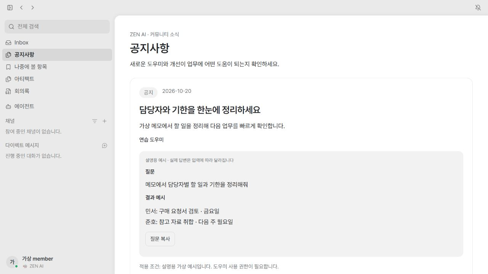
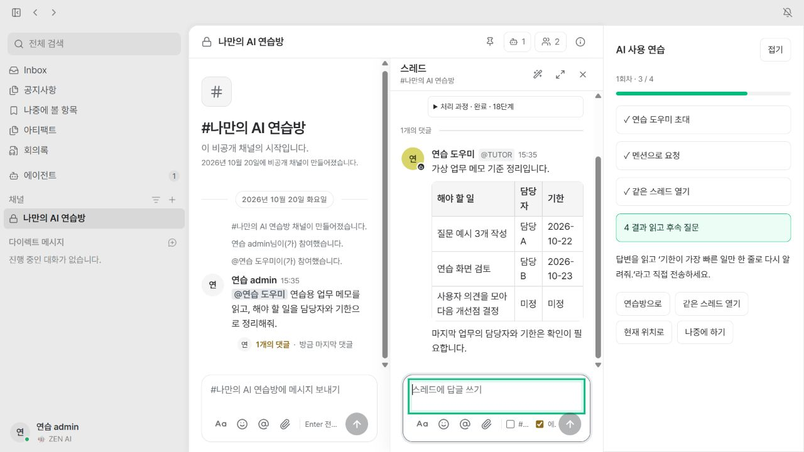

# 구현 및 테스트 결과

**공지사항·연습 Builtin·우측 튜토리얼을 구현하고, 격리 환경에서 실제 AI와 브라우저 E2E를 검증했다. 운영 배포·main 병합·운영 DB 변경은 하지 않았다.**

> 최종 자동 검사·독립 평가: check·lint·knip·Builtin·전체 vitest 통과, 독립 Claude ACCEPT. 튜토리얼 커밋 b5c9f7c(수정 반복2회).

## 목차

1. 구현 결과
2. 실제 사용 검증
3. 자동 검사와 독립 검토
4. 남은 확인과 운영 적용 조건

## 1. 구현 결과

| 항목 | 구현한 내용 |
| --- | --- |
| 공지사항 | 커뮤니티별 DB·RLS·API. 관리자 초안/게시/회수/재게시. 사용자 첫 화면에 **업무 효과·질문·결과 예시·적용 조건** 표시, 질문 복사와 상세 제공 |
| 튜토리얼 | 첫 방문 소개·나중에 하기·메뉴 재개. **우측 체크리스트와 현재 대상 초록 강조**, 첫 실습·선택2회차 지원 |
| 실제 연습 | 본인 비공개 연습방에 `tutorial.assistant`를 초대. 기존 Builtin worker·모델·스킬·도구 대화·스레드 문맥을 공유 |
| 가상 자료 | strict `{}`의 `read_practice_memo`만 제공. 실제 SAP·회의·직원 자료에 접근하지 않음 |
| 완료 저장 | **첫 실제 성공 답변 뒤 같은 root에 보낸 후속 질문의 실제 성공 답변**을 서버 run/event로 확인. 소개 확인과 완료를 구별 |
| 기본 OFF | 서버 전용 `ANNOUNCEMENTS_ENABLED`, `TUTORIAL_ENABLED`. OFF에서 새 메뉴·자동 소개·진행 조회·API 차단 |
| 설계 문서 | 목표→상태→상황→행동 플랜, 운영 보호·구체 설계, 구현 순서·E2E 기준. **Excalidraw 원본·SVG 3쌍** 포함 |

공개 채널 가입·사람 초대는 **모의 설명**으로 제공한다. 실제 체험 중 업무 채널에 가입하거나 실제 동료를 초대하지 않는다.

## 2. 실제 사용 검증

**전용 앱3047·합성 세션 프록시3048·PostgreSQL55436에서 합성 계정만 사용했다.**

| 구분 | 확인한 결과 |
| --- | --- |
| 공지 관리자 | 초안 입력·미리보기·저장·재접속 복원, 게시→회수→재게시 |
| 공지 사용자 | 업무 효과 카드·상세 열람. 복사 버튼 후 **실제 클립보드 원문 일치** |
| 공지 권한·목록 | 일반 멤버 관리404, 타 커뮤니티·회수본 직접 URL404. 더 보기20→24개 |
| 공지 화면 | 이전390×844 검사에서 가로 넘침 없음. 긴 상세 끝까지 키보드 스크롤 확인 |
| 첫 방문·재개 | 소개 자동 표시 → 나중에 하기 → 새로고침 후 반복 없음 → 메뉴로 재개 |
| 실습1회차 | 기존 멤버 UI로 도우미만 초대 → 직접 멘션 전송 → 실제 답변 → 같은 스레드 후속 질문 → **4/4와 완료 저장** |
| 실습2회차 | 새 root로 실제 첫 답변·후속 답변 수신. **새 질문창·후속 질문창 모두 초록 강조와 정확한 초점**, 이전 완료 유지 |
| 강조·키보드 | 닫힌 스레드는 답글 열기 버튼 강조. 열린 스레드의 ‘현재 위치로’는 실제 textbox에 초점. 접으면 강조0개, 재개 정상 |
| 실제 trace | 별도 HTTP 검사에서 첫·후속 실행 모두 completed, `read_skill`·`read_practice_memo` 확인 |
| 모델 장애·재시도 | 미사용 localhost 모델 주소로 실제 장애 재현. **failed·completedAt=null·proof=null**, 정상 설정 복구 후 성공 |
| 새 인증 세션 | 관리자·멤버 각각 새 세션에서도 동일한 완료 시각·연습방 복원, 자동 소개 false — 별도 HTTP 검사 |
| 테넌트 분리 | 다른 커뮤니티의 튜토리얼·private 스레드 접근404, 해당 계정 본인 progress는 비어 있음 — 별도 HTTP 검사 |
| 기능 OFF | 실제 브라우저에서 공지·튜토리얼 메뉴0개, 별도 HTTP에서 두 API404 |

[첫 소개](스크린샷/07-tutorial-intro.jpg) · [완료 기록](스크린샷/09-tutorial-browser-completed.jpg) · [모델 장애 안내](스크린샷/10-tutorial-model-failed.jpg) · [2회차 새 질문 강조](스크린샷/11-tutorial-second-green.jpg) · [2회차 후속 질문 강조](스크린샷/12-tutorial-second-follow-green.jpg) · [기능 OFF](스크린샷/14-uiux-disabled.jpg)

## 3. 자동 검사와 독립 검토

| 검사 | 결과 |
| --- | --- |
| 공지사항 하네스 | **ACCEPT, c9f7fa7**. check·lint·knip·Builtin 검사, Linux493개 파일/5258개 테스트(기존skip포함), Windows19개 통과 |
| 튜토리얼 관련 회귀 | R1–R5 수정 후 **23개 파일·188개 테스트 통과**. 호환 export 오류 경계 추가3개 파일·15개 통과 |
| 튜토리얼 정식 게이트·독립 평가 | check·lint·knip·Builtin 통과. Linux507개 파일·5265개 테스트 통과(기존2개 파일·27개 테스트 skip), Windows19개 통과. 독립 Claude ACCEPT, b5c9f7c |
| production 빌드 | `next build --webpack` **exit0**, 타입 검사·static58개 생성. 게이트 반복1→2 차이는 테스트1개뿐으로 동작 소스 동일 |
| client bundle | **370개 파일, 서버 설정·키·DB 주소·스킬 내용 일치0개** |

독립 최종 검토의 Important5건은 다음과 같이 보완했다. **코드 직접 편집 대신 동일 intent 하네스로 수정했다.**

| 문제 | 수정·회귀 검증 |
| --- | --- |
| 권한 회수 중 늦은 성공 게시 | 게시 잠금 순서·대기 후 최신 권한 확인, disable/config/membership 경합 테스트 |
| 중간 문구+빈 최종 답변의 거짓 성공 | 최종 생성 답변을 구별. 실제 worker의 성공 게시·진행 근거 부재 확인 |
| 새 테이블의 provision/readiness 누락 | schema·최소 권한·RLS·activation에 연결. revoke 복구/RLS OFF 차단 확인 |
| 후속 입력창 대신 크기 조절 버튼 초점 | 현재 root textbox를 강조·초점 대상으로 지정. 1·2회차 회귀 및 브라우저 확인 |
| 보안 SQL 검사 누락 | RLS2개·정의자 함수4개를 정확한 inventory·owner·search_path·실행 권한 단언에 연결 |

독립 평가의 비차단 의견은 OFF의 POST404 직접 단언, 사용자 API의 자동 설치 금지 직접 단언, 테스트 설명의 명확화다. **수용 기준 위반은 없다는 ACCEPT 판정**이며, 새 기능을 늘리지 않고 후속 검증 후보로 남겼다.

`npm run build` 전체 성공으로 표현하지 않는다. Windows의 기존 preview assets 재귀 복사 native 오류 때문에 같은 assets를 준비하고 Next webpack 빌드를 직접 실행했다. 검사기 환경은 Node22·ffmpeg7.1.5·Git2.47.3이며, 게이트 skip·권한 완화 없이 기존 실패 원인을 해결했다.

## 4. 남은 확인과 운영 적용 조건

1. **튜토리얼390px 실사용 재확인:** 브라우저 viewport 설정을390×844로 지정해도 실제1280×720이 유지되어 미완료다. 공지의 이전390px 검증과 구분한다. 접기·재개와 데스크톱 초점은 확인했다.
2. **사람 리뷰:** 인증·권한·migration을 포함하므로 PR의 diff 인간 리뷰가 필요하다. 취소·기한 초과·권한 회수는 통합 회귀 검사이며 실제 고객 환경 검증이 아니다.
3. **별도 운영 적용:** 백업·additive migration·기존 역할 provision·readiness 확인 → 관리자 Builtin 설치/부여·모델 설정 → 제한된 커뮤니티에서 기능 ON 순으로 검토한다. **이번 작업에서는 실행하지 않았다.**
4. **되돌리기:** 새 기능 flag를 OFF한다. 기존 데이터·테이블을 삭제하지 않는다. 계정/version 진행과 community/user/version 연습방 매핑을 유지한다.

원본 checkout의 기존 수정은 보존했다. 세션 비밀값·API key·실제 고객 자료는 문서·Git·스크린샷에 넣지 않았다. 테스트용 인증 경로는 제품에 추가하지 않았다.

