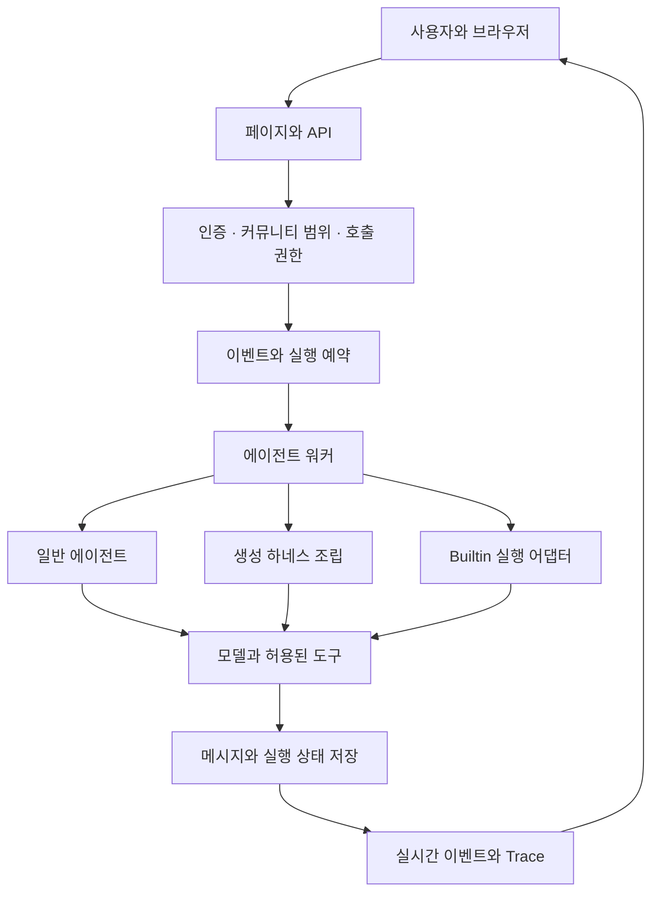

# ZEN AI 기능과 코드 지도

ZEN AI의 기본 단위는 커뮤니티, 그 안의 채널, 그리고 채널에 참여한 사람과 에이전트다. 에이전트를 만드는 기능과 채널에서 호출하는 기능, 실제 모델·도구를 실행하는 워커는 서로 다른 층이다. 화면이 보인다는 사실만으로 호출 권한이나 외부 연결까지 준비됐다고 판단하지 않는다.

## 제품의 주요 영역

기준: **2026-10-23 / `004be12`**. 아래는 기능 존재 지도이며 운영 배포 완료 목록이 아니다.

| 영역 | 하는 일 | 조사 시작 위치 |
| --- | --- | --- |
| 인증과 커뮤니티 | OIDC 로그인, 세션, 소속·역할, 테넌트 격리 | `src/lib/auth/`, `src/lib/communities/`, `src/lib/platform-admins/` |
| 채널과 대화 | 멤버·초대·메시지·스레드·첨부·이벤트·실시간 표시 | `src/app/api/channels/`, `src/lib/events/`, `src/lib/realtime/` |
| 에이전트 관리 | 생성·편집·모델·지침·부여 권한·MCP 선택 | `src/components/workspace/agent-admin.tsx`, `src/lib/agents/` |
| 생성 하네스 | 일반 정의에 버전별 스킬·정책을 연결하고 실행 때 조립 | `src/lib/agent-harness/` |
| Builtin | 코드 정의를 컴파일·릴리스하고 커뮤니티 인스턴스로 활성화 | `agents/`, `src/lib/builtin-agents/` |
| 회의 업무 | 회의록 검색·자료 질문·녹음 제어·선택 대기 | `src/lib/meeting-agent/`, `src/lib/meeting-tools/` |
| 녹음 자료 처리 | 오디오·전사·요약의 비동기 처리 | `src/lib/meetings/`, `src/app/api/meetings/` |
| MCP | 서버 등록, 도구 조회·선택·실행, 정적 헤더·사용자별 인증 | `src/lib/agents/mcp*.ts` |
| 스킬과 파일 작업 | 매뉴얼 조회, 작업 공간, 산출물 제출 | `src/lib/agent-harness/skills/`, `src/lib/agent-workspace/` |
| 실행 관찰 | 실시간 호출 흐름과 저장된 모델·도구 실행 이력 | `src/lib/agent-trace/`, `src/lib/agent-history/` |
| 백그라운드 | 접수 상태 저장, 완료 보고 수신, 후속 run·결과 전달 | `src/lib/agents/background-*.ts`, 양쪽 실행 어댑터 |
| SAP 연동 | 별도 Builtin·권한·MCP/OAuth·검증 경로 | `agents/sap/`, `src/lib/agents/sap-*.ts`, 관련 런북 |
| 튜토리얼 | 첫 소개·개인 연습방·성공 증거·완료 안내·설정 복습 | `src/lib/tutorial/`, `src/lib/tutorial-agent/`, `tutorial-introduction.tsx`, `tutorial-panel.tsx` |
| 공지사항 | 에이전트/서비스 소식, 7개 분류, owner/admin 작성·다중 게시·회수 | `src/lib/announcements/`, `src/components/community/community-announcements-console.tsx`, `announcement-*.tsx` |
| 에이전트 대시보드 | 전체 비교·실패 추적·에이전트 분석, 기간·페이지·버전 그래프 | `src/lib/agent-history/dashboard.ts`, `dashboard-failures.ts`, `src/components/workspace/agent-dashboard.tsx` |

이 목록은 코드의 기능 영역 지도다. 모든 외부 서비스가 현재 PC나 운영에서 연결되어 있다는 뜻은 아니다.

## 전체 실행 관계

그림의 Builtin과 생성 하네스는 별도 진입 경로다. followUp 판단·백그라운드 안내·공통 회의 도구 등은 공유하지만, 현재 전체 엔진이 하나의 코드로 완전히 합쳐진 것은 아니다.

## 화면을 고칠 때 먼저 볼 코드

| 화면 | 진입점과 주요 구성 요소 |
| --- | --- |
| 에이전트 목록 `/manage/agents` | `src/app/(workspace)/manage/agents/page.tsx`, `agent-admin.tsx` |
| 기존 만들기 버튼과 일반/하네스 전환 | `create-agent-card.tsx`, `agent-admin-dialog.tsx` |
| 기존 하네스 편집 흐름 | `agent-harness-dialog.tsx` |
| 재사용 스킬·전용 스킬·백그라운드 입력 | `agent-skill-fields.tsx` |
| Builtin 상세 `/manage/agents/<principalId>` | `src/app/(workspace)/manage/agents/[principalId]/page.tsx`, `builtin-agent-settings.tsx` |
| 기존 MCP 서버·도구 선택 | `mcp-tool-picker.tsx`, `mcp-server-section.tsx` |
| 스레드 호출 흐름 | `thread-trace.tsx` |
| 백그라운드 상태 표시 | `thread-background-status.tsx` |

위 구성 요소 파일은 `src/components/workspace/` 아래에 있다. 관리 화면 노출은 기존 관리 권한과 현재 커뮤니티 문맥을 사용한다. 화면에 토글이 없다고 즉시 CSS 문제로 판단하지 않는다.

## API에서 저장까지

- 튜토리얼: `/api/communities/[communityId]/tutorial` → `src/lib/tutorial/{handlers,runtime,service}.ts`. 소개 열람/보류/시작/검증을 구분하고 실제 성공 Run·게시 답변을 대조한다. 개인 설정 `/settings/guide`가 완료자의 명시적 복습 진입점이다.
- 공지: `/announcements`·`/announcements/[announcementId]` → `src/lib/announcements/`. 관리는 `/w/[communitySlug]/settings/announcements`와 `/api/communities/[communityId]/announcements`이며 다중 게시는 `[announcementId]/publish` 경로다.
- 대시보드: `/agent-dashboard` → `/api/communities/[communityId]/agent-dashboard` → `app_community_agent_dashboard`. 소속 커뮤니티 owner/admin의 기록 조회이며 일반 멤버에게 타인의 실행 원문을 공개하는 화면이 아니다.

### 현재 UI/데이터 계약

| 영역 | 최종 계약과 의도 |
| --- | --- |
| 튜토리얼 | owner/admin/member 공통 기본 제공. 전용 활성 플래그 제한은 제거했지만 로그인·멤버십·개인 기록 격리를 유지한다. 도우미 설치·활성화·호출 grant는 별도다. 완료자의 상시 버튼은 숨기고 설정에서 복습하며 최초 완료를 보존한다. |
| 공지 | `announcementsEnabled()`는 `COMMUNITY_WORKSPACE_ENABLED === 'true'`를 사용한다. `ANNOUNCEMENTS_ENABLED`는 현재 유효한 스위치가 아니다. 기본 목록은 에이전트 소식2분류, 서비스 소식5분류는 별도 선택이다. 최대20개 커뮤니티 게시의 권한을 전부 검증하고 원자적으로 처리하며 복사본은 독립 관리한다. |
| 전체 비교 | 1·7·14·30일/전체/사용자 지정, KST 날짜 경계. 에이전트10개 번호 페이지·480px 이내 표·고정 헤더. 기록 수집 범위 안내는 이 탭에 둔다. |
| 문제 추적 | 실패한 실행 전체 또는 실패10종으로 조회한다. 실패25건 번호 페이지이며 실패 여부와 유형의 집계·목록을 같은 조건으로 맞춘다. 단순 취소 전체를 실패로 확대하지 않는다. |
| 에이전트 분석 | 옛 ‘개선 검토’ 탭. 실패>0, custom 부정 평가>0, 활성 에이전트 사용0 등의 명시적 조건으로 카드 생성, 후보10개 번호 페이지. 카드에서 내부 상세로 들어가 버전별 실패율·p95 꺾은선을 본다. AI 진단·시간 추세·인과 판단이 아니다. |

### 스키마 변경 위치

0108 개인 튜토리얼 진행 → 0109 게시 잠금 → 0110 공지 → 0111 대시보드 → 0112 공지7분류 → 0113 기간 → 0114 실패 페이지 → 0115 삭제된 개인 연습방 복구. 최신 `drizzle/meta/_journal.json`과 SQL을 함께 읽는다. schema.ts만 보고 SECURITY DEFINER/RLS가 없다고 판단하지 않는다.

- 일반 생성·편집: `src/app/api/manage/agents/` → `src/lib/agents/`.
- 생성 하네스: `src/app/api/manage/agent-harness/` → `runtime.ts` → `service.ts` → `repository.ts`.
- 내부 회의 도구 카탈로그: `/api/manage/agent-harness/internal-tools` → `internal-tools/provider.ts`.
- Builtin 설정: `src/app/api/manage/builtin-agents/[principalId]/` → `settings-handler.ts`·`settings.ts`·`skill-settings.ts`.
- 외부 MCP 카탈로그: `src/app/api/manage/mcp-servers/[serverId]/tools/`.
- 완료 보고: `src/app/api/builtin-background/complete/`. 기존 내부 완료 경로도 따로 있으므로 인증 정책을 혼합하지 않는다.

## 실행·상태·관찰 코드

생성 하네스는 `src/lib/agents/worker.ts`에서 버전 스냅샷을 읽고 `agent-harness/assembly.ts`로 조립한다. 기존 `worker-runtime.ts`의 `startAgentStream`을 재사용한다.

회의 Builtin은 `builtin-agents/runtime/`와 `meeting-agent/channel-adapter.ts`를 거쳐 `engine.ts`·`builtin-tool-loop.ts`·`tool-dialogue.ts`에서 실행한다. 옛 `decide()`와 현재 `runTools()` 관련 코드가 함께 있으므로, 이름이 익숙하다는 이유로 사용되지 않는 경로만 수정하지 않는다.

회의 도구의 공통 업무 구현은 `src/lib/meeting-tools/`에 있다. Builtin과 생성 하네스 아래의 `meeting-tool.ts`·`state-repository.ts`는 각 실행 문맥과 DB 함수에 맞춘 어댑터다. 파일명이 둘 있다고 다시 전부 복제본으로 취급하지 않는다.

`src/instrumentation.ts`는 Node 런타임에서 실시간 리스너, 에이전트 워커, 회의 처리 워커, Trace 유지 작업을 시작한다. Next 개발 서버만 띄우면 이 경로로 초기화된다. 임의의 별도 에이전트 워커 명령을 만들어 중복 실행하지 않는다.

실시간 허브에는 프로세스 내부 상태가 있다. README는 다중 앱 인스턴스에서 토큰 스트리밍이 다른 인스턴스의 사용자에게 전달되지 않는 제한을 명시한다. 수평 확장이나 실행기 분리와 혼동하지 않는다.

## 근거 문서

- [저장소 README](<C:/Users/염정운/project/zen-ai/README.md>)
- [저장소 문서 인덱스](<C:/Users/염정운/project/zen-ai/docs/INDEX.md>)
- [[03. 에이전트 설정·저장·실행 구조]]
- [[05. 설계 의도와 변경 시 지켜야 할 경계]]

