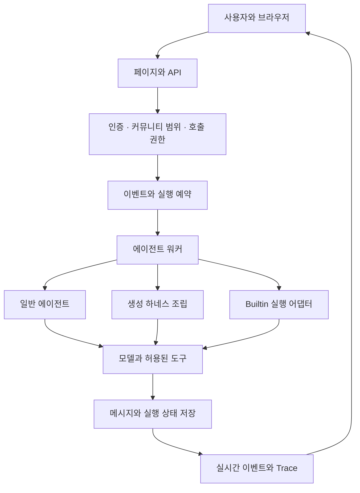

# ZEN AI 기능과 코드 지도

<!-- DASHBOARD-D-CONTEXT-20261106-BEGIN -->
## 대시보드 최신 계약 — 2026-11-06 후속 D

중앙 C:/Users/염정운/project/zen-ai, feat/fix-agent-dashboard-ui@94eab6bfa8d83b8873a9c4b0ee2c45cd4db1ec95. [PR #353](https://github.com/zen-compass/zen-ai/pull/353)은 ericyum 작성·OPEN·미병합이며 최신 head와 원격 브랜치가 일치한다. main3c017a93ea2e658f10b5e5ec14c585736748665a를 포함하고 최종 pull은 Already up to date였다.

- 실행 통계는 커뮤니티·기간만, 에이전트별 통계는 이동 링크 없는 그래프다. 말풍선은 hover/focus로 확인한다.
- LLM/도구 호출 통계는 전체·실패 4카드와 일별 그래프다. LLM은 모델별 누적, 도구는 전체 에이전트/사용자만 조건이면 합계 단일 막대, 특정 에이전트이면 도구명별 누적이다.
- 비용은 모델만 필터링하고 에이전트별/사용자별 사용량을 전환한다. 사용자 행은 평문, 20px 에이전트명만 별도 상세로 이동한다. 날짜·시각 축, 입력/출력/통화별 지표, 자동/0 기준 고정 Y축, 결측 표식과 CU 안내를 제공한다.
- 호출 카드는 기본 5개이며 5/10/20/50개 선택과 페이지 이동을 지원한다. 전체 반환 호출의 차트 범위와 목록 페이지는 독립적이다.
- 문제 추적의 실패 10종 필터는 사용자별 기록에서 실패를 선택했을 때만 표시한다. 기존 상세·양쪽 다운로드·정확한 runId 이동과 가림/auxiliary 차단을 유지한다.

주요 UI는 agent-dashboard.tsx와 agent-usage-panel.tsx/module.css, 이력은 community-agent-history.tsx와 기존 agent-history 서비스/API다. D 후속은 비용 패널·CSS·관련 테스트·intent 5파일만 변경하며 새 SQL·의존성이 없다. 기준과 검증은 05·06·08을 따른다.
<!-- DASHBOARD-D-CONTEXT-20261106-END -->

<!-- DASHBOARD-C-FOLLOWUP-20261106-BEGIN -->
## 대시보드 도구 추이·비용 호출 상세 — 2026-11-06 후속 C

중앙 feat/fix-agent-dashboard-ui@2c651561543afa41905c752cd88267cfa0fb15f8, [PR #353](https://github.com/zen-compass/zen-ai/pull/353)에 반영됐다. main3c017a9를 통합했으며 아직 미병합이다. 아래 과거 B의 '도구는 항상 누적막대·비용 상세는 같은 화면 하단' 설명보다 이 C 계약을 우선한다.

- LLM은 모델별 누적막대를 유지한다. 도구는 전체 에이전트/사용자만 조건이면 날짜별 합계 단일 막대, 특정 에이전트이면 실제 도구명별 누적막대다.
- 비용 에이전트 집계명은 20px이며 별도 내부 상세 URL로 이동한다. 기간·모델/에이전트/사용자 AND·집계 페이지를 보존해 직접 열기/새로고침/Back/목록 복귀를 지원한다.
- 상세는 호출 수·입력/출력 토큰·통화별 추정 비용을 전환하는 꺾은선과 각 call.runId의 사용자별 실행 이력 연결을 제공한다. null/0·원본 decimal·통화와 가림/auxiliary 연결 차단을 유지한다.
- 상세 목록은 10건씩이며 그래프는 같은 조회의 반환 호출 전체를 사용한다. 기존 256span/1000호출 상한은 유지한다. 실제 활성 탭과 여섯 이력 복귀 경로의 회귀도 고정했다.

기존 API·SVG를 재사용한 UI 후속이며 C의 새 SQL·의존성은 없다. 실행/가격/인증·동료 CJK 강조 변경을 보존했다. 전체7046 PASS/기존27 SKIP, build/API45/CI 성공. 공식 도구의 URL 안전 확인 중단으로 C Chrome 실제 화면 검사는 미완료이며 06·08의 재개 지점을 따른다. 최종 병합·배포는 사용자 담당이다. 로컬 시험 DB·호출·로그·설정·로그인·다운로드·스크린샷을 보존한다.
<!-- DASHBOARD-C-FOLLOWUP-20261106-END -->

> **2026-10-28 문서 동기화.** 최신 상태·미완료는 [[06. 현재 상태·미완료 작업·문제 해결]], 가격 계약은 [[07. 토큰 사용량·SAP 가격 수집과 보관 계약]], 실행·CI 근거는 [[08. 통합·HITL·Trace 검증과 세션 인계]]를 우선한다. 아래 날짜가 있는 과거 결과는 당시 이력이다.

ZEN AI의 기본 단위는 커뮤니티, 그 안의 채널, 그리고 채널에 참여한 사람과 에이전트다. 에이전트를 만드는 기능과 채널에서 호출하는 기능, 실제 모델·도구를 실행하는 워커는 서로 다른 층이다. 화면이 보인다는 사실만으로 호출 권한이나 외부 연결까지 준비됐다고 판단하지 않는다.

## 제품의 주요 영역

기능 지도는 2026-10-28 통합 내용으로 보완했다. 과거 10/23 `004be12` 이후의 Git·빌드 상태는 06·08을 따른다. 운영 배포 완료 목록이 아니다.

| 영역 | 하는 일 | 조사 시작 위치 |
| --- | --- | --- |
| 인증과 커뮤니티 | OIDC 로그인, 세션, 소속·역할, 테넌트 격리 | `src/lib/auth/`, `src/lib/communities/`, `src/lib/platform-admins/` |
| 채널과 대화 | 멤버·초대·메시지·스레드·첨부·이벤트·실시간 표시 | `src/app/api/channels/`, `src/lib/events/`, `src/lib/realtime/` |
| 에이전트 관리 | 생성·편집·모델·지침·부여 권한·MCP 선택 | `src/components/workspace/agent-admin.tsx`, `src/lib/agents/` |
| 생성 하네스 | 일반 정의에 버전별 스킬·정책을 연결하고 실행 때 조립 | `src/lib/agent-harness/` |
| Builtin | 코드 정의를 컴파일·릴리스하고 커뮤니티 인스턴스로 활성화 | `agents/`, `src/lib/builtin-agents/` |
| 회의 업무 | 회의록 검색·자료 질문·녹음 제어·선택 대기 | `src/lib/meeting-agent/`, `src/lib/meeting-tools/` |
| 녹음 자료 처리 | 오디오·전사·요약의 비동기 처리 | `src/lib/meetings/`, `src/app/api/meetings/` |
| MCP | 서버 등록, 도구 조회·선택·실행, 정적 헤더·사용자별 인증 | `src/lib/agents/mcp*.ts` |
| 스킬과 파일 작업 | 매뉴얼 조회, 작업 공간, 산출물 제출 | `src/lib/agent-harness/skills/`, `src/lib/agent-workspace/` |
| 실행 관찰 | 실시간 호출 흐름과 저장된 모델·도구 실행 이력 | `src/lib/agent-trace/`, `src/lib/agent-history/` |
| 백그라운드 | 접수 상태 저장, 완료 보고 수신, 후속 run·결과 전달 | `src/lib/agents/background-*.ts`, 양쪽 실행 어댑터 |
| SAP 연동 | 별도 Builtin·권한·MCP/OAuth·검증 경로 | `agents/sap/`, `src/lib/agents/sap-*.ts`, 관련 런북 |
| 튜토리얼 | 첫 소개·개인 연습방·성공 증거·완료 안내·설정 복습 | `src/lib/tutorial/`, `src/lib/tutorial-agent/`, `tutorial-introduction.tsx`, `tutorial-panel.tsx` |
| 공지사항 | 에이전트/서비스 소식, 7개 분류, owner/admin 작성·다중 게시·회수 | `src/lib/announcements/`, `src/components/community/community-announcements-console.tsx`, `announcement-*.tsx` |
| 에이전트 대시보드 | 실행 통계·에이전트별 통계·LLM/도구 호출 통계·토큰 사용량 및 가격·사용자별 기록 | `src/lib/agent-history/dashboard.ts`, `dashboard-failures.ts`, `src/components/workspace/agent-dashboard.tsx` |

이 목록은 코드의 기능 영역 지도다. 모든 외부 서비스가 현재 PC나 운영에서 연결되어 있다는 뜻은 아니다.

## 전체 실행 관계

그림의 Builtin과 생성 하네스는 별도 진입 경로다. followUp 판단·백그라운드 안내·공통 회의 도구 등은 공유하지만, 현재 전체 엔진이 하나의 코드로 완전히 합쳐진 것은 아니다.

## 화면을 고칠 때 먼저 볼 코드

| 화면 | 진입점과 주요 구성 요소 |
| --- | --- |
| 에이전트 목록 `/manage/agents` | `src/app/(workspace)/manage/agents/page.tsx`, `agent-admin.tsx` |
| 기존 만들기 버튼과 일반/하네스 전환 | `create-agent-card.tsx`, `agent-admin-dialog.tsx` |
| 기존 하네스 편집 흐름 | `agent-harness-dialog.tsx` |
| 재사용 스킬·전용 스킬·백그라운드 입력 | `agent-skill-fields.tsx` |
| Builtin 상세 `/manage/agents/<principalId>` | `src/app/(workspace)/manage/agents/[principalId]/page.tsx`, `builtin-agent-settings.tsx` |
| 기존 MCP 서버·도구 선택 | `mcp-tool-picker.tsx`, `mcp-server-section.tsx` |
| 스레드 호출 흐름 | `thread-trace.tsx` |
| 백그라운드 상태 표시 | `thread-background-status.tsx` |

위 구성 요소 파일은 `src/components/workspace/` 아래에 있다. 관리 화면 노출은 기존 관리 권한과 현재 커뮤니티 문맥을 사용한다. 화면에 토글이 없다고 즉시 CSS 문제로 판단하지 않는다.

## API에서 저장까지

- 튜토리얼: `/api/communities/[communityId]/tutorial` → `src/lib/tutorial/{handlers,runtime,service}.ts`. 소개 열람/보류/시작/검증을 구분하고 실제 성공 Run·게시 답변을 대조한다. 개인 설정 `/settings/guide`가 완료자의 명시적 복습 진입점이다.
- 공지: `/announcements`·`/announcements/[announcementId]` → `src/lib/announcements/`. 관리는 `/w/[communitySlug]/settings/announcements`와 `/api/communities/[communityId]/announcements`이며 다중 게시는 `[announcementId]/publish` 경로다.
- 대시보드: `/agent-dashboard` → `/api/communities/[communityId]/agent-dashboard` → `app_community_agent_dashboard`. 소속 커뮤니티 owner/admin의 기록 조회이며 일반 멤버에게 타인의 실행 원문을 공개하는 화면이 아니다.

### 현재 UI/데이터 계약

| 영역 | 최종 계약과 의도 |
| --- | --- |
| 튜토리얼 | owner/admin/member 공통 기본 제공. 전용 활성 플래그 제한은 제거했지만 로그인·멤버십·개인 기록 격리를 유지한다. 도우미 설치·활성화·호출 grant는 별도다. 완료자의 상시 버튼은 숨기고 설정에서 복습하며 최초 완료를 보존한다. |
| 공지 | `announcementsEnabled()`는 `COMMUNITY_WORKSPACE_ENABLED === 'true'`를 사용한다. `ANNOUNCEMENTS_ENABLED`는 현재 유효한 스위치가 아니다. 기본 목록은 에이전트 소식2분류, 서비스 소식5분류는 별도 선택이다. 최대20개 커뮤니티 게시의 권한을 전부 검증하고 원자적으로 처리하며 복사본은 독립 관리한다. |
| 실행 통계 | 커뮤니티·기간만 적용한다. 일별 성공·실패·실패율과 소요 시간 구간 누적막대, 수집 범위를 보여준다. 에이전트/사용자 필터·비교표·이동 링크는 없다. 데이터에 hover/focus하면 가까운 말풍선을 표시한다. |
| 사용자별 기록 | 문제 추적 탭을 통합했다. 실패 선택 때만 10종 사유를 표시하며 요청 최종 실행 구간의 사유로 페이지 조회 전에 필터한다. 중단 사유 조회도 지원한다. 기존 상태·검색·기간·커서·상세·Back·요청/구동로그 다운로드는 유지한다. |
| 에이전트별 통계 | 버전별 비교를 제거했다. 실행수·호출자·실패율·p95·수집 범위를 읽기 전용 그래프로 나타낸다. 그래프 선택은 이동이나 상세를 열지 않으며 데이터의 hover/focus 말풍선과 Escape 닫기를 제공한다. |
| LLM/도구 호출 통계 | 4개 전체·실패 카드와 모델/실제 도구명별 일별 누적막대다. 사용자·에이전트 조건을 AND 적용하며 실패는 해당 span 자체의 failed 상태로 센다. |
| 토큰 사용량 및 가격 | 상단 모델·에이전트·사용자 AND만 두고 중복 그룹 버튼·스레드/요청 입력은 제거했다. 기본 에이전트 집계·행 상세·서버 기존 필터 호환과 decimal 정밀도를 보존한다. 일별 토큰·비용은 막대다. [[07. 토큰 사용량·SAP 가격 수집과 보관 계약]] 참조. |

대시보드 후속 설명은 2026-11-05 `feat/fix-agent-dashboard-ui@e7cf7e3`·[PR #353](https://github.com/zen-compass/zen-ai/pull/353)의 구현 기준이다. 최신 정식 빌드·전체7038/API45·교차 평가·CI는 통과했고 원격 PR에 반영됐다. Chrome 후속 화면 검사는 미완료이며, main 병합·운영 배포 완료를 뜻하지 않는다. 최종 검증 상태는 06·08을 따른다.

### 스키마 변경 위치

0108 개인 튜토리얼 진행 → 0109 게시 잠금 → **0110 agent-history-export(main)** → **0111 announcements → 0112 agent_dashboard → 0113 announcement_categories → 0114 agent_dashboard_periods → 0115 agent_dashboard_failure_pages → 0116 tutorial-deleted-practice**. 기존 우리0110~0115는 내용 그대로 뒤 번호로 이동했고 journal 순서도 조정했다. 과거 기록의0115 삭제방은 현재0116이다. 파일명만 보고 이미 적용된 SQL을 재실행하지 말고 SQL hash·migration 이력을 대조한다. 최신 `drizzle/meta/_journal.json`과 SQL을 함께 읽는다. schema.ts만 보고 SECURITY DEFINER/RLS가 없다고 판단하지 않는다.

- 일반 생성·편집: `src/app/api/manage/agents/` → `src/lib/agents/`.
- 생성 하네스: `src/app/api/manage/agent-harness/` → `runtime.ts` → `service.ts` → `repository.ts`.
- 내부 회의 도구 카탈로그: `/api/manage/agent-harness/internal-tools` → `internal-tools/provider.ts`.
- Builtin 설정: `src/app/api/manage/builtin-agents/[principalId]/` → `settings-handler.ts`·`settings.ts`·`skill-settings.ts`.
- 외부 MCP 카탈로그: `src/app/api/manage/mcp-servers/[serverId]/tools/`.
- 완료 보고: `src/app/api/builtin-background/complete/`. 기존 내부 완료 경로도 따로 있으므로 인증 정책을 혼합하지 않는다.

### main에서 통합한 실행 기록 JSON 다운로드

`src/app/api/communities/[communityId]/agent-runs/[runId]/export/route.ts`와 `src/lib/agent-history/`의 export 계약을 확인한다. owner/admin만 허용하며 communityId가 필수다. 선택 실행과 같은 요청·같은 에이전트 retry만 묶고 다른 agent/trigger는 제외한다. 추론 stream 표시와 저장 이력 다운로드를 혼동하지 않는다.

## 실행·상태·관찰 코드

생성 하네스는 `src/lib/agents/worker.ts`에서 버전 스냅샷을 읽고 `agent-harness/assembly.ts`로 조립한다. 기존 `worker-runtime.ts`의 `startAgentStream`을 재사용한다.

회의 Builtin은 `builtin-agents/runtime/`와 `meeting-agent/channel-adapter.ts`를 거쳐 `engine.ts`·`builtin-tool-loop.ts`·`tool-dialogue.ts`에서 실행한다. 옛 `decide()`와 현재 `runTools()` 관련 코드가 함께 있으므로, 이름이 익숙하다는 이유로 사용되지 않는 경로만 수정하지 않는다.

회의 도구의 공통 업무 구현은 `src/lib/meeting-tools/`에 있다. Builtin과 생성 하네스 아래의 `meeting-tool.ts`·`state-repository.ts`는 각 실행 문맥과 DB 함수에 맞춘 어댑터다. 파일명이 둘 있다고 다시 전부 복제본으로 취급하지 않는다.

`src/instrumentation.ts`는 Node 런타임에서 실시간 리스너, 에이전트 워커, 회의 처리 워커, Trace 유지 작업을 시작한다. Next 개발 서버만 띄우면 이 경로로 초기화된다. 임의의 별도 에이전트 워커 명령을 만들어 중복 실행하지 않는다.

실시간 허브에는 프로세스 내부 상태가 있다. README는 다중 앱 인스턴스에서 토큰 스트리밍이 다른 인스턴스의 사용자에게 전달되지 않는 제한을 명시한다. 수평 확장이나 실행기 분리와 혼동하지 않는다.

## 근거 문서

- [저장소 README](<C:/Users/염정운/project/zen-ai/README.md>)
- [저장소 문서 인덱스](<C:/Users/염정운/project/zen-ai/docs/INDEX.md>)
- [[03. 에이전트 설정·저장·실행 구조]]
- [[05. 설계 의도와 변경 시 지켜야 할 경계]]

## 2026-10-28 추가 코드 지도

| 영역 | 시작 위치 |
| --- | --- |
| SAP 카탈로그·갱신·산술 | `src/lib/ai/pricing/{catalog,runtime,cost}.ts`, `src/instrumentation.ts` |
| 사용량 기록·조회 | `src/lib/agent-history/{usage,usage-recording,usage-summary}.ts`, `src/lib/db/repos/usage.ts` |
| 가격 UI/API | `src/components/workspace/agent-usage-panel.tsx`, `/api/communities/[communityId]/agent-usage`, 기존 대시보드·실행 상세 |
| HITL 전환 후속 | `src/lib/meeting-tools/hitl-tool.ts`와 `agent-harness/internal-tools/execution.ts`, `meeting-agent/builtin-tool-loop.ts` |
| 일반 Trace 예약 연결 후속 | `src/lib/agents/runs.ts`, `src/lib/channels/messages.ts` |

main의 0118 요청 이력·0119 실행 reconciliation·0120 회의 메모 SQL을 보존하고, feature는 0121 권한 중단·0122 스킬/도구 분리·0123 legacy local 선택·0124 사용량/가격 순서로 통합했다. 위 0110~0116은 앞선 이력이며 최신 끝 번호가 아니다. 실제 적용 전 journal·SQL hash·대상 DB 이력을 대조한다.
