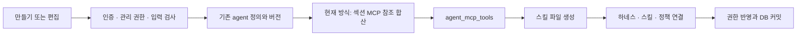
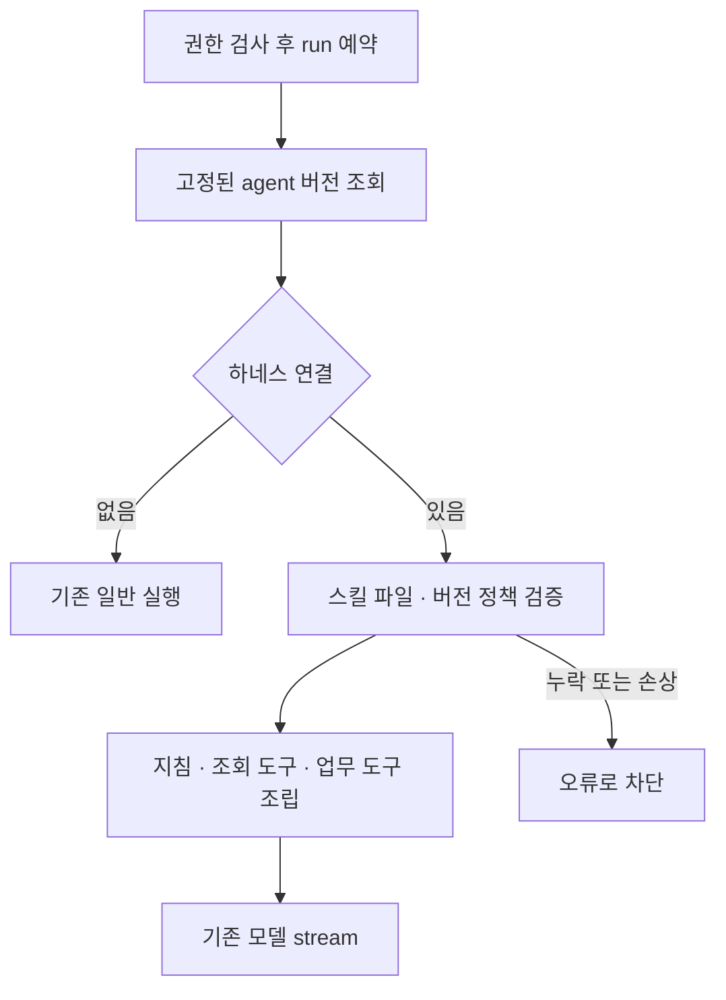
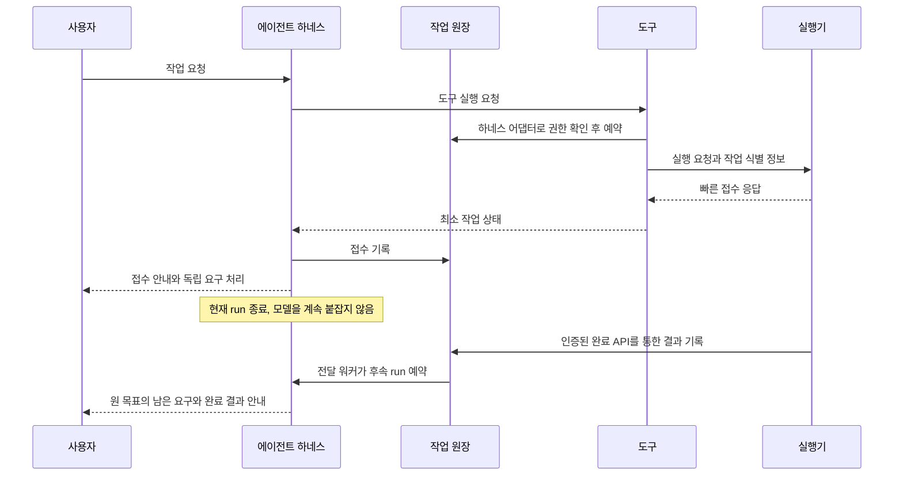

# 에이전트 설정과 저장 실행 구조

> 기준: **2026-10-23 / 004be12**. 아래 기존 하네스·백그라운드 의도를 보존하고 모델 전송·튜토리얼·공지·대시보드 저장 계약을 최신화했다. 스킬/도구 분리 방향은 여전히 미완료이며 이번 UIUX 변경의 완료 범위가 아니다.

일반 에이전트의 기반을 재사용하고, 생성 하네스에는 스킬·백그라운드 정책을 버전별로 연결한다. Builtin은 코드 정의와 커뮤니티 인스턴스 설정을 사용한다. 양쪽의 공통 정책과 각 경로의 차이를 함께 이해해야 기존 동작을 보존할 수 있다.

**현재 구조와 다음 변경 방향을 혼동하지 않는다.** 현재는 전용 스킬의 시나리오와 도구 참조가 결합되어 있다. 사용자는 이를 매뉴얼과 독립 도구 설정으로 분리하도록 요청했다. 이 문서의 “현재” 설명은 그 변경을 완료했다는 뜻이 아니다.

## 에이전트 종류와 설정

| 종류 | 정의와 설정 | 실행 |
| --- | --- | --- |
| 일반 | 기존 이름·호출명·지침·모델·작업 공간·권한·MCP 설정 | 기존 agents worker와 stream |
| 생성 하네스 | 일반 정의 + 전용 매뉴얼 + 체크한 공용 스킬 + 백그라운드 정책 | 같은 worker에서 확장 스냅샷을 조립 |
| Builtin 회의 | 코드의 manifest·스킬 + 등록 인스턴스의 모델·도구·지침·스킬·정책 설정 | Builtin runtime과 회의 어댑터 |

기존 + 만들기 버튼 안에서 일반/하네스를 전환한다. 하네스를 특정 커뮤니티 allowlist에만 제공하려던 예전 조건은 제거됐다. **유효한 커뮤니티 문맥과 기존 생성·관리 권한은 여전히 필요하다.**

공용 “문서 작성” 체크 하나는 현재 PPTX·XLSX·DOCX·PDF 네 매뉴얼을 연결한다. 작성 도구를 새로 설치하는 기능이 아니다. 도구 없이도 매뉴얼을 조회하고 작성 방법·제약을 안내할 수 있으나, 파일을 만들지 않았는데 만들었다고 답하면 안 된다.

## DB에 무엇을 저장하나

### 10/23 추가된 UIUX 데이터

- `tutorial_progress`: 사용자+튜토리얼 버전의 소개 열람·보류·최초 완료 시각. 완료는 채널 실습 상태와 다르며 복습해도 지우지 않는다.
- `tutorial_practice_channels`: 사용자+커뮤니티+버전의 개인 private 연습방 연결. 동시 start는 기존 advisory transaction lock으로 직렬화한다.
- `announcements`: 커뮤니티별 공지 내용·상태·버전. 다중 게시도 독립 복사본이며 이후 수정·회수는 자동 동기화하지 않는다. 0110·0112 및 service/types를 함께 본다.
- 대시보드는 별도 통계 DB나 추론 원문 저장소를 만들지 않는다. 기존 run/span/feedback·정의/설정 버전을 권한 있는 집계 함수로 조회한다. 0111·0113·0114가 범위·기간·실패 페이지 계약이다.
- 0115의 `app_reset_deleted_tutorial_practice_channel(integer)`는 현재 세션 사용자·활성 커뮤니티 멤버·버전·본인 소유 private·실제 deleted를 모두 확인할 때만 낡은 연결을 지운다. 보관·접근권한 상실은 새 방으로 우회하지 않는다. 옛 방/이벤트/Run/최초 완료는 남긴다.

새 DB 서버를 만든 것이 아니라 기존 PostgreSQL에 테이블과 함수를 확장했다.

| 테이블 | 역할 |
| --- | --- |
| `agents`, `agent_versions` | 일반·생성 하네스의 신원과 기본 정의·버전 |
| `agent_allowed_models`, `agent_grants` | 모델 허용·사용자 호출 권한 |
| `mcp_servers`, `agent_mcp_tools` | 서버/내부 제공자 정보와 일반·생성 하네스의 선택 도구 |
| `agent_harness_versions` | 해당 agent 버전이 하네스인지와 계약 연결 |
| `skill_artifact_versions` | 스킬 이름·요약·본문 파일 참조·해시·섹션 메타데이터 |
| `agent_version_skills` | agent 버전과 스킬 버전 연결 |
| `agent_background_policy_versions` | 생성 하네스 버전의 백그라운드 허용 |
| `agent_background_tasks` | 생성 하네스의 예약·접수·완료·전달 원장 |
| `agent_harness_meeting_states` | 생성 하네스 내부 회의 도구의 선택·자료 상태 |
| `builtin_definition_releases` | 코드로 게시한 Builtin 불변 정의 릴리스 |
| `builtin_agent_instances`, `builtin_instance_config_versions` | 커뮤니티별 Builtin 인스턴스와 설정 이력 |
| `builtin_agent_mcp_tools` | Builtin 외부 MCP 도구 선택 |
| `builtin_instance_skill_versions` | Builtin 설정 버전별 스킬 파일 참조·메타데이터 |
| `builtin_background_tasks` | 기존 Builtin 백그라운드 원장 |
| `agent_runs`, `agent_run_spans`, 이벤트 관련 테이블 | 실행과 관찰·대화 기반 |

Builtin 내부 회의/시험 도구 선택은 설정 버전의 `enabled_native_tool_ids`로 관리한다. **Builtin의 모든 도구 선택도 agent_mcp_tools에 저장된다는 설명은 틀리다.** 내부 회의 도구를 사용하는 생성 하네스의 MCP 참조는 기존 agent_mcp_tools를 사용한다.

테이블·컬럼 정의는 `src/lib/db/schema.ts`, 보안 함수·제약·실제 변경 이력은 `drizzle/*.sql`을 함께 확인한다. Drizzle schema만 보고 RLS·DB 함수 검증이 없다고 판단하지 않는다.

주요 확장 순서는 0096 생성 → 0097 연결 불변성 → 0098 harness 명칭 rename → 0099 내부 회의 도구 → 0100 회의 상태 → 0102 Builtin 스킬 → 0103 생성 하네스 백그라운드다. 0101은 회의 전사 모델 변경이다. 과거 migration 파일명에 template이 남아 있는 것은 이력이며 현재 테이블이 그 이름이라는 뜻이 아니다.

## 스킬 본문은 파일에 저장한다

전용 매뉴얼 하나의 여러 시나리오는 **하나의 Markdown 산출물**에 들어간다. UI의 시나리오 카드 수만큼 전용 파일이 생성되는 구조가 아니다. 공용 스킬 네 종류는 각자 산출물이 있다.

```text
AGENT_SKILL_ROOT/
  <communityId>/
    <agentId 또는 Builtin instanceId>/
      <agentVersion 또는 Builtin configEpoch>/
        <본문 sha256>.md
```

물리 파일명이 반드시 SKILL.md인 것은 아니다. 모델에 보이는 `/skills/<name>/SKILL.md`는 가상 조회 경로다.

생성 하네스의 섹션 ID·제목·적용 상황·도구 참조는 DB 메타데이터에, 본문은 파일에 저장한다. Builtin도 설정 스킬을 같은 저장 헬퍼로 고정한다. 스킬 설정이 없는 Builtin은 컴파일된 기본 매뉴얼을 사용한다. 저장된 스킬이 손상됐을 때 이를 조용히 기본값으로 바꿔 성공한 것처럼 처리하지 않는다.

공용 매뉴얼 원본은 현재 `skills/reusable/skills.ts`의 코드 카탈로그다. 임의 폴더를 매번 스캔하지 않으며, 저장 시점의 내용을 agent 버전에 고정한다. 원본 수정이 이미 저장된 모든 agent 버전을 자동 변경하지 않는다.

저장 구현은 절대 경로·비공개 디렉터리·해시·크기·심볼릭 링크 등을 검사한다. DB와 파일 저장소를 함께 보존·백업해야 한다.

## 생성 하네스 저장 순서



핵심 코드는 `agent-harness/service.ts`다. 편집은 `expectedVersion`으로 동시 수정 덮어쓰기를 막는다. DB 작업은 트랜잭션이지만 파일 시스템까지 원자적으로 롤백되지는 않는다. DB 실패 시 미연결 파일이 남을 수 있으나 이를 실행 대상 스킬로 자동 사용하지 않는다.

## 내부 회의 도구의 예외 제공

생성 하네스에서 아래 세 도구는 외부 MCP 서버 없이 로컬 정의를 목록으로 제공한다.

- `search_meetings`
- `question_meetings`
- `control_meeting_recording`

`internal-tools/provider.ts`가 `providerKind=internal_meeting`, URL 없음인 대표 등록 정보를 만든다. 이는 실제 외부 서버가 아니다. 카탈로그는 `internal-tools/meeting/tool-contracts.ts`에서 정의를 읽고, 권한 저장은 기존 MCP 테이블 구조를 재사용한다. 외부 HTTP 연결 대신 내부 어댑터로 실행한다.

공통 회의 업무 구현은 `src/lib/meeting-tools/`다. Builtin과 생성 하네스의 각 경로는 자기 DB 권한 함수와 상태 저장 어댑터를 사용한다. 내부 제공자 예외를 모든 외부 MCP에 적용하거나 실패 서버의 가짜 도구 목록을 만들지 않는다.

## 호출 시 일반과 하네스 구분

이름에 “하네스”가 있는지, 가장 최신 버전이 무엇인지로 구분하지 않는다. **run에 고정된 communityId + agentId + agentVersion**의 하네스 연결을 읽는다.



하네스 연결이 손상됐는데 일반 agent로 조용히 실행하면 안 된다. 기존 에이전트가 하네스로 자동 변환되는 구조도 아니다.

## 현재 스킬 조회와 도구 검사

생성 하네스는 스킬 목록·요약·적용 상황을 먼저 알리고, 모델이 관련 섹션을 `read_file`로 읽게 한다. Builtin은 `read_skill` 경로를 사용한다. 단순 인사는 관련 매뉴얼이 없으면 조회 없이 답할 수 있다.

현재 생성 하네스의 `assembly.ts`는 읽은 섹션의 `toolRefs`와 실행 도구를 대조한다. Builtin도 `requireLoadedAction` 등으로 actions와 조회 상태를 대조한다. 전자는 미조회 상황에 조회할 섹션을 안내하고, 후자는 유효한 미조회 상황을 한 run에서 제한적으로 복구한다.

**다음 변경의 목표:** 매뉴얼 읽기 지침은 유지하되, 섹션의 도구 연결을 실행 권한으로 취급하지 않는다. 독립적으로 선택·허용된 도구는 해당 매뉴얼에 연결돼 있지 않아도 모델이 사용할 수 있어야 한다. 실제 도구 권한 검사는 제거하지 않는다. 상세 범위는 05·06번을 따른다.

## 도구 실행 뒤 종료와 LLM 복귀

현재 공통 종료 규약은 `src/lib/agents/tool-followup.ts`에 있다.

1. 모델은 업무 도구 호출에 optional `followUp`을 지정한다. true·생략은 계속 진행한다.
2. false만으로는 종료하지 않는다. 도구가 명시적인 공개 응답을 반환해야 한다.
3. 마지막 차례의 모든 도구가 완료됐고 실패가 없어야 한다. 모델 종료 이유도 정상이어야 한다.
4. run의 앞선 도구 오류·미실행 이력이 있으면 마지막 성공만 보고 조기 종료하지 않는다.
5. 스킬 조회·HITL 등 lifecycle 도구를 업무 최적화 대상으로 삼지 않는다.

공개 응답 규약의 형태:

```json
{
  "harnessResponse": {
    "version": 1,
    "status": "completed",
    "text": "도구가 보장하는 사용자용 안내"
  }
}
```

접수만 끝난 도구는 status를 accepted로 쓴다. accepted는 업무 완료가 아니다. 원문 자료를 반환하는 질문 도구처럼 모델의 해석이 필요하거나 규약이 없는 외부 도구는 계속 LLM으로 돌아간다.

주입한 followUp 제어값은 실제 업무/MCP 호출 전에 제거한다. 기존 필드와 충돌하거나 안전하게 확장할 수 없는 스키마는 원본을 유지하고 최적화하지 않는다. 공통 종료 정책은 녹음·검색 같은 특정 이름으로 분기하지 않는다. 도구 어댑터가 업무 이름을 알고 있는 것과 공통 하네스가 특정 이름에 종속되는 것은 다르다.

모든 남은 요구가 충족됐는지는 LLM 판단을 포함한다. “녹음 제어 + 매뉴얼 요약”에서 파일을 읽은 것을 요약 완료로 오인하지 않도록 지침을 준다. 항상 모델 2회로 끝난다고 보장하지 않는다.

## HITL 사람 응답

`src/lib/meeting-tools/hitl-tool.ts`는 대기 중인 후보와 원 요청을 모델에 제공한다. 모델은 사람의 자연어를 해석해 선택·추가/대체·취소를 구조화된 응답 도구로 전달한다. 설명 요청이나 모호한 취소는 확인하며 대기를 유지한다.

실제 후보 ID·상태 토큰·만료·권한 검증과 resume/cancel은 코드가 맡는다. LLM이 없는 후보를 만들거나 다른 사용자의 대기를 해제할 수 없다. 취소 문구 하나의 완전일치에 의존하지 않는다. 백그라운드 완료 데이터는 사람 응답으로 해석하지 않는다.

## 백그라운드 접수와 완료 재개



공통 코드는 `agents/background-submission.ts`, `background-context.ts`, `background-continuation.ts`다. DB 어댑터는 Builtin과 생성 하네스가 각각 유지한다. 두 원장을 합치거나 오래된 task를 이동한 것이 아니다.

LLM에는 taskId·toolId·설명·상태·필요한 대기 정보만 제공한다. URL·키·완료 토큰은 모델 입력이 아니다. 접수 응답 유실은 unknown일 수 있으므로 실패라고 단정하거나 자동 재접수하지 않는다. 완료가 접수 기록보다 먼저 도착하는 경우도 고려한다.

백그라운드 OFF는 새 접수를 차단한다. 이미 접수한 작업의 결과 전달까지 삭제하는 뜻은 아니다. 사용자 대기 중지, 현재 run 취소, 실제 외부 계산 중단은 별개의 동작이다. 화면 X를 눌렀다고 외부 실행기 프로세스가 반드시 멈춘다고 설명하지 않는다.

현재 실제 로컬 업무 어댑터는 slow_sum이다. 공통 함수는 도구 이름을 일반 입력으로 받지만, **임의 MCP 도구 설명에 “백그라운드”라는 말이 있다는 이유만으로 외부 접수·예약·콜백이 자동 구현되는 것은 아니다.** 미래 MCP는 실제 계약을 연결하고 별도 검증해야 한다.

## Trace에 남기는 정보

### 현재 모델 전송과 추론 수집

`src/lib/builtin-agents/runtime/model-connection.ts`는 공통 `createChatModel`을 사용하고 회의 model-connection은 이 경로를 재사용한다. 일반·생성 하네스도 공통 Chat 전송이다. 현재 `MEETING_MODEL_API=sap-mixed` 분기는 사용하지 않는다. GPT의 SAP Responses 요청·Claude Chat 요청 구분은 LiteLLM provider/모델 설정과 SAP 호환 이미지가 담당한다.

Builtin 도구 루프와 생성 하네스의 추론 수집기는 공급자가 실제 반환한 공개 reasoning 텍스트를 **요청 owner의 실시간 Trace**로 전달하며 중단 시 수집을 종료한다. DB span에 추론 원문을 영구 저장하는 설계가 아니다. MODELS의 추론 강도 capability, 실제 reasoning_effort 요청, 공급자의 reasoning 반환, 화면 수신을 각각 구분한다. 복잡한 도구 판단 시나리오에서도 SAP가 반환하지 않으면 빈 reasoning 자체는 실패가 아니다.

### Builtin 실행 시간의 세 경계

| 경계 | 역할 |
| --- | --- |
| `runtime/execute.ts`의 `MAX_OPERATION_MS=120_000` | executor 실행을 dispatch한 시점부터 전체 작업에 적용되는 2분 상한. 내부 도구 루프마다 새 2분이 생기지 않는다. 실제 제한은 DB deadline 잔여 시간과 이 상한의 작은 값이며 완료 커밋 전에도 검사한다. |
| 입력 `deadlineAtMs` | DB run의 별도 마감. 큐 대기·다른 실행 사정과 함께 확인해야 한다. `MAX_RUNTIME_MS=15분`은 입력 deadline 잔여 시간의 유효성 상한이지 모든 run에 새 15분을 보장하는 설정이 아니다. |
| worker 실행권 lease | 여러 worker가 같은 run을 동시에 처리하지 않도록 소유권을 제한·갱신한다. 모델 작업 timeout이나 DB 마감과 다른 개념이며 lease가 끝나면 stale 소유자의 게시가 차단돼야 한다. |

정확한 계산과 권한은 `runtime/{execute,worker}.ts` 및 DB claim/commit 함수가 기준이다. 과거 문서의 `executor.ts` 숫자만 찾아 수정하지 않는다. 회의 `agents/meeting/assistant/manifest.json`의 definitionRevision은 8이며 Git SHA·release epoch·config epoch와 같은 번호가 아니다.

실시간 화면용 흐름은 `agent-trace/`, 저장된 실행 span은 `agent-history/` 및 `agent_run_spans`를 함께 본다. 공용 스킬은 읽은 이름을 표시하고 모델·도구 실행 상태와 연결한다.

현재 양쪽 하네스 root 입력은 현재 사용자 질문을 `userRequest`로 보존하되 기존 마스킹·길이 제한을 적용한다. 나머지 payload 억제를 풀어 스킬 본문·회의 자료·도구 원문·내부 추론을 일괄 저장하는 변경은 아니다.

모델 추론 강도 설정, 모델이 제공하는 공개 reasoning 텍스트, trace 실행 이벤트는 서로 다르다. Trace가 보인다고 GPT 배포에서 추론 텍스트 수신까지 검증됐다는 뜻이 아니다.

## 상세 근거

- [[03. 에이전트 템플릿/02. 에이전트 템플릿 작성/3. 하네스 에이전트 설정·저장·실행 명세]]
- [공통 followUp intent](<C:/Users/염정운/project/zen-ai/intents/common-tool-followup-trace.md>)
- [공통 백그라운드 intent](<C:/Users/염정운/project/zen-ai/intents/common-harness-background.md>)
- [[04. 테스트와 브라우저 E2E 방법]]
- [[05. 설계 의도와 변경 시 지켜야 할 경계]]

