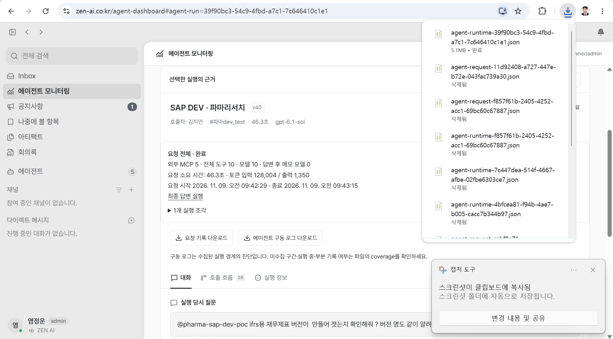
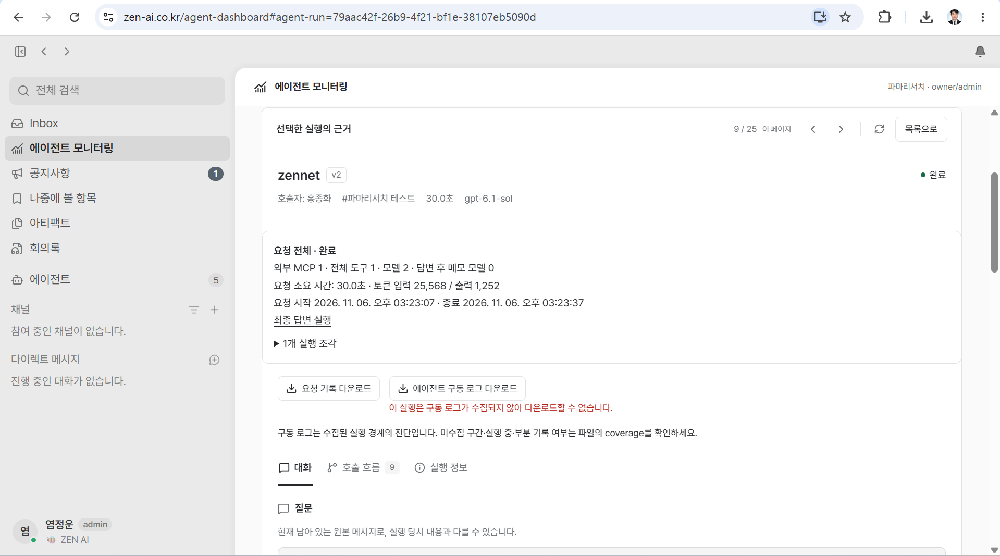

# 에이전트 구동 로그 보존·미수집 판별 조사

작성일: 2026-11-09 (KST)  
대상: 운영 에이전트 모니터링의 **에이전트 구동 로그 다운로드** 및 실패 안내  
상태: 초기 조사에 사용자 제공 운영 화면과 후속 UI 안내 변경 [PR](https://github.com/zen-compass/zen-ai/pull/377)을 추가했다. 운영 소실 원인·실제 보관기간은 미확정이며 운영 서버·DB·보관정책은 변경하지 않았다.  
초기 조사 코드 기준: 중앙 저장소 `a51ea6db8a5cd108e81e3a89be715625d294bd18`. 운영 배포 코드와 실제 저장소 구성의 일치는 별도 확인이 필요하다.

## 1. 현재 증상과 최신 정정

- 사용자는 **운영에서 시간이 지난 실행의 구동 로그를 다운로드할 수 없는 현상**을 보고했다. 화면에는 “이 실행은 구동 로그가 수집되지 않아 다운로드할 수 없습니다.”가 표시된다.
- **로컬에서는 해당 현상이 없고, 타인이 다른 커뮤니티에서 실행한 기록의 다운로드도 정상**임을 사용자가 직접 확인했다. 따라서 Builtin 전용, 타인 실행 또는 다른 커뮤니티라는 조건을 원인으로 간주하지 않는다.
- “일정 시간이 지나 운영 서버의 로그가 소실되는 것 같다”는 현재의 조사 가설이다. 자동 삭제·TTL·정확한 소실 시점·재배포와의 관계는 아직 확인되지 않았다.
- 이번 조사의 질문은 **처음부터 수집되지 않은 실행과, 한 번 저장된 뒤 현재 읽을 수 없게 된 실행을 구분할 수 있는가**다. 최신 사용자 확인은 이전의 넓은 종류·사용자·커뮤니티별 비교 계획보다 우선한다. [E1]

<!-- USER-PRODUCTION-EVIDENCE-20261109 -->
### 2026-11-09 사용자 제공 운영 화면 대조

사용자가 `zen-ai.co.kr`에서 직접 확인한 두 화면이다. 다른 커뮤니티에서 다른 사용자가 실행한 최근 기록도 정상적으로 다운로드되므로, **다른 커뮤니티 또는 다른 사람의 실행이라는 조건 자체가 다운로드를 막는 것은 아니다.** 같은 접근 조건에서 약3일 지난 별도 실행은 다운로드되지 않았고 기존 ‘수집되지 않음’ 안내가 표시됐다. 이번 조사에서 우선 좁혀 볼 조건은 **실행 후 시간이 얼마나 지났는가**다.

| 화면 | 화면에 표시된 요청 시작(KST) | 관측 결과 |
| --- | --- | --- |
| 최근 기록 | 2026-11-09 09:42:29 | `agent-runtime-39f90bc3-54c9-4fbd-a7c1-7c646410c1e1.json`, 5.1MB, 다운로드 완료 |
| 약3일 전 기록 | 2026-11-06 15:23:07 | ‘이 실행은 구동 로그가 수집되지 않아 다운로드할 수 없습니다.’ 표시 |

위 화면은 **사용자 제공 운영 관측**이며 에이전트의 직접 Chrome 검증과 구분한다. 두 화면의 run은 서로 다르므로 동일 파일이 저장 후 삭제됐다는 연속 관측은 아니다. 시간 경과와 실패의 관련성을 보여주지만, 정확한 소실 경계가24시간인지, 외부 정리·재배포·볼륨/경로 변경 중 무엇이 원인인지는 추가 서버 증거가 필요하다. 이번24시간 안내 기준은 이 관측을 바탕으로 사용자가 정한 UI 표시정책이며 실제 서버 TTL을 측정한 결과가 아니다.

## 2. 먼저 내릴 수 있는 결론

**현재 안내 문구나 파일 부재 응답만으로는 ‘최초 미수집’과 ‘수집 후 소실’을 확정적으로 구분할 수 없다.** 현재 코드는 “지금 승인된 저장 위치에서 연결되는 파일을 찾지 못했다”는 결과도 ‘미수집’으로 안내한다. [S1][S3][S4]

다만 **동일한 실행의 과거 정상 다운로드 또는 저장 성공을 입증하는 자료가 있으면, ‘처음부터 한 번도 수집되지 않았다’는 설명은 배제할 수 있다.** 이후 다운로드가 실패하더라도 물리적 파일 삭제인지, 볼륨·호스트·경로 변경으로 현재 조회할 수 없는지는 추가 대조가 필요하다.

초기 조사에서는 확인된 원인별로 문구를 나누는 방안을 제안했다. 이후 사용자는 현재 오류의 안내만24시간 기준으로 구분하는 최소 변경을 선택했다(§6.1). 이 UI 표시를 실제 서버 보관기간이나 삭제 원인의 확정으로 해석하지 않는다.

## 3. 저장·조회 코드에서 확인한 사실

### 구동 로그와 DB Trace는 별도 기록이다

구동 로그 원문은 `AGENT_RUNTIME_LOG_ROOT` 아래의 비공개 append-only JSONL 파일이다. 이름에 community·run 또는 연결된 request/background·recording 식별자를 사용한다. DB에서 실행 기록이나 Trace가 보이는 것만으로 이 JSONL 파일이 성공적으로 저장됐다고 판단할 수 없다. [S1][S2][S5]

- 파일 writer는 실제 `writeSync` 후 `fdatasyncSync`를 수행한다. 그러나 이 성공을 파일 밖의 독립적인 영구 수집 확인 기록으로 저장하는 경로는 현재 확인한 코드에 없다. [S1]
- 수집 실패 수·누락 수·종료 여부는 recorder의 메모리와 **같은 JSONL 파일의 `collection_end`**에 남는다. 파일 일부가 남으면 진단에 쓸 수 있지만, 파일 전체를 잃으면 그 증거도 함께 사라진다. [S2]
- DB Trace의 `traceComplete`, `writeFailures`는 별도의 DB span 저장 경로에 대한 값이다. 이를 구동 로그 JSONL 저장 성공 영수증으로 사용할 수 없다. `run.status=done`도 업무 실행 완료 상태이며 로그 보존 완료 상태가 아니다. [S5]
- 파일의 `collection.complete`는 해당 recording의 구조적 수집 완전성이고, 다운로드의 `transport.complete`는 JSON 전송 완료다. 서로 다른 의미이며, 어느 쪽도 장기 보관을 보증하지 않는다. [S1][S3]

### 서로 다른 상황이 동일한 ‘미수집’ 응답으로 합쳐진다

`handlers.ts`는 권한과 연결된 실행들을 검사한 뒤, 조회 결과가 `file_missing`, `storage_not_configured`, `instrumented_points_only`로만 구성돼 실제 로그 이벤트를 찾지 못하면 HTTP 409와 `agent_runtime_log_not_collected`를 반환한다. UI는 이 코드에 고정된 한 문구를 표시한다. [S3][S4]

| 현재 신호 | 확인할 수 있는 범위 | 이 신호만으로 확정할 수 없는 것 |
| --- | --- | --- |
| `file_missing` | 현재 root에서 승인된 식별자와 연결되는 파일을 찾지 못했거나, 조회 중 해당 파일을 잃음 | 한 번도 없었는지, 삭제됐는지, 다른 위치·볼륨에 남아 있는지 |
| `storage_not_configured` | 현재 프로세스의 유효한 저장 root 설정이 없음 | 과거에도 설정이 없었는지, 과거 파일이 삭제됐는지 |
| `instrumented_points_only` | 계측 범위 안내용 run 메타데이터이며, 뒤의 실제 recording 존재 여부를 함께 확인해야 함 | 최초 미수집이나 보관기간 만료 여부 |
| `recorded` 및 유효한 `collection_end` | 현재 읽은 recording에서 누락·실패·미종료 작업 없이 수집된 구조를 확인 | 이후에도 파일이 계속 보존되는지 |
| `end_marker_missing`·`corrupt_or_partial_file`·`collection_loss` | 남은 파일에서 종료 표식 누락·부분 기록·수집 누락 등을 확인 | 파일 전체가 없어진 과거 recording의 상태, 자동 만료 여부 |
| DB 실행·Trace 정상 | 업무 실행 또는 DB Trace가 존재함 | 별도 JSONL 저장 성공·현재 보존 여부 |

파일이 일부라도 있으면 기존 partial 다운로드와 진단 정보를 유지해야 한다. 일부 recording의 부재를 이유로 요청 전체를 ‘만료’나 ‘미수집’으로 바꾸면 안 된다. 기존 관리자 권한·커뮤니티 격리·원본 삭제 가림도 그대로 유지해야 한다. [S1][S3][S6]

## 4. 시간 경과와 서버 보존에 관해 확인한 범위

- 조사한 파일 writer/reader에는 **날짜가 오래됐다는 이유로 조회를 거절하거나 자동 삭제하는 TTL 분기가 없다.** 운영 문서도 임의 기간 자동 삭제를 두지 않는다고 설명한다. 따라서 “하루가 지나면 앱이 지운다”는 결론은 현재 근거로 낼 수 없다. 운영 호스트의 외부 정리 작업까지 확인했다는 뜻은 아니다. [S1][S6]
- 별도 기능인 **라이브 Trace 메모리에는 기본 168시간, 세션 연결 registry에는 기본 24시간 제한**이 있다. 이들은 프로세스의 메모리 Map을 정리하며 구동 로그 JSONL 파일을 삭제하는 경로가 아니다. 화면의 Trace 만료 시각이나 이 TTL을 구동 로그 다운로드의 보관기간으로 전용하면 안 된다. [S9]
- 파일 연결을 확정할 때의 `unlinkSync`는 새 이름으로 hard-link를 만든 뒤 이전 이름을 제거하는 처리다. 보관기간에 따른 삭제 코드가 아니다. [S1]
- 저장소의 운영 Compose는 `agent-runtime-logs:/app/runtime-logs` named volume과 앱의 root 설정을 선언한다. **실제로 같은 볼륨이 연결돼 있다면 컨테이너 교체와 파일 보존을 분리할 수 있지만**, 다른 호스트·프로젝트·볼륨·root로 바뀌면 파일이 남아 있어도 현재 앱에서는 찾지 못할 수 있다. [S6][S7]
- 배포 workflow는 서버 Compose 파일과 저장소 판의 해시가 달라도 경고 후 계속한다. 따라서 저장소에 volume 선언이 있다는 사실만으로 실제 운영에 적용됐다고 보증할 수 없다. 운영의 실제 mount·root·파일 목록·교체 이력은 아직 확인하지 않았다. [S8]
- Compose의 Docker `json-file` 로그 회전 설정과 CI의 artifact 보관기간은 별도 대상이다. 이 설정을 앱 JSONL 구동 로그의 TTL 근거로 사용하면 안 된다. [S7][S8]

### 기존 관측과 증거의 한계

| 증거 | 실제 확인 내용 | 이번 결론에 사용할 때의 한계 |
| --- | --- | --- |
| 사용자 최신 확인 | 로컬 및 타인·다른 커뮤니티 다운로드 정상 | 자동화 직접 검증 결과로 소급하지 않음 |
| 합성 파일 writer/reader 검사 | 일반·Builtin의 이벤트 시각과 mtime을 6일 전으로 둔 파일을 별도 프로세스에서 다시 읽음 | 6일 동안 운영에서 보관한 시험이 아님. 파일 나이만으로 reader가 만료시키지 않는다는 근거 [E2] |
| 기존 로컬 회의 recording | 11/04 파일 2개·295이벤트·2collection을 11/09에 다시 읽음 | 로컬 파일 조회이며 운영·HTTP·Chrome 검증이 아님 [E3] |
| 과거 운영 TUTOR 다운로드 감사 | 11/04 07:52 KST 다운로드된 run `b98de06b-2051-4391-8789-22e42ba9d157`의 304이벤트·3collection 확인 | 구현 담당의 Chrome 다운로드를 테스트2가 저장 파일로 감사한 과거 증거. 같은 run의 현재 서버 상태는 미확인. 현재 PC의 원파일 부재가 서버 소실 증거는 아님 [E4] |
| 11/09 Downloads의 파일 3개 메타데이터 | 파일명·크기·생성 시각만 확인 | origin·실행 시각·실제 다운로더가 미확인. 다운로드 시각은 실행 시각이나 서버 보관기간이 아님 [E5] |

테스트2가 이번 조사에서 직접 재현한 운영 구동 로그 다운로드 실패·정상 대조는 아직 없다. Chrome 탭 진입 성공과 이후 탭 부재는 제품의 로그 수집·보존 결과로 집계하지 않는다. [E5]

## 5. 미수집과 수집 후 소실을 어떻게 구분할 것인가

### 기존 실행은 남아 있는 증거로 범위를 좁힌다

1. **동일한 community/run 및 연결 recording을 고정한다.** 실행 시각과 조회 시각을 나누어 적고, 가능하면 과거에 다운로드가 성공했던 바로 그 run을 대조한다. 다른 실행끼리의 성공·실패만으로 시간 경과 원인을 확정하지 않는다.
2. **과거 수집 성공을 입증한다.** 보관된 정상 다운로드의 식별자·이벤트·수집 종료 표식 또는 당시의 서버 저장 확인 기록이 있으면 ‘최초부터 미수집’은 배제할 수 있다. 과거 다운로드가 요청 전체 묶음이면 어느 recording까지 있었는지도 구분한다.
3. **현재 조회 실패와 실제 저장 위치를 대조한다.** 운영 앱/worker의 배포 신원, root, mount 대상·volume 식별자, 동일 파일 키의 존재·크기·mtime, 배포/재시작·정리 이력을 읽기 전용으로 확인한다. 비밀 환경값·로그 업무 본문은 수집하지 않는다.
4. 과거 성공 자료와 현재 실패만 있으면 **‘수집 이력은 있으나 현재 접근 불가’**까지 말할 수 있다. 물리적 삭제·보관 위치 변경·식별자 연결 문제 중 어느 것인지는 추가 근거가 필요하다.
5. **삭제 또는 보관기간 만료라고 확정하려면** 실제 정책·대상·처리 시각/삭제 기록이 필요하다. 오래된 날짜나 파일 없음만으로 자동 만료를 판정하지 않는다.

기존 실행에 과거 수집 증거도 없고 파일도 없으면, 나중에 메타데이터 기능을 추가해도 당시의 원인을 확정 복원할 수 없다. 이 경우는 **원인 미확인**으로 유지한다.

### 앞으로의 실행은 로그 파일과 독립된 최소 상태를 남긴다 — 제안, 미구현

기존 DB의 권한·실행 식별 체계를 재사용해 **recording별 수집 상태 확인 기록**을 로그 파일과 독립적으로 남기는 방안이 필요하다. 새 로그 본문 저장소나 외부 서비스를 먼저 만드는 제안은 아니다. 구체적인 기존 테이블/metadata 확장 위치는 intent와 권한 검토로 확정한다.

- 최소 연결 식별자와 수집 지원 여부, 실제 파일 쓰기·동기화 성공 시각, 마지막 확인 시각, 부분 수집/쓰기 실패의 안전한 오류코드를 기록한다. 여러 attempt·slice·recording을 run 하나의 단순 성공 boolean으로 축약하지 않는다.
- 성공 기록은 **파일 쓰기·동기화가 성공한 후에만** 남긴다. 시작 시각이나 DB Trace 완료를 파일 저장 성공으로 대신하지 않는다. 파일과 DB를 한 트랜잭션으로 원자화할 수는 없으므로 확인 기록 저장 자체가 실패하면 ‘원인 미확인’ 상태를 허용해야 한다.
- 보관 정책을 도입한다면 정책 버전·보관 종료 시각과 실제 정리 결과를 남긴다. `expired`는 확인된 정책/처리 근거로만 만들며, 이번 현상을 이유로 임의 보관기간이나 자동 삭제 작업을 추가하지 않는다.
- 저장소 세대/불투명한 파일 키를 함께 대조할 수 있어야 “수집은 성공했으나 현재 다른 볼륨을 보고 있음”을 자동 만료와 혼동하지 않는다. 사용자에게 서버 절대 경로나 인증값을 노출하지 않는다.
- 과거 실행의 확인 기록 부재는 ‘미수집 확정’이 아니다. 기존 권한·테넌트·삭제 가림을 통과한 뒤에만 상태를 조회하며, 원문 삭제로 가려진 상태를 ‘파일 소실’로 바꾸지 않는다.

## 6. 초기 조사에서 제안한 원인별 안내 — 미구현

아래 상태명은 **개선 계약의 예시이며 현재 API에 구현된 코드가 아니다.** 현재 `agent_runtime_log_not_collected`만으로 이 분기를 모두 표현할 수 없다. 원인별 상태를 API에서 제공하고 UI가 그 상태를 표시해야 한다.

| 확인된 상태 | 권장 안내 |
| --- | --- |
| 처음부터 미수집임을 확인 | 이 실행은 구동 로그가 수집되지 않아 다운로드할 수 없습니다. |
| 보관기간 만료를 확인 | **구동 로그 보관기간이 지나 다운로드할 수 없습니다.** |
| 과거 수집 성공은 확인했으나 현재 파일을 찾지 못함 | 이전에 수집된 구동 로그를 현재 저장소에서 찾을 수 없습니다. 관리자에게 문의해 주세요. |
| 파일이 없고 과거 수집 여부도 모름 | 구동 로그 파일을 현재 찾을 수 없습니다. 미수집 여부 또는 보관 상태를 확인해 주세요. |
| 현재 저장소 설정/접근 오류를 확인 | 구동 로그 저장소에 접근할 수 없습니다. 관리자에게 문의해 주세요. |
| 일부 recording만 확보됨 | 다운로드를 제공하면서 ‘일부 구동 로그만 포함되어 있습니다.’와 확인된 수집 상태를 안내 |

사용자가 제안한 “시간이 오래 지나서 다운로드할 수 없습니다.”의 취지는 **처음부터 안 모은 로그와 보관기간이 끝난 로그를 구분해 설명하는 것**으로 반영한다. 다만 실제 정책이 있다면 ‘보관기간이 지나’라는 표현이 더 정확하다. 단순히 실행이 오래됐다는 이유로 해당 문구를 선택하지 않는다.

가장 작은 선행 개선은 현재 파일 부재의 원인을 알 수 없는 경우를 **중립 문구**로 바로잡는 것이다. 미수집/소실/만료를 자동 판별하는 기능은 독립적인 수집 이력 근거와 함께 구현해야 한다. 저장소 미설정 같은 현재 조회 오류도 과거 미수집으로 단정하지 않는다.

### 6.1 사용자 확정 최소 변경 — 24시간 기준 UI 안내

[제품 PR](https://github.com/zen-compass/zen-ai/pull/377) · 후보 `95608fe7b4f4e8cc9b39fb1643846ac364bef7ef` (운영 반영 여부는 별도). 아래는 초기 원인별 상태 제안과 구분되는 후속 사용자 결정이다.

- 기존 HTTP409 JSON `agent_runtime_log_not_collected`를 받았을 때, 오류 처리 시점과 표시된 실행 `run.createdAt`의 차이로 안내만 구분한다.
- 정확히24시간까지는 기존 ‘이 실행은 구동 로그가 수집되지 않아 다운로드할 수 없습니다.’, 24시간 초과는 ‘구동 로그가 만료되어 다운로드할 수 없습니다.’를 표시한다. 잘못된 날짜·미래 날짜는 기존 안내를 유지한다.
- 정상 로그 attachment는 오래된 기록도 다운로드한다. 요청 기록 다운로드와 다른 오류·권한 처리는 유지한다. 일반·하네스·Builtin이 사용하는 공통 상세의 두 진입점에 같은 안내를 적용한다.
- 서버 자동삭제·실제 보관기간·DB수집확인기록·원인별 새API 상태는 추가하지 않는다. **24시간은 안내 기준이며 실제 운영 로그가 소실되는 정확한 시각을 의미하지 않는다.**

초기 제안의 ‘확인된 만료만 안내’와 후속 구현을 혼동하지 않도록, 이 절을 현재 제품 변경 기준으로 읽는다. 서버 보존 원인 조사는 여전히 별도 미완료다.

## 7. 원인 판별 기능을 확장할 때의 후속 기준 — 미구현

- 같은 실행의 과거 수집 성공과 현재 부재를 구분하고, `file_missing` 또는 오래된 실행 시각만으로 만료 표시가 나오지 않는다.
- 구동 로그와 DB Trace를 분리해 검사한다. 최초 파일 쓰기 실패, 성공 후 파일 접근 불가, 저장소 설정 오류, 일부 recording, 확인 기록 자체의 실패, 과거 메타데이터 없는 실행을 구분한다.
- 보관기간 만료는 확인된 정책의 경계와 실제 처리 상태로 검증한다. 정책이 없는 현 상태에서는 임의 만료를 만들지 않는다.
- 기존 관리자/타인 실행·커뮤니티 격리·삭제 가림·partial 다운로드·요청 기록 다운로드를 보존한다. 현재 정상 동작을 다시 실패 원인으로 전제하지 않는다.
- 제품 변경은 intent의 수용 기준↔테스트 매핑과 공식 harness 경로로 진행한다. 실제 UI 안내는 최종 빌드의 Chrome 버튼 조작으로 확인하고 API/파일 reader 검사를 UI 통과로 대신하지 않는다.

초기 조사 범위는 위 기록으로 보존한다. 후속 제품 변경은 §6.1의 UI 안내와 [PR](https://github.com/zen-compass/zen-ai/pull/377)이며, 운영 mount·파일·삭제 이력 대조와 원인별 상태 API는 아직 구현·확인하지 않았다.

## 8. 근거

### 1차 소스 — 위 코드 기준 SHA

- [S1: 파일 writer·동기화·이름 연결 및 reader 상태 판정](https://github.com/zen-compass/zen-ai/blob/a51ea6db8a5cd108e81e3a89be715625d294bd18/src/lib/agent-history/code-path-files.ts#L123): 특히 173–180, 184–196, 294 이후, 547–570.
- [S2: CodeRecorder의 메모리 오류계수와 collection_end](https://github.com/zen-compass/zen-ai/blob/a51ea6db8a5cd108e81e3a89be715625d294bd18/src/lib/agent-history/code-path.ts#L587): 587–653.
- [S3: runtime-log 권한 확인·미수집 공통 응답·스트리밍](https://github.com/zen-compass/zen-ai/blob/a51ea6db8a5cd108e81e3a89be715625d294bd18/src/lib/agent-history/handlers.ts#L103): 129–151 및 154 이후.
- [S4: 현재 UI 고정 안내](https://github.com/zen-compass/zen-ai/blob/a51ea6db8a5cd108e81e3a89be715625d294bd18/src/components/community/community-agent-history-detail.tsx#L708): 708–720.
- [S5: DB Trace의 완전성 값과 별도 sink](https://github.com/zen-compass/zen-ai/blob/a51ea6db8a5cd108e81e3a89be715625d294bd18/src/lib/agent-history/trace.ts#L307): 314–317, 389–415. [DB span 구조](https://github.com/zen-compass/zen-ai/blob/a51ea6db8a5cd108e81e3a89be715625d294bd18/src/lib/db/schema.ts#L1766).
- [S6: 구동 로그 운영 계약과 현재 진단 한계](https://github.com/zen-compass/zen-ai/blob/a51ea6db8a5cd108e81e3a89be715625d294bd18/docs/ops/community-agent-history.md#L90), [DB에서 승인된 연결 식별자만 reader로 전달](https://github.com/zen-compass/zen-ai/blob/a51ea6db8a5cd108e81e3a89be715625d294bd18/src/lib/agent-history/service.ts#L93).
- [S7: 운영 Compose root·volume 선언과 Docker 로그 회전](https://github.com/zen-compass/zen-ai/blob/a51ea6db8a5cd108e81e3a89be715625d294bd18/docker-compose.prod.yml#L25), [Dockerfile 기본 root](https://github.com/zen-compass/zen-ai/blob/a51ea6db8a5cd108e81e3a89be715625d294bd18/Dockerfile#L49).
- [S8: 배포 시 서버 Compose 드리프트 경고와 기존 서버 파일 사용](https://github.com/zen-compass/zen-ai/blob/a51ea6db8a5cd108e81e3a89be715625d294bd18/.github/workflows/deploy.yml#L195). CI artifact 보관기간은 별도 [ci.yml](https://github.com/zen-compass/zen-ai/blob/a51ea6db8a5cd108e81e3a89be715625d294bd18/.github/workflows/ci.yml).
- [S9: 라이브 Trace 메모리 TTL](https://github.com/zen-compass/zen-ai/blob/a51ea6db8a5cd108e81e3a89be715625d294bd18/src/lib/agent-trace/memory.ts#L37), [세션 연결 메모리의 별도 수명](https://github.com/zen-compass/zen-ai/blob/a51ea6db8a5cd108e81e3a89be715625d294bd18/src/lib/agent-trace/session.ts#L63), [화면 남은 시간 계산](https://github.com/zen-compass/zen-ai/blob/a51ea6db8a5cd108e81e3a89be715625d294bd18/src/lib/ui/trace-retention.ts#L1).

### 기존 조사·검사 원장

- E1: `C:/Users/염정운/project/zen-ai/.context/agent-log-download-fix-20261109/investigation.md` — 사용자 최신 정정, 운영 미확인 범위, 구현 담당의 조사.
- E2: 같은 폴더 `retention-result.json`·`retention-probe.mjs` — 파일 시각을 6일 전으로 설정한 합성 writer/reader 검사. 운영 장기 보관 검사가 아님.
- E3: 같은 폴더 `existing-file-result.json` — 기존 로컬 recording reader 결과.
- E4: `C:/Users/염정운/project/zen-ai/.context/add-harness-log-test2-20261102/candidate-9787ca9c1c81/production-file-audit-b98de06b-2051-4391-8789-22e42ba9d157-final.json` — 과거 운영 다운로드 파일 감사와 조작/감사의 출처 구분.
- E6: §1의 사용자 제공 운영 화면 두 장 — 최근 타인·타커뮤니티 실행 다운로드 성공과 약3일 전 별도 실행의 다운로드 실패. 자동화 직접 운영 검증이나 동일run의 연속 추적은 아님.
- E5: `C:/Users/염정운/project/zen-ai/.context/agent-log-download-fix-20261109/test2-chrome-investigation-20261109.json` — 이번 직접 조작의 한계, 파일 메타데이터만 확인한 범위, 최신 범위 변경.
