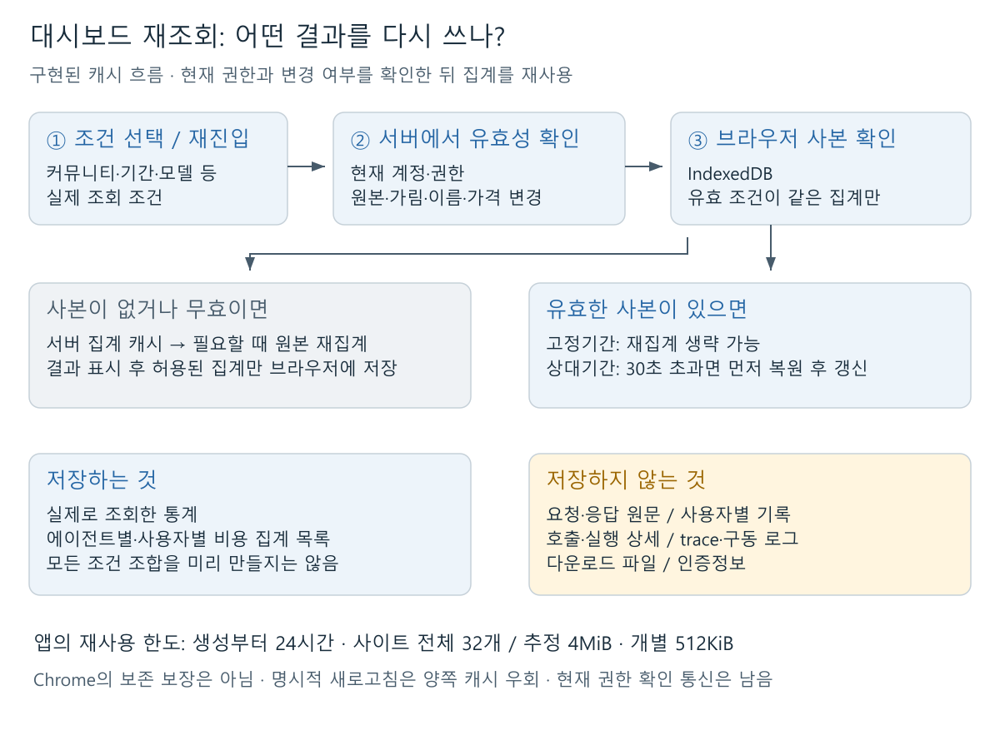
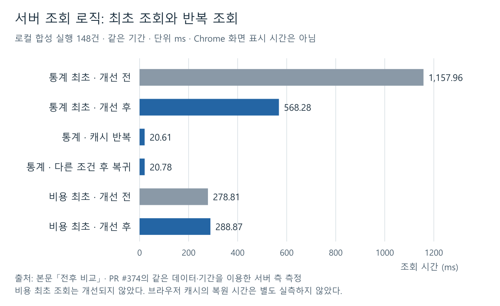

# 에이전트 대시보드 조회 최적화와 브라우저 캐시

작성: 2026-11-09

**통계 화면에 필요 없는 상세 데이터 조회를 줄이고, Chrome에 조회 결과를 제한 저장해 같은 조건으로 돌아올 때 재사용하도록 개선했다.**

<!-- SESSION1-VISUAL-GUIDE-20261110-CACHE -->
> [!info] 그림으로 읽는 순서
> **① 왜 느렸나 → ② 서버에서 무엇을 줄였나 → ③ Chrome에서 무엇을 재사용하나 → ④ 언제 다시 조회하나.**
> 아래 그림은 실제 구현 흐름을 설명한다. 원래 측정표와 근거는 그대로 보존했다.
> 아래 ‘병합·배포 전’은 최초 작성 당시의 기록이다. 이후 사용자가 PR #382 병합을 알렸으며, 이번 문서 보완에서 운영 배포를 새로 확인한 것은 아니다.

| 단계 | 먼저 이해할 핵심 | 읽을 곳 |
| --- | --- | --- |
| **1. 원인** | 통계 화면에서도 필요 없는 목록·상세를 만들고 있었다 | [느렸던 원인과 개선](#느렸던-원인과-개선) |
| **2. 조회 최적화** | 통계와 상세를 나누고 서버 집계를 재사용한다 | [전후 비교](#전후-비교) |
| **3. 브라우저 복원** | 조회했던 집계만 현재 권한·변경 여부 확인 후 다시 쓴다 | [브라우저 캐시 정책](#브라우저-캐시-정책) |
| **4. 경계** | 캐시가 있어도 권한 확인·필요한 갱신은 남는다 | 아래 흐름과 정책 |
<!-- /SESSION1-VISUAL-GUIDE-20261110-CACHE -->

## 느렸던 원인과 개선

| 원인 | 개선 |
| --- | --- |
| 통계만 표시해도 실행 이력 요약·목록까지 생성 | 통계 전용 조회로 분리하고 상세는 필요할 때 조회 |
| 비용 합계에서도 개별 모델 호출을 가공하고 공개 여부를 중복 판정 | 합계 계산을 분리하고 공통 판정을 재사용 |
| 같은 조건의 조회에서도 집계 반복 | 현재 권한·데이터·가격 변경을 확인하는 서버 캐시 적용 |
| 페이지 왕복 때 브라우저 저장이 없고, 상대기간 종료 시각이 매번 변경 | IndexedDB에 실제 조회 결과와 조회 범위를 저장하고 안정된 조건 키로 복원 |
| 브라우저 캐시 확인 전에 서버에서 통계 선집계 | 무거운 초기 집계를 제거하고 캐시가 없을 때 집계 요청 |

서버 조회 개선은 [PR #374](https://github.com/zen-compass/zen-ai/pull/374), 브라우저 캐시는 [PR #382](https://github.com/zen-compass/zen-ai/pull/382)에서 반영한다. 서버 메모리 캐시와 브라우저 저장은 별도 계층이다.

## 브라우저 캐시 정책

[Excalidraw로 편집](assets/session1-cache-log/01-cache-layers.excalidraw) · [벡터 그림](assets/session1-cache-log/01-cache-layers.svg)

> [!tip] 캐시가 있다고 통신이 없어지는 것은 아니다
> **현재 권한과 데이터 변경 여부를 확인한 뒤**, 비싼 집계의 중복 실행을 줄인다. 응답 원문·구동 로그까지 Chrome에 저장하는 기능은 아니다.

- 실제 조회한 통계와 에이전트별·사용자별 비용 집계 목록만 저장한다. 모든 검색 조건 조합을 미리 조회하지 않으며, 같은 데이터를 쓰는 탭은 결과를 공유한다.
- 계정·세션·접근 가능한 커뮤니티와 결과에 영향을 주는 조회 기간·모델·에이전트·사용자·집계 방식·페이지 등 해당 조회의 유효 조건을 구분한다. 표시 전 현재 권한과 실행·가림·표시명·가격 변경을 서버에서 확인한다.
- 최근 1·7·14·30일 및 전체 조회는 한국 날짜(KST)와 선택한 기간을 조건 키에 사용한다. 같은 날 재진입할 때 종료 시각의 밀리초 차이로 다른 캐시가 생기지 않으며, KST 날짜가 바뀌면 다른 키를 사용한다. 시작·종료가 고정된 기간은 입력 경계를 소수초까지 보존해 구분한다.
- 생성부터 최대 **24시간**, 동일 사이트 저장소 전체 **32개·추정 4MiB**, 개별 결과 **512KiB**로 제한한다. 만료된 항목부터, 이후 오래 사용하지 않은 항목부터 제거한다.
- 상대기간은 실제 조회 범위를 보존한다. 현재 권한·원본 변경 확인을 통과하고 생성 시각과 조회 종료 시각을 기준으로 30초 이내이면 저장 결과를 재사용한다. 30초가 지난 유효 사본은 조회시각·갱신 상태와 함께 먼저 복원하고 백그라운드에서 최신 범위로 갱신한다.
- 시작·종료가 고정된 기간은 현재 권한·원본 변경 확인을 통과하면 24시간 보관 한도 안에서 불필요한 재집계 없이 재사용한다. 캐시를 읽거나 유효성을 확인해도 최초 생성 시각부터 계산하는 24시간은 연장되지 않는다.
- 명시적 새로고침은 양쪽 캐시를 우회한다. 로그아웃은 전용 캐시와 늦은 저장을 차단하며 녹음 복구·초안 등 다른 저장소는 보존한다.
- 요청·응답 원문, 사용자별 기록, 실행·호출 상세, trace·구동 로그, 다운로드 파일, 인증값은 저장 대상이 아니다.

**24시간은 앱의 재사용 상한이며 Chrome의 보존 보장이 아니다.** 사이트 데이터 삭제·시크릿 모드 종료·저장 공간 부족·브라우저 정책으로 먼저 사라질 수 있으며, 이때는 정상 서버 조회로 돌아간다. 현재 권한 확인에 필요한 네트워크 비용은 남는다. 새 서버 DB 테이블·의존성·서비스워커는 추가하지 않았다.

## 전후 비교

PR #374 최종 소스에서 같은 로컬 합성 실행 148건과 같은 기간을 사용한 **서버 조회 로직** 측정이다.

| 항목 | 개선 전 | 개선 후 |
| --- | ---: | ---: |
| 통계 최초 조회·캐시 없음 | 1,157.96ms | 568.28ms |
| 통계 응답 크기 | 91,507B | 9,030B |
| 통계에 불필요한 이력 목록 | 25건 | 0건 |
| 비용 최초 조회·캐시 없음 | 278.81ms | 288.87ms |

개선 후 서버 캐시가 유효한 통계 반복 조회는 **20.61ms**, 다른 조건을 거친 복귀는 **20.78ms**였다. 비용 최초 조회는 개선되지 않았다. 위 수치는 브라우저 렌더링이나 운영 성능 측정이 아니다.

이번 브라우저 캐시의 기능·화면 복원은 사용자가 로컬에서 직접 확인했다(**USER_VERIFIED**). Chrome 복원 시간을 별도로 측정하지 않았으므로 “0ms”나 일정 배수의 속도 향상으로 표현하지 않는다.

**읽는 법:** 파란 막대가 개선 후다. 통계 최초 조회도 줄었지만 **비용 최초 조회는 빨라지지 않았다.** 이 그림을 운영·Chrome 렌더링 시간으로 해석하면 안 된다.

## 검증과 범위

- 승인된 교차 검토와 정식 build/postbuild, 실제 API 25개 및 [최종 CI](https://github.com/zen-compass/zen-ai/actions/runs/42597523989)를 통과했다.
- 통합 검사에서 발견한 줄바꿈 차이는 Git 원본 복원 후 관련 26개 회귀로 해결했고, 원래 실패 기록은 보존했다.
- 현재 상태: PR #382 일반 PR, 최종 병합·배포 전.

실제 Chrome BFCache 발생·저장소 자동 퇴거·운영 배포 후 성능은 별도 검증 대상이다. 최종 병합·배포는 사용자가 진행한다.

후속 집계 SQL 변경과 통합할 때는 캐시 무효화 경계를 별도로 확인해야 한다. 원본 기록이 그대로여도 집계 대상·계산 규칙의 의미가 바뀌면 기존 데이터 변경 표식만으로는 과거 집계를 구분하지 못할 수 있다. 브라우저·서버 양쪽 캐시의 집계 버전 갱신 또는 이에 준하는 무효화가 적용되는지 확인하며, 이 통합 확인은 아직 완료로 기록하지 않는다.

정책 근거: [MDN 저장소 수명·퇴거](https://developer.mozilla.org/en-US/docs/Web/API/Storage_API/Storage_quotas_and_eviction_criteria), [구현 조사 문서](https://github.com/zen-compass/zen-ai/blob/54789e97d37dfbdf6f40db4e4e16b26ac9680ec5/docs/notes/2026-11-09-dashboard-browser-cache-research.md).
