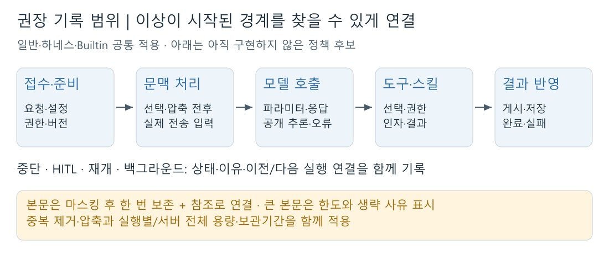

# 에이전트 구동 로그 기록 범위 재정의와 후보 기준

작성: 2026-11-09 · 핵심 정리: **2026-11-10**

> [!info] 문서의 상태
> **기록 정책을 정하기 위한 제안이다.** 아래 범위·용량 제한·보관 정책은 아직 제품에 적용하지 않았다.

## 1. 지금 우리가 해야 할 일

**현재의 상세 로그를 ‘원인 위치를 좁힐 수 있는 최소 충분 기록’으로 재정의한다.**

1. **필수 기록을 정한다:** 실행 경로·중요 판단·실제 입출력·최종 반영을 연결한다.
2. **불필요한 반복을 줄인다:** 같은 본문은 한 번 저장하고 참조·중복 제거·압축을 적용한다.
3. **누적량을 제한한다:** 본문·실행·논리 요청·서버 전체 용량과 보관기간을 함께 정한다. 알려진 문제의 진단 능력이 유지되는지도 비교한다.

조사에서 같은 지침·문맥·모델 입력의 반복 저장을 확인했다. 운영 다운로드 표본 5개의 JSONL은 **9.50MB → gzip 1.79MB**였다. **본문을 전부 없애기 전에 중복과 저장 형식부터 개선할 여지가 있다.** 이 수치는 오프라인 실험이며 실제 운영 과부하나 새 정책의 절감률을 증명하지는 않는다.

## 2. 로그의 목적과 그 목적을 이루기 위한 판단 기준

> **이상이 보였을 때 ‘어떤 입력과 판단 뒤에, 어느 단계에서 기대와 달라졌는가’를 좁히는 것이 목적이다.**

| 판단 기준 | 로그로 답할 수 있어야 하는 질문 |
| --- | --- |
| **위치** | 마지막으로 정상 처리된 단계와 처음 이상해진 단계는 어디인가? |
| **판단 이유** | 어떤 권한·한도·조건 때문에 그 분기를 선택했는가? |
| **실제 내용** | 어떤 문맥·파라미터가 들어갔고 무엇이 반환됐는가? |
| **실제 반영** | 실행 시도·외부 접수·저장·게시 중 어디까지 확인됐는가? |
| **증거의 한계** | 본문이 정책상 생략됐나, 저장에 실패했나, 현재 파일을 찾을 수 없나? |

**이 질문에 새 정보를 더하지 않는 반복 기록은 줄인다.** 반대로 경로·권한·문맥·상태·결과를 바꾸는 분기는 남긴다. 최종 성공으로 끝났더라도 중간 오류·재시도와 잘못된 답변을 조사할 수 있어야 한다.

## 3. 그 기준을 충족하려면 어디까지 기록해야 하나

[Excalidraw로 편집](assets/session1-cache-log/02-log-scope-summary.excalidraw)

**일반·하네스·Builtin의 공통 실행 경계에 적용**하고, 각 에이전트의 중요한 고유 분기도 같은 기준으로 연결한다.

| 기록할 구간 | 반드시 남길 핵심 |
| --- | --- |
| **접수·실행 준비** | 요청·실행·시도 간 연결, 에이전트·배포/설정 버전, 실제 모델·한도, 대상 선택·권한 판단 |
| **문맥·scratchpad·압축** | 자료 선택·제외 이유와 순서, 요약·절단 전후, 저장·복원한 맥락, **실제 모델 입력과의 연결** |
| **모델 호출** | 실제 입력·안전한 파라미터, 응답·도구 선택·수신한 공개 추론, 오류·재시도·종료 사유·시간·사용량 |
| **도구·스킬** | 선택·읽은 범위, 권한 허용/거절, 실제 실행 여부, 인자·결과·오류·소요 시간 |
| **중단·HITL·재개·백그라운드** | 상태 전이·이유·시각, 이전/다음 실행 연결, 외부 접수 여부와 결과 불명 상태 |
| **결과 게시·종료** | 게시·저장 시도와 **실제 반영 확인**, 최종 성공·실패·취소 사유 |
| **로그 자체** | 수집 정책, 생략 범위·크기·이유, 부분 수집·쓰기 실패·확인된 보관 종료 여부 |

**본문은 한도 안에서 한 번 보존하고 각 단계가 참조한다.** 작은 인자·결과와 문맥 변환 전후는 읽을 수 있게 남긴다. 큰 본문은 보존 범위와 빠진 이유를 표시한다. **길이·해시만으로 빠진 내용까지 진단할 수는 없다.**

줄일 대상은 **같은 지침·문서·입출력의 재복사, 매 루프의 동일 scratchpad 전체, 매 토큰 이벤트, 변하지 않은 정상 heartbeat·검사 반복**이다. 단순 함수마다 전체 객체를 덤프할 필요는 없다.

**공통 조건:** 인증정보는 저장 전에 마스킹한다. 서버 비공개 파일과 현재 다운로드 권한을 유지하며 새 DB 로그 테이블은 전제하지 않는다. 제공자가 반환하지 않은 내부 추론과 미계측·외부 시스템 내부까지 보장하지 않는다.

## 4. 기록 정도에 따른 네 가지 안

| 안 | 기록 수준 | 할 수 있는 진단 | 한계·부담 |
| --- | --- | --- | --- |
| **A. 구조만** | 경계·상태·판단·오류와 크기/해시 | 실패·지연·권한 문제의 **위치** 파악 | 실제 문맥·인자·답변 내용 문제를 판단하기 어렵다 |
| **B. 구조 + 한도 있는 핵심 본문** | A + 중요한 내부 분기, 실제 입출력·문맥 변환 전후를 제한 보존 | **위치·판단 이유·내용 문제**를 함께 좁힘 | 한도를 넘어 보존하지 않은 본문은 확인할 수 없다 |
| **C. B + 대상 한정 상세 수집** | B를 기본으로 특정 에이전트·문제·기간의 상세 증거 강화 | 재현이 어려운 문제를 집중 조사 | 수집 제어가 복잡하며 이미 버린 과거 본문을 되살릴 수 없다 |
| **D. 현재 상세 범위 유지 + 중복 제거·압축** | 현재와 가까운 상세 본문에 중복 제거·압축·용량·보관 제한 적용 | 기존 내용 진단 능력을 최대한 보존 | 불필요한 생성·직렬화 비용이 남아 기록량 증가 문제를 전부 해결하지 못한다 |

## 5. 현재 ZEN AI에 가장 적합한 안

> [!tip] 권장안
> **B안을 기본으로 선택하고, D안의 중복 제거·압축을 결합한다.**
> 구체적인 조사에서 부족함이 확인될 때만 **C안의 대상·기간 제한 상세 수집**을 추가한다.

에이전트 기록에서 이상을 발견했을 때는 오류 위치뿐 아니라 **잘못 조립한 문맥, 누락된 요약 조건, 틀린 도구 인자**까지 확인해야 한다. 그래서 본문이 없는 A보다 B가 목적에 맞는다. 모든 상세 내용을 계속 만드는 D만으로는 불필요한 생성·쓰기 부담을 충분히 줄이기 어렵다.

예를 들어 **모델의 도구 미선택 / 권한 거절 / 도구 오류 / 게시 실패**를 구분하고, 문맥 문제라면 **압축 전후와 실제 전송 입력**을 비교할 수 있어야 한다. B는 이 증거를 우선 남기면서 반복 본문을 줄이는 안이다.

**다음 결정은 세 가지다:** ① 어떤 본문을 우선 보존할지, ② 실행별·서버 전체 용량을 얼마로 제한할지, ③ 얼마 동안 보관할지. 운영 요청량·디스크 여유·문제 발견까지 걸리는 시간을 확인한 뒤 확정한다.

세부 분석·표본·코드 근거는 [기존 상세 조사 보존본](assets/session1-cache-log/runtime-log-detailed-research-before-rewrite-20261110.md)에서 확인할 수 있다.
