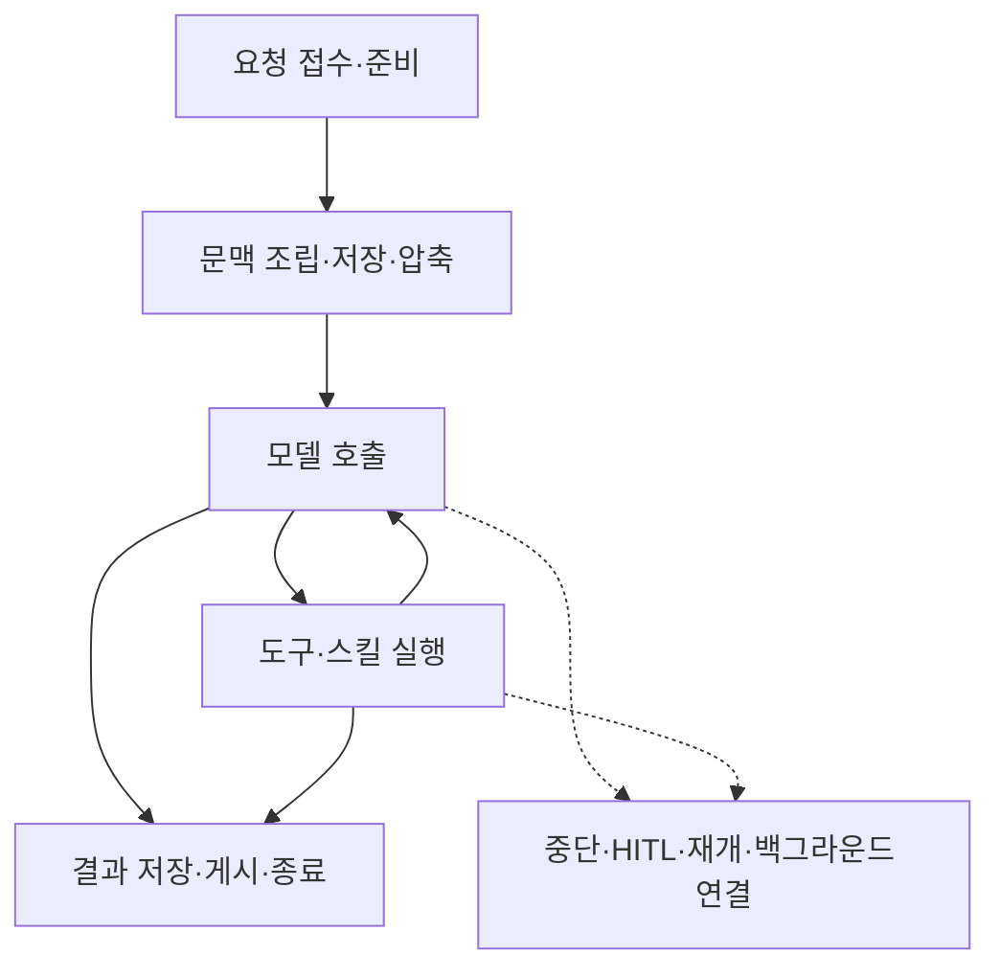

# 에이전트 구동 로그 기록 범위 재정의와 후보 기준

작성: 2026-11-09 · 기록 조건·측정 결과·가독성 갱신: **2026-11-12**

> [!info] 기록 원칙
> **모든 실행에서 구조 정보와 제한된 본문을 함께 기록한다.** 본문은 작은 조각으로 저장하며, 한도에 닿으면 저장된 앞부분과 불완전한 범위·사유를 남긴다. 구현·검증 현황은 4-2절에서 확인할 수 있다.

## 왜 로그의 기록 범위를 바꾸려는가?

**문제가 생겼을 때 원인을 찾을 증거를 유지하면서, 서버에 쌓이는 로그의 양을 줄이기 위해서다.**

어디에서 문제가 생길지 미리 알 수 없으므로, 특정 실행만 골라 기록하거나 오류가 난 뒤 상세 수집을 시작하는 방식을 기본안으로 삼지 않는다. **모든 실행에 공통된 진단 기준을 적용하고, 같은 증거를 반복 저장하는 비용을 줄인다.**

## 1. 에이전트 실행 중 무엇을 기록해야 하는가?

### 1-1. 원인을 좁힐 수 있는 판단 기준

로그 수집 지점을 설계할 때 **“이 기록이 문제의 원인을 좁히는 데 도움이 되는가?”**를 다음 다섯 기준으로 판단한다.

| 기준 | 확인하려는 내용 |
| --- | --- |
| **위치** | 어디까지 정상적으로 진행됐고, 어디에서 처음 기대와 달라졌는가? |
| **판단 이유** | 어떤 조건·권한·한도·판단값 때문에 그 경로를 선택했는가? |
| **실제 내용** | 어떤 문맥·파라미터·인자가 들어갔고, 무엇이 반환됐는가? |
| **실제 반영** | 실행을 시도한 것인가, 실제 접수·저장·게시까지 확인된 것인가? |
| **증거의 한계** | 기록이 없는 이유가 정책상 생략, 저장 실패, 미계측, 파일 부재 중 무엇인가? |

**선택한 경로 → 판단 이유 → 오고 간 값 → 실제 처리 결과**를 서로 연결해서 남겨야 한다. 최종 성공 여부만으로는 중간 오류나 잘못된 답변의 원인을 설명할 수 없다.

이 기준은 **사람과 개발자가 수집 지점을 설계하는 기준**이다. 실행 중 로거가 내용을 이해해 필요한 기록을 자동으로 골라내는 것은 아니다.

### 1-2. 그 기준에 따라 기록할 주요 처리 구간



위 그림은 주요 구간의 관계를 설명한다. 모든 요청이 도구를 실행하거나 같은 순서로 끝나는 것은 아니며, HITL·백그라운드의 후속 작업은 별도 실행으로 이어질 수 있다.

| 기록할 구간 | 남겨야 할 증거 |
| --- | --- |
| **요청 접수·준비** | 요청·실행·시도 간 연결, 에이전트·설정 버전, 대상 선택·권한 판단, 실제 모델·한도 |
| **문맥 조립·저장·압축** | 자료 선택·제외와 순서, scratchpad 저장·복원, 요약·절단 전후, 실제 모델 입력과의 연결 |
| **모델 호출** | 실제 입력·안전한 파라미터, 응답·도구 선택·반환된 공개 추론, 사용량·시간·오류·재시도·종료 사유 |
| **도구·스킬 실행** | 선택·로딩·권한 허용/거절, 실제 실행 여부, 인자·결과·오류·소요 시간 |
| **중단·HITL·재개** | 상태 변화·이유·시각, 이전/다음 실행 연결, 백그라운드 접수·완료 여부 |
| **결과 저장·게시·종료** | 저장·게시 시도와 실제 반영 확인, 최종 성공·실패·취소 사유 |
| **로그 수집 상태** | 수집 정책, 생략 범위·이유, 쓰기 실패·부분 수집·종료 여부 |

**일반·하네스·Builtin에 공통 적용할 기준**이다. 공통 로거는 계측된 주요 처리 지점에서 구조 정보와 본문을 기록한다. 모든 제품 코드와 미래의 고유 분기를 자동으로 빠짐없이 기록한다는 뜻은 아니다.

인증정보는 저장 전에 마스킹한다. 제공자가 반환하지 않은 모델 내부 추론이나 외부 시스템 내부는 기록할 수 없다.

## 2. 본문과 저장량을 어떻게 줄이는가?

### 2-1. 긴 본문은 나누어 보존하고 recording 전체에 상한 적용

**본문은 각 처리 지점에서 로거에 전달하는 실제 데이터 묶음**이다. 메시지·파라미터, 도구 인자·반환 객체, scratchpad, 오류 상세 등이 해당한다. 실행 위치·시각·분기 결과·오류 분류·참조 ID 같은 구조 정보와 구분한다.

**본문은 작은 조각으로 마스킹·직렬화해 저장하며, recording의 남은 본문 예산 안에서 보존한다.** 긴 회의 자료도 이 조건을 따르며, 모든 조각이 저장되면 마스킹된 전체 JSON을 복원할 수 있다.

| 대상 | 적용 조건·한도 | 의미 |
| --- | --- | --- |
| **본문 하나** | **recording의 남은 본문 예산 이내** | 작은 조각으로 저장하며 본문 합계에 포함 |
| **본문 합계** | **8MiB / recording** | 서로 다른 본문들의 합계. 최초 오류 본문용 4KiB 포함 |
| **직렬화 이벤트 합계** | **16MiB / recording** | 본문과 구조 정보를 합친 압축 전 이벤트. 오류·종료용 여유 포함 |
| **서버 파일** | **16MiB / recording** | 실제 압축 파일 크기에도 별도 상한 적용 |

본문 크기는 **마스킹된 JSON의 UTF-8 바이트**로 센다. 고정 상한과 입력 검사 비용 제한은 무제한 메모리·CPU·디스크 사용을 막기 위한 것이며, 모든 문서를 끝까지 기록한다는 보장은 아니다.

~~~text
상한 이내: 앞서 저장한 기록 + 현재 본문 전체 → 완성 본문으로 복원
상한 도달: 앞서 저장한 기록 + 현재 본문의 저장된 앞부분 → 불완전 표시
                                      └─ 이후 저장하지 못한 내용은 복원 불가
~~~

조각에는 **본문 ID·순서·저장된 UTF-8 범위·전체 크기(모르면 미확정)·완성 여부·부분 보존 사유**를 붙인다. 앞부분이 JSON 중간에서 끝나면 완성 객체로 읽지 않는다. 파일 쓰기 실패로 마지막 표식조차 남지 않았을 때도 수집 실패·종료 표식 부재와 실제 남은 범위를 함께 확인한다. 물리적인 파일 줄이 중간에서 잘렸다면, 그 뒤에 새 기록을 이어 붙이지 않는다.

최초 오류·종료용 예약은 **정책 상한 때문에 최소 진단이 밀려나는 것을 막는 여유**다. 디스크 고장·권한 오류처럼 저장 자체가 불가능한 상황까지 보장하지는 않는다.

> [!warning] 용량에 따른 부분 보존과 보안 생략은 다르다
> 용량 상한에서는 **이미 저장한 기록을 지우지 않는다.** 반면 비밀값 발견·가림을 안전하게 완료하지 못한 본문은 **보안 사유로 전체 생략**할 수 있다. 검사 깊이·노드·처리량에도 한도가 있으며, 이 한도를 완화해 비밀값을 남기지는 않는다.

#### 2-1-1. recording은 사용자 요청 또는 run과 같은가?

**recording은 recorder 하나가 시작부터 종료까지 수집한 기록 단위**다. 대표적으로 다음과 같이 나뉜다.

```text
사용자 요청에 연결된 기록
├─ 요청 접수 recording
├─ 워커의 실행 인수 recording
└─ 에이전트 실행 recording
   └─ 여러 차례 모델·도구 루프를 포함할 수 있음
```

워커의 실행 인수란 **대기 중인 실행을 특정 워커가 맡고 중복 실행을 방지하는 과정**이다. 실제 recording 개수는 실행 경로·재시도 등에 따라 달라지며, 항상 세 개는 아니다. 루프마다 recording을 새로 만드는 것도 아니다.

다운로드는 선택한 실행을 출발점으로 **같은 요청으로 연결된 관련 실행과 recording**을 모아 제공한다. 같은 스레드의 모든 후속 질문이 자동으로 한 파일에 포함되는 것은 아니다.

**위 한도는 recording마다 적용한다. 사용자 요청·run·다운로드 파일 전체를 합친 한도는 현재 없다.**

### 2-2. 동일 본문은 한 번 저장하고 참조

같은 recording 안에서 **마스킹 후 동일하며, 모든 조각의 저장 성공이 확인된 완성 본문**이 다시 나오면 본문을 복사하지 않고 기존 본문을 참조한다. 부분 본문·저장 실패·아직 비동기 저장 중인 본문은 완성 참조로 취급하지 않는다.

```text
문맥 조립: 본문 P1을 저장
모델 입력: 동일한 내용이면 P1 참조
후속 관측: 동일한 내용이면 P1 참조
```

각 기록의 위치·시각과 본문의 연결은 유지한다. 따라서 **어느 단계에서 어떤 자료를 사용했는지 확인하면서 같은 내용을 반복 저장하는 비용을 줄인다.** 저장 실패·생략된 본문을 정상 참조하지 않으며, 다른 recording 간에는 중복 제거하지 않는다.

### 2-3. 스트림 조각은 묶어서 기록

모델의 답변·공개 추론·도구 입력은 잘게 도착하므로, 조각마다 부가 정보를 반복 기록하는 대신 **종류·식별자별로 모아 제한된 크기의 묶음으로 기록**한다.

| 구분 | 예시 |
| --- | --- |
| 모델에서 도착 | `회의` → ` 내용을` → ` 정리` → `하겠습니다.` |
| 조각별 기록 | 각 조각마다 시각·실행 위치·식별자 등을 붙여 저장 |
| 묶음 기록 | `회의 내용을 정리하겠습니다.`처럼 모아서 저장 |

긴 텍스트는 여러 묶음으로 나누고 종료할 때 남은 내용도 기록한다. 사용자 화면에 실시간으로 전달하는 흐름은 유지한다.

**원래 조각별 도착 시각과 경계는 보존하지 않는다.** 본문 예산 안의 텍스트 내용·순서는 보존하지만, 조각별 지연 분석에는 한계가 있다. 비정상 종료 시 아직 묶는 중인 내용 일부가 저장되지 않을 가능성도 있다.

### 2-4. 서버 파일은 무손실 압축해서 저장

기록할 내용을 정한 뒤 **이벤트별로 압축해 서버 파일에 저장하고, 다운로드할 때 다시 풀어 JSON으로 제공**한다. 압축 포장까지 포함해 오히려 커지는 이벤트는 원문으로 저장한다.

**보존한 내용은 그대로 복원하는 무손실 압축**이며, 본문 제한으로 이미 생략한 내용을 복구해 주지는 않는다. 서버 파일의 절감률이 다운로드 JSON의 절감률과 같은 것도 아니다.

압축은 저장 크기를 줄이는 방법이며, **누적 저장량·보관기간·자동 삭제는 별도의 운영 정책이 필요하다.**

**구동 로그는 서버 파일에, 호출 기록은 DB에 저장한다.** 이 문서의 본문 보존 조건은 구동 로그에 적용한다. 호출 기록의 질문·답변·도구 요약에는 별도의 길이 제한과 절단 표시가 있으므로, 그 요약의 절단을 구동 로그 원문 유실로 해석하지 않는다.

## 3. 가능한 후보와 권장안

### 3-1. 후보 비교

| 후보 | 방식 | 장점 | 한계 |
| --- | --- | --- | --- |
| **A. 구조만 기록** | 경계·상태·판단·오류 분류·참조 정보 중심 | 가볍고 실패 위치를 좁히기 쉽다 | 실제 문맥·도구 인자·답변 내용의 문제를 확인하기 어렵다 |
| **B. 구조 + 제한된 본문** | 구조와 실제 입출력·문맥 변환 전후를 한도 안에서 보존 | 위치·판단 이유·내용 문제를 함께 조사할 수 있다 | 상한 이후 저장하지 못한 뒷부분은 확인할 수 없다 |
| **C. 상세 본문 + 중복 제거·압축** | 상세 내용을 보존하며 저장 표현을 줄임 | 실제 내용의 문제를 진단하는 데 유리하다 | 고유한 큰 본문을 계속 만들고 처리하는 부담이 남는다 |

### 3-2. 권장안: B + C의 중복 제거·압축

> [!tip] 권장 방향
> **B를 기본으로, C의 중복 제거·무손실 압축과 스트림 묶음을 결합한다.** 모든 실행에 같은 기준을 적용하고, 증거를 반복 저장하는 비용을 줄인다.

ZEN AI에서는 실패 위치뿐 아니라 **잘못 조립한 문맥·도구 인자·반환 내용**까지 조사해야 한다. 본문이 없는 A로는 부족하고, 상세 본문을 계속 보존하는 C만으로는 고유한 대형 데이터의 부담을 제한하기 어렵다.

다만 B의 한도는 저장된 앞부분을 유지하더라도 이후 증거 일부를 포기하는 선택이다. **확인한 진단 사례의 증거를 유지했는지와 얼마나 줄었는지를 함께 비교해야 하며, 모든 문제의 원인 규명을 보장하지는 않는다.**

## 4. 조사 결과·개선 효과·검증

### 4-1. 기존 로그에서 발견한 반복

기존 다운로드 로그에서는 **같은 지침·회의 자료·대화 문맥이 여러 단계에서 반복 저장**됐다. 앞서 저장한 본문을 참조하면 어느 단계에서 어떤 자료를 사용했는지는 남기면서 복사 비용을 줄일 수 있다고 판단했다.

즉, 개선의 중심은 **실행 과정과 판단의 연결을 남기고, 동일 내용의 반복 저장을 줄이는 것**이다. 단순히 로그 줄 수가 적어지는 것만으로 개선을 판단하지 않는다.

### 4-2. 적용 조건과 검증 결과

#### 적용하는 기록 조건

| 항목 | 기록 조건 |
| --- | --- |
| **긴 회의·도구 본문** | 작은 조각으로 저장하며, 남은 본문 예산 안에서 전체 보존 |
| **recording 상한 도달** | 앞서 저장한 기록과 현재 본문의 저장된 앞부분 유지 |
| **증거의 한계 표시** | 저장 byte 범위·전체 크기·완성 여부·부분 보존 또는 생략 사유를 연결 |
| **중복 제거** | **완전히 저장된 본문만 참조**. 부분·실패·저장 중인 본문은 완성 참조로 사용하지 않음 |
| **파일 쓰기 실패** | 실제 저장이 확인된 완전한 줄까지만 증거로 인정. 이후 독립 본문은 안전하게 쓸 수 있을 때만 기록 |
| **최초 오류·종료 요약** | 상한 안에 별도 여유를 두고, 오류가 앞서 저장한 본문을 참조하는 경우에도 적용 |

일반·하네스·Builtin의 공통 로거에 같은 조건을 적용한다. 스트림은 묶어서 기록하고, 서버 파일은 무손실 압축한다.

#### 실제로 얼마나 줄었는가? — 2026-11-12 측정

> [!summary] 같은 내용을 보존한 표본에서 **70.62% 감소**
> 개선 전과 현재 로거에 **동일한 입력**을 넣었을 때, 서버 파일 합계가 **256.25MB → 75.28MB**로 줄었다. 약 **180.97MB를 절약**했다.
> 본문·스트림 내용과 주요 실행 흐름이 같은 표본만 집계했으며, **내용을 생략해서 줄인 용량은 포함하지 않았다.**

**일반·하네스·Builtin의 공통 로거 경로에서 각 시나리오를 3회씩 비교**했다. 아래 5개 시나리오의 유효 비교는 **45쌍**, 전후 파일은 **252개**다. 이번에는 실제 에이전트나 모델을 새로 호출하지 않고 같은 입력을 로거에 재생했다.

| 비교한 상황 | 개선 전 | 현재 | 저장량 감소율 |
| --- | ---: | ---: | ---: |
| **기본 실행·진단 기록** | 0.073MB | 0.055MB | **23.75%** |
| **긴 본문** — 한글·이스케이프·낮은 압축률 문자열 | 102.64MB | 45.76MB | **55.42%** |
| **대형 도구 결과·후속 문맥** | 63.03MB | 26.97MB | **57.21%** |
| **동일 문맥 12회 반복** | 66.46MB | 1.18MB | **98.22%** |
| **긴 스트림·조각 경계 마스킹** | 24.05MB | 1.31MB | **94.55%** |
| **전체 합산** | **256.25MB** | **75.28MB** | **70.62%** |

MB는 1,000,000바이트 기준이다. **전체 감소율은 `1 − 현재 파일 합계 ÷ 개선 전 파일 합계`**로 계산했다. 각 퍼센트를 단순 평균한 값이 아니며, 시나리오별 기록 크기도 서로 다르다.

| 공통 로거 경로 | 유효 비교쌍 | 합산 감소율 |
| --- | ---: | ---: |
| 일반 | 15 | **70.67%** |
| 하네스 | 15 | **70.67%** |
| Builtin | 15 | **70.53%** |

세 경로의 차이보다 **본문의 반복 정도·압축 가능성**에 따른 차이가 컸다. 동일 문맥을 여러 번 쓰면 효과가 크지만, **압축이 잘되지 않는 문자열만 따로 집계한 대조군은 약 4.97% 감소**에 그쳤다. 모든 로그가 70%씩 줄어든다고 해석하면 안 된다.

**유효 표본의 본문·스트림 내용, 참조 해석, 주요 이벤트 순서는 일치**했다. 생략·부분 본문·저장 실패·큐 유실·미종료 작업·해석 오류는 모두 **0건**이었다. 객체 키 순서만 정규화해 비교했고, 배열 순서와 값은 유지했다.

총 54쌍 중 나머지 **9쌍은 비정상 유니코드 시험 입력**을 두 버전이 다르게 저장해 제외했다. 크기가 커서 제외한 것이 아니며, 내용이 동등하지 않은 비교를 절감 실적으로 계산하지 않았다.

> [!warning] 이 수치는 **운영 평균이 아닌 표본 합산 절감률**이다
> 운영 원본 표본과 실제 사용 비중을 확보하지 못했다. 합성 입력에는 반복성이 높은 본문도 포함되므로, **운영에서도 70.62%가 줄어든다고 보장할 수 없다.**
> 또한 이번 비교는 내용·주요 흐름의 보존을 확인한 것이며, 스트림의 원래 조각별 도착 시각과 경계까지 같다는 뜻은 아니다.

#### 기존 실제 에이전트 실행 로그에서도 효과가 보이는가?

별도로 **실제 모델을 사용했던 로컬 실행 23건**의 서버 파일 **69개**를 다시 확인했다. API 실행 19건과 사용자 Chrome 실행 4건이며, 정상 응답·긴 입력·도구·루프·HITL 등의 기록을 포함한다. 운영 트래픽이나 이번에 새로 실행한 결과는 아니다.

| 비교 대상 | 저장량 |
| --- | ---: |
| **동일하게 보관된 이벤트**를 압축 없이 저장할 경우 | **46.95MB** |
| 현재 서버 파일 | **23.82MB** |
| **파일 인코딩·압축만의 감소율** | **49.26%** |

이 비교는 **같은 이벤트의 저장 표현만 비교**한다. 원래 모델 스트림의 조각 경계나 이미 생략된 본문을 되살릴 수 없으므로, 개선 전 전체 실행을 정확히 재현한 수치로 사용하지 않았다. **위의 70.62%와 더해서 계산하지 않는다.**

기존 로그의 본문 참조 **2,303개**는 해석됐고, 부분 본문·해석 오류는 **0건**이었다. 별도로 저장 중인 동일 본문의 중복 기록 **15건**은 `duplicate_pending_storage`라는 생략 사유가 있었다. 이 기존 집단을 앞의 **생략 0건인 전후 비교 표본**과 섞지 않았다.

#### 상한은 왜 본문 8MiB로 정했는가?

**상한을 낮추는 것과 같은 내용을 더 작게 저장하는 것은 다르다.** 정상 범위에서는 4MiB·8MiB 후보의 보존 내용과 저장량이 사실상 같았고, 큰 본문이 한도에 걸렸을 때만 보존량이 달라졌다.

| 본문 / 이벤트 / 파일 상한 | 10MiB 압박 본문에서 보존한 범위 | 판단 |
| --- | --- | --- |
| **4 / 8 / 8MiB** | 약 4MiB 앞부분 | 실제 앱에서 한 recording의 본문 합계가 **4.86MB**에 도달해 부족할 수 있음 |
| **8 / 16 / 16MiB** | 약 8MiB 앞부분 | 확인한 실제 대형 기록을 보존해 **현재 기본값으로 선택** |
| **16 / 32 / 32MiB** | 10MiB 전체와 중복 참조 | 더 많이 보존하지만, 기본 상한을 확대할 실측 근거는 부족 |

상한에 도달하더라도 **앞서 저장한 기록과 현재 본문의 저장된 앞부분은 유지**한다. 이후 보존하지 못한 범위·이유를 표시한다. 모든 미래 실행에 이 한도가 최적이라는 뜻은 아니다.

#### 검증 범위는 어디까지인가?

| 확인 항목 | 핵심 결과 |
| --- | --- |
| **현재 코드 전후 용량 비교** | 동일 입력의 유효 **45쌍**, 본문·주요 흐름 동등. 생략·부분 저장·저장 실패 **0건** |
| **상한·실패 경계** | 별도의 합성 시험에서 저장된 앞부분 유지, 잘못된 참조 방지, 최초 오류·종료 요약 확인 |
| **제품 자동 검사·빌드** | 최종 구현에서 **8,895개 통과**, check·lint·knip·교차 평가·정식 빌드 성공 |
| **실제 실행·다운로드** | API **19실행**, 사용자 Chrome **4실행**. Chrome의 호출 기록·구동 로그 **8파일** 정상 다운로드와 서버 원본 대조 |
| **코드 반영 상태** | [PR #406](https://github.com/zen-compass/zen-ai/pull/406) **main 병합 완료**. 운영 배포·운영 평균은 별도 확인 대상 |

취소·실제 문맥 압축 실행·비어 있지 않은 scratchpad는 실제 앱 검사에서 관측하지 못했다. **로거 재생 시험, 실제 에이전트 실행, 사용자 화면 확인을 각각 구분**하며, 이번 용량 측정에서 제품 전체 검사·Chrome 조작을 새로 수행한 것으로 계산하지 않는다.

> [!info]- 세부 근거 — 상한 후보와 합성 경계 시험
> #### 같은 입력으로 전후를 비교했는가?
>
> 공통 recorder에 같은 합성 입력을 넣어 **111개 독립 자식 프로세스 비교 셀**, 후보 **486개 recording**과 기준 코드 **486개 recording**을 검사했다. 4MiB·8MiB 후보는 각각 같은 전체 54셀, 16MiB 후보는 압박 3셀이다. 이 측정본은 `8bcf9781`과 공통 모듈의 바이트가 일치함을 확인했다. 이후 최초 오류 참조 보완은 별도 회귀·영향 검사로 구분한다. 일반·하네스·Builtin 식별자로 재현한 것으로, 실제 에이전트 엔진·모델·Chrome 실행과는 구분한다.
>
> | 확인한 상황 | 관측 |
> | --- | --- |
> | **128KiB 전후·512KiB·2MiB, 한국어·emoji·escape·낮은 압축률** | 대용량 본문 135개 전체 복원·마스킹 후 hash 일치 |
> | **512KiB 문맥 + 2MiB 도구 결과 + 중복 + 후속 문맥** | 전체 보존과 유효한 완성 참조 확인 |
> | **같은 문맥 12회** | recording마다 최초 저장 후 11개 참조. 기본 상한 비교 9회에서 총 99개 참조 |
> | **스트림·조각 경계 비밀값** | 내용·순서와 마스킹 확인. 원래 delta별 시각·경계는 보존 대상 아님 |
> | **상한·쓰기 실패 강제 주입** | 저장된 앞부분 유지, 부분 본문 참조 없음. 첫 오류 또는 명시적 오류 생략과 종료 요약 보존 |
> | **읽기·완결성·업무 결과** | 후보 486건의 해석 오류 0, 실제 저장량과 footer 일치. 반환값·generator 결과 보존 |
>
> **저장량은 같은 내용을 보존했는지와 함께 평가한다.** 본문을 더 많이 보존하면 파일이 커질 수 있다. 압축·중복 제거의 효과와 생략에 따른 감소를 구분한다.
>
> #### 상한은 어떻게 정했는가?
>
> | 본문 / 이벤트 / 파일 상한 | 정상 대형 control | 10MiB 압박 본문 | 해석 |
> | --- | --- | --- | --- |
> | **4 / 8 / 8MiB** | 2.5MiB 보존 | 약 4MiB 앞부분 보존 | 전체 54셀의 정상 증거는 8MiB 후보와 동일하게 보존 |
> | **8 / 16 / 16MiB** | 2.5MiB 보존 | 약 8MiB 앞부분 보존 | 전체 54셀 검증. 실제 앱의 최대 본문 합계 4.86MB도 보존해 현재 상한으로 선택 |
> | **16 / 32 / 32MiB** | 2.5MiB 보존 | 10MiB 전체와 중복 참조 보존 | 큰 압박 사례의 보존에는 유리하나 정상 control만으로 확대 근거 부족 |
>
> 4MiB·8MiB의 대응하는 정상 recording 180개씩은 본문 hash·완전성·참조·스트림이 같았고, 직렬화 이벤트 합계도 **163,559,895B로 동일**했다. 정상 서버 파일 합계는 각각 약 79.66MB로 사실상 같았다. **상한을 낮춘다고 정상 로그가 줄지는 않았고, 큰 압박 본문의 보존량만 줄었다.**
>
> 세 profile 모두 최초 오류용 여유가 상한에 포함된다. 과거 실제 회의 기록의 마스킹 JSON을 정적으로 재조립하면 본문 합계 **4,620,629B**, 동일 문자열을 제외한 합계 **3,952,509B**였다. 4MiB 정상 예산과의 차이는 약 238KB뿐이었다. 이 과거 추정과 별도로, 최신 실제 앱 검사에서는 한 recording의 저장 본문 합계가 **4,863,643B**에 도달했다. **실제 사례가 4MiB를 넘었고, 8MiB 안에서는 보존됐다.** 따라서 현재 상한은 **본문 8MiB / 이벤트 16MiB / 파일 16MiB**로 정한다. 모든 미래 실행에 최적이라는 뜻은 아니며, 16MiB 본문 상한으로 확대할 실측 근거는 부족하다.
>
> CPU·시간·RSS도 측정했으나 공유 호스트 부하와 입력 생성·저장을 포함하므로 운영 성능 보장이나 독립 성능 비교로 쓰지 않는다.

> [!info]- 세부 근거 — 최종 구현·실제 실행·Chrome 검증
> #### 최종 검증과 PR
>
> | 구분 | 최종 확인 결과 |
> | --- | --- |
> | **공식 자동 검사** | `b529b384`에서 check·lint·knip·Builtin 통과, 전체 **8,895개 통과·실패 0·기존 제외 27**, 교차 모델 **ACCEPT** |
> | **최종 소스 영향 비교** | `b529b384`에서 6개 시나리오를 새 자식 프로세스로 재검증. 후보·기준 **각각 26 recording**, 별도 최초 오류 참조 검사 **1건 통과**. 이전 111셀과 별도 집계 |
> | **최신 정식 빌드** | `b529b384`의 정식 build 성공(exit 0), `BUILD_ID: ydV-o34ER3-rVm-KFvDG-` |
> | **실제 에이전트 API·구동 로그** | 일반·하네스·Builtin **19요청·55모델 호출·57 recording**. 원입력 hash 19/19, 본문 참조 1,991개·마스킹·물리 파일 대조 문제 0. 최대 본문 4,863,643B / 이벤트 7,554,303B / 서버 파일 3,403,415B |
> | **실제 실행에서 관측한 흐름** | 긴 한국어 입력 반복, 도구 오류 후 복구, HITL 대기·선택 처리, 하네스 계획·파일 쓰기·재읽기. Windows의 기존 evidence confinement 보호에 따른 검색 도구 실패 2건도 로그에 보존 |
> | **API 업무 성공과 구분할 결과** | 위 API 검사에서는 HITL의 선택·재개 도구는 완료됐지만 최종 비교 답변은 미완성. 로그 수집 검증 통과를 사용자 업무 성공으로 확대하지 않음 |
> | **실제 실행에서 미검증** | 취소는 시험 도구의 task ID 연결 오류로 미관측. compaction은 `not_needed`만 관측. 하네스의 비어 있지 않은 scratchpad도 미관측. 실제 도구 결과는 최대 16,930B로, 2MiB 결과의 공통 recorder 검사와 구분 |
> | **Chrome 직접 입력·버튼 다운로드** | **사용자가 정상 동작 확인 완료(USER_VERIFIED)**. 일반·하네스·Builtin 회의 선택·HITL 후속의 **4실행**, 호출 기록·구동 로그 **8파일** 다운로드. 화면 확인과 아래 파일 검사는 구분 |
> | **다운로드 내용·서버 원본 대조** | **12 recording·2,831 이벤트**, 완전한 본문 **355개·1,051,532B**, 본문 참조 **312개** 복원. 서버 원본 12파일의 독립 압축 해제 결과와 다운로드 이벤트 일치. 본문·참조 해석 오류, 저장 실패·큐 유실·미종료 작업 **0** |
> | **이번 다운로드의 생략·오류** | 저장 중인 동일 본문의 중복 기록 **2건**을 `duplicate_pending_storage`로 명시했고 앞선 본문은 보존. 용량 초과·부분 본문 **0건**. 일반 에이전트의 `read_file` 실패 **1건**은 오류·후속 모델 응답·최종 게시까지 연결돼 기록. 4실행 모두 `done` |
> | **이번 다운로드의 마스킹** | 민감 필드의 `[redacted]` 처리 확인. 복원 본문·요청 기록의 민감 키·인증 패턴 검사에서 미마스킹 의심 항목 **0건**. 별도 비밀값을 주입한 검사는 아니므로 모든 비밀값의 부재를 보장하지 않음 |
> | **PR·CI** | [일반 PR #406](https://github.com/zen-compass/zen-ai/pull/406) · [CI #988](https://github.com/zen-compass/zen-ai/actions/runs/43113227147) **SUCCESS**. 정식 빌드·LiteLLM 계약·테스트 두 샤드 성공, 합계 **8,895 통과·27 제외**. 로컬 Chrome 사용자 확인·다운로드 내용 검증 완료. main 병합 완료(`3624cbdd`). 운영 배포는 별도 확인하지 않음 |
>
> 이번 Chrome 다운로드의 최대 개별 본문은 **28,209B**다. 대용량·상한 경계는 앞선 합성 비교와 실제 API 검사의 근거를 따르며, 이번 다운로드로 새로 입증한 것으로 계산하지 않는다. 취소·실제 compaction·비어 있지 않은 scratchpad의 미관측도 유지한다.
>
> 합성 입력을 공통 recorder에 넣은 비교, 실제 엔진·모델 실행, 사용자 Chrome 확인과 다운로드 파일 검사를 각각 구분한다. 이전 빌드나 과거 다운로드를 새 후보의 실행 성공으로 계산하지 않는다.
>
> CI의 **보고 전용 의존성 감사**에는 기존 의존성의 경고 **5건(낮음 4·높음 1, sharp/librsvg)**이 남아 있다. `package.json`·lockfile은 main과 같으며, 이번 로그 보완에서 이 경고를 해결한 것은 아니다. 비밀값 검사와 Semgrep에서는 유출·발견 항목이 없었다.

> [!warning] 남는 한계
> **상한 이후의 뒷부분은 복원할 수 없으며, 모든 제품 분기를 관측하는 로그도 아니다.** recording 한도는 요청·다운로드 전체 합계 한도가 아니다. 누적 저장량·보관기간·자동 삭제는 이번 범위에 포함하지 않아 별도 운영 정책이 필요하다.

> [!info]- 근거 — 필요할 때 펼치기
> - [최신 전후 측정·상황별·종류별 결과](<C:/Users/염정운/project/zen-ai/.context/log-cut-down-20261110/test1/size-measurement-20261112/report.md>) — 2026-11-12, 원본 로거와 현재 main의 동일 입력 비교. 합산 절감률·제외 사유·측정 한계.
> - [Chrome 다운로드 8파일·서버 원본 대조](<C:/Users/염정운/project/zen-ai/.context/log-cut-down-20261110/test1/downloads-20261112-2026-11-12T02-32-08.202Z/report.json>) — 2026-11-12, 같은 최종 빌드의 4실행·12 recording. 화면 동작은 사용자 확인, 파일 내용은 독립 해석·원본 대조.
> - [111셀 비교 집계](<C:/Users/염정운/project/zen-ai/.context/log-cut-down-20261110/test1/streaming-wip-2026-11-11T15-05-44.953Z/aggregate-profile4.json>) — `8bcf9781` 측정본과 바이트 일치 확인. 최종 오류 예약 보완은 별도 영향 검사로 구분.
> - [최종 실제 API·로그 대조](<C:/Users/염정운/project/zen-ai/.context/log-cut-down-20261110/test1/runtime-prepared/live-b529b3841d22ea3cd39cf6afaaaeb11bc5fc9aa4/verified-2026-11-11T18-42-29.049Z.json>) — 19실행·57 recording, Chrome 검사와 별도.
> - [최종 영향 비교](<C:/Users/염정운/project/zen-ai/.context/log-cut-down-20261110/test1/streaming-affected-b529b3841d22-2026-11-11T18-02-32.924Z/affected-report.json>) — 최종 소스의 6개 시나리오·오류 예약 회귀.
