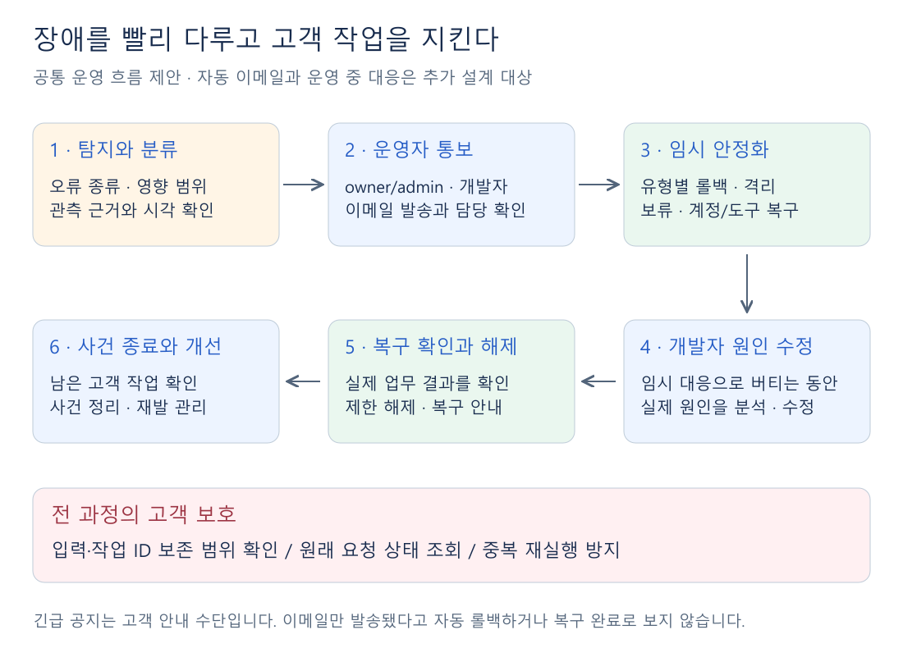

# 사용자 리스크 관리 — 기준과 ZEN AI 권장안

작성: 2026-11-09 · 전면 정리: 2026-11-10  
**구현 전 제안서.** 소스 확인 기준은 `main@1ee6a67c`이며, 아래 제안이 현재 운영에 모두 구현되어 있다는 뜻은 아니다.

## 1. 리스크 관리가 무엇인[[3. 사용자 리스크 관리 기준과 청사진 후보 (2026-11-09)]]가

**장애를 빠르게 인지하고 상황에 맞게 대응하면서, 개발자가 원인을 고치는 동안 사용자의 작업·시간·비용 손실을 줄이는 운영 체계**다.

관리자에게 알리는 것, 이전 정상 버전으로 복귀하는 것, 입력을 보존하고 중복 실행을 막는 것이 모두 이 체계에 포함된다. **긴급 공지는 그중 사용자에게 상황을 설명하는 수단**이다.

[그림 확대](자료/03-user-risk-management/01-notice-and-risk.svg) · [Excalidraw 원본](자료/03-user-risk-management/01-notice-and-risk.excalidraw)

**예시:** GPT 모델 변경 후 실행 오류 발생 → 관리자·개발자 통보 → 호환되는 이전 버전으로 임시 복귀 → 사용자 입력과 기존 요청 상태 유지 → 개발자 수정 → 실제 호출로 복구 확인.

## 2. 리스크 관리가 잘 되는지 판단하는 기준

**“오류를 알렸는가”에 더해 “사용자의 손실이 줄었고, 다시 업무를 할 수 있는가”를 판단한다.**

| 판단 기준 | 잘 관리되는 상태 | 확인할 지표·사실 |
| --- | --- | --- |
| **빠른 인지와 대응** | 담당자가 상황을 알고 대응을 맡는다 | 최초 오류부터 담당 수락·임시 안정화까지 걸린 시간 |
| **작업 보존** | 질문·첨부·녹음 등을 가능한 범위에서 되살릴 수 있다 | 입력 손실·재입력 건수, 실제 복원 가능한 범위 |
| **중복과 추가 비용 억제** | 기존 실행 여부를 확인하고 불필요한 재시도를 줄인다 | 중복 외부 작업, 재시도 횟수·추가 토큰 사용량 |
| **영향 최소화** | 문제 모델·기능·계정만 다루고 정상 업무를 유지한다 | 영향 사용자·기능 범위, 이용 불가 시간 |
| **확실한 복구** | 실제 요청이 성공하고 남은 작업도 확인한다 | 영향받은 실행 경로의 성공, 미완료·결과 불명 작업 |
| **지속 가능한 운영** | 알림 폭주·담당 누락을 막고 재시작 후에도 대응 이력이 남는다 | 중복 알림·미응답 사건, 기록 보존·접근권한 준수 |

알림 발송 성공, 헬스 검사 통과, 초록색 복구 공지는 각각 부분적인 근거다. **사건 종료는 실제 업무 복구를 확인한 뒤 판단한다.** 시간·횟수의 목표치는 운영 데이터를 확인해 정하며, 현재 달성 수치는 측정하지 않았다.

## 3. 이를 이루기 위해 해야 할 일

| 순서 | 필요한 일 | 핵심 동작 |
| --- | --- | --- |
| **① 탐지·분류** | 오류 종류와 영향 범위 확인 | 변경 직후 오류, 제공자 장애, 작업 중단, 계정·도구 문제를 구분한다. 정상 권한 거절·사용자 취소를 전역 장애로 취급하지 않는다. |
| **② 사건 기록** | 같은 장애를 하나로 묶기 | 사건 ID에 발생 시각·모델/기능·영향 범위·관련 실행 ID를 연결한다. |
| **③ 통보·담당 확인** | owner/admin·지정 개발자에게 자동 알림 | 권한과 영향 범위에 맞게 이메일·보조 알림을 전달하고, 발송 실패 재처리·중복 억제·미응답 시 대체 담당 전달을 둔다. |
| **④ 임시 대응·작업 보호** | 피해 확산과 중복 실행 방지 | 아래 네 방법 중 상황에 맞게 선택한다. 입력을 보존하고 원래 요청의 접수·진행·완료 여부를 먼저 확인한다. |
| **⑤ 원인 수정** | 개발자가 결함·설정·연동 원인 해결 | 임시 안정화 상태에서 수정하며, 정상 기능·현재 권한·기존 실행 계약을 유지한다. |
| **⑥ 복구 확인·종료** | 실제 업무 성공과 남은 작업 확인 | 영향받은 일반·하네스·Builtin 경로를 확인하고 제한 해제·복구 안내·사건 종료를 기록한다. |

**기록은 작게, 기존 자료는 재사용한다.** 기존 PostgreSQL에 사건·담당 수락·알림 전달 결과·조치·복구 결과를 남기고, 질문과 실행 내용은 기존 메시지·run/task 기록을 참조한다. 보관기간과 접근권한을 정하며, 업무 원문·첨부·인증정보를 사건 기록이나 이메일에 복제하지 않는다.

**입력 초안, 서버의 요청 접수, 외부 도구의 실행 완료는 서로 다른 상태다.** 입력이 남아 있다고 미실행으로 판단하지 않는다. 결과가 불명확하면 기존 요청을 조회하고, 확인 전에는 자동 재실행하지 않는다.

## 4. 상황에 따라 사용할 네 가지 방법

네 방법은 **장애 유형별 대응책**이다. 공통 탐지·통보·고객 보호를 갖추고 상황에 맞게 선택하거나 조합한다.

| 방법 | 적용할 상황 | 임시 대응과 고객 보호 | 지켜야 할 조건 |
| --- | --- | --- | --- |
| **1. 이전 정상 버전으로 복귀** | 모델·설정·배포 변경 직후 저장·실행 오류 | 문제 변경의 노출을 멈추고 이전 앱·설정으로 복귀한다. 작성 내용과 기존 유효 설정·요청을 보존한다. | 이전 버전과 현재 DB·설정의 호환성을 확인한다. DB를 과거로 일괄 되돌리지 않는다. |
| **2. 장애 범위만 제한** | 특정 모델·SAP/LiteLLM 경로의 반복 실패 | 해당 경로의 새 실행만 한시 제한하고 정상 기능을 유지한다. 입력·현재 요청 상태와 사용 가능한 대안을 안내한다. | 제한·해제 근거가 필요하다. 모델 변경은 기능·권한·비용 차이를 설명한 뒤 사용자가 선택하며, 안전 거부를 우회하지 않는다. |
| **3. 작업 확인 후 안전하게 재개** | 워커 중단·긴 지연·접수 또는 실행 결과 불명 | 원래 작업과 외부 처리 결과를 대조하고, 완료되지 않은 안전한 단계만 이어간다. | 기존 워커와 중복 실행을 막고 현재 권한을 재확인한다. 외부 결과 조회·중복 방지 수단이 없으면 사람이 확인한다. |
| **4. 계정·도구 문제만 복구** | OAuth 만료·자격 부재·특정 도구 연결 문제 | 해당 사용자·도구에 재인증·정당한 권한 수정·재연결을 안내한다. 보존 가능한 입력과 진행을 유지한다. | 권한 검사를 우회하지 않는다. 접근권이 사라진 자료는 계속 노출하지 않는다. |

**외부 제공자 장애에는 앱 롤백이 효과가 없을 수 있고, 결과 불명 작업에는 단순 재시도가 피해를 키울 수 있다.** 따라서 장애 종류를 먼저 구분해야 한다.

## 5. 현재 ZEN AI에 가장 적합한 구현 방향

> [!tip] 권장안
> **공통 사건 관리와 자동 통보를 먼저 연결하고, 복구 조치는 담당자가 선택하는 방식으로 시작한다.** 기존 기능을 활용해 네 대응책을 연결한 뒤, 근거가 쌓인 부분만 자동화한다.

**네 방법의 기반을 한 번 만들면** 알림·담당 확인·기록 방식을 여러 실행기에 중복 구현하지 않아도 된다. 처음부터 자동 롤백·자동 모델 변경·범용 작업 재개를 도입하는 것보다 구현과 유지보수 범위를 작게 잡을 수 있다.

### 현재 활용할 수 있는 기반

- **실행·입력:** 메시지 초안, 메시지 ID 기반 중복 판정, run/task·작업 소유/유효기간 관리, 일부 이어하기 구조가 있다. 입력·첨부의 보존 범위와 외부 작업 중복 방지는 추가 확인이 필요하다.
- **알림·안내:** 일반·하네스 공통 워커에는 최종 모델 오류를 활성 플랫폼 관리자에게 Web Push로 보내는 경로가 있고, 전역 긴급 공지도 있다. **이메일·담당 수락·Builtin까지의 연결은 추가 설계 대상**이다.
- **배포 복구:** 배포 중 헬스 실패 시 이전 이미지 복구 경로가 있다. 운영 중 모든 장애를 판별해 자동 복구하는 체계까지 구현된 것은 아니다.

### 방법별 구현·유지보수 비교

아래 난이도는 **기존 구조를 활용한다는 전제의 상대 평가**이며 작업 기간 산정은 아니다.

| 방법 | 초기 구현 난이도 | 유지보수의 핵심 | 권장 적용 |
| --- | --- | --- | --- |
| **1. 정상 버전 복귀** | **중간** — 기존 배포 복구 기반 활용 가능 | 이전 이미지·설정 보관, DB·모델 호환성 유지 | 변경 직후 장애에 대응하는 **수동 복귀 절차부터** |
| **2. 범위 제한** | **중간~높음** — 서버 측 제한 제어 추가 필요 | 일반·하네스·Builtin의 적용 일치, 오탐·해제 관리 | **관측·담당자 판단부터**, 반복 장애 근거를 쌓은 뒤 자동화 |
| **3. 안전한 재개** | **높음** — 외부 업무별 결과 확인 필요 | 중복 실행·권한·작업 인계·비용을 함께 관리 | 결과를 확인할 수 있는 **특정 업무에 한정** |
| **4. 계정·도구 복구** | **중간** — 기존 자격·권한 경로 활용 가능 | 도구별 인증 만료·재연결 방식의 차이 | 해당 계정에 **재인증·복구 안내부터** |

### 가장 작은 시작 범위

1. **공통 사건·알림:** 일반·하네스·Builtin의 오류를 공통 사건 형식에 연결한다. 이메일 전달·담당 수락·미응답 전달·복구 결과를 기존 DB에 작게 보관한다. 상세 trace나 프로세스 메모리는 사건 상태의 원본으로 삼지 않는다.
2. **사용자 보호와 수동 대응:** 실제 입력 보존 범위·원래 요청 상태를 안내하고, 담당자가 1번 복귀 또는 4번 국소 복구 등을 선택하도록 절차를 마련한다. 2번은 관측부터 시작하며 실제 실행 제한에는 별도 서버 제어가 필요하다.
3. **선택적 자동화:** 오탐·해제 조건을 확인한 범위 제한부터 자동화한다. 3번 자동 재개는 외부 결과 확인과 중복 방지 조건을 충족한 업무만 대상으로 한다.

**이 구조에서는 공지는 사용자 안내, 사건 기록은 운영 대응, run/task는 개별 실행 상태를 맡는다.** 공지를 회수하거나 서버를 재시작했다는 이유로 장애 제한이나 미완료 작업이 임의로 사라지지 않도록 구분한다.

> [!info]- 현재 구조를 판단한 주요 소스
> 고정 기준: `1ee6a67c243fe19c76c6913f1080e3a959689418`. 소스 판독 근거이며 운영 실행 결과를 뜻하지 않는다.
>
> - [관리자 Web Push](https://github.com/zen-compass/zen-ai/blob/1ee6a67c243fe19c76c6913f1080e3a959689418/src/lib/push/provider-alert.ts) · [공통 워커](https://github.com/zen-compass/zen-ai/blob/1ee6a67c243fe19c76c6913f1080e3a959689418/src/lib/agents/worker.ts): 최종 모델 오류 알림. VAPID·구독에 의존하며 모델별 30분 중복 억제는 프로세스 메모리다.
> - [입력·전송](https://github.com/zen-compass/zen-ai/blob/1ee6a67c243fe19c76c6913f1080e3a959689418/src/components/workspace/composer.tsx) · [서버 접수](https://github.com/zen-compass/zen-ai/blob/1ee6a67c243fe19c76c6913f1080e3a959689418/src/lib/channels/messages.ts) · [이어하기](https://github.com/zen-compass/zen-ai/blob/1ee6a67c243fe19c76c6913f1080e3a959689418/src/lib/agent-workspace/continuation.ts): 기존 입력·실행 보호 기반.
> - [긴급 공지](https://github.com/zen-compass/zen-ai/blob/1ee6a67c243fe19c76c6913f1080e3a959689418/src/lib/emergency-notices/service.ts) · [배포 workflow](https://github.com/zen-compass/zen-ai/blob/1ee6a67c243fe19c76c6913f1080e3a959689418/.github/workflows/deploy.yml) · [배포 런북](https://github.com/zen-compass/zen-ai/blob/1ee6a67c243fe19c76c6913f1080e3a959689418/docs/runbooks/ec2-deploy.md): 전역 안내와 배포 시 복구 기반. DB down migration은 하지 않는다.
