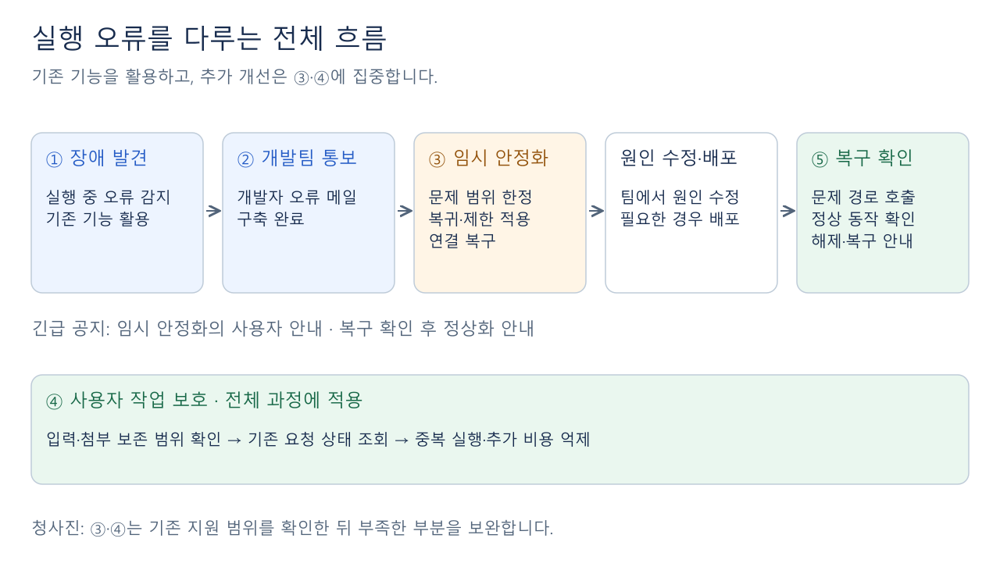
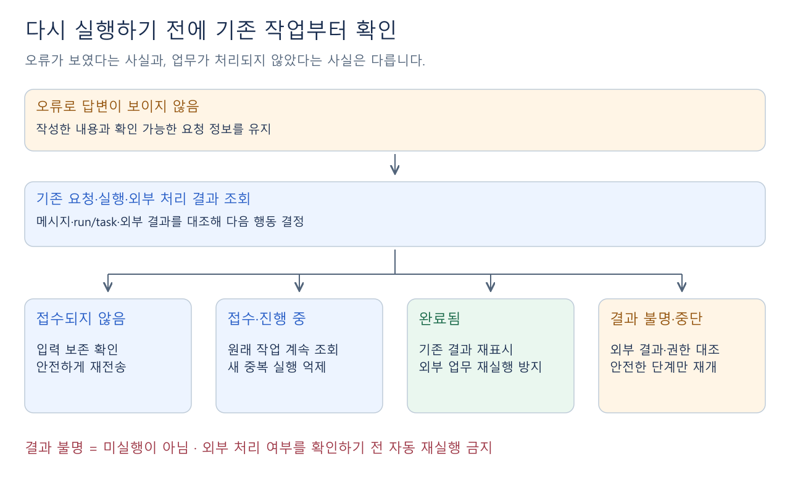

# 에이전트 실행 오류의 리스크 관리 — 기준과 청사진

작성: 2026-11-09 · 구조 재정리: 2026-11-11

> [!important] 이번 문서의 범위와 전제
> **에이전트 실행 과정에서 발생하는 오류**를 대상으로 한다. 오류 감지와 개발자 오류 메일 발송은 **이미 잘 구축된 기능**이라는 상급자의 확인을 전제로 활용한다.
> **추가 개선의 핵심은 ③ 임시 안정화와 ④ 사용자 작업 보호다.** 개발팀이 공통 절차로 대응하고, 기존 기능의 지원 범위를 확인해 부족한 부분을 보완한다. 아래 내용은 구현 전 청사진이다.

## 1. 리스크 관리 그 자체에 대한 이해

### 1-1. 리스크 관리는 무엇인가?

**장애가 발생했을 때 신속하게 대응하고, 개발자가 고치는 동안 사용자의 불편과 손실을 줄이며, 정상화까지 확인하는 과정**이다.

이번 문서에서는 이 정의를 **에이전트 실행 오류에 대한 상황 대처**에 적용한다.

### 1-2. 어떤 요소로 이루어지는가?

| 요소 | 하는 일 |
| --- | --- |
| **① 장애 발견** | 모델·도구 호출 등 에이전트 실행 과정의 오류를 감지한다. |
| **② 개발팀 통보** | 사용자를 포함한 개발자들에게 오류 메일을 보내 대응을 시작하게 한다. |
| **③ 임시 안정화** | 원인을 수정하는 동안 장애의 영향 범위와 이용 불가 시간을 줄인다. |
| **④ 사용자 작업 보호** | 작성 내용과 진행 상태를 보존하고, 불필요한 재입력·중복 실행·추가 비용을 줄인다. |
| **⑤ 복구 확인** | 수정본 배포·제공자 장애 해소·설정 복구·재인증 이후, 문제가 발생했던 실제 사용 흐름이 정상 동작하는지 확인한다. |

[그림 확대](자료/03-user-risk-management/06-runtime-team-flow.svg) · [Excalidraw 원본](자료/03-user-risk-management/06-runtime-team-flow.excalidraw)

**④는 전체 과정에 걸쳐 유지한다.** 팀은 원인을 조사·수정하고 필요한 경우 배포하며, 사용자 작업은 그동안 계속 보호한다.

> [!note] 긴급 공지의 위치
> **긴급 공지는 ③ 임시 안정화의 사용자 안내 수단**이다. 오류 메일로 상황을 인지하면 기존 공지 기능으로 장애·주의사항을 알리고, 실제 복구를 확인한 뒤 복구 공지를 게시한다.

### 1-3. 이미 있는 것과 남은 것은 무엇인가?

| 구분 | 현재 활용하거나 보완할 부분 |
| --- | --- |
| **구축 완료 전제** | 실행 오류 감지·개발자 오류 메일 발송 |
| **기존 기능 활용** | 긴급 공지·배포 복구 경로·입력 초안·메시지와 실행 기록 |
| **팀의 운영 절차** | 원인 조사·수정, 필요한 배포, 실제 호출을 통한 복구 확인 |
| **추가 개선** | **③ 임시 안정화·④ 사용자 작업 보호의 지원 범위를 조사하고 부족한 부분 보완** |

③·④를 처음부터 모두 새로 만드는 것은 아니다. 초안 저장·중복 접수 방지 등 기존 기반을 먼저 활용한다.

## 2. 리스크 관리가 잘 되는지 판단하는 기준

### 2-1. 무엇을 기준으로 판단하는가?

**“장애가 발생했을 때 사용자의 손실을 줄이고, 다시 업무를 할 수 있도록 잘 되어 있는가?”**를 각 요소에 적용한다.

| 판단 기준 | 확인할 질문 |
| --- | --- |
| **빠른 인지와 대응** | 오류를 인지한 뒤 피해를 줄이는 조치를 신속하게 시작했는가? |
| **사용자 작업 보존** | 질문·첨부·진행 내용 중 보호 대상으로 정한 것을 다시 사용할 수 있는가? |
| **중복과 추가 비용 억제** | 같은 요청·외부 업무의 반복 실행과 불필요한 토큰 사용을 줄였는가? |
| **영향 최소화** | 문제가 생긴 모델·기능·연결 범위만 다루고 정상 기능은 유지했는가? |
| **확실한 복구** | 문제가 발생했던 실제 호출이 성공하고, 남은 미완료·결과 불명 작업도 확인했는가? |
| **지속 가능한 운영** | 공통 대응 절차를 반복 적용할 수 있고, 재시작 후에도 필요한 실행 상태·조치 기록을 확인할 수 있는가? |

### 2-2. 남은 ③·④에는 어떻게 적용하는가?

| 개선 대상 | 성공 여부를 판단할 핵심 |
| --- | --- |
| **③ 임시 안정화** | 장애 때문에 사용할 수 없는 **기능의 범위와 시간을 줄였는가?** |
| **④ 사용자 작업 보호** | **입력 손실·재입력·중복 실행과 그로 인한 추가 비용을 줄였는가?** |

알림 발송·헬스 검사·복구 공지는 각각 부분적인 근거다. **업무 복구는 실제 사용 흐름의 성공으로 확인한다.** 구체적인 목표 시간·횟수는 운영 자료를 보고 정한다.

## 3. 이를 이루기 위해 실제로 해야 할 일

### 3-1. 임시 안정화를 위해 해야 할 일

1. **문제 범위를 구분한다.** 특정 모델·도구만 실패하는지, 새 배포 이후 실행 전체가 실패하는지, 특정 계정의 연결 문제인지 확인한다.
2. **상황별 대응 방법과 실행 조건을 정한다.** 어떤 경우에 호환되는 이전 버전으로 복귀하고, 어떤 범위의 실행을 제한하며, 어떤 연결을 복구할지 정한다. 기존 수단으로 실행 가능한지도 함께 확인한다.
3. **조치 해제 조건을 정한다.** 문제가 발생했던 실제 호출이 정상화됐는지 확인한 뒤 제한을 해제하도록 한다.

### 3-2. 사용자 작업 보호를 위해 해야 할 일

1. **무엇이 보존되는지 확인한다.** 작성 중 질문·첨부·이미 전송한 요청·실행 결과가 오류나 새로고침 이후에도 남는지 조사한다.
2. **요청의 처리 상태를 구분한다.** 사용자가 **접수 전·접수됨·진행 중·완료·결과 확인 필요**를 구별할 수 있게 한다.
3. **재실행 전에 기존 요청을 확인한다.** 답변이 안 보여도 서버나 외부 도구에서는 처리됐을 수 있다. 기존 결과를 확인하고 안전한 경우에만 재시도·재개한다.

[그림 확대](자료/03-user-risk-management/07-request-state-check.svg) · [Excalidraw 원본](자료/03-user-risk-management/07-request-state-check.excalidraw)

> [!warning] 확인이 필요한 보호 범위
> 코드에는 입력 초안 저장과 같은 메시지 ID의 중복 접수 방지 기반이 있다. **입력·첨부의 실제 보존 범위와 외부 작업의 중복 방지 여부는 아직 검증하지 않았다.** 입력이 남아 있다는 사실, 요청이 접수됐다는 사실, 외부 업무가 완료됐다는 사실은 각각 구분해야 한다.

## 4. 상황에 따라 사용할 대응 방법

### 4-1. 대응 방법을 어떻게 구분하는가?

| 방법 | 적용할 상황 | 핵심 대응과 조건 |
| --- | --- | --- |
| **A. 이전 정상 버전으로 복귀** | 배포·모델·설정을 변경한 직후 실행 오류 | 호환되는 이전 앱·설정으로 복귀한다. **현재 DB·설정과의 호환성을 확인하고, DB를 과거로 일괄 되돌리지 않는다.** |
| **B. 장애 범위만 제한** | 특정 모델·기능의 반복 실패 | 해당 경로의 새 실행만 한시 제한하고 정상 기능은 유지한다. 제한·해제 조건을 정하고, 대체 모델은 기능·권한·비용 차이를 확인한 뒤 사용자가 선택한다. |
| **C. 작업 확인 후 안전하게 재개** | 실행 중단·연결 끊김·처리 결과 불명 | 원래 요청과 외부 처리 결과를 확인해 안전한 단계만 재개한다. **기존 실행과의 중복을 막고 현재 권한을 확인한다.** |
| **D. 계정·도구 문제만 복구** | 특정 사용자의 인증 만료·도구 연결 문제 | 해당 범위의 재인증·재연결을 안내한다. 정당한 권한 거절과 안전 거부는 유지한다. |

**A·B·D는 주로 ③, C는 주로 ④와 연결된다.** 주된 역할에 따른 구분이며 여러 방법을 함께 쓸 수 있다. 모든 대응에서 사용자 작업 보호를 함께 적용한다.

### 4-2. 실행 중 어떤 상황에 어떤 방법이 적합한가?

**대응 열은 앞으로 적용할 후보**다. 과거에 실제로 그 조치를 수행했다는 뜻은 아니다. 근거는 **운영 발생 기록·시험 재현·예상 상황**으로 구분한다.

| 에이전트 실행 중 상황 | 근거 구분 | 우선 대응과 사용자 작업 보호 |
| --- | --- | --- |
| **GPT 6.1 전환 후 모델 오류로 실행 불가** | **운영 발생 기록** | **A 검토·필요시 B.** 실행 모델·버전·설정의 호환성을 확인해 복구하고, 기존 요청을 무조건 재전송하지 않는다. |
| **Luna에 미지원 추론 강도인 minimal을 보내 호출 실패** | **실제 SAP API 확인** | **지원 조합 검증·설정 교정.** 같은 잘못된 요청의 반복 실행을 줄인다. 모델 변경 때 생긴 문제라면 A의 설정 복구도 검토한다. |
| **모델 호출이 일시적으로 503을 반환** | **통제된 시험 재현** | **C의 안전한 재시도.** 기존 재시도 정책·상한을 지키며 이미 수행한 외부 업무를 처음부터 반복하지 않는다. 지속 장애면 B를 검토한다. |
| **특정 모델의 429·5xx·연결 실패가 지속** | **예상 상황** | **B.** 실패 범위의 새 실행과 재시도를 제한하고 정상 기능은 유지한다. 기존 요청 상태·대안을 안내한다. |
| **외부 도구 호출에서 403 권한 거절** | **시험 재현** | 인증 문제라면 **D**, 정당한 권한 거절이면 중단·안내한다. 권한을 우회하거나 자동 재시도를 반복하지 않는다. |
| **특정 사용자의 OAuth 인증 만료·연결 해제** | **관련 코드 경로 존재·운영 발생 미확인** | **D.** 재인증·재연결 후 현재 권한을 확인한다. 보존 가능한 입력·기존 실행 상태를 유지한다. |
| **요청 전송 뒤 연결이 끊겨 접수 여부를 모름** | **예상 상황** | **C.** 메시지·실행 기록을 먼저 조회하고, 미접수가 확인된 경우 안전하게 재전송한다. |
| **외부 업무는 완료됐을 수 있으나 최종 답변이 안 보임** | **예상 상황** | **C.** 외부 처리 결과를 먼저 조회한다. 완료된 업무는 재실행하지 않고 기존 결과를 활용한다. |
| **워커·서버 중단 후 실행의 완료 여부가 불명확함** | **예상 상황** | **C.** 기존 실행·작업 소유 상태와 외부 결과를 확인한다. 옛 실행과 중복되지 않는 안전한 단계만 재개한다. |
| **호출이 오래 지연되어 진행 중인지 실패인지 모름** | **예상 상황** | **C로 상태 확인, 반복 장애면 B 검토.** 느리다는 이유만으로 미실행으로 판단하거나 새 요청을 자동 생성하지 않는다. |

**분류할 때의 주의점:** 사용자 취소·사람의 선택 대기는 정상 제어 상태일 수 있다. 미지원 설정·정당한 권한 거절·안전 거부도 제공자 전체 장애와 구분한다. A~D는 상황에 맞는 대응 후보이며 모든 오류를 하나에 억지로 분류하지 않는다.

## 5. ZEN AI에 적합한 구현 방향과 행동 순서

### 5-1. 어떤 원칙으로 구현하는가?

**기존 오류 메일·긴급 공지·배포 복구 경로·입력 초안·실행 기록을 활용해 새 기능과 관리할 상태를 최소화한다.**

- **복구:** 기존 배포 복구 수단을 활용하되 운영 중 실행 오류에 적용할 때는 호환성을 확인한다.
- **보호:** 기존 메시지·run/task 등 실행 기록으로 원래 요청을 조회하고, 필요한 기록만 보완한다. 업무 원문·첨부·인증정보를 별도 대응 기록에 복제하지 않는다.
- **일관성:** 일반·생성 하네스·Builtin의 영향받은 실행 경로에 같은 보호 원칙을 적용한다.

### 5-2. ③·④는 무엇부터 작업하는가?

**③은 3-1의 세 가지 할 일을 장애 유형별 공통 대응 절차로 정리하고, 팀이 기존 수단으로 실행하는 것부터 시작한다.** 기존 수단으로 수행할 수 없는 제한·복구 동작만 기능을 보완한다.

**④는 기존 보존·상태 확인·중복 방지 기능을 조사한 뒤 부족한 부분부터 보완한다.** 외부 결과를 확인할 수 있는 특정 업무부터 안전한 재개를 검토한다.

여기서 **수동 대응**은 3-1의 판단·조치를 팀이 실행한다는 뜻이다. 문제 범위 판단 → 대응 적용 → 실제 호출 확인·해제를 공통 절차로 정리한다. 해당 실행 수단이 없으면 절차와 함께 기능 보완이 필요하다.

| 방법 | 상대적인 구현 난이도 | 유지보수 관점에서 권장하는 시작점 |
| --- | --- | --- |
| **A. 정상 버전 복귀** | 중간 | 기존 복구 수단과 호환성 확인 절차 활용 |
| **B. 장애 범위 제한** | 중간~높음 | 제한·해제 조건을 먼저 정하고 필요한 서버 제어 보완 |
| **C. 안전한 작업 재개** | 높음 | 외부 결과 조회·중복 방지가 가능한 특정 업무부터 적용 |
| **D. 계정·도구 복구** | 중간 | 기존 인증·연결 기능을 통한 재인증·재연결 안내 |

난이도는 기존 구조를 활용한다는 전제의 상대 평가다. 특히 C는 외부 업무의 중복 처리·권한·비용까지 확인해야 하므로 적용 범위를 좁혀 시작한다.

### 5-3. 구체적인 행동 순서는 무엇인가?

| 순서 | 할 일 | 확인할 결과 |
| --- | --- | --- |
| **1. 현재 기능과 사례 조사** | 입력·첨부·실행 상태의 보존 범위와 실제 실행 오류 확인 | 이미 지원하는 보호와 부족한 부분 구분 |
| **2. 상황별 대응표 확정** | 오류별 조치·실행 조건·해제 조건 정리 | 팀이 함께 활용할 공통 대응 절차 |
| **3. ③·④의 부족한 기능 보완** | 필요한 제한 수단·상태 안내·작업 보존·중복 방지 구현 | 기존 기능을 재사용한 최소 변경 |
| **4. 동작과 부작용 검증** | 정상 기능 유지·보존·중복 방지·복구 확인 | 일반·하네스·Builtin의 영향받은 경로에서 실제 동작 확인 |
| **5. 필요한 부분만 자동화 검토** | 반복 빈도·효과·오탐과 부작용을 보고 선택 | 검증된 조건 안에서 선택적으로 자동화 |

**자동화는 필수 완료 조건이 아니라 후속 선택 사항이다.** 우선 팀이 실행할 수 있는 임시 대응과 실제 사용자 작업 보호를 갖춘다.

> [!info]- 근거와 확인 범위
> - **오류 감지·메일:** 2026-11-11 사용자가 전달한 상급자의 구축 완료 확인을 전제로 활용한다.
> - **기존 구조:** 소스 판독 기준은 main의 [1ee6a67c](https://github.com/zen-compass/zen-ai/tree/1ee6a67c243fe19c76c6913f1080e3a959689418)다. 입력 초안·메시지 ID 중복 접수 방지·run/task·이어하기·긴급 공지·배포 복구 기반을 참조했다. 배포 중 헬스 실패 복구가 모든 실행 장애의 자동 복구를 뜻하지는 않는다.
> - **GPT 전환 사례:** [[11. GPT 6.1 전환·배포·하네스 저장 해결 기록]]의 실행 모델 오류 부분. 당시 상급자의 운영 수동 복구가 앱 전체 롤백이었다고 단정하지 않는다.
> - **503·권한 거절:** [[06. 현재 상태·미완료 작업·문제 해결]]·[[08. 통합·HITL·Trace 검증과 세션 인계]]의 기존 시험 기록. 503은 통제된 시험이며 실제 제공자 운영 장애로 확대하지 않는다. 당시 일반·하네스와 Builtin의 재시도 동작도 같지 않았다.
> - **Luna:** [[2026-10-30 SAP AI Core 추론 요청 조합과 반환율 핵심 요약]]의 2026-11-09 보강 절. 해당 배포·버전의 Native 요청에서 minimal 거절·low 성공을 확인한 결과다.
> - **추가 확인:** 입력·첨부의 실제 보존 범위, 외부 업무 중복 방지, 각 대응의 운영 효과·수치는 이번 청사진에서 검증하지 않았다.
