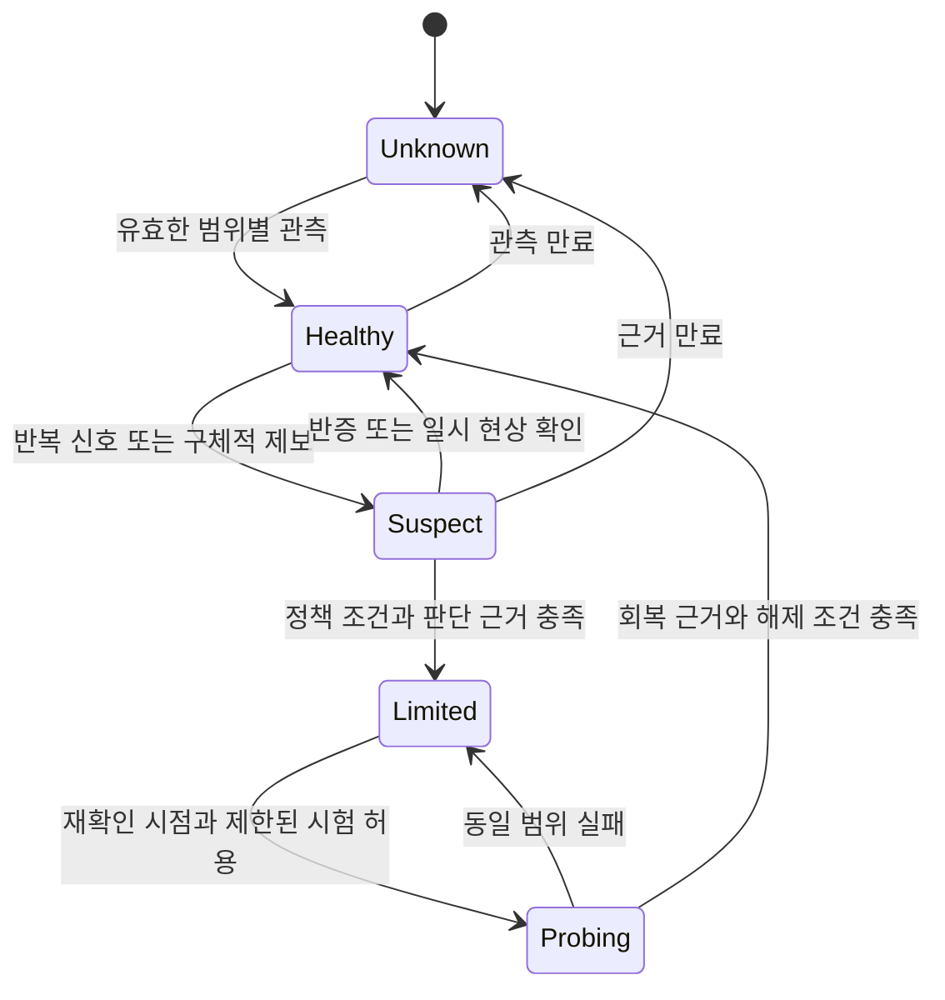

# 사용자 리스크 관리 기준과 청사진 후보

작성일: 2026-11-09  
문서 성격: 구현 전 조사·선택안. 아래 권장안·수치·저장 정책은 승인·구현된 제품 동작이 아니다.  
소스 확인 기준: `zen-compass/zen-ai`의 고정 커밋 `2d831612d7fc577fadab49eb522ee937a315f712`(PR #382 병합본). 운영 실행 버전과 동일하다고 가정하지 않는다.

## 1. 먼저 제안하는 방향

**ZEN AI의 사용자 리스크 관리는 장애를 반드시 없애는 약속보다, 장애가 있어도 고객이 잃는 작업·시간·비용·통제권을 작게 유지하는 운영 원칙으로 정의하는 것이 적합하다.** 긴급 공지는 이 원칙의 전달 수단이다. 별도의 실행 보호·작업 보존·재개 판단이 있어야 실제 불편이 줄어든다.

우선순위는 **작업과 권한을 지키기 → 현재 상태를 정확하게 설명하기 → 실패할 행동의 반복을 줄이기 → 검증된 대안으로 이어가기**다. 오류를 숨기거나 무조건 다른 모델로 바꾸면 표면상의 성공률은 좋아져도 품질·비용·보안 리스크가 늘 수 있다.

청사진은 네 가지로 비교한다. A는 작업 보존과 복구 안내, B는 영향 범위를 좁힌 실행 보호, C는 중단된 업무의 안전한 이어하기, D는 배포·설정 변경의 노출 관리다. 서로 완전히 배타적인 대안은 아니다. **A를 공통 기반으로 삼고, B를 관찰 모드부터 적용하는 조합을 우선 권장한다. C는 안전한 작업에 한정하고 D는 변경 관리 축으로 병행한다.**

기록은 상세 로그를 무한히 모으는 방향으로 가지 않는다. 기존 실행 사실을 재사용하면서, **무슨 불편이 있었고 → 어떤 근거로 보호 조치를 했으며 → 사용자가 다시 일을 할 수 있었는지**를 원문 없이 연결하는 최소 기록을 우선한다. 작업을 실제로 제어하는 상태와 사라져도 되는 관측 자료는 같은 저장 계약으로 다루지 않는다.

## 2. ‘해결’과 ‘관리’를 구분하는 기준

| 구분 | 이 문서에서의 의미 | GPT 모델 전환 장애에 대입한 예 |
| --- | --- | --- |
| 리스크 원인 해결 | 잘못된 설정·구현·배포를 고쳐 실패 원인을 제거 | 모델 ID·허용 목록·실제 제공 경로의 불일치 수정 |
| 리스크 예방 | 고객에게 노출될 가능성을 낮춤 | 활성 에이전트 참조 검사, 실제 호출 검증, 단계적 적용 |
| 리스크 관리 | 원인이 남아 있거나 아직 불명확해도 손실을 제한 | 질문 보존, 무한 재시도 방지, 해당 모델만 제한, 확인 가능한 대안 제시 |
| 리스크 수용 | 남는 불편과 허용 범위를 책임자가 알고 결정 | 짧은 지연은 허용하되 재입력·중복 외부 변경은 허용하지 않음 |
| 회복 확인 | 사용자 업무가 다시 가능한지 증거로 확인 | 모델 목록 조회뿐 아니라 일반·하네스·Builtin의 저장·호출·최종 응답 확인 |

관리와 해결은 함께 필요하다. 관리 기능을 만들었다고 원인 수정을 끝낸 것으로 보거나, 원인을 고쳤다고 영향받은 고객의 작업이 모두 회복됐다고 보면 안 된다.

‘불편한 점이 없어야 한다’는 제품 가치로 유지하되, 이를 **무조건 성공·무중단·무료 재실행 보장**으로 바꾸지 않는다. 대신 잃지 않아야 할 것과 감당할 수 있는 지연을 구체화한다. NIST AI RMF는 위험의 맥락·측정·관리와 책임을 지속적으로 다루는 틀을 제공하며, Google SRE는 고객이 경험하는 결과를 기준으로 목표와 개선 우선순위를 정한다. 아래 설계는 이를 ZEN AI에 적용한 제안이지 해당 기관의 ZEN AI 권고안은 아니다.[S1][S2]

## 3. 현재 ZEN AI에서 확인한 기반과 조사 한계

### 3.1 이미 있는 것을 다시 만들지 않을 것

| 영역 | 고정 소스에서 확인한 사실 | 이번 청사진에서의 활용·한계 |
| --- | --- | --- |
| 긴급 공지 | 전역 초안 1개와 게시본 1개. `outage`/`recovered` 게시·회수, 버전 경합 검사, 관리자 권한 확인 | 전체 고객에게 설명하는 통로. 기계적인 장애 판정·실행 차단의 원장으로 사용하지 않음 [C1] |
| 공지 표시 | 상단바·X 닫기·게시 버전 구분. 첫 조회·보이는 탭의 60초 주기·탭 복귀 등으로 재조회 | 닫기는 현재 화면 표시만 제어. 닫았다는 사실을 장애 수용이나 실행 허가로 해석하지 않음 [C2] |
| 작성 중 메시지 | 채널·스레드 초안 키와 sessionStorage 복원. 전송 실패 시 입력을 비우지 않는 흐름 | 기본 작업 보존 기반. 계정 전환·첨부·브라우저 종료까지 모두 보장한다는 뜻은 아님 [C3] |
| 메시지 중복 방지 | 같은 전송 의미의 재시도는 ID 재사용. 서버에 이벤트 충돌·중복 판정 존재 | 메시지 접수의 중복 방지 기반. 외부 도구 실행·모델 과금까지 중복이 없다는 보장은 별도 [C3][C4] |
| 실행·작업 상태 | run/task, 상태, 시각, 유효 모델, 시도·조각, 취소 요청·claim/lease 등 기존 구조 | 고객 요청과 내부 실행 조각을 연결해 사용. 새 범용 큐를 먼저 만들지 않음 [C5] |
| 에이전트 제어 | 권한 재검사, 취소 신호, provider 오류·timeout 및 후속 조각 처리 등의 실행 코드 | 모든 종류가 같은 정책으로 동작한다고 가정하지 않고 일반·생성 하네스·Builtin을 각각 대조 [C6] |
| 이어하기 | 작업 공간 continuation·메시지 검증·체크포인트·출처 일치 검사 등이 존재 | C 후보는 기존 기능을 확장·검증하는 문제. 아무 도구나 자동 재실행하는 새 엔진이 아님 [C7] |
| 회의 입력 복구 | IndexedDB의 사용자·커뮤니티·세션 구분과 탭 간 녹음 보호 구조 | 회의는 일반 채팅보다 입력 손실 비용이 크므로 별도 보호 대상. 브라우저 보존은 영구 저장 보장이 아님 [C8] |
| 비용 | 호출별 토큰·단가 snapshot, 미측정/미산정, 통화별 합계 처리 기반 | 재시도·대체 호출 비용을 기존 기록과 연결. 실제 SAP 청구액이나 사전 확정 가격으로 표현하지 않음 [C9] |
| 배포 사전 검사 | 활성 일반·하네스·Builtin 참조를 runtime/provider 목록과 대조하는 검사 존재 | 목록의 일치와 실제 추론 성공은 구분. 이 검사를 새 예방 기능으로 다시 제안하지 않음 [C10] |
| 실시간 trace | 기본 최대 나이 168시간 외 건수·요청당/전체 바이트 제한을 둔 프로세스 메모리 관측 | 최대 나이는 보존 보장이 아니다. 재시작·퇴거를 견디는 제어 상태의 원본으로 쓰면 안 됨 [C11] |
| 구동 로그 다운로드 | 파일 기반 수집·권한 검사·다운로드와 미수집 응답. 24시간 경과에 따른 UI 문구 정책 | 실행 이력·실시간 trace·구동 로그 파일은 다른 자료다. ‘24시간이면 서버가 삭제한다’고 결론 내리지 않음 [C12] |

현재 구조에는 이미 여러 보호 장치가 있다. 따라서 이번 과제는 ‘전부 새로 구현’이 아니라 **각 장치가 고객 여정에서 연결되는지, 어떤 실패에서 효과가 없으며, 어디까지 약속할 수 있는지를 정의하는 일**이다. 범위별 자동 제한·통합된 위험 판단 이력이 충분한지는 후속 설계에서 더 확인해야 하며, 이 문서의 표적 코드 조사만으로 저장소 전체에 관련 기능이 없다고 단정하지 않는다.

### 3.2 과거 관측에서 가져올 수 있는 교훈

- 모델 전환 때 UI 선택·설정 저장·배포 검사·실제 호출은 서로 다른 단계였다. 한 단계의 성공을 전체 성공으로 확대하지 않아야 한다.
- 다른 사람·다른 커뮤니티의 최근 구동 로그는 다운로드됐고, 약 3일 전의 다른 실행은 없었다는 사용자 증거가 있다. 시간 경과를 조사할 근거이지만 동일 파일의 삭제나 정확한 TTL을 입증하지 않는다. [구동 로그 보존·미수집 판별 조사](<../00. Bug Report/5. 에이전트 구동 로그 보존·미수집 판별 조사.md>) 참조.
- 진단 파일이 사라진 상태와 실제 업무 실패는 같지 않다. 고객 상태 설명을 임시 상세 파일에만 의존하면 원인 확인도 지원도 어려워진다.
- 긴급 공지의 전체 전파와 개별 요청의 즉시 보호는 다른 지연 목표가 필요하다. 상단바의 polling 주기로 실행 안전성을 보장할 수 없다.

이 절은 기존 코드와 인계·사용자 관측의 해석이다. 이번 조사에서 운영 서버·고객 데이터·제공자에 재현 요청을 보내거나 장애를 주입하지 않았다.

## 4. 고객 여정을 기준으로 리스크를 나누기

단위는 ‘서버 1개’나 ‘모델 호출 1회’보다 **고객이 끝내려던 작업 1건**이 우선이다. 한 질문이 내부적으로 여러 run·slice·모델 호출·도구 호출을 만들 수 있으므로, 이를 각각 별개의 고객 실패로 세면 안 된다.

| 고객 여정 | 고객이 기대하는 것 | 관리할 불편 | 관리가 작동한 상태 |
| --- | --- | --- | --- |
| 에이전트 생성·설정 저장 | 선택한 모델과 버전으로 저장 | 저장 실패, 이유 없는 비활성화, 기존 정상 설정 손상 | 입력과 이전 유효 설정 보존, 문제 항목 안내, 무관한 에이전트 사용 유지 |
| 질문 작성·첨부 | 내용과 첨부를 잃지 않음 | 재입력·파일 재업로드·잘못된 채널 전송 | 접수 전 실패와 접수 후 결과 불명을 구분, 복원 가능한 범위 표시 |
| 질문 전송·접수 | 한 번 보낸 요청이 한 번 접수 | 연타·네트워크 끊김으로 중복 접수 | 같은 작업 ID로 접수 여부 확인 후 이어감 |
| 응답 대기 | 무엇을 기다리는지와 멈출 방법을 앎 | 끝없는 spinner, 접수됐는지 모름, 강제 새로고침 | 접수·대기·실행·지연·상태 확인 필요를 구분하고 새 전송을 유도하지 않음 |
| 도구 실행 | 허용한 작업만 정확히 수행 | 중복 외부 변경, 권한 상실 뒤 실행, 결과 불명 상태의 재실행 | 실행 영수증·현재 권한 확인, 불명확한 쓰기는 자동 반복 중단 |
| 응답·산출물 수신 | 사용할 수 있는 결과를 받음 | 중간 응답을 완료로 오인, 결과 저장 실패, 늦은 응답 덮어쓰기 | 생성·게시·사용자 표시를 분리하고 부분 결과를 명시 |
| 중단·취소 | 원치 않는 후속 작업이 멈춤 | 버튼만 취소되고 워커 진행, 이미 실행된 작업 오해 | 취소 요청·종결 확인·외부 결과 확인 필요를 구분 |
| 새로고침·재접속 | 이전 상태에서 계속 확인 | 재호출·재과금·작업 유실 | 기존 작업 조회가 먼저이며 복구 가능/불가 범위를 정확히 설명 |
| 회의·장시간 업무 | 장시간 입력과 진행이 보존 | 녹음·전사·검토분을 처음부터 반복 | 보존된 입력과 완료 구간 확인 후 가능한 단계부터 재개 |
| 이력·로그 조회 | 지난 결과와 문제 근거 확인 | 로그 없음의 원인을 권한 문제로 오해 | 이력·산출물·진단자료의 각 가용성과 보관 한계를 구분 |

## 5. 후보를 평가할 기준

### 5.1 반드시 지킬 기준

아래 항목은 점수를 더해 상쇄하지 않는다. 하나라도 위반하면 편의성·속도가 좋아도 채택하지 않는다.

1. **권한·격리:** 사용자·커뮤니티·채널·도구 권한을 우회하지 않는다. 대체 모델·재개·캐시 표시 때도 현재 권한을 다시 확인한다.
2. **작업 무결성:** 기존 정상 설정·작성 내용·완료한 결과를 보호한다. 보호가 확인되지 않았으면 ‘안전하게 저장됨’이라고 말하지 않는다.
3. **외부 변경 통제:** 결과가 불명확한 쓰기를 무조건 재시도하지 않는다. 취소나 timeout이 이미 발생한 외부 변경의 취소를 의미하지 않는다.
4. **사실에 맞는 상태:** 목록 조회 성공, HTTP 200, 생성 완료, 게시 완료, 사용자 표시 완료를 구분한다. 모름은 모름으로 남긴다.
5. **고객 선택 보존:** 승인되지 않은 모델·추론 강도·비용·데이터 전송 경로 변경을 몰래 수행하지 않는다. 제공자의 안전 거부를 다른 모델로 우회하는 자동화는 넣지 않는다.
6. **자원 상한:** 재시도·대기열·프로브·관측·저장의 시간·횟수·용량에 상한이 있어야 한다. 보호 기능이 서비스 과부하를 만들면 안 된다.

### 5.2 우선순위를 판단할 기준

| 기준 | 판단 질문 | 필요한 관측·기록 | 주의점 |
| --- | --- | --- | --- |
| 고객 손실 크기 | 몇 분의 지연인가, 긴 회의 입력 손실인가, 외부 업무 중복인가? | 작업 유형·실패 단계·보존/중복 상태 | 실행 횟수만으로 중요도를 정하지 않음 |
| 영향 범위 | 한 계정·한 에이전트인가, 특정 모델·전체 고객인가? | 권한 있는 범위의 영향 집계·모델/버전/의존성 | 한 계정의 403을 전역 장애로 확대하지 않음 |
| 발생 가능성·노출 | 같은 실패가 얼마나 자주 반복되고 앞으로 몇 명이 노출되는가? | 성공·실패 모두의 분모, 시각·변경 이력 | 최근 실패 1건과 지속 장애를 구분 |
| 탐지 신뢰도 | 직접 확인인가, 상관관계인가, 고객 제보인가? | 증거 출처·관측 시각·표본 수·측정 누락 | 작은 표본의 실패율 100%를 과신하지 않음 |
| 회복 가능성 | 재조회만 하면 되는가, 사람의 외부 결과 확인이 필요한가? | 접수 영수증·최종 상태·도구 결과 확인 여부 | timeout을 ‘미실행’으로 기록하지 않음 |
| 고객 노력 | 재입력·재업로드·설정 재선택·새로고침이 필요한가? | 복구 단계 수, 도움 요청·재전송의 제한된 이벤트 | 화면 전체 행동 추적을 기본값으로 삼지 않음 |
| 기다림의 예측 가능성 | 언제까지 기다리고 다음에 무엇을 할 수 있는가? | 접수·시작·최종 응답/게시 시각, 지연 안내 시각 | 근거 없는 남은 시간·진행률 금지 |
| 비용·품질 변화 | 재시도·대안이 얼마의 추가 사용과 품질 변화를 만드는가? | 실제 호출 수·토큰·추정 비용·선택 모델·단가 snapshot | 미측정 비용을 0원으로 채우지 않음 |
| 보호 조치의 부작용 | 정상 고객까지 차단하거나 실패를 다른 곳으로 전가하는가? | 차단 수·오탐 해제·대안 성공/실패·정상군 변화 | 차단으로 분모를 줄여 성공률을 꾸미지 않음 |
| 운영 가능성 | 사람이 관리할 규칙·예외·알림이 감당 가능한가? | 수동 개입 횟수·설정 revision·해제 책임자 | 복잡한 자동 복구부터 시작하지 않음 |
| 관측 비용·민감성 | 이 정보가 실제 판단에 필요한가? | 필드 목적·크기·권한·만료·누락률 | 고객 원문과 개인정보 수집의 확장을 피함 |
| 변경 가역성 | 잘못 제한했을 때 바로 되돌릴 수 있는가? | 이전 정책·적용 범위·만료·override 기록 | 예외 해제가 권한 검사를 해제해서는 안 됨 |

발생 가능성과 손실을 임의 숫자로 곱한 하나의 ‘위험 점수’를 첫 구현에 넣지는 않는다. 현재는 확률·손실액 근거가 부족하다. 우선 **손실 유형·영향 범위·확신도·되돌릴 수 있는지**를 나란히 표시하고 판단 이유를 남기는 방식이 낫다.

### 5.3 심각도와 관측 확신도를 분리

| 우선순위 제안 | 조건 | 대응 방향 |
| --- | --- | --- |
| P0 | 권한 노출, 데이터 손실, 중복 외부 변경 등 중대한 피해가 확인되거나 구체적으로 의심됨 | 확산 억제와 사람의 판단 우선. 표본 수 충족을 기다리며 피해를 늘리지 않음 |
| P1 | 핵심 업무 진행 불가, 여러 사용자/범위에 반복, 유효한 대안 부족 | 해당 범위를 제한하고 업무 보존·상태 안내·담당자 대응 |
| P2 | 입력·결과가 보존되고 재조회/승인된 대안으로 진행 가능한 지연·부분 장애 | 국소 안내와 제한된 회복, 반복 시 상향 |
| P3 | 핵심 업무에 영향 없는 표시·부가 진단 자료 문제 | 일반 개선으로 관리. 무조건 전역 긴급 공지하지 않음 |

각 사건에는 별도로 `제보 / 관측됨 / 재현됨 / 원인 확인` 같은 근거 상태를 둔다. 예를 들어 ‘P1·원인 미확정’도 가능하다. 피해가 커서 관리해야 한다는 판단과 원인이 확정됐다는 주장은 다르다. 위 등급은 조직의 기존 사고 등급을 조사해 맞출 제안이며 확정된 당직 규정이 아니다.

## 6. 무엇을 측정해야 ‘불편이 줄었다’고 말할 수 있는가

처음에는 아래 후보 중 **업무 완료·상태 인지·작업 보존·중복 피해·추가 비용**을 우선 본다. 기존 데이터로 계산 가능한 항목과 새 계측이 필요한 항목을 나눠 구현량을 결정한다. 서버 자원 사용률은 원인 진단에 유용하지만 고객 불편의 직접 대체 지표는 아니다.[S2]

| 지표 후보 | 분자·분모 또는 정의 | 오해를 막는 규칙 |
| --- | --- | --- |
| 고객 작업 완료율 | 정한 시간 안에 최종 결과가 게시된 작업 / 유효한 고객 시작 작업 | run·재시도 개수로 분모를 부풀리지 않음. 의미적 정확성은 별도 평가 |
| 첫 시도 완료율 | 자동/수동 재시도 없이 완료한 작업 / 유효 시작 작업 | 재시도로 숨겨진 불편을 확인 |
| 상태 인지 지연 | 접수·지연·실패 등 상태 확정부터 고객에게 표시하기까지 | 서버 기록만 있으면 ‘표시됨’이 아니라 ‘표시 가능’까지만 측정 |
| 완료·대기 지연 | 시작→접수, 큐 대기, 실제 실행, 최종 게시를 구분한 p50/p95 | 장시간 회의와 짧은 질문의 지연 목표를 섞지 않음. 실패·미완료도 별도 집계 |
| 작업 보존 실패 | 복원이 필요했던 작업 중 입력/첨부/산출물 손실이 확인된 수 | 관측하지 못한 복원을 성공으로 세지 않음. 브라우저 강제 삭제까지 보장하지 않음 |
| 중복 외부 효과 | 하나의 의도에서 중복 변경이 확인된 수 | 메시지 중복과 도구 중복을 따로 봄. 외부 증거 없으면 결과 불명 |
| 고객 재작업 부담 | 재전송·재입력·지원 요청·필수 복구 단계의 집계 | 정확한 소요 시간은 관찰·동의된 조사로 확인. 클릭 수만으로 추정하지 않음 |
| 회복 후 재개율 | 영향받은 작업 중 정한 기간 안에 재개·완료한 수 / 재개 가능한 영향 작업 | 단순 시스템 정상화와 고객 작업 회복을 구분 |
| 제한의 정확성 | 제한된 범위, 해제 후 정상, 오탐으로 해제된 사건·불편 | 완벽한 반사실은 알 수 없으므로 ‘막은 실패 수’를 사실처럼 표시하지 않음 |
| 추가 사용량·추정 비용 | 같은 고객 작업에 연결된 재시도·대체의 실제 호출·토큰·금액 | 통화별·미측정/미산정 별도. SAP 실제 청구액과 구분 |
| 관측 신뢰도 | 완료/실패/차단/결과 불명/계측 누락의 각 건수 | 알 수 없음과 로그 소실이 정상으로 합쳐지지 않아야 함 |

정상적인 접근 거부·지원하지 않는 사용자 입력은 인프라 오류율과 분리한다. 그러나 정상 권한의 고객이 회귀로 거부된 경우, 보호 조치로 요청이 막힌 경우, 상태 불명으로 완료하지 못한 경우는 고객 불편 집계에 남긴다. 사용자 취소도 ‘자발적 취소’와 ‘지연 때문에 취소’를 구분할 수 있는 범위에서 보고하며 실패를 감추기 위해 전부 분모 밖으로 빼지 않는다.

**SLO 수치와 자동 차단 임계치는 아직 정하지 않는다.** 합의한 고객 허용 시간, 업무별 기준선, 실제 트래픽과 담당자의 대응 가능성이 먼저다. 오류 예산을 쓰면 `불량 작업 비율 / (1 - 합의 SLO)`로 소비 속도를 볼 수 있다. 다만 저트래픽에서 1건 실패가 큰 비율이 되는 문제를 고려하고, 합성 검사 결과와 실제 고객 비율을 섞어 정상처럼 보이게 하지 않는다. 장·단기 창을 함께 보는 알림은 후보지만 Google의 예시 숫자를 그대로 제품값으로 복사하지 않는다.[S3]

## 7. 오류 이름보다 ‘어떤 행동이 안전한가’로 분류하기

| 관측 | 우선 판단·고객 보호 | 자동으로 하면 안 되는 것 |
| --- | --- | --- |
| 접수 전 연결 실패 | 입력 보존, 연결 안내, 같은 의도 ID의 재접수 가능성 확인 | 새로운 의도 ID로 무한 전송 |
| 접수 응답이 끊겨 결과 불명 | 원래 ID로 접수/실행 상태 먼저 조회 | 실패로 단정하고 새 작업 실행 |
| 제공자 429·일시 5xx | 허용된 retry-after·기존 retry 정책·전체 deadline/예산 확인 | 모든 계층이 각자 여러 번 재시도 |
| 잘못된 모델/추론 조합·폐기 모델 | 해당 설정 오류로 안내, 기존 유효 설정 보존 또는 사용자 수정 | 동일 설정 반복, 사용자 몰래 강도 상향 |
| 개인 인증·도구 권한 오류 | 해당 계정/도구 범위에서 재인증·관리자 확인 | 타인 인증 재사용, 전체 모델 장애 공지 |
| 제공자 안전 거부·정책 거부 | 거부 유형에 맞는 설명과 허용된 입력 수정 안내 | 다른 모델로 거부를 자동 우회 |
| 길어진 큐·과부하 | 대기 상태와 허용 시간, 접수 상한·공정성, 취소·나중에 시도 선택 | 무한 큐에 숨기거나 사용자별 연타 유도 |
| 스트림 중단·부분 결과 | 수신된 부분의 상태 표시, 원래 작업 확인 | 부분 결과를 최종 완료로 포장, 전체 쓰기 작업 반복 |
| 외부 쓰기 timeout | 실행 영수증/대상 시스템 조회, 결과 불명 유지 | ‘응답 없음=미실행’으로 재실행 |
| 취소 요청 뒤 늦은 응답 | 요청 수락과 워커 종결을 구분하고 후속 게시 경쟁 검사 | UI가 닫혔다고 외부 변경/과금 취소 확정 |
| 관측/공지/로그 시스템 실패 | 관측 불가를 명시, 본업 기능과 장애 영역 분리 | 관측 누락을 정상 판정, 전체 서비스 자동 중단 |

재시도는 일시 실패를 줄일 수 있지만 이미 느린 의존성을 더 압박하고 외부 변경을 중복시킬 수 있다. **재시도 책임 계층 하나, 누적 시간·시도·비용 상한, backoff/jitter, 멱등 계약**을 함께 설계해야 한다.[S4][S5]

## 8. 상태 설계: 공지·가용성·고객 작업을 섞지 않기

세 가지 상태는 서로 다른 원본을 가진다.

- **공지 상태:** 관리자가 게시한 설명. 현재의 미게시/장애/복구 게시와 회수 계약을 유지한다. 초록 공지가 모든 모델·모든 고객의 정상 실행 증거는 아니다.
- **범위별 가용성 상태:** 특정 기능·모델·버전·연결 경로의 최근 건강 신호. 고객 원문이나 다른 tenant의 정보를 포함하지 않는다.
- **고객 작업 상태:** 접수·대기·실행·사람 응답 대기·부분 결과·종결·결과 확인 필요. 실제 run/task/도구 영수증 등 업무 원장으로 판정한다.

아래는 B 후보의 **제안 상태도**다. 현재 구현 상태도가 아니다.

`Limited`에서는 상태 TTL이 지났다고 무조건 정상으로 열지 않는다. 재확인이 필요하면 제한된 probe나 관리자 판단으로 넘긴다. 반대로 관측 시스템만 잠시 끊겼다고 정상 고객을 전부 막지도 않는다. **정확히 알려진 권한·설정의 불허는 계속 거부하고, 일반적인 가용성 미확인은 보수적인 시도 상한과 상태 안내로 다루는 식으로 원인별 정책을 나눈다.**

범위 키는 우선 `업무 기능 + 실행 경로(일반/하네스/Builtin) + 모델/중요 설정 + 배포·정책 revision`을 검토한다. 개별 사용자 인증·도구 장애는 그 사용자/tenant 범위로 좁힌다. 공용 제공자 장애 근거가 있어야 더 큰 범위로 확대한다. 모델 이름만 같다고 지역·연결 경로·배포 버전까지 같은 실패 영역이라고 가정하지 않는다.

규칙은 통계만으로 만들지 않는다. 지원하지 않는 모델 조합처럼 확정적인 불허와, 반복 5xx처럼 통계적인 의심을 구분한다. 저트래픽·관측 누락·신규 배포는 확신도와 신선도를 낮추며, 수동 override에는 이유·책임자·만료·변경 revision을 남긴다. 재시작 뒤 메모리가 비었다는 이유로 기존 제한이 해제되면 안 되는 정책은 영속된 원본이 필요하다.

## 9. 청사진 후보 A — 작업 보존과 복구 안내

**고객에게 주는 약속:** 문제가 나더라도 무엇이 접수됐고 무엇이 남아 있으며 다음에 무엇을 할 수 있는지 알 수 있다.

추가 범위는 입력·첨부·전송 ID·실행 상태가 끊기는 지점을 연결하는 것이다. 전송 실패 시 작성 내용을 유지하고, 새로고침/재접속 시 기존 작업을 먼저 조회한다. 접수 여부가 불명확하면 ‘다시 실행’보다 ‘상태 확인’을 먼저 제공한다. 저장 성공을 확인한 자료와 브라우저에만 남은 자료를 구분한다. 기존 초안·회의 복구·이벤트 중복 방지를 우선 재사용한다.

현재 composer의 전송 시도 ID는 컴포넌트 ref에서 관리된다. 초안이 복원된다는 사실만으로 새로고침 뒤에도 같은 전송 ID로 접수 상태를 확인할 수 있다고 보장하지 않는다. A의 구현 전에는 이 연결과 계정·첨부의 복원 범위를 조사해야 한다.[C3]

고객 화면은 현재 요청 옆에 간단히 표시한다. 예: ‘접수 여부를 확인하고 있습니다. 같은 내용을 다시 보내지 않아도 됩니다.’ 이 문구는 실제로 원래 요청을 조회하는 기능이 있을 때만 사용한다. 복구가 불가능한 범위는 숨기지 않는다.

**기록:** 원래 고객 작업 ID, 접수/종결 시각, 결과 상태·실패 단계, 보존·복구 가능 범위, 고객이 수행한 복구 선택. 원문을 새 위험 로그에 복사하지 않는다. 노출한 설명의 코드·revision으로 충분한지 먼저 본다.

**장점:** 자동 차단 오탐이 적고 기존 구조를 활용하기 좋다. 원인 해결 전에도 재입력·연타·불필요한 재실행을 줄인다.

**한계·잔여 리스크:** 실패할 요청의 최초 노출을 막지는 못한다. 첨부 만료·브라우저 퇴거·기기 변경을 별도 조사해야 하며 sessionStorage만으로 영속·교차 기기 복구를 약속하지 않는다. 외부 도구의 중복까지 해결하지 않는다.

**선택 조건:** 가장 작은 첫 적용안이 필요하거나, 아직 장애 표본·정책 신뢰도가 부족할 때. 다른 후보를 골라도 이 기반은 필요하다.

## 10. 청사진 후보 B — 문제가 있는 범위만 제한하는 실행 보호

**고객에게 주는 약속:** 이미 실패가 확인된 경로를 계속 시도하며 시간을 낭비하지 않고, 무관한 정상 기능은 사용할 수 있다.

기존 실행 사실과 제한된 합성 검사를 조합해 범위별 가용성을 판정한다. 초기에는 **관찰 모드**로 ‘제한했을 경우의 판단’만 기록하고 실제 실행은 바꾸지 않는다. 오탐·누락·운영 부담을 본 뒤 알려진 설정 오류, 반복된 특정 경로 장애부터 서버 접수/실행 경계에 제한을 적용한다. UI 안내만으로 막는 방식은 우회·경합을 막지 못한다.

선택지는 ‘입력 유지하고 나중에 시도’, ‘현재 요청 상태 확인’, ‘명시적으로 승인된 대안 선택’이다. 대안은 모델 지원 기능·컨텍스트·도구·데이터 경로·비용·품질을 검증한 범위만 제공한다. 정상적인 Luna 고정 정책이나 사용자의 모델 선택을 장애 대응 명목으로 임의 변경하지 않는다.

Circuit breaker는 같은 실패를 반복하며 서비스 자원을 소모하는 것을 줄이는 후보다. 허용/차단/일부 재확인과 회복 조건이 필요하며 재시도와 역할이 다르다. 여기서 ‘차단’은 대상 실행 경로의 제한이지 계정 전체 정지나 권한 해제가 아니다.[S6]

**기록:** A의 최소 결과 + 범위·정책 revision·증거 창/분모·확신도·판정·적용/해제·override. 제한된 각 요청은 원래 작업과 연결해 고객 불편 분모에 남긴다. ‘예방한 실패’는 추정치이며 사실 수치로 집계하지 않는다.

**장점:** 실패 반복·대기·불필요한 호출 비용·장애 확산을 직접 줄일 수 있다. 전역 긴급 공지를 남발하지 않고 국소 안내가 가능하다.

**한계·잔여 리스크:** 오탐 차단·인스턴스 간 정책 불일치·회복 지연이 새 리스크다. 단순 메모리 카운터만으로 전체 서버의 제한을 일관되게 보장할 수 없다. 초기에는 자동 대체보다 명시적 대안 선택을 권장한다.

**선택 조건:** 같은 모델/경로의 반복 장애가 고객 불편의 중요한 원인이고, 최소한의 결과·정책 기록과 해제 책임을 운영할 수 있을 때. **우선 권장 후보**다.

## 11. 청사진 후보 C — 검증된 작업만 안전하게 이어하기

**고객에게 주는 약속:** 오래 수행한 업무를 가능한 구간에서 이어가되, 끝난 외부 변경을 반복하지 않는다.

기존 task·slice·continuation·Builtin checkpoint를 출발점으로, 어떤 단계가 완료됐고 어떤 결과가 저장됐는지 확인해 이어간다. 읽기·계산처럼 반복이 안전한 작업과, 외부 시스템을 바꾸는 작업을 구분한다. 처음에는 장시간 회의 처리나 읽기 중심 조사 등 손실 비용이 크고 경계가 명확한 한 유형으로 좁힌다.

서버가 재시작돼도 복구하겠다는 약속에는 작업 ID·체크포인트·외부 실행 영수증의 지속성이 필요하다. 외부 쓰기 뒤 응답이 유실되면 대상 시스템에서 결과를 조회하거나 검증된 멱등 키로 대조한다. 그런 계약이 없으면 사람의 확인을 기다린다. DB에 기록했다고 외부 시스템과 원자적으로 한 번만 실행되는 것은 아니다.[S5]

멱등 키는 사용자/tenant·대상·요청 의미를 구분하고, 같은 키에 다른 내용이 오면 거절해야 한다. 재시도 가능 기간은 서버와 외부 시스템이 중복 식별 정보를 유지하는 기간을 넘길 수 없다. 키가 만료된 오래된 요청은 새 작업으로 자동 재전송하지 말고 결과 확인으로 전환한다. 재조회·재실행마다 현재 권한도 검사한다.

재개 전에 현재 사용자·커뮤니티·도구 권한, 원래 버전과 새 버전의 호환, 입력/첨부 가용성, 작업 deadline·취소·비용 상한을 확인한다. 새 모델·새 설정으로 이어가면 변경과 사용자 동의가 필요한지 정책으로 정한다. 이미 게시된 최종 답변을 뒤늦은 워커가 덮어쓰지 않게 기존 claim/lease·종결 제약을 보존한다.

**기록:** A/B의 관련 기록 + 단계 ID·완료 증거 참조·resume 부모/자식 관계·외부 실행 식별자·확인 상태·재개 시 권한/버전 판정. 필요한 업무 입력은 기존 권한 있는 저장소에서 참조하며 별도 진단 원문으로 중복 저장하지 않는다.

**장점:** 긴 회의·복잡한 업무의 재작업 손실을 크게 줄일 가능성이 있다.

**한계·잔여 리스크:** 가장 복잡하다. 체크포인트에 과거 권한·민감 입력이 남거나 외부 도구가 중복될 수 있다. 모든 도구의 ‘정확히 한 번’을 선언하지 않는다. 안전한 부분만 이어가고 나머지는 수동 확인하는 것이 관리의 일부다.

**선택 조건:** 장시간 업무 손실이 실제로 크고, 특정 업무의 단계·영수증·보관 정책을 정의할 수 있을 때. 첫 구현 전체 범위로 권장하지 않는다.

## 12. 청사진 후보 D — 배포·설정 변경의 고객 노출 관리

**고객에게 주는 약속:** 모델·버전·연결 설정을 바꿀 때 고객이 처음으로 장애를 발견하는 상황과 영향 범위를 줄인다.

기존 활성 모델 참조 검사를 유지하고, 저장 가능한 목록·실제 호출·도구 기능·일반/하네스/Builtin의 최종 응답을 별도로 확인한다. 운영의 실제 연결 경로에서 합성 요청을 검증하되, 외부 업무를 변경하는 도구·고객 자료를 쓰지 않는다. 모델 카탈로그 조회만으로 inference·tool call·추론 옵션 호환을 증명하지 않는다.

인프라가 지원하면 제한된 시험 대상이나 작은 트래픽부터 후보를 노출하고 같은 기간의 정상군과 비교한다. 지원하지 않으면 **사전 검사 + 통제된 시험 계정/채널 + 노출 전 수동 확인 + 명확한 되돌리기 절차**부터 시작한다. 이것을 정식 트래픽 분할 canary라고 부르지는 않는다. 새 배포 시스템부터 구축할 필요는 없다.

건강 검사는 실행 신원·설정 revision·실제 경로를 함께 기록한다. DB·환경·제공자 상태까지 서로 호환되는지 확인해야 하며 이전 앱 이미지로 되돌리면 무조건 복구된다고 가정하지 않는다. 이미 접수된 업무를 새 버전이 어떻게 인계하는지도 검토한다. 실제 canary 역시 노출을 줄이는 방법이지 모든 장애를 미리 찾는 보장이 아니다.[S7]

**기록:** 변경 전후 버전·모델/설정 revision, 검증한 실행 유형과 결과, 후보/정상군의 기간·분모·지연, 승인·중지·되돌리기 결정과 그 근거. 비밀 URL·키·원본 env를 담지 않는다.

**장점:** 최근 모델 전환 같은 변경 기인 사고에 직접 대응한다. 고객 피해가 생기기 전 관리할 기회가 있다.

**한계·잔여 리스크:** 대표성이 낮은 합성 질문, 저트래픽, 공용 의존성·DB 변경, 운영 drift는 놓칠 수 있다. 자원·동시 운영 비용과 되돌리기 가능성을 확인해야 한다.

**선택 조건:** 모델·정의·배포가 자주 바뀌거나 변경 직후 장애의 영향이 큰 경우. A/B를 대신하지 않고 병행한다.

### 12.1 후보 비교

| 비교 항목 | A 작업 보존·안내 | B 범위별 실행 보호 | C 안전한 이어하기 | D 변경 노출 관리 |
| --- | --- | --- | --- | --- |
| 주로 줄이는 손실 | 재입력·혼란·불필요한 연타 | 반복 실패·대기·호출 낭비 | 장시간 업무의 재작업 | 변경 직후 집단 장애 |
| 최초 실패 예방 | 제한적 | 이미 위험이 확인된 범위 | 제한적 | 변경 전후에 강점 |
| 기존 기능 재사용 | 높음 | 기존 run/usage/권한 기반 활용 | 기존 checkpoint를 쓰되 업무별 추가 조사 큼 | 기존 배포 검사·시험 행렬 활용 |
| 새 판단 자동화 | 거의 없음 | 있음. 관찰→명확한 범위부터 | 있음. 외부 부작용 위험 큼 | 수동 게이트부터 가능 |
| 지속성 필수 부분 | 접수·결과 사실 | 적용 중인 정책과 판단 이력 | 작업·단계·영수증 | 변경·승인·검증 근거 |
| 상대적 구현/운영 부담 | 낮음~중간 | 중간 | 높음 | 수동 시작 중간, 정식 canary는 환경 의존 |
| 주요 역효과 | 저장·복구 가능성을 과장 | 정상 고객의 오탐 차단 | 중복 변경·오래된 권한 재사용 | 부실한 검사로 정상 오판 |
| 권장 위치 | 공통 기반 | 우선 도입, 관찰 모드 선행 | 한 업무 유형의 후속 후보 | 변경 관리에서 병행 |

부담·효과 평가는 소스와 구조를 바탕으로 한 정성 판단이다. 실제 개발 일수·절감 금액·장애 감소율을 측정한 결과가 아니다.

## 13. 어디까지 기록할 것인가

### 13.1 문서화의 깊이부터 구분

이번 문서는 사용자 가치·위험 기준·후보별 범위·필요 기록·잔여 리스크·선택 순서까지 정한다. 다음 의도 확정 단계에서 선택한 후보에 대해서만 필드/API/저장소/전이 규칙/수용 기준을 구체화한다. 모든 후보의 테이블·화면을 미리 구현하거나 상세 명세로 고정하지 않는다.

### 13.2 운영 기록은 목적별로 네 층

| 층 | 필요한 질문 | 기본 기록 범위 | 샘플링·지속성 |
| --- | --- | --- | --- |
| R0 업무 사실 | 무엇을 접수했고 끝났는가? | 기존 고객 작업↔run/task 연결, 상태·시각·실패 단계·유효 모델·기존 사용량 참조 | 접수·종결 사실은 빠뜨리지 않음. 업무 원장 재사용 |
| R1 관리 판단 | 왜 제한·재개·대안을 선택했는가? | 사건/범위·정책 revision·판정 근거 요약·확신도·조치·해제/만료·결과 | 적용된 중요한 제어·관리 변경은 샘플링하지 않음. 재시작 뒤 설명할 수 있는 기록 |
| R2 진단 세부 | 실패가 어떤 경로에서 났는가? | 허용된 오류 코드·단계·지연·선택된 tool/model·수집 범위/누락·관련 trace 참조 | 실패/특정 사건 중심으로 크기·기간 제한. 성공 표본도 필요시 제한 수집 |
| R3 업무 원문·상세 payload | 원문이 없으면 특정 사건의 판별이 불가능한가? | 별도 승인·목적·범위·보관·열람 정책이 있는 최소 자료 | 기본 비수집. 수집하더라도 별도 접근 통제·짧은 기간·감사 필요 |

**권장 조합은 R0 + 작은 R1, 필요할 때 한정한 R2다.** R3 상시 수집은 권장하지 않는다. 이미 업무 저장소에 있는 질문·답변·첨부·산출물을 위험 로그에 다시 복제하지 않는다. 상세 구동 로그 기록 범위의 정량 조사는 별도 문서와 조율하고, 이 문서가 기존 로그를 삭제·축소하라는 실행 지시가 되지는 않는다.

공개 추론 텍스트가 있더라도 전부 관리 원장에 저장할 이유는 없다. 모델의 비공개 내부 판단을 수집하거나 복원하려는 설계도 아니다. 위험 판단에는 검증 가능한 실행 결과·도구 영수증·정책 결정이 우선이다. OpenTelemetry의 GenAI 지침도 모델 입출력을 민감하고 큰 자료로 보고 기본 수집을 피하는 방향을 설명한다. 관련 명세는 Development 상태이므로 필드 이름을 그대로 신규 의존 계약으로 고정하지 않는다.[S8]

### 13.3 R1에 필요한 최소 필드 후보

| 묶음 | 필드 의미 | 남기지 않을 것 |
| --- | --- | --- |
| 연결 | 사건 ID, 고객 작업 ID, 관련 run/task/attempt 참조 | 요청·응답 원문 전체 복사 |
| 범위 | 기능·실행 종류·모델·배포/설정 revision, 필요한 tenant/사용자 참조 | 공개 화면의 타인 이름·다른 커뮤니티 내용 |
| 시간·순서 | 관측/수신/조치 시각(UTC), 정책 revision, 측정 구간 | 분산 시계를 무시한 전역 절대 순서 단정 |
| 근거 | 실패 유형, 관측 출처, 성공/실패/미확인 건수, 창·신선도·확신도 | 전체 stack·인증 header·도구 인자 |
| 결정 | 허용/제한/상태 확인/대안 제시/수동 확인, 이유 코드·정책 버전 | 자유 서술에 민감 오류 원문 삽입 |
| 권한·선택 | 적용한 권한 판정 결과, 필요한 사용자 선택의 ID·revision | 세션 cookie·토큰·암호·키 |
| 회복 | 재확인 시각·만료/해제·책임자·결과·남은 불확실성 | ‘정상 같음’만으로 완료 선언 |
| 수집 품질 | 누락·truncated·sampling·수집 범위 | 기록이 없다는 이유로 정상 처리 |

사용자·작업 ID도 다른 자료와 결합하면 식별 가능하다. ‘가명처리했으니 익명’이라고 간주하지 않는다. 단순 해시도 개인정보·짧은 입력의 기밀성을 보장하지 않는다. 지표 label에는 userId/runId/자유 오류문 같은 무제한 값을 넣지 않고, 제한된 기능·모델·오류 분류로 집계한다. 상세 연결은 권한 있는 이벤트/원장에 둔다.

### 13.4 기록 범위 대안

| 기록안 | 구성 | 설명 가능한 것 | 포기·위험 | 판단 |
| --- | --- | --- | --- | --- |
| L 최소 | 기존 R0 + 사건별 수동 R1, 필요한 때 기존 로그 조회 | 고객 작업 결과, 수동 조치 이유 | 짧은 자동 제한의 근거·오탐 추적 부족 | A와 수동 D에 적합 |
| M 균형 | R0 + 자동/수동 R1 전환·조치 + 제한된 R2 | 왜 제한했는지, 어느 범위가 회복됐는지, 고객 재작업/비용 | 관측 누락·샘플 편향은 표시 필요 | **B까지 적용할 때 권장** |
| H 상세 | M + 광범위한 단계/payload·성공/실패 상세 수집 | 복잡한 실행의 더 세밀한 분석 가능 | 용량·민감성·성능·열람 부담 증가. 완전한 인과 보장은 아님 | 특정 조사에만 한시 적용 |

‘실패 로그만 남기자’는 방안은 성공 분모·정상 회복·느린 성공·오탐 제한을 확인하기 어렵다. 그렇다고 모든 성공의 원문을 남길 필요는 없다. **성공·실패의 최소 결과는 전체, 진단 상세는 제한**하는 방식이 차이를 해결한다.

## 14. 어디에 얼마나 보관할 것인가

### 14.1 서버 메모리와 DB 중 하나로 통일하지 않기

| 정보 | 저장 방향 후보 | 이유 |
| --- | --- | --- |
| 최근 가용성 창·반복 카운터·probe 임시 상태 | 상한 있는 서버 메모리/기존 관측 기반 | 빠르고 소실 허용 가능. 재시작 후 Unknown·인스턴스 차이를 인정해야 함 |
| 실제로 적용 중인 수동 제한·중요 보호 정책 | 기존 설정/영속 원장 활용 우선, 없으면 최소 확장 검토 | 재시작으로 차단이 풀리거나 서버마다 다르게 판단하면 안 되는 상태 |
| 접수·종결·외부 변경 영수증·재개 근거 | 기존 DB/task/권한 있는 업무 저장소 | 상세 trace가 없어도 작업 상태·중복 판단을 유지해야 함 |
| 관리 결정 R1 | 기존 이력 metadata/감사 경로의 적합성 우선 조사 | 장기 설명·회복·정책 변경 대조. 새 거대 모니터링 DB가 선행 조건은 아님 |
| 진단 R2 | 현재 파일·관측 경로의 제한 수집/보관 정책과 조율 | 큰 자료와 핵심 상태의 수명 분리. 수집 실패를 측정 가능하게 함 |
| 사용자 초안·회의 복구 | 기존 browser 저장 구조 보완 여부 조사 | 서버 미접수 입력 보호. 저장 실패·퇴거·로그아웃·공유 PC 정책을 명시 |
| 전역 공지 | 현재 singleton DB 계약 유지 | 별도 범위의 사용자 확정 기능. 메모리 건강 상태로 게시본을 자동 덮어쓰지 않음 |

**‘메모리라서 무료’도, ‘DB면 무조건 안전’도 아니다.** 메모리는 정상 재시작에도 사라지고 다중 인스턴스에서 공유되지 않는다. DB·파일도 권한·볼륨·백업·용량·삭제 정책을 검증해야 한다. 어떤 정보가 사라져도 되는지부터 결정한 뒤 저장소를 선택한다.

관측 장애는 가능한 한 본업을 막지 않게 처리하되, **중복 방지 영수증·권한·업무 종결 기록**은 부가 로그가 아니다. 이것들을 저장하지 못했는데 성공으로 응답하거나 위험한 외부 쓰기를 계속해도 된다고 일반화하지 않는다. 관측 로그 실패와 업무 무결성 저장 실패는 서로 다른 정책을 가져야 한다.[S9]

### 14.2 보관 기간의 작업 가설

아래는 비교를 위한 **초기 후보**다. 기존 데이터의 실제 TTL, 법적 보관 의무, 합의한 고객 약속을 뜻하지 않는다. 정책 확정 전 자동 삭제를 구현하지 않는다.

| 자료 | 기간 후보 | 확정 전에 확인할 것 |
| --- | --- | --- |
| 최근 건강 신호 | 초~분 단위 신선도와 bounded window | 프로브 간격·트래픽·다중 인스턴스·관측 누락. stale=정상 금지 |
| 정상 요청의 최소 관리용 추가 정보 | 30일 후보 | 기존 R0 보관 정책을 재사용할 수 있는지, 지원 요청이 오는 기간 |
| 사건·중요 관리 조치 요약 | 사건 종료 후 90일 후보 | 미종결 사건 보존, 책임·열람·감사 필요, 개인식별 정보 최소화 |
| 비식별성 검토를 거친 추세 집계 | 90~180일 후보 | 소수 집단 재식별·오해 가능성, 실제 장기 비교 필요 |
| 진단 상세 R2 | 24~72시간 후보 또는 사건별 한시 보관 | 별도 구동 로그 조사 결과·용량 예산·지원 수요와 조율. 현재 24시간 UI 문구와 무관 |
| 승인된 R3 | 사건별 최소 기간 | 목적·자료 소유자·민감성·회수/삭제·백업 사본까지 검토 |

중요한 것은 ‘몇 시간’ 하나가 아니라 **시간 + 총 바이트 + 개별 자료 크기 + tenant/작업별 상한 + 만료/수집 실패 이유**다. 기간 안에 용량 때문에 사라질 수 있으면 그 한계를 밝힌다. 과거 소실된 자료의 원인을 나중에 만료로 꾸며 쓰지 않는다. 상세 로그 다운로드 안내의 24시간 기준을 저장소 삭제 정책으로 재사용하지 않는다.

### 14.3 용량과 비용을 비교하는 방법

산식은 `일 요청 수 × 요청당 실제 직렬화 바이트 × 보관 일수`부터 시작하고, DB 인덱스·WAL·복제·백업·다운로드·수집 CPU/IO를 더 측정한다. 압축률·절감률을 미리 보장하지 않는다.

순수한 예시로 하루 1만 작업, 요약 2KB, 30일이면 약 **600MB**다. 작업당 상세 5MB를 7일 보관하면 약 **350GB**다(여기서는 KB/MB/GB를 십진 단위로 계산). 둘 다 실제 운영 평균이나 현재 서버 여유 공간을 측정한 값이 아니다. ‘전부 저장’과 ‘판단 가능한 최소 기록’의 차이를 비교하기 위한 가정이다.

실측할 때는 성공/실패·일반/하네스/Builtin·짧은/긴 업무의 바이트 분포와 상위 큰 실행을 함께 본다. 상세 로그 몇 개의 평균을 전체 트래픽에 그대로 적용하지 않는다. 누락·truncation·내보내기 시 추가되는 포맷도 구분한다.

### 14.4 관측 체계 자체의 리스크

- 건강 검사도 실제 모델을 호출하면 사용량·비용·부하가 생길 수 있다. 대상·주기·동시성·일 예산·재시도 상한을 먼저 정하고 고객 요청과 구분한다.
- 성공/실패 통계는 상세 원문을 반복 스캔하는 방식보다 기존 요약·집계 활용을 우선한다. 새 위험 대시보드 때문에 기존 실행이 느려지면 안 된다.
- 디스크 포화·수집 중단·샘플 누락은 따로 관측한다. 부가 진단 저장은 제한하고 중요 업무·보호 조치의 기록과 자원 경계를 둔다.
- 수집 필드·길이·enum을 제한하고 오류 문자열을 그대로 보관하지 않는다. 마스킹·권한·암호화·열람 이력을 자료 민감도에 맞춘다. 보관·삭제는 백업/내보낸 사본까지 고려한다.[S9]

## 15. UI는 누구에게 무엇을 보여줄 것인가

### 15.1 고객 화면

고객에게 필요한 것은 ‘내 작업에 어떤 영향이 있고 지금 무엇을 할 수 있는가’다. DB·circuit breaker·stack·원격 연결 설정을 제품 문구에 노출하지 않는다.

| 상황 | 위치·표현 후보 | 표현 조건 |
| --- | --- | --- |
| 전체 서비스의 중대한 사건 | 기존 빨강/초록 전역 상단바 | 관리자가 사실·영향·임시 대안·갱신 시각을 확인해 게시 |
| 특정 모델·에이전트·도구 제한 | 해당 선택지/설정/요청 근처의 국소 안내 | 다른 정상 기능은 유지. 정책을 UI에만 적용하지 않음 |
| 접수 응답 불명 | 해당 메시지의 상태와 ‘상태 확인’ | 실제 조회로 원래 작업을 찾을 수 있어야 함 |
| 긴 대기 | 현재 단계·경과·취소/나중에 확인 | 측정하지 않은 남은 시간·진행률 금지 |
| 승인된 대안 존재 | 차이와 비용 가능성을 설명하는 선택 | 현재 권한·지원 기능·데이터 경로를 통과한 대안만 |
| 부분 결과·일부 외부 작업 완료 | 해당 결과와 ‘완료된 부분/확인 필요’ | 쓰기 작업의 재실행을 가볍게 권하지 않음 |
| 복구 후 | 영향을 받았던 요청 옆 재조회·재개 가능 안내 | 기존 실패 요청이 저절로 완료됐다는 인상을 주지 않음 |

기존 합의대로 전역 공지를 추가 모달·‘확인하고 계속’ 버튼으로 바꾸지 않는다. X는 안내 표시를 닫는 동작일 뿐 서버의 보호 조치를 풀거나 위험한 실행에 동의한 행위가 아니다. 색·아이콘·텍스트를 함께 쓰고 포커스를 빼앗지 않는 상태 안내와 키보드 사용을 유지한다. 접근성의 상태 메시지 지침은 이 방향의 근거가 된다.[S10]

‘다른 모델이면 된다’는 문구만 보여주지 않는다. 선택 가능한 대안이 실제로 없는 경우도 있다. ‘작성 내용은 이 화면에 유지됩니다’와 ‘서버에 저장됐습니다’는 다른 약속이다. 긴급 공지나 지원 답변의 문구는 확인된 보존 범위에 맞춘다. AI가 실패할 상황을 미리 상정하고 사용자가 회복할 수 있게 설계하는 관점은 HAX 자료와도 맞는다.[S11]

### 15.2 관리자 화면

초기에는 기존 에이전트 모니터링/이력에서 **영향받는 기능·작업 수·미완료/불명 상태·유효 모델/버전·재시도 사용량·현재 제한과 근거·해제 조건**을 확인하는 방향을 검토한다. 새로운 탭을 바로 늘리지 않고 기존 화면과 연결점을 먼저 설계한다.

관리자에게도 ‘정확한 원인’과 ‘현재 증거’를 구분해 보여준다. 다른 커뮤니티의 개인정보·업무 내용은 기존 권한 없이 표시하지 않는다. 전역 건강 판단에 필요한 집계 권한과 개인 trace 열람 권한을 혼동하지 않는다. 사고 대응용 권한 확장이 필요하면 별도 명시적인 정책으로 다룬다.

**전역 공지와 자동 보호는 느슨하게 연결한다.** 처음에는 탐지 결과로 관리자 초안을 돕거나 영향 범위를 제안하되 자동 게시·자동 초록 전환은 넣지 않는다. 여러 국소 사건이 동시에 있어도 현재 전역 게시본 1개 계약을 임의 변경하지 않는다. 핵심 사건을 관리자가 요약하고 개별 요청에는 해당 범위 상태를 표시하는 조합을 우선 검토한다.

## 16. 실제 장애 시나리오로 후보를 검토하기

아래는 후속 구현의 검토·시험 목록이며 이번 조사에서 실행한 테스트 결과가 아니다.

| 시나리오 | 기대하는 관리 결과 | 필요한 증거·실패 판정 |
| --- | --- | --- |
| 모델 목록에는 있지만 실제 호출 실패 | 해당 경로에 국소 안내, 입력·기존 정상 설정 보존 | 일반/하네스/Builtin별 실제 요청·종결·오류. 목록 성공만으로 통과 금지 |
| 한 사용자의 MCP 인증 만료 | 그 계정·도구만 제한·재인증 | 정상 타 계정/기능 영향 없음, 토큰 누출 없음 |
| 일시 429 뒤 회복 | 누적 상한 안에서 재시도 또는 대기 안내 | 계층별 총 시도·대기·사용량. 연쇄 retry 증폭 없음 |
| 서버 접수 후 응답 유실·사용자 재전송 | 원래 ID로 상태를 확인하고 중복 접수 방지 | 이벤트·run·외부 효과 각각의 중복 여부 |
| 외부 쓰기 성공 후 응답 timeout | 결과 불명→영수증 조회/사람 확인 | 자동 중복 변경 없음. 미실행이라고 잘못 표시하면 실패 |
| 질문 후 권한 회수 | 재시도·재개·캐시도 현재 권한 준수 | 이전 권한·다른 tenant 정보로 우회하지 않음 |
| 취소와 완료가 경쟁 | 한 번의 유효 종결, 확인되지 않은 외부 취소는 불명 | DB/worker·게시 상태와 실제 버튼 결과 대조 |
| 회의 도중 브라우저 종료·저장 공간 부족 | 가능한 입력 복구 또는 정확한 한계 안내 | 확인된 chunk/첨부 범위, 다른 계정 노출 없음 |
| 로그 만료·수집 중단 | 작업 상태는 별도 사실로 조회, 진단 부재를 구분 | 관측 없음이 작업 완료/실패로 바뀌지 않음 |
| 잘못된 자동 제한 | 정당한 범위만 제한, 수동 해제·만료·이유 추적 | 정상군 영향·오탐·정책 revision 확인 |
| 제한 중 서버 재시작·인스턴스 교체 | 지속성이 필요한 정책은 유지, 신호만 잃으면 Unknown | 전부 정상 초기화·중복 probe 폭증 없음 |
| 복구 공지 직후 일부 모델은 계속 실패 | 고객 요청별 정확한 상태, 전역 문구 정정 가능 | 초록 배너만으로 제한 해제/성공 기록하지 않음 |
| 신규 배포에서 일부 종류만 회귀 | 노출 중지·범위 축소·검증된 되돌리기 | 일반·하네스·Builtin의 저장/호출/최종 응답 각각 확인 |
| telemetry·공지 조회만 장애 | 관측 불가를 표시하고 정상 업무까지 불필요하게 중단하지 않음 | 부가 기록 실패와 업무 저장 실패를 구분 |

자동 단위/회귀 검사, 실제 큐·DB·권한·경합 검사, 최신 빌드의 E2E, 실제 Chrome 사용자 흐름을 나눠 검증해야 한다. 사용자 배포 후에는 운영의 실제 경로에서 동일한 종류별 핵심 흐름을 별도로 확인한다. 합성 자료와 안전한 도구를 사용하고 운영 장애 주입·임의 DB 변경을 시험의 기본값으로 삼지 않는다.

## 17. 권장 진행 순서와 선택을 바꾸는 조건

### 단계 0 — 고객 약속과 기준선 정의

핵심 업무 3개 정도를 고르고 접수·완료·보존·지연 허용 범위를 정한다. 일반·생성 하네스·Builtin을 구분하되 고객 작업으로 연결한다. 기존 run/task/usage/공지/복구 기능과 새 계측 필요를 매핑한다. 적어도 평상시와 변경 직후를 포함해 데이터를 보며 표본 부족은 그대로 표시한다. ‘2주면 충분’ 같은 고정 기간보다 업무 대표성과 노출량이 기준이다.

### 단계 1 — A와 기록안 L 또는 작은 M

가장 불편이 큰 접수 불명·재입력·상태 혼란부터 줄인다. 기존 기능의 빈틈을 확정한 뒤 최소 수정한다. 결과·상태 인지·보존·중복·추가 사용량을 비교할 수 있어야 한다. 고객 원문 상시 수집 없이 성립해야 한다.

### 단계 2 — B 관찰 모드 → 제한된 실제 보호

대상 모델/기능 한 범위를 선택하고 예상 판정과 실제 영향을 비교한다. 확정적인 잘못된 설정과 관측 기반 반복 장애의 규칙을 분리한다. 오탐·해제·다중 인스턴스·재시작·관측 중단 정책을 검토한 뒤 실제 제한을 켠다. 활성화 이전에 담당자·override·만료·회복 절차를 준비한다.

### 단계 3 — D를 변경 절차에 연결

기존 사전 검사를 유지하고 세 종류의 실제 호출을 확인한다. 인프라가 허용하는 노출 범위만 단계적으로 늘린다. 이전 버전과 DB/환경 호환성을 확인한 중지·되돌리기 절차가 필요하다. 대규모 자동 배포 시스템은 필요성이 확인된 뒤 검토한다.

### 단계 4 — C를 손실 큰 한 업무에만 시험 적용

긴 회의나 읽기 중심 조사처럼 이익이 확인된 한 유형에서 시작한다. 기존 continuation을 재사용하고 재실행 안전성이 없는 도구는 확인 대기로 남긴다. 재작업 감소보다 중복·권한·미확인 상태가 늘면 적용 범위를 다시 줄인다.

### 권장안을 바꿀 조건

- 실제 문제 대부분이 짧은 일시 실패이고 재작업도 작으면 A와 제한된 retry만으로 시작하고 B 자동화를 늦춘다.
- 장애가 주로 모델·설정 변경 직후라면 D의 사전 검사·노출 관리에 먼저 투자한다.
- 중복 외부 변경·권한 노출이 관측되면 편의 기능보다 해당 실행의 중지·무결성·권한 관리가 우선이다.
- 장시간 회의 입력 손실이 주요 불편이면 A의 입력 보존과 좁은 C의 우선순위를 높인다.
- 오탐·신호 부족으로 B의 정상 고객 차단이 크면 관찰/수동 모드로 되돌린다.
- 진단 용량이 문제면 R0/R1을 유지하면서 R2/R3의 목적·범위를 줄인다. 상세 로그 전부 보존을 고객 보호의 선행 조건으로 만들지 않는다.

## 18. 구현 의도 확정 전에 결정할 항목

1. **가장 먼저 보호할 고객 업무:** 짧은 질문, 에이전트 설정 저장, 회의/장시간 작업 중 우선순위.
2. **절대 허용하지 않을 손실과 지연 허용치:** 재입력·중복 변경·권한 노출·추가 사용량을 구분.
3. **최초 자동화 범위:** 안내만, 관찰 모드, 확정 설정 오류 제한, 통계 기반 제한 중 어디까지인지.
4. **대안 선택:** 기본은 사용자 선택. 검증된 특정 작업에서 자동 전환을 허용할지, 비용/품질/전송 경로 조건은 무엇인지.
5. **기록 수준:** L/M/H와 R2의 용량·기간·수집 권한. R0/R1에 기존 원장을 어떻게 재사용할지.
6. **지속성이 필요한 정책:** 서버 재시작·다중 인스턴스에서도 반드시 유지할 제한·취소·중복 방지 상태.
7. **탐지·해제의 책임:** 관리자와 자동화의 경계, 근거 미확정·신호 중단·override 만료 시 행동.
8. **전역 공지의 역할:** 현재 관리자 게시/회수 유지가 기본. 국소 상태 안내와 충돌하지 않게 할 방식.
9. **효과 판정:** 첫 시도/최종 완료·고객 재작업·보존·중복·추가 비용·오탐을 어떤 분모와 기간으로 볼지.

이 결정들을 선택한 후보 하나의 intent와 수용 기준에 옮긴 뒤 구현한다. 이 조사만으로 제품 정책·모델 설정·운영 자료 수집·보관·삭제·권한을 바꾸지 않는다.

## 19. 근거와 확인하지 못한 것

### 19.1 외부 1차 자료

모두 2026-11-09 열람했다. 공식 자료의 원칙과 본 문서의 ZEN AI 적용 제안은 구분한다. 원문을 길게 옮기지 않고 필요한 설계 근거만 요약했다.

- **[S1] NIST, AI RMF 1.0 Core** — Govern·Map·Measure·Manage, 지속적인 위험 관리와 맥락별 적용. 2023년 판본이며 사이트는 개정 진행 중이라고 안내한다. 법규 준수 인증을 의미하지 않는다. <https://airc.nist.gov/airmf-resources/airmf/5-sec-core/>
- **[S2] Google, Implementing SLOs** — 고객 결과에 맞는 지표·분모, 가용성 외 지연·내구성·신선도 등. <https://sre.google/workbook/implementing-slos/>
- **[S3] Google, Alerting on SLOs** — 장·단기 창, 오류 예산 소비, 저트래픽·합성 검사 한계. <https://sre.google/workbook/alerting-on-slos/>
- **[S4] AWS Builders’ Library, Timeouts, retries, and backoff with jitter** — 재시도 부하·timeout의 불확실성·지연 분산. 공식 원문 URL은 열람 시 AWS Builder Center로 연결됐다. <https://aws.amazon.com/builders-library/timeouts-retries-and-backoff-with-jitter/>
- **[S5] AWS Builders’ Library, Making retries safe with idempotent APIs** — 같은 의도를 식별하는 ID·중복 방지 계약·늦은 요청. <https://aws.amazon.com/builders-library/making-retries-safe-with-idempotent-APIs/>
- **[S6] Microsoft Azure Architecture Center, Circuit Breaker pattern** — 반복 실패 차단과 제한된 회복 확인, retry와의 역할 구분. <https://learn.microsoft.com/en-us/azure/architecture/patterns/circuit-breaker>
- **[S7] Google, Canarying Releases** — 변경의 노출 범위를 줄이고 대표성과 사용자 영향 지표로 판단. <https://sre.google/workbook/canarying-releases/>
- **[S8] OpenTelemetry, Generative client AI spans / Capturing instructions, inputs, and outputs** — 민감·대용량 콘텐츠의 기본 비수집과 명시적 수집 선택. Development 명세라 변경 가능하다. <https://github.com/open-telemetry/semantic-conventions-genai/blob/main/docs/gen-ai/gen-ai-spans.md#capturing-instructions-inputs-and-outputs>
- **[S9] OWASP, Logging Cheat Sheet** — 기록 목적·상관 ID·민감 정보 제외·용량/기록 실패·열람·폐기 관리. 보안 로그에 관한 자료이며 이를 업무 원장의 무결성 정책과 동일시하지 않았다. <https://cheatsheetseries.owasp.org/cheatsheets/Logging_Cheat_Sheet.html>
- **[S10] W3C WAI, Understanding WCAG 2.2 SC 4.1.3 Status Messages** — 포커스를 옮기지 않는 상태 변화의 보조기술 전달. Understanding 문서는 설명 자료다. <https://www.w3.org/WAI/WCAG22/Understanding/status-messages.html>
- **[S11] Microsoft, HAX Toolkit / Guidelines for Human-AI Interaction** — 실패 상황을 사전에 상정하고 사용자가 회복하도록 계획하는 접근. <https://www.microsoft.com/en-us/haxtoolkit/> · <https://www.microsoft.com/en-us/research/publication/guidelines-for-human-ai-interaction/>

### 19.2 고정 소스 근거

아래 링크는 조사 기준 커밋에 고정했다. 작업 중인 다른 브랜치의 변경을 현재 main의 구현으로 섞지 않았다.

- **[C1] 공지 서비스·전이·권한:** [service.ts](https://github.com/zen-compass/zen-ai/blob/2d831612d7fc577fadab49eb522ee937a315f712/src/lib/emergency-notices/service.ts), [types.ts](https://github.com/zen-compass/zen-ai/blob/2d831612d7fc577fadab49eb522ee937a315f712/src/lib/emergency-notices/types.ts).
- **[C2] 공지 표시·갱신:** [emergency-notice-host.tsx](https://github.com/zen-compass/zen-ai/blob/2d831612d7fc577fadab49eb522ee937a315f712/src/components/workspace/emergency-notice-host.tsx), [use-visible-resource.ts](https://github.com/zen-compass/zen-ai/blob/2d831612d7fc577fadab49eb522ee937a315f712/src/lib/ui/use-visible-resource.ts).
- **[C3] 작성·전송·초안:** [composer-state.ts](https://github.com/zen-compass/zen-ai/blob/2d831612d7fc577fadab49eb522ee937a315f712/src/lib/ui/composer-state.ts), [composer.tsx](https://github.com/zen-compass/zen-ai/blob/2d831612d7fc577fadab49eb522ee937a315f712/src/components/workspace/composer.tsx).
- **[C4] 서버 접수 중복 판정:** [channels/messages.ts](https://github.com/zen-compass/zen-ai/blob/2d831612d7fc577fadab49eb522ee937a315f712/src/lib/channels/messages.ts).
- **[C5] 실행 데이터 구조:** [db/schema.ts의 agentRuns·agentTasks](https://github.com/zen-compass/zen-ai/blob/2d831612d7fc577fadab49eb522ee937a315f712/src/lib/db/schema.ts).
- **[C6] 기존 실행 제어:** [agents/runs.ts](https://github.com/zen-compass/zen-ai/blob/2d831612d7fc577fadab49eb522ee937a315f712/src/lib/agents/runs.ts), [agents/worker.ts](https://github.com/zen-compass/zen-ai/blob/2d831612d7fc577fadab49eb522ee937a315f712/src/lib/agents/worker.ts), [worker-runtime.ts](https://github.com/zen-compass/zen-ai/blob/2d831612d7fc577fadab49eb522ee937a315f712/src/lib/agents/worker-runtime.ts).
- **[C7] 이어하기 기반:** [agent-workspace/continuation.ts](https://github.com/zen-compass/zen-ai/blob/2d831612d7fc577fadab49eb522ee937a315f712/src/lib/agent-workspace/continuation.ts).
- **[C8] 회의 복구 기반:** [meeting-recording-recovery.ts](https://github.com/zen-compass/zen-ai/blob/2d831612d7fc577fadab49eb522ee937a315f712/src/lib/ui/meeting-recording-recovery.ts).
- **[C9] 기존 사용량·가격 기록:** [agent-history/usage-recording.ts](https://github.com/zen-compass/zen-ai/blob/2d831612d7fc577fadab49eb522ee937a315f712/src/lib/agent-history/usage-recording.ts), [토큰 사용량·SAP 가격 수집과 보관 계약](<../../97. codex 세션에게 이해를 위한 문서/07. 토큰 사용량·SAP 가격 수집과 보관 계약.md>).
- **[C10] 활성 참조 사전 검사:** [verify-active-model-references.ts](https://github.com/zen-compass/zen-ai/blob/2d831612d7fc577fadab49eb522ee937a315f712/scripts/verify-active-model-references.ts), [관련 회귀 테스트](https://github.com/zen-compass/zen-ai/blob/2d831612d7fc577fadab49eb522ee937a315f712/src/lib/ai/model-reference-preflight.test.ts).
- **[C11] 유한 메모리 trace:** [agent-trace/memory.ts](https://github.com/zen-compass/zen-ai/blob/2d831612d7fc577fadab49eb522ee937a315f712/src/lib/agent-trace/memory.ts).
- **[C12] 구동 로그 파일·다운로드:** [code-path-files.ts](https://github.com/zen-compass/zen-ai/blob/2d831612d7fc577fadab49eb522ee937a315f712/src/lib/agent-history/code-path-files.ts), [handlers.ts](https://github.com/zen-compass/zen-ai/blob/2d831612d7fc577fadab49eb522ee937a315f712/src/lib/agent-history/handlers.ts), [24시간 안내 변경 PR #377](https://github.com/zen-compass/zen-ai/pull/377).

### 19.3 미확정 사항

- 실제 운영의 현재 배포/환경·트래픽·장애 비율·서버 여유·지원 문의 도착 시점은 측정하지 않았다. 효과·적정 임계치·용량을 확정할 수 없다.
- 운영 구동 로그 소실의 실제 조건과 정확한 보관 기간은 미확정이다. 메모리 trace의 기본 나이·다운로드 UI의 24시간·브라우저 통계 캐시의 24시간은 각각 다른 정책이다.
- 일반·하네스·Builtin별 retry·취소·재개·외부 영수증·부분 결과 처리의 전체 동등성은 이번 표적 조사로 증명하지 않았다.
- 현재 초안·첨부의 계정 경계·기기 변경·브라우저 종료·저장 공간 부족에 대한 전체 보장도 미확정이다. A의 첫 구현 전에 별도 조사해야 한다.
- 대체 모델의 품질·비용·도구 호환과 SAP 실제 청구는 검증하지 않았다. 더 싼 모델·같은 이름·목록 노출만으로 동등한 대안이라 하지 않는다.
- 개인정보·계약상 보관 기간·기존 사고 대응 규정은 담당자 확인이 필요하다. 제안한 기간은 정책 승인이나 법적 적합성 판단이 아니다.
- 이번 산출물은 조사 문서다. 제품 코드·환경·DB·실행 정책·운영 설정 변경, 새 계측·모델 요청·부하/장애 주입·E2E를 수행하지 않았다.

