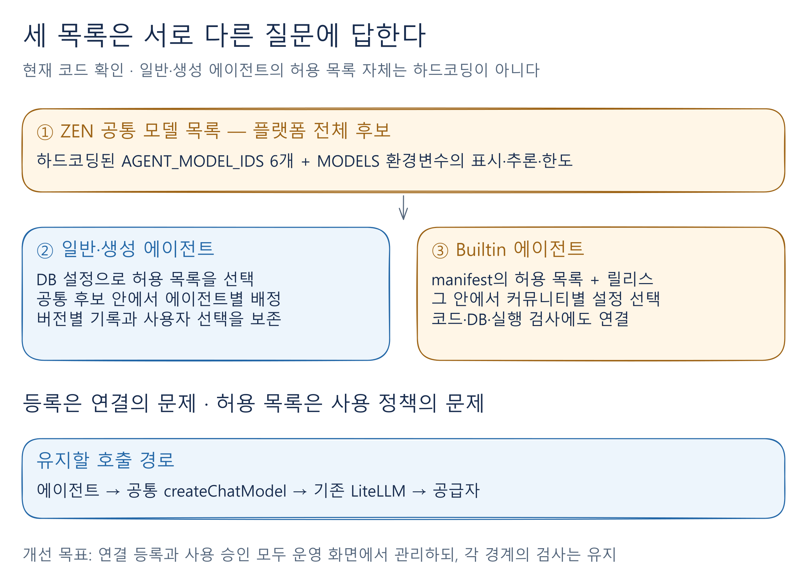
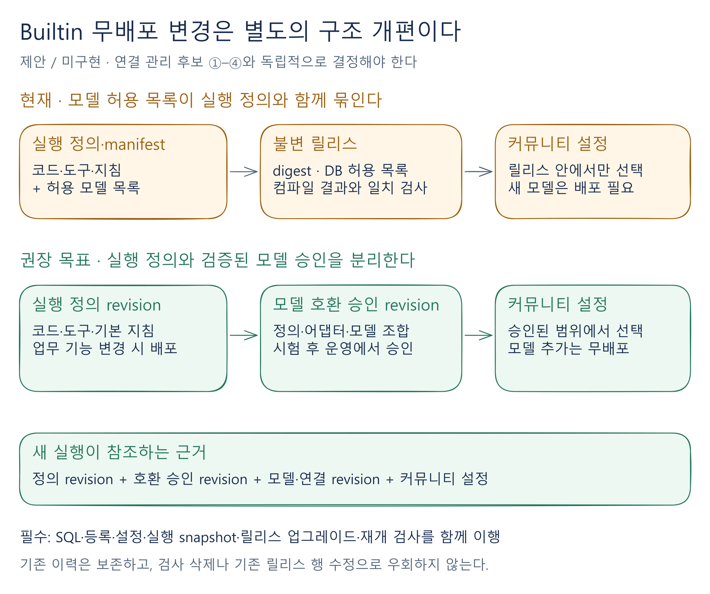
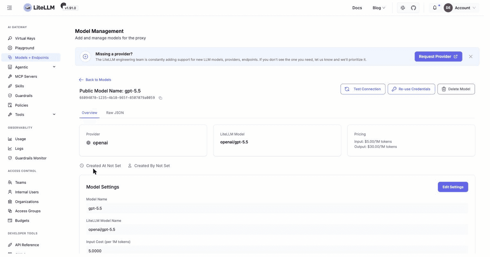
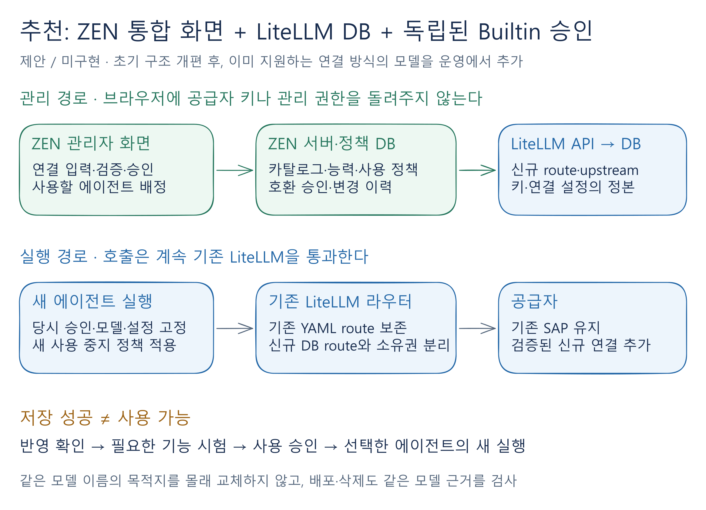
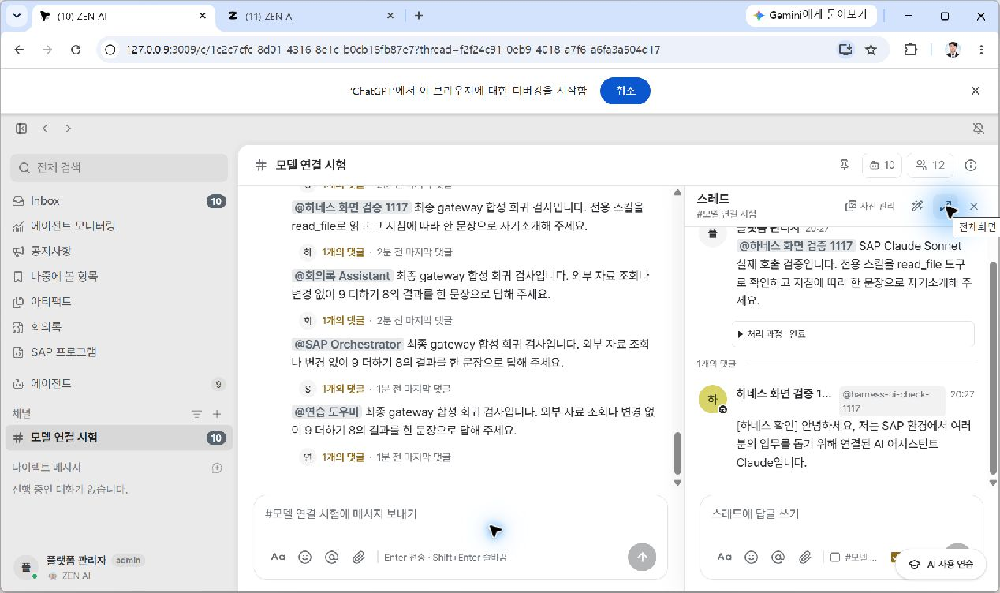
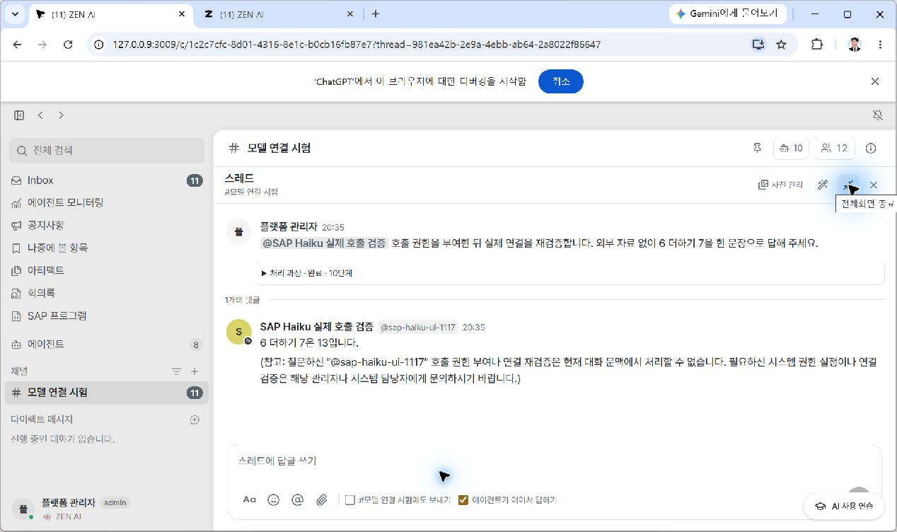
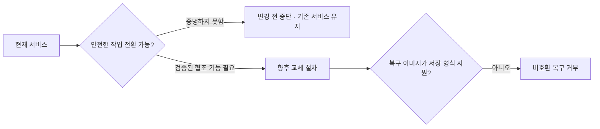
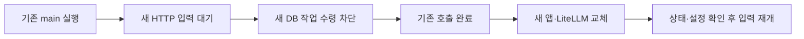

# 프로바이더와 모델 관리 페이지의 현실성 조사와 도입 기준

최종 요구 정리: **2026-11-12** · 담당: **세션 3 / 문서 4**  
상태: **설계·수용 기준 확정, 구현·운영 검증 전** · 구현 브랜치: `agent/add-model-provider-page`

> [!abstract] 이 문서에서 결정한 것
> **기존 LiteLLM을 유지하고, ZEN 화면에서 모델 등록 → 검증 → 에이전트 사용 설정을 처리한다.** 후보 **② ZEN 통합 화면 + LiteLLM 관리 API**를 우선안으로 선정한다. 신규 SAP 모델 추가, 기존 SAP 연결의 변경·삭제, 다른 프로바이더로의 전환, 일반·생성·Builtin 에이전트의 사용 설정을 **모두 최종 범위에 포함**한다.

## 1. 무엇이 목표이며, 무엇을 만들려는가?

### 1-1. 목표: 모델 변경을 매번 개발·배포하는 일에서 운영 업무로 바꾸기

**최초 구조 개편과 배포를 마친 이후, 이미 지원하는 연결 방식 안에서 모델 추가와 사용 설정을 운영 화면에서 재배포 없이 처리한다.**

예를 들어 SAP에 새 모델이 나오면 등록·검증 후 에이전트에 배정한다. SAP 대신 다른 제공자의 모델을 쓰고 싶으면 새 연결을 등록·검증한 뒤 에이전트 설정을 전환한다. 기존 SAP 연결의 수정·중지·삭제도 관리 범위다.

여기서 ‘프로바이더’는 모델을 제공하는 서비스이고, ‘연결’은 그 서비스에 접근할 주소와 인증 설정을 뜻한다. **새 인증 방식·미지원 API·새 SDK 기능까지 자동 지원한다는 의미는 아니다.** 공급자 계정과 SAP/Azure의 실제 모델 배포는 준비되어 있어야 한다.

### 1-2. 만들 화면과 운영자가 하는 일

운영자가 **ZEN의 ‘프로바이더와 모델’ 페이지**에서 다음 순서로 처리한다.

| 순서                           | 운영자가 할 일                                                                 | 완료의 의미                            |
| ------------------------------ | ------------------------------------------------------------------------------ | -------------------------------------- |
| **1. 연결·모델 등록**          | 제공자 주소·모델 이름·인증정보와 표시명·지원 추론 강도·컨텍스트 한도 등을 입력 | 모델에 어떻게 연결할지 등록됨          |
| **2. 모델 검증**               | 실제 호출, 도구 사용·스트리밍 등 필요한 기능, 지원 추론 강도를 확인            | 사용하려는 연결과 기능이 작동함을 확인 |
| **3. 에이전트 사용 설정·저장** | 사용할 에이전트, 허용/기본 모델, 기본·최대 추론 강도를 지정                    | 선택한 에이전트의 **새 실행**에 적용   |

**모델 등록 → 작동 검증 → 사용할 에이전트와 정책 지정·저장 → 이후 새 실행에 반영**

‘사용 허용’은 선택지에 추가하는 것이며 기본 모델 변경은 별도 선택이다. 등록 성공만으로 사용 가능하다고 표시하지 않는다. 필요한 기능과 실제 반영을 확인한 뒤 사용을 승인한다.

추론 강도는 **모델 이름만이 아니라 실제 제공 경로에서 지원하는 목록**으로 관리한다. 예를 들어 해당 SAP 연결이 `minimal`을 지원하지 않는다면 선택·저장·호출에서 제외한다. 추론 강도와 공급자가 반환하는 공개 추론 텍스트의 유무는 별개이며, 강도를 지정해도 모든 응답에 공개 요약이 생기는 것은 아니다.

SAP는 단일 API key 방식만 가정하지 않는다. OAuth 자격정보·resource group·deployment URL 등 해당 연결에 필요한 인증 정보를 다룬다.

> [!important] 유지하는 실제 호출 경로
> **ZEN 에이전트 → 기존 LiteLLM → 실제 모델 제공자**를 유지한다. 관리 기능을 추가하되 모델별 SDK를 ZEN에 다시 넣는 식으로 호출 구조를 확대하지 않는다.

이번 범위는 에이전트 모델 관리다. 회의록 Assistant는 포함하지만 녹음 전사·회의 요약·`TASK_MODEL` 보조 업무의 별도 모델 정책까지 자동으로 통합하지는 않는다.[^separate]

## 2. 현재 구조는 어떻고, 무엇을 바꾸는가?

모델 사용 설정은 **LiteLLM의 연결 설정**과 **ZEN의 사용 정책**으로 나뉜다. 연결을 등록하는 것과 에이전트에 사용을 허용하는 것은 각각 필요한 판단이다.

### 2-1. LiteLLM: 어떤 모델에 어떻게 요청을 보낼 것인가?

현재 저장소는 모델 연결을 주로 **YAML과 환경변수**로 구성한다. YAML에는 공개 모델 이름·실제 모델·처리 방식·URL을 적고, 민감정보와 배포 주소는 환경변수에서 읽는다. 일부 SAP 보완 코드는 특정 모델과 URL 변수의 대응 관계를 직접 검사한다.[^sap]

| 시점                     | 실제로 일어나는 일                                                                                 |
| ------------------------ | -------------------------------------------------------------------------------------------------- |
| **로컬 SAP 검증용 시작** | 실행기가 환경파일을 읽어 Docker에 전달하고, 로컬 YAML을 `/app/config.yaml`로 연결해 LiteLLM을 시작 |
| **운영 시작·배포**       | Compose가 운영 환경변수와 운영 YAML 또는 검증된 배포 후보 YAML을 컨테이너에 연결                   |
| **LiteLLM 시작**         | `--config /app/config.yaml`을 읽고 모델 이름별 연결 경로를 구성                                    |
| **실제 호출**            | ZEN의 모델 이름을 연결 설정에 대응시키고, 필요한 변환·인증 후 제공자에게 전달                      |

로컬 파일을 고친다고 운영 설정까지 바뀌지는 않는다. **SAP 보완 코드는 이미지 빌드 때 LiteLLM 내부에 적용되며, 요청이 들어올 때 실행**된다. 현재 고정 모델 매핑을 그대로 두면 새 SAP 모델을 YAML에 추가하는 것만으로는 충분하지 않을 수 있다.[^sap]

한편 **LiteLLM 자체는 DB와 관리 API로 모델을 등록·수정·삭제하는 기능을 제공**한다. 이것은 우리가 추가한 SAP 보완 코드와 별개다. DB 연결·모델 저장 기능 활성화·관리 권한이 필요하며, 실제 운영의 활성화 여부는 아직 확인 전이다.[^litellm]

### 2-2. ZEN: 연결한 모델을 어디에서 사용해도 되는가?

_조사한 기존 구조. [Excalidraw 원본](4-provider-model-management-assets/v2-01-three-model-layers.excalidraw) · [확대 SVG](4-provider-model-management-assets/v2-01-three-model-layers.svg)_

| 구분                             | 현재 역할과 관리 방식                                                                                   | 바꿔야 하는 이유                                       |
| -------------------------------- | ------------------------------------------------------------------------------------------------------- | ------------------------------------------------------ |
| **ZEN 공통 모델 목록**           | 코드의 `AGENT_MODEL_IDS` 고정 6개로 후보를 제한. `MODELS` 환경변수에서 표시명·추론 강도·한도 등을 보완  | LiteLLM에 새 모델이 있어도 고정 목록에서 제외됨        |
| **일반·생성 에이전트 허용 목록** | 공통 목록에서 선택한 모델을 DB와 버전 기록에 저장. **목록 자체는 이미 설정 데이터**                     | 기존 구조를 활용하되 새 동적 공통 목록과 연결해야 함   |
| **Builtin 에이전트 허용 목록**   | `manifest.json`의 허용 목록을 실행 정의에 포함해 컴파일하고 DB 릴리스와 대조. 설정·실행·재개에서도 검사 | 모델 목록 변경이 실행 정의의 릴리스 갱신·배포와 연결됨 |

근거: [공통 카탈로그][catalog] · [일반 에이전트 정책][policy] · [설정·버전 저장][registry] · [생성 하네스][harness] · [Builtin 설정][builtin].

Builtin의 핵심 문제는 ‘버전 숫자가 있다’는 사실보다 **허용 모델이 실행 정의의 일부라는 결합**이다. 이를 분리하더라도 도구·권한·실행 안전성 검사는 유지해야 한다.[^builtin-contract]

### 2-3. 선정한 ②안에서는 이렇게 바꾼다

| 대상                   | 변경 방향                                                                                             |
| ---------------------- | ----------------------------------------------------------------------------------------------------- |
| **LiteLLM 연결 관리**  | 관리 API와 DB를 사용. SAP 고정 매핑을 개편하고 기존 YAML 연결도 검증된 절차로 관리 방식을 이행        |
| **ZEN 공통 목록**      | 모델 정보·지원 추론 강도·검증/사용 상태를 운영 화면에서 관리. 발견된 모델을 무조건 자동 승인하지 않음 |
| **일반·생성 에이전트** | 기존 DB 설정과 버전 구조를 활용해 공통 목록을 연결. 테이블·컬럼 추가 여부는 실제 책임에 따라 결정     |
| **Builtin**            | 실행 정의는 코드 릴리스로 유지하고, 검증된 모델 조합의 승인은 **ZEN 내부에서 별도로 관리**            |

_목표 구조이며 구현 완료를 뜻하지 않는다. [Excalidraw 원본](4-provider-model-management-assets/v2-02-builtin-separation.excalidraw) · [확대 SVG](4-provider-model-management-assets/v2-02-builtin-separation.svg)_

**Builtin 모델 승인도 ZEN의 책임이다.** 별도 외부 시스템을 만드는 것이 아니다. 등록·릴리스 대조·SQL 접수/실행 검사·실행 snapshot·업그레이드·중단/재개가 같은 승인 근거를 사용하도록 함께 바꾼다.[^builtin-contract]

## 3. 기존 LiteLLM을 유지하는 방법 후보와 비교

### 3-1. 운영 화면에서 관리하는 네 가지 후보

다음 후보는 모두 실제 추론에 기존 LiteLLM을 사용한다. ‘원본’은 해당 정보를 수정·관리할 책임이 있는 기준 데이터를 뜻한다.

| 후보                                   | 운영자가 사용하는 방식                                                 | 연결 설정의 원본             | 특징                                                                  |
| -------------------------------------- | ---------------------------------------------------------------------- | ---------------------------- | --------------------------------------------------------------------- |
| **① LiteLLM 자체 관리 UI 도입**        | LiteLLM 제공 UI에서 등록 → ZEN에서 사용 승인·에이전트 배정             | LiteLLM DB                   | 두 화면 사용. 제공 UI가 적합하면 등록 화면 개발을 줄일 수 있음        |
| **② ZEN 통합 화면 + LiteLLM 관리 API** | ZEN에서 입력 → ZEN 서버가 LiteLLM API로 등록·반영 확인 → ZEN 사용 설정 | LiteLLM DB                   | **ZEN 한곳에서 관리**. ZEN은 연결의 별도 수정 가능 사본을 만들지 않음 |
| **③ ZEN 설정 저장 + LiteLLM 동기화**   | ZEN에 연결 원본 저장 → 별도 처리기가 반영·재시도·차이 확인             | ZEN DB                       | 연결 설정의 승인·버전·자동 복원까지 ZEN이 책임                        |
| **④ ZEN 화면 + 설정·배포 자동화**      | 화면 입력 → Git/YAML 변경 → 검토·배포·검증                             | Git/YAML, 비밀은 보안 저장소 | 모델 변경에도 배포가 남음                                             |

①의 화면은 우리가 이미 만들어 둔 화면을 뜻하지 않는다. **LiteLLM 제공 UI를 실제 환경에 구성해 사용하는 후보**이며, 운영 이미지에서의 제공·사용 가능 여부와 인증 구성은 확인이 필요하다. 불충분해 별도 화면을 개발해야 한다면 개발량 절감 장점은 줄어든다.

_LiteLLM 공식 문서의 예시이며 ZEN 화면·현재 운영 화면이 아니다. 이미지 버전과 고정 조사 버전 1.92.0의 지원 계약은 구분한다. [공식 문서](https://docs.litellm.ai/docs/proxy/model_management)_

### 3-2. 후보 선택과 별개로 정비해야 하는 구조

**①②③의 무배포 운영에는 공통 목록의 동적 관리가 필요**하고, Builtin까지 포함하려면 실행 정의와 모델 승인을 분리해야 한다. ④는 목록을 배포 산출물로 갱신하고 릴리스 결합을 유지하는 방식도 가능하다.

| 공통 검토 대상            | 필요한 일                                                                                                                   |
| ------------------------- | --------------------------------------------------------------------------------------------------------------------------- |
| **1. ZEN 공통 모델 목록** | 모델 목록·표시명·추론 강도·한도·활성 상태를 운영 관리와 일치시킴                                                            |
| **2. 일반·생성 에이전트** | 기존 설정을 새 목록과 연결하고 기본/허용 모델·추론 정책을 검증                                                              |
| **3. Builtin 에이전트**   | 무배포 목표에 맞춰 독립 모델 승인과 실행·재개 계약을 함께 이행                                                              |
| **4. 변경·중지·삭제**     | 에이전트 기본값·허용 목록·공유 연결·진행/재개 참조를 확인하고 과거 이력을 보존                                              |
| **5. 배포·재시작·복구**   | 동적 모델을 사전 검사에 포함하고 YAML+DB 연결과 ZEN 정책의 일치를 확인. 지원하지 못하는 rollback은 적용 전에 거부           |
| **6. 가격·사용량**        | 제공자별 가격 근거와 호출 당시 snapshot 보존. 가격 미확인은 ‘미산정’으로 구분하고 외부 모델에 SAP 가격을 잘못 적용하지 않음 |

**LiteLLM에 등록하고 ZEN에서 사용하게 연결하는 것뿐 아니라, 이후 배포·복구와 사용량·비용 관리까지 정비해야 한다.**[^deploy][^pricing]

| 운영 동작              | 영향과 처리 원칙                                                                                                          |
| ---------------------- | ------------------------------------------------------------------------------------------------------------------------- |
| **새 모델 추가**       | 검증·승인 후 허용한 대상부터 적용. 기존 에이전트의 허용 목록을 자동 확대하지 않음                                         |
| **연결·인증정보 변경** | 공유 에이전트와 실행 영향 확인. 목적지 변경은 새 식별자/버전으로 검증·전환하고 진행 중 실행의 목적지를 몰래 교체하지 않음 |
| **중지**               | 새 배정·접수를 차단. 기존 실행의 완료/재개 정책 및 공급자 key 폐기와 구분                                                 |
| **삭제**               | 기본값·활성/재개 참조를 해소한 뒤 물리 삭제. 과거 호출·가격·변경 책임은 비밀 없이 보존                                    |

LiteLLM의 block/unblock만으로 ZEN 접수 차단·기존 실행 종료·다른 deployment/fallback·공급자 key 폐기까지 해결되지는 않는다. 승인 전 모델 접근 범위도 별도 확인한다.[^block]

### 3-3. 후보별 추가 작업·난이도·운영 영향

**난이도는 코드 결합과 운영 책임에 따른 정성 비교이며 예상 개발일이나 실측 점수가 아니다.** Builtin 승인 분리는 무배포 목표를 택한 후보에 별도로 필요한 큰 작업이다.

| 후보                   | 추가로 필요한 작업                                           | 상대 난이도             | 운영에서 주의할 점                                                                  |
| ---------------------- | ------------------------------------------------------------ | ----------------------- | ----------------------------------------------------------------------------------- |
| **① 자체 UI 도입**     | 접속·관리 권한, ZEN 가져오기·승인, 외부 변경 감지            | **중** — UI 적합성 전제 | LiteLLM에서 먼저 삭제·개명하면 ZEN 참조가 깨질 수 있음                              |
| **② 통합 화면·API**    | ZEN UI/API, LiteLLM 연동, 작업 결과·반영 확인·부분 실패 복구 | **중~상**               | LiteLLM 등록 성공/ZEN 저장 실패, timeout 후 결과 불명 등을 처리해야 함              |
| **③ 원본 저장·동기화** | ②의 상당 부분 + 목표 설정 버전·작업자·재시도·충돌·자동 수렴  | **상**                  | 반영 대기 추적과 복원에 유리하나 잘못된 설정도 자동 재적용할 수 있음                |
| **④ 설정·배포 자동화** | 입력 검증, 비밀 참조, 변경 요청·배포·결과 연동               | **중~상**               | 배포 대기와 서비스 교체 영향이 남고 Git 되돌리기만으로 폐기된 key까지 복원되지 않음 |

②에도 불일치 감지와 재조회가 필요하다. ③은 여기에 더해 **ZEN의 목표 상태로 LiteLLM 설정을 다시 맞추는 책임**을 갖는다. 어느 안이든 저장 성공을 전체 replica의 반영·실제 호출 성공으로 간주하면 안 된다.[^observed]

## 4. 판단 기준·추천안·행동 플랜

### 4-1. 어떤 기준으로 ②를 선정했는가?

| 판단 기준                                              | 우선순위                        | 선정에 미친 영향                                                        |
| ------------------------------------------------------ | ------------------------------- | ----------------------------------------------------------------------- |
| **기존 LiteLLM 호출 경로 유지**                        | 필수                            | 네 후보 모두 충족 가능한 공통 전제                                      |
| **모델 변경마다 재배포하지 않기**                      | 핵심 목표                       | 배포가 남는 ④는 이번 우선안에서 제외                                    |
| **ZEN에서 등록·검증·사용 설정 통합**                   | 사용자 요구                     | 두 화면을 사용하는 ①보다 ②③이 적합                                      |
| **구현량과 지속 운영 책임 줄이기**                     | 목표 충족 후보 사이의 선택 기준 | 연결 원본·자동 동기화까지 떠맡지 않는 ②를 우선                          |
| **기존 SAP·데이터·실행·복구 보호**                     | 모든 안의 도입 필수 조건        | ②라는 이유로 자동 충족되지 않으며 populated upgrade와 회귀 검증 필요    |
| **연결 원본의 사전 승인·버전 복구·자동 동기화 필요성** | 추천을 바꾸는 조건              | 필수가 되면 ③을 재검토. LiteLLM이 하나여도 해당 요구가 있으면 의미 있음 |

선정 논리는 **④는 무배포 목표에 덜 맞음 → ①은 통합 운영 경험에 덜 맞음 → ②③ 중 현재 필수가 아닌 동기화 책임을 추가하지 않는 ② 선정**이다.

③은 여러 LiteLLM 환경을 동일하게 유지하거나 승인된 연결 설정으로 복원하는 데 적합하다. 다만 현재는 연결 원본의 사전 승인·버전 복구·자동 동기화를 필수로 확정하지 않았다. **‘LiteLLM이 하나이므로 무조건 ②’라는 판단은 아니다.**

### 4-2. 추천 구조: 두 시스템의 책임을 명확히 나누기

> [!success] 최종 추천
> **② ZEN 통합 관리 화면 + LiteLLM 관리 API·DB + ZEN 동적 카탈로그·사용 정책**을 구현한다. Builtin 모델 승인도 ZEN 안에서 관리하되 코드 릴리스와 분리한다.

_목표 구조. 그림의 ‘기존 YAML 보존’은 안전한 이행 중의 상태이며 최종적으로 기존 SAP 관리를 제외한다는 뜻이 아니다. [Excalidraw 원본](4-provider-model-management-assets/v2-03-recommended-architecture.excalidraw) · [확대 SVG](4-provider-model-management-assets/v2-03-recommended-architecture.svg)_

| 시스템      | 담당하는 정보·동작                                                                                                 |
| ----------- | ------------------------------------------------------------------------------------------------------------------ |
| **LiteLLM** | 실제 모델 연결·공급자 인증·요청 변환·전달. 연결 원본은 LiteLLM DB/단일 보안 저장 경로에 두고 ZEN은 관리 API로 대행 |
| **ZEN**     | 공통 모델 목록·검증·사용 승인·가격 연결·일반/생성/Builtin 모델 정책·에이전트 배정·변경 이력                        |

**Builtin 호환 승인은 별도 외부 시스템이 아니다.** 코드·도구·권한의 실행 정의는 ZEN 릴리스로 유지하고, 검증된 정의·어댑터·모델 조합의 사용 승인은 ZEN 내부의 독립 버전으로 관리한다. 당시 승인 번호를 저장하는 것만으로 실제 route가 고정되는 것은 아니므로 실행이 해당 연결을 계속 사용하는지도 확인한다.[^routing]

### 4-3. 단계적 행동 플랜과 운영 보호 시험

| 순서                           | 필수 작업                                                                                                   | 완료 판단                                                                     |
| ------------------------------ | ----------------------------------------------------------------------------------------------------------- | ----------------------------------------------------------------------------- |
| **1. 운영 준비 확인**          | 실제 이미지·보안 패치·DB 모델 관리 활성화·관리/추론 권한·영구 암호화 설정 확인. 격리 DB와 mock gateway 준비 | 기존 환경과의 차이 및 부족한 준비를 비밀 없이 식별                            |
| **2. 연결 관리 구조 개편**     | LiteLLM 관리 API, SAP 고정 매핑 개편, 기존 YAML 연결의 관리 방식 이행                                       | **신규 SAP 모델 등록, 기존 SAP 연결 변경·삭제, 타 프로바이더 연결 등록** 가능 |
| **3. ZEN 화면·일반/생성 연결** | 공통 모델 목록·지원 추론 강도·검증/사용 상태·에이전트 정책 연결                                             | 새 모델 배정과 프로바이더 전환이 새 실행에 반영                               |
| **4. Builtin 확장**            | 실행 정의와 모델 승인 분리. SQL·snapshot·업그레이드·재개 계약 함께 이행                                     | meeting·SAP·tutorial에서 새 모델을 무배포로 승인·사용                         |
| **5. 운영 전환·전체 검증**     | 추가·수정·중지·삭제·전환·가격/사용량·다음 배포·재시작·복구 시험                                             | 기존 사용자가 있는 상태에서도 지원 계약이 보존됨을 검증                       |

**신규 SAP 모델과 기존 SAP 연결 관리는 선택사항이 아니다.** 기존 연결은 이행 중 호출을 보호하기 위해 유지하며, 검증 후 관리 책임을 이전한다. 같은 공개 모델 이름을 YAML과 DB에 동시에 등록해 의도치 않은 다중 route를 만들지 않는다.[^coexist]

> [!important] 공유 연결을 지우기 전에 확인할 범위
> 에이전트 배정을 모두 옮겼어도 **별도 업무가 같은 LiteLLM 연결을 사용할 수 있다.** 관리 화면의 영향 확인과 다음 배포의 YAML 정리 직전에 함께 검사한다.
>
> - **함께 보호:** 회의 요약·예약된 요약 재생성·TASK_MODEL·SAP 보조 작업. 현재 회의 모델과 예약 작업의 모델이 달라도 확인한다.
> - **이력과 구분:** 완료·취소된 재생성 작업의 이력만으로는 삭제를 막지 않는다. 저장된 회의의 재요약 의존성은 별도로 보호한다.
> - **별도 호출 경로:** SAP에 직접 요청하는 전사는 LiteLLM 연결과 이름이 같다는 이유만으로 참조로 취급하지 않는다.
>
> 기존 요약·보조 작업의 모델 정책을 이 에이전트 관리 화면에 합치는 변경은 아니다.

이미 사용 중인 main 환경을 전제로 다음 회귀를 수용 기준에 포함한다.

| 시험 상황                                 | 반드시 확인할 동작                                                                                                                   |
| ----------------------------------------- | ------------------------------------------------------------------------------------------------------------------------------------ |
| **기존 데이터가 있는 DB의 migration**     | 합성 기존 사용자·에이전트·Builtin 릴리스·설정·실행·호출 이력·가격을 준비해 이행 전후 보존 확인. 삭제·rename·기존 설정 일괄 확대 금지 |
| **관리 기능이 아직 미설정인 첫 배포**     | 기존 6개 모델과 기존 설정으로 호출 가능. 준비 부족이 관리 기능에 명확히 표시됨                                                       |
| **진행·중단 후 재개할 실행이 존재**       | 새 모델 전환이 기존 실행의 목적지를 몰래 바꾸지 않음. 참조 중인 연결의 파괴적 변경·삭제 차단                                         |
| **일반·생성·Builtin 실행**                | 기존 모델 회귀와 새 모델 사용, 도구·권한·추론 강도·사용자 확인·재개 검증                                                             |
| **등록의 부분 실패·관측 지연**            | 중복 route/허위 사용 가능 상태 없이 결과를 재확인하고 회복                                                                           |
| **프로바이더·가격 변경 이후 조회**        | 과거 호출·가격 근거는 유지. 미확인 외부 모델 가격은 미산정                                                                           |
| **새 모델 사용 후 다음 배포·재시작·복구** | YAML+DB inventory와 ZEN 정책 검사. 지원 rollback 계약 확인 또는 적용 전 거부                                                         |
| **권한·비밀·목적지 공격**                 | 플랫폼 관리자 경계, key 비노출, 마스킹값 보존, 임의 URL·redirect·SAP token 목적지 경계 확인                                          |

> [!warning] 검증 범위를 부풀리지 않는다
> 운영 DB·실제 고객 원문을 사용하거나 운영 설정을 임의 변경하지 않는다. populated upgrade는 **격리 DB의 합성 기존 데이터**로 검증한다. 단위·통합 시험 통과와 실제 운영 무중단 보장은 구분한다. 테스트·권한 검사·게이트를 완화하거나 skip하여 완료로 표시하지 않는다.

조사 기준 LiteLLM 1.92.0은 공식 보안 권고의 영향 범위에 포함되므로 실제 운영 이미지의 수정 포함 여부와 SAP 호환을 확인해야 한다. 이번 문서는 운영 취약성을 재현하거나 침해를 확인한 결과가 아니다.[^security]

구현 의도와 기준↔테스트 매핑은 ZEN 저장소 `intents/add-model-provider-page.md`가 관리한다. 이 문서는 사용자 판단과 운영 흐름을 설명하며, 검증 전인 제안을 완료 기능으로 표기하지 않는다.

#### 구현 중 확인한 호환 계약

Chrome으로 로컬 격리 환경을 확인하면서 다음 세 가지를 **운영 전환의 필수 기준**으로 구체화했다.

| 지켜야 할 계약 | 구현·검증 원칙 |
| --- | --- |
| **기존 압축 설정 보존** | 저장된 압축 모델·비율·NULL의 기존 기본 정책과 버전·실행 스냅샷을 유지한다. 현재 목록에 없는 저장 모델은 **기존 설정 유지**로 표시한다. 새 에이전트는 승인된 동적 모델을 사용하고, 모델 하나만 있어도 **백업 없음**으로 생성할 수 있어야 한다. |
| **검증과 실제 호출의 일치** | 연결 성공뿐 아니라 실제 실행이 보내는 **추론 강도·명시적 도구 선택·도구 왕복·스트리밍**을 검사한다. LiteLLM 내부 목록에 없는 새 모델은 검증 요청과 실제 요청의 옵션이 다르면 검증만 통과하고 실행은 실패할 수 있다. **도구 사용 안 함·특정 도구만 사용** 등의 제약을 삭제하거나 완화해 통과시키지 않는다. |
| **화면 결과와 저장 상태의 일치** | 긴 입력 폼의 저장 오류는 저장 버튼 가까이에서 항상 확인할 수 있어야 한다. 모델 사용 승인 후에는 카드의 이전 ‘승인 필요’ 안내도 함께 갱신한다. 실패 시에는 입력값과 재시도에 필요한 정보를 유지한다. |

> [!important] 기존 시험 연결은 새 revision으로 이행
> **기존 연결의 옵션이나 fingerprint를 몰래 덮어쓰지 않는다.** 새 revision을 등록·검증·승인한 뒤 사용할 에이전트를 명시적으로 전환한다. SAP Responses의 Luna 검증에 이어 SAP Claude도 아래 범위에서 실제 호출을 확인했다.

#### SAP Claude: 원인·수정·실제 검증 (2026-11-17)

**원인:** pinned LiteLLM 1.92.0의 SAP 변환기가 `tool_choice`를 받아 놓고 SAP 요청을 만들 때 제거했다. 따라서 연결 등록만으로는 ‘특정 도구 선택’이나 ‘도구 사용 안 함’이 제공자에게 전달되지 않았다.

**수정:** Claude 연결에서 OpenAI 도구 선택을 SAP의 `model.params.tool_choice`로 전달한다. 기존 YAML과 새 관리형 연결에 적용하며, 다른 SAP 모델·Responses·인증·추론 이력은 보존한다. 유효한 fallback 배열은 지원하고 알 수 없는 구조에서 선택을 조용히 누락하지 않는다.

**추가로 발견한 원인과 수정:** SAP 응답이 정상 종료 정보(`finish_reason`) 없이 끊겨도 LiteLLM이 정상 `stop`으로 합성했다. 실제 pinned Router→HTTP 검사에서 재현한 뒤, 동기·비동기 스트림의 조기 EOF·읽기 오류·`[DONE]`을 **`SAP_STREAM_INCOMPLETE` 오류로 거부**하도록 수정했다. 정상 종료·도구·추론·토큰 처리는 보존한다. **Python 계약 67개를 통과한 최종 gateway**로 교체한 후 위 두 Claude 조합의 실제 검증과 아래 5종 실행을 다시 통과했다.

| ZEN의 요청 | SAP Claude에 전달하는 의미 |
| --- | --- |
| **auto** | 모델이 도구 사용 여부를 판단 |
| **none** | 도구 사용 금지 |
| **required** | 도구 사용 필수 (any) |
| **특정 function** | 지정한 도구만 선택 (tool + 이름) |

> [!success] 격리 로컬의 실제 제공자·Chrome 검사 통과
> **Haiku 4.5(추론 없음)**와 **Sonnet 4.6(low)**에서 특정 `zen_probe(value=7)` 호출 → 도구 결과 전달 → `none` 최종 스트림 → 사용 승인이 통과했다. terminal 수정 전 Chrome에서 합성 질문으로 아래 5종을 실행하고 실제 모델·추론 강도·토큰·도구·최종 답변을 DB에서 읽기 전용으로 대조했다. terminal 수정 후 최종 gateway 이미지에서 같은 5종을 HTTP로 다시 실행해 모두 완료했다. 이후의 새 Chrome 입력 검사는 도구 연결 제한으로 반복하지 못했으며, HTTP 재검사를 Chrome 검사와 구분한다.

| 실제 실행 대상 | 확인 결과 |
| --- | --- |
| **일반 에이전트 · Haiku** | 실제 모델 호출·토큰·최종 답변 완료 |
| **하네스 · Sonnet(low)** | `read_file`로 전용 스킬을 읽고 **[하네스 확인]** 지침을 적용한 최종 답변 |
| **회의록 Builtin · Sonnet(low)** | 최종 답변·기존 정의 릴리스 보존 |
| **SAP Builtin · Sonnet(low)** | `sap.discover` 도구 왕복 후 최종 답변 |
| **연습 Builtin · Sonnet(low)** | `read_skill` 도구 왕복 후 최종 답변 |
| **기존 데이터 보호** | 시험 전 에이전트 8개 중 명시적으로 모델을 바꾼 하네스 1개만 제외하고 7개 원본 행 일치. 과거 버전 **16개**, 완료 실행 **9개**, Builtin 불변 릴리스 **3개** 보존. Haiku 시험용 에이전트는 별도 추가 |
| **권한·중지·삭제** | 관리자/일반 사용자·위조 헤더·Origin 경계, 미검증 승인·중복 등록 거절, 임시 연결 중지/재확인/삭제, 사용 중 연결 삭제 거절을 최종 수정 뒤 재확인 |

_Chrome에서 실행한 Sonnet(low) 하네스의 완료 응답. 도구 호출과 토큰은 같은 실행의 DB 기록으로 대조했다._

**검증 범위:** 합성 입력만 사용한 로컬 production 앱·gateway 검사다. 다른 Claude 버전이나 모든 추론 강도의 지원을 보장하지 않는다. 조합별 실제 검증을 통과해야 승인할 수 있으며, 검증을 통과시키려고 추론이나 도구 제약을 끄지 않는다. 운영 DB·서버에는 쓰지 않았다.

| 최종 확인 (2026-11-17) | 결과 |
| --- | --- |
| **전체 게이트** | check·lint·knip·Builtin 통과. Linux **9,039개**, Windows 전용 **19개**, 합계 **9,058개 통과**. 기존 27개 skip 유지·새 skip 없음 |
| **실제 pinned gateway 이미지** | Python 계약 **67개 통과**. 실제 fallback 생성·입력 보존·도구 선택 전달·HTTP/body 오류·잘린 스트림 거부 포함 |
| **교차 평가** | 최종 하네스 Codex **ACCEPT**, 외부 Claude **ACCEPT**. 외부 전송은 승인된 소스·테스트·intent·diff에 한정하며 비밀·운영 원문·실사용 로그 제외 |
| **최신 통합 커밋·원격 CI** | [5e55b732](https://github.com/zen-compass/zen-ai/commit/5e55b73258281fbcedacad6ab020fa4b77196557) — [CI 통과](https://github.com/zen-compass/zen-ai/actions/runs/44101101008) · [Docker Build Check 통과](https://github.com/zen-compass/zen-ai/actions/runs/44101101054) |

**기존 의존성 경고 (2026-11-18 CI 재확인):** 보고용 `npm audit --omit=dev --audit-level=high`는 6건(고위험 1건: `sharp`/librsvg [CVE-2026-96889](https://github.com/advisories/GHSA-wq5f-xc86-pv6w))을 보고했다. main의 기존 `continue-on-error: true` 설정을 유지했으며, 이번 PR은 `package.json`·lockfile을 변경하지 않았다. **CI 성공은 취약점 0건을 뜻하지 않는다.** 의존성 갱신은 이번 범위에 포함하지 않았다.

**운영 적용 전 확인:** PR은 draft를 유지한다. 운영 DB 직접 검증·전체 과거 YAML inventory 사전검사·권한/마이그레이션 사람 리뷰는 남아 있다. 이 결과는 운영 배포·무중단 보장을 뜻하지 않으며 다른 Claude 모델·추론 강도도 개별 검증해야 한다.

#### 실제 main 데이터로 확인한 업그레이드 기준 (2026-11-18)

> [!important] 기존 사용자 작업을 보호하는 기준
> **기존 설정·연결·이력은 자동 변경하지 않는다.** 새 접수의 잠깐 대기는 허용하지만 이미 접수한 작업의 실패·유실·중복 실행은 허용하지 않는다. 안전한 인계를 증명하지 못하면 **migration·환경파일·서비스 변경 전에 중단하고 기존 서비스를 유지**한다.

**보완한 보호와 남은 도입 조건**

| 구분 | 확인된 문제 | 적용한 보호 |
| --- | --- | --- |
| **저장 형식과 복구** | main은 SQL `NULL` 압축의 기본값 상속과 문자열 백업 모델은 지원하지만, 명시적 `fallbackModel:null`은 읽지 못한다. legacy 모델 이름만 사용해도 비호환일 수 있다. | 현재 설정·현재 불변 버전과 실제 실행·재개가 참조하는 snapshot의 **원본 JSON**을 검사한다. 비활성·보관된 현재 설정도 포함하고, 참조 없는 과거 완료 이력은 제외한다. |
| **HITL 대기 참조** | 첫 질문 run은 `done / task_id=NULL`이어도 스레드에는 사용자 응답을 기다리는 작업이 남을 수 있다. | 같은 커뮤니티·에이전트·채널·canonical 스레드의 작업을 대조한다. 다른 root나 reply를 별개 작업의 root로 오인하지 않는다. **0161은 함수만 추가 보완하며 기존 값을 바꾸지 않는다.** |
| **교체 중 작업 보존** | 현재 main에는 worker claim과 직접 모델 호출을 함께 안전하게 멈추고 되돌리는 협조 기능이 없다. 한 번의 작업 수 조회·이미지 표시값·SIGTERM만으로는 안전성을 증명할 수 없다. | 자동 배포·복구·app-only·Ops를 **DEPLOY_WORK_TRANSITION_UNSUPPORTED**로 변경 전에 차단한다. **최초 안전 교체를 위한 준비 배포는 아직 구현·검증되지 않았다.** |

**실제 앱으로 수행한 독립 검증 — 운영 DB가 아닌 격리 환경**

| 검증 | 결과 |
| --- | --- |
| **기준 앱·자료** | main `2fcede9720ac5d6ac6af399346bed30d145fc537`의 production 앱이 HTTP로 일반·하네스를 생성·수정하고 Builtin을 등록했다. 실제 worker 완료와 단일 응답, 개인 지침·모델·추론 설정 저장을 확인했다. 모델 응답만 모형이다. |
| **migration 중 main 사용** | 최신 0161 적용 전후 연속 읽기·쓰기 **각 7회**, 오류 **0회**. 이 중 실제 migration 시작~종료 구간에 완료된 읽기·쓰기 **각 4회**를 별도로 단언했다. 직전 **32개 테이블의 원본 행 해시**가 유지됐다. 초기 0159/0160 검증의 읽기·쓰기 각 9회와 구분한다. |
| **접수 작업 → 신버전** | main이 접수한 일반·하네스·meeting pending **3건**이 약 **12초** 전환 시험에서 모두 완료됐다. 원래 ID·버전·모델·압축 snapshot을 유지하고 응답을 각각 **1회** 저장했다. claim 권한 일시 제한은 **소유 DB의 시험 장치이며 운영 인계 방법이 아니다.** |
| **기존 질문 대기 → 신버전** | main이 만든 `task_id=NULL` 첫 질문에 답변을 제출하고, 기존 작업의 `todo_write` 완료·단일 최종 응답·작업 `done`을 확인했다. 답변은 기존 동작대로 당시 현재 버전으로 새 실행되며, 과거 질문 버전 그대로 실행됐다는 뜻은 아니다. |
| **관리 OFF·ON** | 기존 설정 읽기와 관리 ON의 일반·하네스·meeting 신규 호출을 통과했다. 개인 Haiku 선택과 기존 압축 정책을 유지했다. |
| **원본 보존** | 에이전트 **12행**, 불변 버전 **17개**, 허용 모델 **15행**, 개인 설정/버전 각 **1행**, 하네스/스킬 버전 각 **4행**, 이전 이벤트 **38행**의 해시를 재대조했다. 새 실행 행은 추가되며 이전 행을 덮어쓰지 않았다. |
| **복구 거부** | production 이미지의 검사기로 SQL NULL·문자열 백업은 contract 0 허용, 명시적 JSON null은 contract 0 거부·contract 1 허용을 확인했다. null 사례의 임시 설정 변경은 격리 합성 검사 후 원복했다. |
| **실패 원인 구분** | 최초 시험은 복사 볼륨 하위 UID 오류와 빌드 대기 중 meeting 2분 deadline 초과로 실패했다. 실패 이력을 삭제·재큐잉하지 않고 보존했다. 시험 볼륨 UID만 복구한 뒤 새 main 접수로 재검증했다. 모형의 텍스트 응답만으로 기존 작업이 완료된다고 가정한 검사도 실제 완료 도구 호출로 보완했다. |
| **독립 평가의 추가 결함 → 재현·수정** | 중지·보관 커뮤니티의 재개 snapshot, 비활성·보관 에이전트에만 저장된 동적 모델을 구버전 검사에서 놓쳤다. 두 경우 모두 production 검사기의 **red → green**을 확인했다. 기본·허용 모델·개인 선택·Builtin 현재 설정·실제 재개 버전을 활성 라우팅 검사와 별개로 확인한다. SQL NULL·문자열 백업의 정상 허용과 무관한 완료 이력 제외도 유지했다. |
| **배포·Ops 계약** | 실제 Linux Bash/Python **51개 통과**. 서비스·환경파일 변경 전 차단과 pending·기존 환경 보존을 확인했다. |
| **전체 게이트·평가·CI** | 최신 제품 커밋 **`5c87328d`**. check·lint·knip·Builtin과 Linux **9,062개** + Windows **19개** 통과, 기존 skip **27개** 유지·새 skip 없음. 하네스 교차 평가와 독립 Codex·Claude **ACCEPT**. [최신 CI](https://github.com/zen-compass/zen-ai/actions/runs/44235004853)·[Docker Build Check](https://github.com/zen-compass/zen-ai/actions/runs/44235003816) 통과. production 이미지 빌드·소스 **2,962개 hash 일치**도 확인했다. PR #410·Jira ZA-130에 같은 결과와 적용 제한을 기록한다. |

#### 등록 모델 삭제와 사용 중 설정 보호 (2026-11-18)

**삭제 준비 → 최신 영향 확인 → 새 사용 중지 → 참조를 명시적으로 변경·진행 작업 완료 → 별도 확인 → 삭제 확정** 순서다. 삭제 준비만 여는 것으로 연결이나 에이전트 설정을 바꾸지 않는다.

| 현재 사용 상태 | 삭제 정책 |
| --- | --- |
| **에이전트 설정에 사용 중** | 기본·허용·압축 모델, 개인 선택, Builtin 설정을 먼저 변경해야 한다. 비활성·보관 에이전트도 보호하며, 시스템이 대체 모델을 임의로 고르거나 권한을 없애지 않는다. |
| **진행·대기·재개 가능한 작업에 필요** | 삭제를 차단하고 연결을 유지한다. 작업을 강제로 취소하거나 다시 실행시키지 않는다. |
| **참조 없음 + 중지 또는 연결 없음** | 운영자가 별도 확인한 뒤 서버와 DB가 삭제 직전에 다시 검사한다. 오래된 화면과 설정/삭제 경합으로 보호를 우회할 수 없다. |
| **삭제 완료** | 활성 관리 목록과 실제 연결에서 제거한다. 과거 실행·감사 이력과 식별자는 보존하고, 같은 모델 ID를 재사용하지 않는다. |
| **외부 실패·응답 유실·연결 ID 재사용** | 성공으로 표시하지 않는다. 실제 연결을 재확인한 뒤 재시도하며, 다른 모델의 연결을 잘못 삭제하지 않도록 차단한다. |

> [!info] 검증 범위와 남은 검사
> 화면·API·서비스·오류 안내의 **DB 없는 검사 4개 파일·48건**은 통과했다. 실행 환경은 Windows Node 22.23.4 / 설치 Vitest 4.1.11이며, lockfile 기준 전체 검사와 구분한다. **실제 DB 참조·경합 검사, 전체 게이트·Claude 평가·최신 CI는 아직 미완료**다. 최신 main **a4002ca8**의 권한·migration159와 통합하면서 과거 원본 검증을 보완하고 있다. 최초 서버 교체 미완료와 운영 배포 차단도 그대로 유지한다.

**추적:** [삭제 작업 ZA-132](https://zenconsulting.atlassian.net/browse/ZA-132) · [PR #410](https://github.com/zen-compass/zen-ai/pull/410). 이 표는 운영 배포·main 병합 또는 삭제 기능의 전체 검증 완료를 의미하지 않는다.

#### 관리 화면 개선과 커뮤니티 권한 (2026-11-18)

> [!abstract] 이번에 추가한 목표
> **에이전트 메뉴 바로 아래에서 모델을 관리**하고, 설정·승인·처리 결과를 같은 화면에서 쉽게 확인한다. 메뉴 노출과 실제 변경 권한은 **현재 커뮤니티의 활성 owner/admin**을 기준으로 검사한다.

| 사용자 작업 | 적용할 화면·정책 |
| --- | --- |
| **페이지 열기** | 에이전트 바로 아래에 모델 관리 메뉴를 둔다. member·지원 열람·타 커뮤니티 관리자·플랫폼 역할만으로 접근 권한이 생기지 않는다. |
| **등록 모델 확인** | 기존 에이전트 탭의 제목·폭·버튼·색상·카드에 맞춘다. 목록은 기본 **3개**, **3/6/12개** 선택과 페이지 이동을 제공한다. |
| **설정 변경** | 제공자·모델 이름·주소·인증·추론·컨텍스트·가격을 바꿀 수 있다. 사용 중인 연결을 덮어쓰지 않고 **변경본 저장 → 검증 → 사용 승인 → 에이전트에서 명시적으로 선택**한다. |
| **Builtin 승인** | 한 대상 승인과 **전체 대상 승인**을 제공한다. 전체 처리에서도 대상별 성공·실패를 보여 주며 부분 실패를 전체 성공으로 표시하지 않는다. |
| **결과 확인** | 작업한 카드와 눈에 띄는 알림에서 처리 중·성공·실패를 확인한다. 새로고침 오류가 방금 작업한 결과를 지우지 않는다. |
| **삭제** | 앞의 최신 영향·중지·별도 확인·실행 보호 정책을 그대로 적용한다. |

**기존 공통 모델 보호:** 현재 등록 모델은 플랫폼 공통 자원이다. 메뉴 권한만 확대하면 다른 커뮤니티가 쓰는 연결까지 바꿀 수 있으므로, 신규 커뮤니티 모델에는 소유 범위를 두고 **서버·DB의 배정·실행 경계에서도 검사**한다. 기존 공통 모델과 에이전트 설정·실행·이력은 자동으로 이동하거나 변경하지 않는다. 공통 연결의 변경·삭제 권한은 기존 플랫폼 관리 경로를 유지한다.

**인증정보 보호:** 기존 모델의 API key를 화면에 다시 표시하지 않는다. 저장하지 않는 연결값과 인증정보는 변경본 등록 시 다시 입력하도록 안내한다. 실패 시 입력을 보존하고, 성공한 뒤에는 비밀값을 지운다.

**저장된 실행 보호:** 관리 기능을 끈 경우에도 이미 저장된 압축 모델의 실제 입력 한도를 읽는다. 한도 조회 실패를 큰 기본값으로 대체하지 않으며, 기존 백업 모델·취소·권한 검사를 유지한다. 관리 기능 켜짐·꺼짐·미설정의 회귀 사례를 포함한 **79건**과 갱신한 main 원본 무결성 **6건**이 통과했다. 이는 전체 DB·빌드·화면 검증을 대신하지 않는다.

> [!info] 현재 검증 단계 — 2026-11-19
> **기능 반영과 최종 검증 완료는 구분한다.** 아래는 이번 UI 개선의 결과이며, 이전 커밋의 CI 성공을 새 변경의 결과로 사용하지 않는다.

| 구분 | 이번에 확인한 내용 |
| --- | --- |
| **기능 반영** | 메뉴·커뮤니티 권한·디자인·설정 변경본·전체 Builtin 승인·카드 알림·기본 3개 페이지네이션을 공식 하네스로 구현했다. |
| **실제 DB와 권한** | 원래 커뮤니티 통합 시나리오와 구스키마 업그레이드·정확한 RLS 계약 103건이 통과했다. 운영 DB를 사용한 결과는 아니다. |
| **기존 schema·원본 보존** | 실제 main `a4002ca8`의 Git blob 91개와 추가 SQL 4개를 대조했다. schema·ledger·원본 복원·변조 거부의 집중 검사 49건이 통과했다. 과거 원본 digest와 권한·rollback 단언은 유지했다. |
| **최종 전체 게이트** | 기존 제품 커밋 `45683eae`의 check·lint·knip·Builtin 및 Linux **9,831건** + Windows **19건** = **9,850건 통과**, 기존 skip27·새 skip0. 새 전환 도구의 check·lint·knip·Builtin은 통과했지만, 실제 background 실패가 발견되어 진행 중 전체 테스트를 취소하고 보완 중이다. background 보완 후 집중 **46/46 통과** 및 실제 main 인계 재시험도 통과했다. 새 전체 게이트·교차 평가는 진행 중이며 기존 제품 CI와 이번 변경의 결과를 구분한다. |
| **실제 main와 새 빌드** | main `a4002ca8`의 입력 2,729개를 Git blob 원본 바이트와 대조하고, 새 production 이미지의 소스 3,242개 hash가 게이트와 일치함을 확인했다. 두 이미지 빌드 성공. |
| **migration·실행·재개** | 실제 main HTTP/worker가 만든 자료로 migration 중 읽기·쓰기 각 8회, 오류0회. 실제 migration 구간 안의 완료는 각5회이고 기존31개 테이블 행 hash를 보존했다. main 접수 일반·하네스·meeting 3건의 동일ID·설정·응답 각1회, 기존 질문 답변 후 task 완료, 새 호출3종·설정/이력 보존·비호환 복구 거부를 확인했다. 모델 응답만 합성이다. |
| **로컬 DB와 최신 UI** | 원본 백업과 복제본의 기존 행·원장 보존, 반복 적용, idle·저장소 내용/UID·readiness 확인 후 최신 UI 앱을 교체했다. 이전 개발 DB의 비정규 migration 시각2개는 고치지 않고 확인된 미적용 SQL만 적용했다. 정식 installer는 그 특수 원장을 계속 거부하며 이 로컬 전용 절차는 운영 경로가 아니다. |
| **실패 기록 보존** | Windows archive CRLF 변환은 Git 원본 바이트 검사를 추가해 해결했다. Docker stream 복사의 UID0 하위 파일은 전용 시험 볼륨의 내용 hash를 유지하며 UID1000으로 복원했다. 원래 실패 DB·실행은 삭제·재큐잉하지 않고 새 main 접수로 재검증했다. |
| **로컬 HTTP** | 최신 production 앱에서 owner 에이전트·모델 페이지200, owner 모델 API200, member403, 익명401, 교차 Origin 변경403의 **6건 통과**. Chrome 시각 검증과는 구분한다. |
| **최신 CI** | 제품 `45683eae`의 [CI](https://github.com/zen-compass/zen-ai/actions/runs/44377811177)·[Docker Build Check](https://github.com/zen-compass/zen-ai/actions/runs/44377811869) 모두 **SUCCESS**. CI 테스트 **4,257 + 5,593 = 9,850건 통과**, 기존 skip27·새 skip0. 타입·lint·knip·앱 빌드·LiteLLM 계약·Git 이력 비밀 검사도 통과했다. |
| **Claude 판정** | 공식 하네스 구현 평가는 **ACCEPT**. 추가 최종 증거 평가는 **REVISE**: Chrome 화면 검증이 미수행이어서 전체 완료를 주장할 수 없다. 코드·artifact·CI 통과와 구분하며 PR은 draft로 유지한다. |
| **아직 남은 확인** | 최신 UI의 Chrome 메뉴·권한·모바일/데스크톱·3/6/12 탐색·편집/취소·전체 승인/알림·삭제 준비/차단/취소. 공식 CUA timeout 후 승인된 공식 Windows UI도 현재 URL을 확인하지 못해 안전 정책으로 중단했다. 페이지 시각 단언은 미수행이며 우회 자동화를 하지 않는다. |

**최초 교체의 추가 로컬 검증 — 2026-11-19**

| 확인 항목 | 실제 격리 시험 결과 |
| --- | --- |
| **전환 핵심 경계** | 보완 전 HTTP·PostgreSQL 회귀 **28/28 통과**. 입력 단일 전달, 취소·시간 초과 복원, 제어 프로세스 강제 종료·소유권 복구와 잘못된 권한 거부를 확인했다. |
| **실제 이미지 교체** | main `a4002ca8` → 새 앱·실제 LiteLLM 교체. 일반·하네스·Builtin과 대기 실행 **4건 완료·최종 응답 각1회**, 직접 HTTP200, 대기 등록 POST201·저장1건. 기존 설정7개 테이블 hash·공유파일3개 보존. |
| **회의 전사·요약 인계** | 실제 main에 합성 음성을 업로드했다. 활성 회의는 교체 전에 완료하고, 대기 회의는 같은 ID·전사/요약 모델·snapshot으로 새 앱에서 처리했다. **두 회의 모두 전사 구간1회·요약1회 완료**, 근거·요약 보존. 모델 제공자 응답만 합성이다. |
| **기존 질문 대기 재개** | 같은 task ID·에이전트·버전·모델·압축 설정으로 완료. 재개 실행과 응답 각1회. |
| **실제 비호환 복구 거부** | 새 앱에서 백업 압축 모델 없음(`fallbackModel:null`) 저장 후 contract0 검사 거부. 정상 새 앱·gateway를 내리지 않고 입력 처리 재개. |
| **gateway 실패·명시 복구** | 실제 이미지 기동 실패 뒤 HTTP·DB 대기와 원래 입력을 유지했다. 비호환 복구는 정상 앱 중지 전에 거부하고, 같은 gateway 이미지로 복구한 뒤 원래 POST201·저장1건을 확인했다. 앱 재시작 없음. |
| **최초 경로 설치 자체** | 실제 main에 이미 접수된 모델 호출·부분 전송 POST가 있는 상태에서 Caddy를 새 ingress로 reload했다. 사전 보조 경로가 없던 상태에서도 기존 요청 수를 계속 확인했고, 직접 호출HTTP200·부분POST201·응답1회, 새 대기POST 저장1건을 확인했다. Caddy 재시작 후 새 경로가 유지됐으며 앱·gateway·DB는 재시작하지 않았다. **공식 배포 명령 연결은 별도 미완료**다. |
| **열린 실시간 스트림** | 실제 main의 인증된 SSE를 열어 둔 상태에서는 시간 초과 후 **교체를 시도하지 않고** 기존 연결과 서비스를 유지했다. 대기 POST201·저장1건, 앱·gateway·DB 재시작0을 확인했다. **안전한 거부의 성공이며, 접속자가 있는 상태에서 교체를 완료한 시험은 아니다.** |
| **중계 프로세스의 대기 상태 보존** | 선택적 영구 상태를 추가하고 기존 HTTP·PostgreSQL 회귀와 함께 **60/60건 통과, skip 0건**. 재시작 후 같은 소유자만 대기 해제, 변경한 목적지 보존, 파일 부재·손상·다른 설정·동시 제어·저장 실패의 안전한 거부를 확인했다. 중계 프로세스 자체 장애에서 이미 연결된 소켓까지 살아남는다는 보장은 아니다. |
| **background의 실제 실패 발견** | main이 접수한 외부 계산은 완료됐지만 앱 교체 중 완료 보고의 재시도 한도가 소진되어 DB에는 실행 중으로 남았다. 원래 외부 작업 ID로 **보고만 다시 전달**하면 새 앱에서 단일 완료·응답이 가능했다. 자동 인계 성공으로 기록하지 않는다. 완료 보고가 저장되기 전에는 앱을 교체하지 않도록 보완했다. 별도 실제 main/new 앱·gateway 재시험에서 **같은 task·외부 job ID·snapshot 유지, executor 재시작0, 완료 전달·최종 응답 각1회**를 확인했다. 이전 실패 근거는 보존했다. |

> [!warning] 통과한 시험과 아직 제공하지 못한 운영 경로
> **공식 명령 연결의 현재 단계:** 실제 경계의 준비·차단·배출·재개는 검증했고, 실제 서비스 교체와 장애 복구는 구현 중입니다.

**11/19 공식 경계 후속 검증 — 이전 검증 기록**

| 검사 | 결과 |
| --- | --- |
| 관측 경계·고정 교체 계획의 root 회귀 | **869/869 통과, skip 0**. 최종 Compose와 유효 환경, 제어 컨테이너 설정을 고정한 v2 계획이 이전과 다른 값을 거부하는지 검사했습니다. 실제 Linux root 파일·권한을 검사했고 Docker·DB 응답은 모의입니다. |
| 실제 HTTP·PostgreSQL 핵심 회귀 | **73/73 PASS, skip0**. 진행 중 관측을 모두 끝낸 뒤 복구하도록 경합을 수정했습니다. 잘못된 카운트·다른 소유자·조회 실패에서 교체를 거부합니다. |
| 공식 준비·Caddy 경로 설치 | 과거 main `a4002ca8` 및 최신 main `9b6041bb`의 실제 production 이미지에서 통과. 모델 HTTP200·부분 POST201·새 대기 입력 저장1회, 원래 실행·응답 각1회, 기존 서비스 재시작0입니다. |
| **공식 HTTP·DB 동시 차단·재개** | 최신 main과 실제 Caddy·PostgreSQL·LiteLLM에서 통과. 진행 작업은 완료하고 차단 뒤 생성된 pending은 claim·수정 없이 보존했습니다. 해제 후 같은 ID·모델·버전·압축 정책으로 attempts1·응답1, 대기 입력 저장1회입니다. |
| **Caddy를 우회한 직접 HTTP** | Caddy 활성0이어도 앱의 실제 TCP 연결1을 감지해 drain을 막았습니다. 기존 부분 POST201 뒤에만 연결 수가0이 됐습니다. |
| **공식 경계 + 실제 SSE timeout** | 인증된 실시간 스트림을 유지한 채 **교체 시도0**, 기존 스트림·앱 보존, DB 차단 해제·HTTP 재개, 대기 POST201·저장1회입니다. 첫 시험의 잘못된 slug로 인한400은 보존하고 유효 입력으로 재시험했습니다. 열린 접속자가 있는 상태의 교체 성공을 뜻하지 않습니다. |
| **실제 Docker의 교체 계획 준비·재조회** | 최신 main·Caddy·PostgreSQL에서 고정 계획 생성과 재조회를 통과했습니다. root 소유0600·단일 링크·비밀값 미포함을 확인했고, 중복 생성은 거부하며 원본 파일·서비스를 보존했습니다. **교체 권한은 부여하지 않으며 실제 교체 시험도 아닙니다.** |
| 검증 기준 main 원본 자료·SQL | `9b6041bb` 독립 Git blob 기준 **104개 변경-main 파일·추가SQL4개**와 pin을 갱신했습니다. 병합된36개 파일은 Git 원본 바이트로, 수정 테스트2개는 LF만 복원했습니다. TeamWork SQL11개는 원본·manifest hash와 일치합니다. 기존 before 자료·SQL 내용·DB 원장은 바꾸지 않았습니다. |
| 전용 시험 DB 준비 | 최신 main의 실제 setup·cleanup 통과. 전용 비기본 루프백 포트가 같은 합성 DB를 가리키는지 확인했고 기존 역할을 보존했습니다. 시험 DB 안전 조건·권한 검사를 완화하지 않았습니다. |
| **전체 실패 → 보완 → 집중 재시험** | 이전 전체 검사에서 실패했던 21개 파일을 실제 격리 PostgreSQL에서 다시 실행해 **114/114 통과, skip 0**을 확인했습니다. 기존 main 원본과 migration의 무결성 규칙은 그대로 검사했습니다. |
| 현재 전체 게이트 | Windows 재부팅으로 Docker를 복구해 같은 검사를 재개했습니다. 타입·린트·knip·Builtin과 Linux root 검사가 통과했고 일반 Vitest 전체를 실행 중입니다. |
| **Windows 타입·린트** | 기본2GB 힙 실패 후 검사 프로세스에만4GB를 적용해 **check·lint PASS**. 미추적 `.harness` 사본은 제외하고 실제 앱·전환 스크립트는 검사 대상임을 확인했습니다. Git Windows 필터로 TeamWork·회의 백업·운영 문서의 원본 바이트 일치를 확인했습니다. |
| Windows 검사 | 재개한 공식 검사에서 전용 PostgreSQL과 Windows Vitest 환경을 복원했고 Windows 전용 테스트 **19건**이 통과했습니다. |
| 현재 전환 제어기 이미지 | 최신 전환 소스를 넣은 로컬 WIP 이미지 빌드 성공. 최신 main과 별도 실제 Docker 환경을 생성했으나 준비 API 관측이 네트워크 장애로 미완료입니다. 빌드 성공을 실제 교체 성공으로 취급하지 않습니다. |
| **실제 v2 계획과 요청 인계** | 최신 main `9b6041bb`의 production 이미지·PostgreSQL·Caddy에서 공식 경로 설치, 새 계획 생성·재조회·중복 거부·기존 파일과 컨테이너 신원 보존을 확인했습니다. 이어서 진행 실행 완료, 대기 실행의 claim 차단과 해제 후 동일 실행 1회, 새 입력의 저장 1회를 확인했습니다. 실제 앱·gateway 이미지 교체는 미완료입니다. |
| **Chrome과 삭제 준비 취소** | 실제 로컬 Chrome에서 관리자 모델 메뉴, 일반 사용자 숨김·직접 접근 제한, 3/6/12개 페이지 이동, 390px 가로 넘침 없음, 등록 알림·편집 취소·삭제 차단을 확인했습니다. 검증 완료 상태를 준비한 합성 모델에서 실제 사용 승인 및 Builtin 3종의 결과를 확인했고 시험 모델은 사용 중지했습니다. 삭제 준비 취소 누락을 발견해 보완 후보의 UI 테스트 **20/20 통과**를 확인했습니다. 수정 빌드의 Chrome 재검증은 남아 있습니다. |

### 11/19 로컬 재검증

| 확인 항목 | 결과 |
| --- | --- |
| **새 이미지와 DB 사전검사** | 격리 PostgreSQL에서 미적용 상태를 거부했습니다. 새 이미지의 마이그레이션 적용 뒤 Drizzle 163건, Team Work 11건, Builtin 릴리스 3개가 일치했습니다. 기존 앱의 컨테이너와 볼륨은 보존됐습니다. |
| **기존 앱의 실제 교체** | main `9b6041bb`과 새 빌드를 Docker·Caddy·PostgreSQL에서 교체했습니다. HTTP·DB를 함께 차단하고 실행 중 작업을 완료한 뒤 교체했습니다. 대기 실행은 같은 ID와 설정으로 한 번 재개됐고 새 입력도 한 번 저장됐습니다. LiteLLM은 기존 컨테이너를 사용했습니다. |
| **정지된 앱 관측과 회귀** | 실제 중단 상태에서 고정 계획, DB·HTTP 차단, 기존 볼륨을 확인했습니다. Docker·DB 응답을 모의로 실행한 Linux root 회귀는 940건이 통과했습니다. |
| **삭제 준비 취소** | 같은 소스의 production 빌드와 UI 회귀 20건이 통과했습니다. 합성 API에 연결한 실제 Chrome에서 취소 후 다시 열면 확인 체크가 초기화되는 것을 확인했습니다. 새 DB를 연결한 앱의 Chrome 검증은 전용 테스트 관리자 로그인 자동 승인 검토에서 차단됐습니다. |

**전체 로컬 게이트**는 스냅샷 `52d310fa`에서 통과했습니다. 일반 Linux 9,974건, Linux root 940건, Windows 19건으로 **10,933건 통과**, 27건 건너뜀입니다. 새 앱이 실제 격리 DB에 저장한 백업 모델 없음 설정은 구버전 복구 계약에서 거부됐고 호환 계약에서 통과했습니다.

현재 원격 main은 `880b3638`입니다. 에이전트와 회의 워커가 바뀌어 위의 `9b6041bb` 기반 인계 결과를 새 main 기준으로 재검증해야 합니다.

전용 시험 스크립트에서 앱 교체를 검증했습니다. **공식 Deploy/Ops 진입점, 게이트웨이 동시 교체, 중단 이후 최종 상태 저장·복구, 최신 커밋 교차 평가와 CI**가 남아 있습니다. 원격 `45683eae`의 CI와 Docker 검사는 통과했습니다. 현재 로컬 작업은 배포 차단 `DEPLOY_WORK_TRANSITION_UNSUPPORTED`과 PR draft를 유지합니다. 운영 서버와 운영 DB는 이번 검증 대상에 포함하지 않았습니다.

**실제 커뮤니티 DB 검사 — 운영 DB가 아닌 격리 PostgreSQL 16**

| 확인한 동작 | 결과 |
| --- | --- |
| **현재 커뮤니티의 owner/admin과 모델 소유 범위** | 실제 runtime 세션으로 등록·검증·승인, 일반 에이전트 생성·수정, Builtin 설정·활성화 조회를 확인했다. 다른 커뮤니티 모델은 압축·허용 목록과 직접 SQL 배정에서도 차단한다. |
| **기존 공통 모델·과거 실행 보존** | 공통 모델의 소유권 이전은 DB가 거부한다. 시험용 준비 변경과 설정 저장은 한 트랜잭션에서 롤백하고, 앞뒤 전체 스냅샷이 같은지 단언했다. |
| **발견한 등록 오류 수정** | 삭제 상태를 확인하기 전에 참조 조회가 평가되어 정상 커뮤니티 등록도 플랫폼 권한을 요구했다. 추가 migration 0164에서 실제 삭제·기존 연결 해제 조건일 때만 참조를 조회하도록 고쳤다. 기존 0160~0162의 원문과 삭제 보호는 유지했다. |
| **Linux 배포·복구 보호** | 네트워크를 차단한 별도 Linux 컨테이너에서 실제 Bash/Python의 배포·환경 설정·후보 생성 계약 **69건**, 실패·skip **0건**을 확인했다. 기존 서비스와 사용자 DB는 수정하지 않았다. 전체 게이트와 새 production 이미지 검사를 대신하지 않는다. |
| **검증 자료 갱신** | 최신 수정 내용을 독립 main Git 원본과 대조한 무결성 검사 **6건**도 통과했다. 진단용 wrapper·사용자 DB·운영 원문을 사용하지 않았다. |
| **구스키마 업그레이드·권한 계약 (11/19)** | 전체 검사에서 새 커뮤니티 보호 함수가 RLS 활성화의 정확한 계약 목록에 빠진 문제를 발견했다. 함수 계약과 기존 변조 거부 사례를 보완한 뒤, 원래 업그레이드·RLS 검사 **103건**을 통과했다. RLS 우회 권한은 추가하지 않았다. |

**기존 로컬 시험 DB 이행:** 원본 백업과 복제 DB 이행·보존·반복 적용 검사를 마친 뒤, 확인한 미적용 SQL만 적용하고 최신 로컬 앱을 실행했다. 과거 개발 버전의 비정규 migration 시각2개와 기존 행·원장은 보존했다. 정식 installer는 그 비정규 원장을 계속 거부한다. 이 절차는 이전 WIP 로컬 자료 전용이며 운영의 안전한 최초 교체 방법이 아니다.

> [!warning] 병합 순서에 따른 migration 확인
> 현재 main의 마지막 migration 이후를 기준으로 검증했다. 다른 PR의 migration이 먼저 병합·배포되면, 아직 적용되지 않은 이 작업의 migration들을 **실제 최신 적용 시각 뒤로 재배치하고 다시 검사**해야 한다. 이미 적용한 SQL 원문을 고치거나 과거 시각 사이에 단순 삽입하지 않는다.

**추적:** [화면 개선 ZA-133](https://zenconsulting.atlassian.net/browse/ZA-133) · [삭제 정책 ZA-132](https://zenconsulting.atlassian.net/browse/ZA-132) · [PR #410](https://github.com/zen-compass/zen-ai/pull/410).

### 11/20 세션 3 로컬 검증

| 검사 | 결과 |
| --- | --- |
| **Chrome 모델 관리** | 합성 커뮤니티 관리자로 실제 모델 관리 페이지를 열어 에이전트 아래 메뉴, 고정 알림, 페이지당 기본 3개를 확인했다. 실제 삭제 영향 조회를 마친 뒤 확인을 체크하면 확정 버튼이 활성화된다. 취소한 뒤 다시 열면 체크가 초기화됐고 모델은 남았다. |
| **교체 중 신규 요청** | 접수 전에 HTTP 503과 재시도 안내를 반환하는 정책으로 변경했다. HTTP 및 전용 PostgreSQL 회귀 58건이 통과했고 플랫폼 조건 15건은 건너뛰었다. |
| **실제 교체와 복구** | main `9b6041bb`에서 실제 Docker 앱 교체를 통과했다. 신규 요청은 503으로 거절되고 저장되지 않았다. 진행 실행은 완료됐고 대기 실행은 기존 ID·모델·버전·압축 설정으로 한 번 재개됐다. 교체 직후 제어기를 중단해도 새 제어기가 이어서 복구했고, 사용자가 같은 요청을 다시 보내면 한 번 저장·실행됐다. |
| **복구 호환성** | 새 앱이 저장한 백업 모델 없음 설정은 구버전 복구 계약에서 거부됐다. 호환 계약은 통과했고 새 앱·볼륨은 보존됐다. |
| **로컬 게이트** | check·lint·knip·Builtin, Windows 19건과 Linux 권한·파일시스템 940건을 확인했다. 일반 Linux Vitest는 Docker 실행 종료 127로 통과 처리하지 않았으며, 실행 기록을 컨테이너에 남기는 방식으로 재실행하고 있다. |
| **현재 main** | 원격 main `880b3638`의 빌드 입력 2,748개를 Git blob과 대조했다. 두 번의 Docker 연결 오류 뒤, 격리 빌드 프로세스의 힙을 제한해 다시 확인하고 있다. |

후속 로컬 변경의 결과다. 운영 배포 차단과 PR draft를 유지한다. [PR #410](https://github.com/zen-compass/zen-ai/pull/410) · [ZA-134](https://zenconsulting.atlassian.net/browse/ZA-134?focusedCommentId=10325)

#### 최초 서버 교체의 실제 프로세스 시험 (2026-11-18)

> [!failure] 안전한 최초 교체는 아직 미통과
> **현재 구현은 위험한 교체를 거부해 기존 서비스를 보존한다.** 정상적으로 최초 교체를 마치는 경로가 완성됐다는 뜻이 아니다. 종료 코드 0이나 실행 수 0만으로 교체하면 실제 사용자 요청이 실패할 수 있음을 재현했다.

| 실제 시험 | 결과와 의미 |
| --- | --- |
| **worker 실행 중 배포 거부** | 원본 helper가 변경 전에 거절했다. 컨테이너 ID·시작 시각·run ID·claim token이 유지됐고, 모델 응답 후 같은 실행의 시도 **1회**, 응답 **1개**로 완료됐다. |
| **직접 스레드 요약 중 배포 거부** | running run은 **0개**였지만 실제 모델 호출은 진행 중이었다. 보호 장치가 교체를 거부한 뒤 원래 요청은 **200**으로 정상 완료됐다. |
| **Caddy reload** | **212ms**에 새 경로 적용이 끝났지만 구 앱의 요약 요청은 아직 진행 중이었다. 모델 응답을 반환한 뒤 구 요청이 200으로 완료됐다. **프록시 설정 적용 완료는 기존 요청 완료 증거가 아니다.** |
| **구 앱에 종료 신호만 전송** | 폐기 가능한 격리 앱에서만 보호를 우회했다. run은 **0개**, 직접 호출은 **1건**인 상태에서 앱은 **298ms**에 종료 코드 0으로 끝났지만 사용자 요청은 **502**가 됐다. **기존 종료 방식만으로는 안전 조건을 만족하지 못한다.** |

**시험 범위:** main **2fcede97**의 고정 production 이미지와 실제 worker·HTTP writer·Caddy 2.10.2를 별도 DB·네트워크에서 실행했다. 모델 제공자만 응답 시점을 제어하는 모형이다. 제품 소스와 배포 차단은 바꾸지 않았다. 시험 컨테이너 네 개와 전용 네트워크는 정리했으며, 기존 사용자 테스트 앱·로그인 도우미·DB·gateway는 유지했다.

**최신 main과의 구분:** 원격 main **a513bfb6**의 종료 콜백도 agent+builtin만 세고 회의 worker는 별도인 것을 소스로 확인했다. 이 확인을 a513 이미지의 실제 실행 검증으로 보고하지 않는다.

**남은 구현:** 최초 이행 시점부터 새 입력과 모든 worker claim을 가역적으로 제어하고, 직접 모델 호출·회의·background의 종료를 확인하는 교체 절차가 필요하다. 준비 이미지를 먼저 배포한다는 설명만으로는 그 준비 배포의 안전성이 해결되지 않는다. **실제 성공·실패·취소·복구 전환 검증까지 통과하기 전에는 운영 적용 완료로 판단하지 않는다.** [PR 시험 결과](https://github.com/zen-compass/zen-ai/pull/410#issuecomment-6970604222) · [Jira ZA-130](https://zenconsulting.atlassian.net/browse/ZA-130).

> [!warning] 운영 적용은 아직 승인 대상이 아니다
> **운영 DB 접속·쓰기, 운영 배포, main 병합은 0회**다. 실제 main 앱·worker를 사용했지만 자료와 제공자 응답은 격리 시험용이다. **자동 교체의 안전한 준비 경로는 미완료**이며 PR은 draft, Jira는 작업중을 유지한다. 기능 검증 성공과 운영 무중단 도입 완료를 구분한다.

> [!info] 구현 상태와 조사 결론 구분
> 위 표는 확인된 호환 계약이다. **모든 수정의 완료·운영 적용을 뜻하지 않는다.** 최신 코드·Chrome 검증·전체 테스트·교차 평가·CI 상태와 남은 운영 확인은 아래 PR과 Jira에서 추적한다. 실제 운영 DB 직접 검증은 접속 준비가 없어 미실행이며, 격리 DB의 합성 데이터 검사와 구분한다.

**구현·검증 추적:** [Jira ZA-130](https://zenconsulting.atlassian.net/browse/ZA-130) · [PR #410](https://github.com/zen-compass/zen-ai/pull/410). PR의 최신 검증 결과와 운영 절차를 기준으로 적용 여부를 판단한다. 이 문서의 갱신은 운영 배포 완료를 뜻하지 않는다.

[catalog]: https://github.com/zen-compass/zen-ai/blob/1ee6a67c243fe19c76c6913f1080e3a959689418/src/lib/ai/models.ts#L124-L216
[policy]: https://github.com/zen-compass/zen-ai/blob/1ee6a67c243fe19c76c6913f1080e3a959689418/src/lib/agents/policy.ts#L49-L86
[registry]: https://github.com/zen-compass/zen-ai/blob/1ee6a67c243fe19c76c6913f1080e3a959689418/src/lib/agents/registry.ts#L364-L521
[harness]: https://github.com/zen-compass/zen-ai/blob/1ee6a67c243fe19c76c6913f1080e3a959689418/src/lib/agent-harness/service.ts#L229-L309
[builtin]: https://github.com/zen-compass/zen-ai/blob/1ee6a67c243fe19c76c6913f1080e3a959689418/src/lib/builtin-agents/settings.ts#L101-L138

[^separate]: [회의 전사·요약 모델 정책](https://github.com/zen-compass/zen-ai/blob/1ee6a67c243fe19c76c6913f1080e3a959689418/src/lib/meetings/model-policy.ts), [전사의 별도 SAP 호출](https://github.com/zen-compass/zen-ai/blob/1ee6a67c243fe19c76c6913f1080e3a959689418/src/lib/ai/transcribe.ts#L270-L423), [TASK_MODEL](https://github.com/zen-compass/zen-ai/blob/1ee6a67c243fe19c76c6913f1080e3a959689418/src/lib/ai/task-model.ts).

[^sap]: [SAP Responses의 모델·URL·토큰 목적지 방어](https://github.com/zen-compass/zen-ai/blob/1ee6a67c243fe19c76c6913f1080e3a959689418/docker/litellm-sap/sap_responses.py), [기존 GPT 모델과 env 계약 검사](https://github.com/zen-compass/zen-ai/blob/1ee6a67c243fe19c76c6913f1080e3a959689418/docker/litellm-sap/prepare-production.py#L13-L68). 고정 mapping을 제거할 때 자격증명 목적지 방어도 함께 사라지지 않게 대체해야 한다.

[^deploy]: [활성 모델 참조 검사](https://github.com/zen-compass/zen-ai/blob/1ee6a67c243fe19c76c6913f1080e3a959689418/scripts/verify-active-model-references.ts), [YAML inventory·rollback 파일 생성](https://github.com/zen-compass/zen-ai/blob/1ee6a67c243fe19c76c6913f1080e3a959689418/docker/litellm-sap/prepare-production.py#L115-L151).

[^pricing]: [SAP 중심 가격 runtime·고정 모델 대상](https://github.com/zen-compass/zen-ai/blob/1ee6a67c243fe19c76c6913f1080e3a959689418/src/lib/ai/pricing/runtime.ts), [호출 시작 가격 snapshot](https://github.com/zen-compass/zen-ai/blob/1ee6a67c243fe19c76c6913f1080e3a959689418/src/lib/agent-history/usage-recording.ts#L35-L99).

[^litellm]: [고정 소스 CRUD·권한](https://github.com/BerriAI/litellm/blob/b3086ccd74553565c9a39716e72303ae985555f9/litellm/proxy/management_endpoints/model_management_endpoints.py#L927-L1333), [PATCH](https://github.com/BerriAI/litellm/blob/b3086ccd74553565c9a39716e72303ae985555f9/litellm/proxy/management_endpoints/model_management_endpoints.py#L168-L275), [공식 Model Management 문서](https://docs.litellm.ai/docs/proxy/model_management), [공식 OpenAI-compatible guide](https://docs.litellm.ai/docs/providers/openai_compatible). 최신판의 settings 우선순위·기능을 고정 버전의 보장으로 사용하지 않았다.

[^coexist]: [YAML 모델을 보존하는 DB 모델 정리](https://github.com/BerriAI/litellm/blob/b3086ccd74553565c9a39716e72303ae985555f9/litellm/proxy/proxy_server.py#L4879-L4946), [공개 모델 group·deployment resolve](https://github.com/BerriAI/litellm/blob/b3086ccd74553565c9a39716e72303ae985555f9/litellm/router.py#L9959-L10035).

[^builtin-contract]: [모델 포함 compile digest](https://github.com/zen-compass/zen-ai/blob/1ee6a67c243fe19c76c6913f1080e3a959689418/src/lib/builtin-agents/compile/compile.ts#L49-L74), [코드↔DB 릴리스 대조](https://github.com/zen-compass/zen-ai/blob/1ee6a67c243fe19c76c6913f1080e3a959689418/src/lib/builtin-agents/persistence/principals.ts#L136-L163), [실행 snapshot 모델 검사](https://github.com/zen-compass/zen-ai/blob/1ee6a67c243fe19c76c6913f1080e3a959689418/src/lib/builtin-agents/runtime/execute.ts#L84-L120), [현재 SQL guard·모델/릴리스 복구](https://github.com/zen-compass/zen-ai/blob/1ee6a67c243fe19c76c6913f1080e3a959689418/drizzle/0128_builtin_model_release_recovery.sql), [meeting manifest](https://github.com/zen-compass/zen-ai/blob/1ee6a67c243fe19c76c6913f1080e3a959689418/agents/meeting/assistant/manifest.json), [SAP manifest](https://github.com/zen-compass/zen-ai/blob/1ee6a67c243fe19c76c6913f1080e3a959689418/agents/sap/orchestrator/manifest.json), [tutorial manifest](https://github.com/zen-compass/zen-ai/blob/1ee6a67c243fe19c76c6913f1080e3a959689418/agents/tutorial/assistant/manifest.json).

[^routing]: [deployment ID resolve](https://github.com/BerriAI/litellm/blob/b3086ccd74553565c9a39716e72303ae985555f9/litellm/router.py#L9959-L9993), [mutable deployment upsert/delete](https://github.com/BerriAI/litellm/blob/b3086ccd74553565c9a39716e72303ae985555f9/litellm/router.py#L8138-L8215). 실제 SDK·key allowlist·fallback까지의 end-to-end revision routing은 추가 시험 대상이다.

[^observed]: [DB refresh의 예외 처리](https://github.com/BerriAI/litellm/blob/b3086ccd74553565c9a39716e72303ae985555f9/litellm/proxy/proxy_server.py#L5027-L5089), [모델/credential 30초 polling](https://github.com/BerriAI/litellm/blob/b3086ccd74553565c9a39716e72303ae985555f9/litellm/proxy/proxy_server.py#L7548-L7576), [salt/master fallback](https://github.com/BerriAI/litellm/blob/b3086ccd74553565c9a39716e72303ae985555f9/litellm/proxy/common_utils/encrypt_decrypt_utils.py#L23-L31), [credential PATCH](https://github.com/BerriAI/litellm/blob/b3086ccd74553565c9a39716e72303ae985555f9/litellm/proxy/credential_endpoints/endpoints.py#L248-L284). polling 주기는 운영 반영 SLA가 아니다.

[^block]: [고정 버전 block/unblock](https://github.com/BerriAI/litellm/blob/b3086ccd74553565c9a39716e72303ae985555f9/litellm/proxy/management_endpoints/model_management_endpoints.py#L307-L460), [router blocked 필터](https://github.com/BerriAI/litellm/blob/b3086ccd74553565c9a39716e72303ae985555f9/litellm/router.py#L10864-L10890), [생성 insert 필드](https://github.com/BerriAI/litellm/blob/b3086ccd74553565c9a39716e72303ae985555f9/litellm/proxy/management_endpoints/model_management_endpoints.py#L470-L501).

[^security]: [공식 GHSA-3cv6-jpf6-8222](https://github.com/BerriAI/litellm/security/advisories/GHSA-3cv6-jpf6-8222). 영향 범위와 1.92.2 등 backport를 명시한다. 실제 설치 image의 수정 포함 여부와 SAP 패치 호환은 별도 확인 대상이다.
