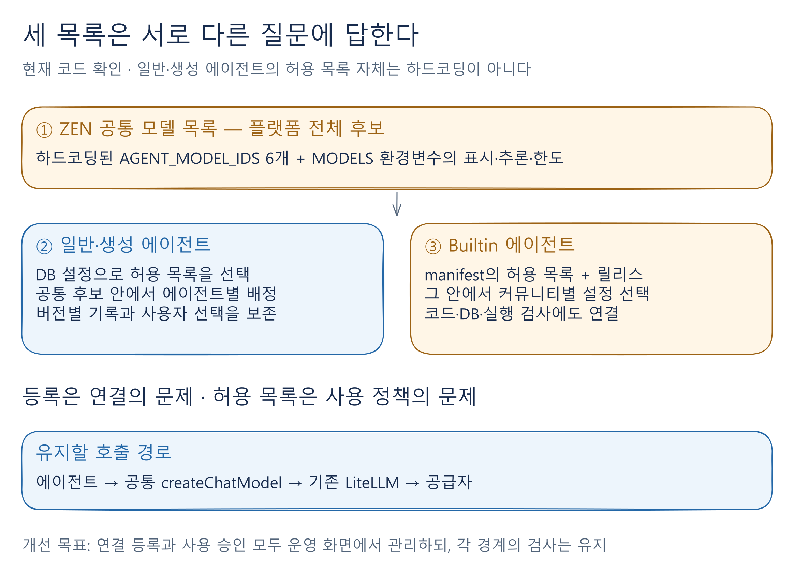
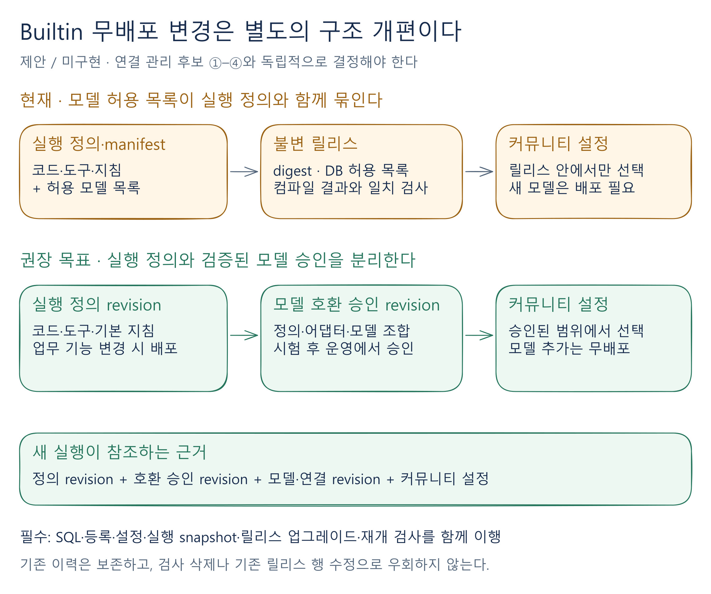
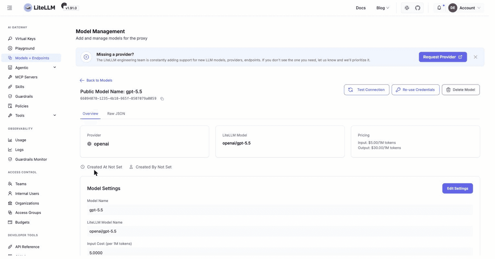
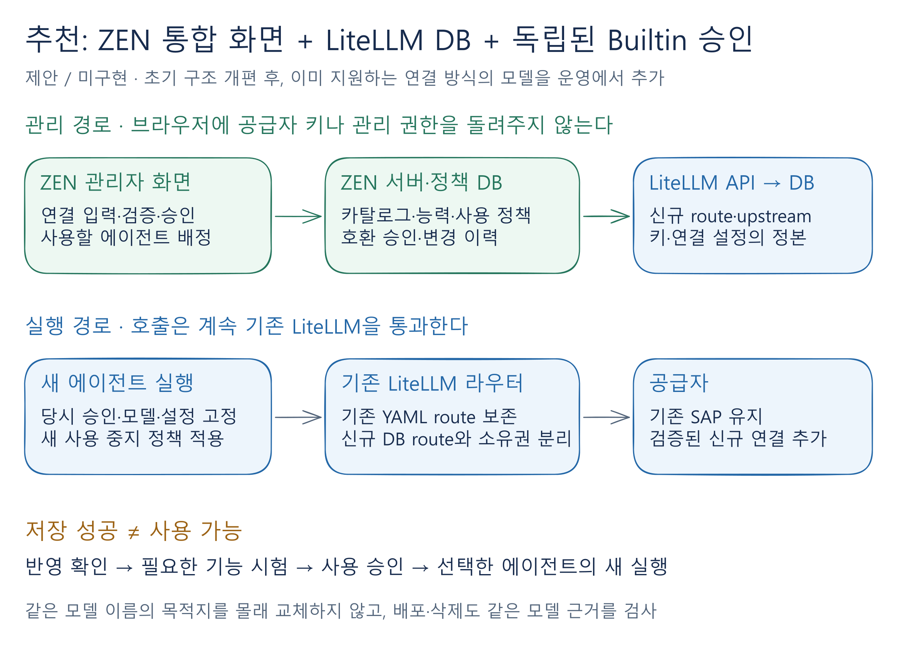

# 프로바이더와 모델 관리 페이지의 현실성 조사와 도입 기준

최종 요구 정리: **2026-11-12** · 담당: **세션 3 / 문서 4**  
상태: **설계·수용 기준 확정, 구현·운영 검증 전** · 구현 브랜치: `agent/add-model-provider-page`

> [!abstract] 이 문서에서 결정한 것
> **기존 LiteLLM을 유지하고, ZEN 화면에서 모델 등록 → 검증 → 에이전트 사용 설정을 처리한다.** 후보 **② ZEN 통합 화면 + LiteLLM 관리 API**를 우선안으로 선정한다. 신규 SAP 모델 추가, 기존 SAP 연결의 변경·삭제, 다른 프로바이더로의 전환, 일반·생성·Builtin 에이전트의 사용 설정을 **모두 최종 범위에 포함**한다.

## 1. 무엇이 목표이며, 무엇을 만들려는가?

### 1-1. 목표: 모델 변경을 매번 개발·배포하는 일에서 운영 업무로 바꾸기

**최초 구조 개편과 배포를 마친 이후, 이미 지원하는 연결 방식 안에서 모델 추가와 사용 설정을 운영 화면에서 재배포 없이 처리한다.**

예를 들어 SAP에 새 모델이 나오면 등록·검증 후 에이전트에 배정한다. SAP 대신 다른 제공자의 모델을 쓰고 싶으면 새 연결을 등록·검증한 뒤 에이전트 설정을 전환한다. 기존 SAP 연결의 수정·중지·삭제도 관리 범위다.

여기서 ‘프로바이더’는 모델을 제공하는 서비스이고, ‘연결’은 그 서비스에 접근할 주소와 인증 설정을 뜻한다. **새 인증 방식·미지원 API·새 SDK 기능까지 자동 지원한다는 의미는 아니다.** 공급자 계정과 SAP/Azure의 실제 모델 배포는 준비되어 있어야 한다.

### 1-2. 만들 화면과 운영자가 하는 일

운영자가 **ZEN의 ‘프로바이더와 모델’ 페이지**에서 다음 순서로 처리한다.

| 순서                           | 운영자가 할 일                                                                 | 완료의 의미                            |
| ------------------------------ | ------------------------------------------------------------------------------ | -------------------------------------- |
| **1. 연결·모델 등록**          | 제공자 주소·모델 이름·인증정보와 표시명·지원 추론 강도·컨텍스트 한도 등을 입력 | 모델에 어떻게 연결할지 등록됨          |
| **2. 모델 검증**               | 실제 호출, 도구 사용·스트리밍 등 필요한 기능, 지원 추론 강도를 확인            | 사용하려는 연결과 기능이 작동함을 확인 |
| **3. 에이전트 사용 설정·저장** | 사용할 에이전트, 허용/기본 모델, 기본·최대 추론 강도를 지정                    | 선택한 에이전트의 **새 실행**에 적용   |

**모델 등록 → 작동 검증 → 사용할 에이전트와 정책 지정·저장 → 이후 새 실행에 반영**

‘사용 허용’은 선택지에 추가하는 것이며 기본 모델 변경은 별도 선택이다. 등록 성공만으로 사용 가능하다고 표시하지 않는다. 필요한 기능과 실제 반영을 확인한 뒤 사용을 승인한다.

추론 강도는 **모델 이름만이 아니라 실제 제공 경로에서 지원하는 목록**으로 관리한다. 예를 들어 해당 SAP 연결이 `minimal`을 지원하지 않는다면 선택·저장·호출에서 제외한다. 추론 강도와 공급자가 반환하는 공개 추론 텍스트의 유무는 별개이며, 강도를 지정해도 모든 응답에 공개 요약이 생기는 것은 아니다.

SAP는 단일 API key 방식만 가정하지 않는다. OAuth 자격정보·resource group·deployment URL 등 해당 연결에 필요한 인증 정보를 다룬다.

> [!important] 유지하는 실제 호출 경로
> **ZEN 에이전트 → 기존 LiteLLM → 실제 모델 제공자**를 유지한다. 관리 기능을 추가하되 모델별 SDK를 ZEN에 다시 넣는 식으로 호출 구조를 확대하지 않는다.

이번 범위는 에이전트 모델 관리다. 회의록 Assistant는 포함하지만 녹음 전사·회의 요약·`TASK_MODEL` 보조 업무의 별도 모델 정책까지 자동으로 통합하지는 않는다.[^separate]

## 2. 현재 구조는 어떻고, 무엇을 바꾸는가?

모델 사용 설정은 **LiteLLM의 연결 설정**과 **ZEN의 사용 정책**으로 나뉜다. 연결을 등록하는 것과 에이전트에 사용을 허용하는 것은 각각 필요한 판단이다.

### 2-1. LiteLLM: 어떤 모델에 어떻게 요청을 보낼 것인가?

현재 저장소는 모델 연결을 주로 **YAML과 환경변수**로 구성한다. YAML에는 공개 모델 이름·실제 모델·처리 방식·URL을 적고, 민감정보와 배포 주소는 환경변수에서 읽는다. 일부 SAP 보완 코드는 특정 모델과 URL 변수의 대응 관계를 직접 검사한다.[^sap]

| 시점                     | 실제로 일어나는 일                                                                                 |
| ------------------------ | -------------------------------------------------------------------------------------------------- |
| **로컬 SAP 검증용 시작** | 실행기가 환경파일을 읽어 Docker에 전달하고, 로컬 YAML을 `/app/config.yaml`로 연결해 LiteLLM을 시작 |
| **운영 시작·배포**       | Compose가 운영 환경변수와 운영 YAML 또는 검증된 배포 후보 YAML을 컨테이너에 연결                   |
| **LiteLLM 시작**         | `--config /app/config.yaml`을 읽고 모델 이름별 연결 경로를 구성                                    |
| **실제 호출**            | ZEN의 모델 이름을 연결 설정에 대응시키고, 필요한 변환·인증 후 제공자에게 전달                      |

로컬 파일을 고친다고 운영 설정까지 바뀌지는 않는다. **SAP 보완 코드는 이미지 빌드 때 LiteLLM 내부에 적용되며, 요청이 들어올 때 실행**된다. 현재 고정 모델 매핑을 그대로 두면 새 SAP 모델을 YAML에 추가하는 것만으로는 충분하지 않을 수 있다.[^sap]

한편 **LiteLLM 자체는 DB와 관리 API로 모델을 등록·수정·삭제하는 기능을 제공**한다. 이것은 우리가 추가한 SAP 보완 코드와 별개다. DB 연결·모델 저장 기능 활성화·관리 권한이 필요하며, 실제 운영의 활성화 여부는 아직 확인 전이다.[^litellm]

### 2-2. ZEN: 연결한 모델을 어디에서 사용해도 되는가?

_조사한 기존 구조. [Excalidraw 원본](4-provider-model-management-assets/v2-01-three-model-layers.excalidraw) · [확대 SVG](4-provider-model-management-assets/v2-01-three-model-layers.svg)_

| 구분                             | 현재 역할과 관리 방식                                                                                   | 바꿔야 하는 이유                                       |
| -------------------------------- | ------------------------------------------------------------------------------------------------------- | ------------------------------------------------------ |
| **ZEN 공통 모델 목록**           | 코드의 `AGENT_MODEL_IDS` 고정 6개로 후보를 제한. `MODELS` 환경변수에서 표시명·추론 강도·한도 등을 보완  | LiteLLM에 새 모델이 있어도 고정 목록에서 제외됨        |
| **일반·생성 에이전트 허용 목록** | 공통 목록에서 선택한 모델을 DB와 버전 기록에 저장. **목록 자체는 이미 설정 데이터**                     | 기존 구조를 활용하되 새 동적 공통 목록과 연결해야 함   |
| **Builtin 에이전트 허용 목록**   | `manifest.json`의 허용 목록을 실행 정의에 포함해 컴파일하고 DB 릴리스와 대조. 설정·실행·재개에서도 검사 | 모델 목록 변경이 실행 정의의 릴리스 갱신·배포와 연결됨 |

근거: [공통 카탈로그][catalog] · [일반 에이전트 정책][policy] · [설정·버전 저장][registry] · [생성 하네스][harness] · [Builtin 설정][builtin].

Builtin의 핵심 문제는 ‘버전 숫자가 있다’는 사실보다 **허용 모델이 실행 정의의 일부라는 결합**이다. 이를 분리하더라도 도구·권한·실행 안전성 검사는 유지해야 한다.[^builtin-contract]

### 2-3. 선정한 ②안에서는 이렇게 바꾼다

| 대상                   | 변경 방향                                                                                             |
| ---------------------- | ----------------------------------------------------------------------------------------------------- |
| **LiteLLM 연결 관리**  | 관리 API와 DB를 사용. SAP 고정 매핑을 개편하고 기존 YAML 연결도 검증된 절차로 관리 방식을 이행        |
| **ZEN 공통 목록**      | 모델 정보·지원 추론 강도·검증/사용 상태를 운영 화면에서 관리. 발견된 모델을 무조건 자동 승인하지 않음 |
| **일반·생성 에이전트** | 기존 DB 설정과 버전 구조를 활용해 공통 목록을 연결. 테이블·컬럼 추가 여부는 실제 책임에 따라 결정     |
| **Builtin**            | 실행 정의는 코드 릴리스로 유지하고, 검증된 모델 조합의 승인은 **ZEN 내부에서 별도로 관리**            |

_목표 구조이며 구현 완료를 뜻하지 않는다. [Excalidraw 원본](4-provider-model-management-assets/v2-02-builtin-separation.excalidraw) · [확대 SVG](4-provider-model-management-assets/v2-02-builtin-separation.svg)_

**Builtin 모델 승인도 ZEN의 책임이다.** 별도 외부 시스템을 만드는 것이 아니다. 등록·릴리스 대조·SQL 접수/실행 검사·실행 snapshot·업그레이드·중단/재개가 같은 승인 근거를 사용하도록 함께 바꾼다.[^builtin-contract]

## 3. 기존 LiteLLM을 유지하는 방법 후보와 비교

### 3-1. 운영 화면에서 관리하는 네 가지 후보

다음 후보는 모두 실제 추론에 기존 LiteLLM을 사용한다. ‘원본’은 해당 정보를 수정·관리할 책임이 있는 기준 데이터를 뜻한다.

| 후보                                   | 운영자가 사용하는 방식                                                 | 연결 설정의 원본             | 특징                                                                  |
| -------------------------------------- | ---------------------------------------------------------------------- | ---------------------------- | --------------------------------------------------------------------- |
| **① LiteLLM 자체 관리 UI 도입**        | LiteLLM 제공 UI에서 등록 → ZEN에서 사용 승인·에이전트 배정             | LiteLLM DB                   | 두 화면 사용. 제공 UI가 적합하면 등록 화면 개발을 줄일 수 있음        |
| **② ZEN 통합 화면 + LiteLLM 관리 API** | ZEN에서 입력 → ZEN 서버가 LiteLLM API로 등록·반영 확인 → ZEN 사용 설정 | LiteLLM DB                   | **ZEN 한곳에서 관리**. ZEN은 연결의 별도 수정 가능 사본을 만들지 않음 |
| **③ ZEN 설정 저장 + LiteLLM 동기화**   | ZEN에 연결 원본 저장 → 별도 처리기가 반영·재시도·차이 확인             | ZEN DB                       | 연결 설정의 승인·버전·자동 복원까지 ZEN이 책임                        |
| **④ ZEN 화면 + 설정·배포 자동화**      | 화면 입력 → Git/YAML 변경 → 검토·배포·검증                             | Git/YAML, 비밀은 보안 저장소 | 모델 변경에도 배포가 남음                                             |

①의 화면은 우리가 이미 만들어 둔 화면을 뜻하지 않는다. **LiteLLM 제공 UI를 실제 환경에 구성해 사용하는 후보**이며, 운영 이미지에서의 제공·사용 가능 여부와 인증 구성은 확인이 필요하다. 불충분해 별도 화면을 개발해야 한다면 개발량 절감 장점은 줄어든다.

_LiteLLM 공식 문서의 예시이며 ZEN 화면·현재 운영 화면이 아니다. 이미지 버전과 고정 조사 버전 1.92.0의 지원 계약은 구분한다. [공식 문서](https://docs.litellm.ai/docs/proxy/model_management)_

### 3-2. 후보 선택과 별개로 정비해야 하는 구조

**①②③의 무배포 운영에는 공통 목록의 동적 관리가 필요**하고, Builtin까지 포함하려면 실행 정의와 모델 승인을 분리해야 한다. ④는 목록을 배포 산출물로 갱신하고 릴리스 결합을 유지하는 방식도 가능하다.

| 공통 검토 대상            | 필요한 일                                                                                                                   |
| ------------------------- | --------------------------------------------------------------------------------------------------------------------------- |
| **1. ZEN 공통 모델 목록** | 모델 목록·표시명·추론 강도·한도·활성 상태를 운영 관리와 일치시킴                                                            |
| **2. 일반·생성 에이전트** | 기존 설정을 새 목록과 연결하고 기본/허용 모델·추론 정책을 검증                                                              |
| **3. Builtin 에이전트**   | 무배포 목표에 맞춰 독립 모델 승인과 실행·재개 계약을 함께 이행                                                              |
| **4. 변경·중지·삭제**     | 에이전트 기본값·허용 목록·공유 연결·진행/재개 참조를 확인하고 과거 이력을 보존                                              |
| **5. 배포·재시작·복구**   | 동적 모델을 사전 검사에 포함하고 YAML+DB 연결과 ZEN 정책의 일치를 확인. 지원하지 못하는 rollback은 적용 전에 거부           |
| **6. 가격·사용량**        | 제공자별 가격 근거와 호출 당시 snapshot 보존. 가격 미확인은 ‘미산정’으로 구분하고 외부 모델에 SAP 가격을 잘못 적용하지 않음 |

**LiteLLM에 등록하고 ZEN에서 사용하게 연결하는 것뿐 아니라, 이후 배포·복구와 사용량·비용 관리까지 정비해야 한다.**[^deploy][^pricing]

| 운영 동작              | 영향과 처리 원칙                                                                                                          |
| ---------------------- | ------------------------------------------------------------------------------------------------------------------------- |
| **새 모델 추가**       | 검증·승인 후 허용한 대상부터 적용. 기존 에이전트의 허용 목록을 자동 확대하지 않음                                         |
| **연결·인증정보 변경** | 공유 에이전트와 실행 영향 확인. 목적지 변경은 새 식별자/버전으로 검증·전환하고 진행 중 실행의 목적지를 몰래 교체하지 않음 |
| **중지**               | 새 배정·접수를 차단. 기존 실행의 완료/재개 정책 및 공급자 key 폐기와 구분                                                 |
| **삭제**               | 기본값·활성/재개 참조를 해소한 뒤 물리 삭제. 과거 호출·가격·변경 책임은 비밀 없이 보존                                    |

LiteLLM의 block/unblock만으로 ZEN 접수 차단·기존 실행 종료·다른 deployment/fallback·공급자 key 폐기까지 해결되지는 않는다. 승인 전 모델 접근 범위도 별도 확인한다.[^block]

### 3-3. 후보별 추가 작업·난이도·운영 영향

**난이도는 코드 결합과 운영 책임에 따른 정성 비교이며 예상 개발일이나 실측 점수가 아니다.** Builtin 승인 분리는 무배포 목표를 택한 후보에 별도로 필요한 큰 작업이다.

| 후보                   | 추가로 필요한 작업                                           | 상대 난이도             | 운영에서 주의할 점                                                                  |
| ---------------------- | ------------------------------------------------------------ | ----------------------- | ----------------------------------------------------------------------------------- |
| **① 자체 UI 도입**     | 접속·관리 권한, ZEN 가져오기·승인, 외부 변경 감지            | **중** — UI 적합성 전제 | LiteLLM에서 먼저 삭제·개명하면 ZEN 참조가 깨질 수 있음                              |
| **② 통합 화면·API**    | ZEN UI/API, LiteLLM 연동, 작업 결과·반영 확인·부분 실패 복구 | **중~상**               | LiteLLM 등록 성공/ZEN 저장 실패, timeout 후 결과 불명 등을 처리해야 함              |
| **③ 원본 저장·동기화** | ②의 상당 부분 + 목표 설정 버전·작업자·재시도·충돌·자동 수렴  | **상**                  | 반영 대기 추적과 복원에 유리하나 잘못된 설정도 자동 재적용할 수 있음                |
| **④ 설정·배포 자동화** | 입력 검증, 비밀 참조, 변경 요청·배포·결과 연동               | **중~상**               | 배포 대기와 서비스 교체 영향이 남고 Git 되돌리기만으로 폐기된 key까지 복원되지 않음 |

②에도 불일치 감지와 재조회가 필요하다. ③은 여기에 더해 **ZEN의 목표 상태로 LiteLLM 설정을 다시 맞추는 책임**을 갖는다. 어느 안이든 저장 성공을 전체 replica의 반영·실제 호출 성공으로 간주하면 안 된다.[^observed]

## 4. 판단 기준·추천안·행동 플랜

### 4-1. 어떤 기준으로 ②를 선정했는가?

| 판단 기준                                              | 우선순위                        | 선정에 미친 영향                                                        |
| ------------------------------------------------------ | ------------------------------- | ----------------------------------------------------------------------- |
| **기존 LiteLLM 호출 경로 유지**                        | 필수                            | 네 후보 모두 충족 가능한 공통 전제                                      |
| **모델 변경마다 재배포하지 않기**                      | 핵심 목표                       | 배포가 남는 ④는 이번 우선안에서 제외                                    |
| **ZEN에서 등록·검증·사용 설정 통합**                   | 사용자 요구                     | 두 화면을 사용하는 ①보다 ②③이 적합                                      |
| **구현량과 지속 운영 책임 줄이기**                     | 목표 충족 후보 사이의 선택 기준 | 연결 원본·자동 동기화까지 떠맡지 않는 ②를 우선                          |
| **기존 SAP·데이터·실행·복구 보호**                     | 모든 안의 도입 필수 조건        | ②라는 이유로 자동 충족되지 않으며 populated upgrade와 회귀 검증 필요    |
| **연결 원본의 사전 승인·버전 복구·자동 동기화 필요성** | 추천을 바꾸는 조건              | 필수가 되면 ③을 재검토. LiteLLM이 하나여도 해당 요구가 있으면 의미 있음 |

선정 논리는 **④는 무배포 목표에 덜 맞음 → ①은 통합 운영 경험에 덜 맞음 → ②③ 중 현재 필수가 아닌 동기화 책임을 추가하지 않는 ② 선정**이다.

③은 여러 LiteLLM 환경을 동일하게 유지하거나 승인된 연결 설정으로 복원하는 데 적합하다. 다만 현재는 연결 원본의 사전 승인·버전 복구·자동 동기화를 필수로 확정하지 않았다. **‘LiteLLM이 하나이므로 무조건 ②’라는 판단은 아니다.**

### 4-2. 추천 구조: 두 시스템의 책임을 명확히 나누기

> [!success] 최종 추천
> **② ZEN 통합 관리 화면 + LiteLLM 관리 API·DB + ZEN 동적 카탈로그·사용 정책**을 구현한다. Builtin 모델 승인도 ZEN 안에서 관리하되 코드 릴리스와 분리한다.

_목표 구조. 그림의 ‘기존 YAML 보존’은 안전한 이행 중의 상태이며 최종적으로 기존 SAP 관리를 제외한다는 뜻이 아니다. [Excalidraw 원본](4-provider-model-management-assets/v2-03-recommended-architecture.excalidraw) · [확대 SVG](4-provider-model-management-assets/v2-03-recommended-architecture.svg)_

| 시스템      | 담당하는 정보·동작                                                                                                 |
| ----------- | ------------------------------------------------------------------------------------------------------------------ |
| **LiteLLM** | 실제 모델 연결·공급자 인증·요청 변환·전달. 연결 원본은 LiteLLM DB/단일 보안 저장 경로에 두고 ZEN은 관리 API로 대행 |
| **ZEN**     | 공통 모델 목록·검증·사용 승인·가격 연결·일반/생성/Builtin 모델 정책·에이전트 배정·변경 이력                        |

**Builtin 호환 승인은 별도 외부 시스템이 아니다.** 코드·도구·권한의 실행 정의는 ZEN 릴리스로 유지하고, 검증된 정의·어댑터·모델 조합의 사용 승인은 ZEN 내부의 독립 버전으로 관리한다. 당시 승인 번호를 저장하는 것만으로 실제 route가 고정되는 것은 아니므로 실행이 해당 연결을 계속 사용하는지도 확인한다.[^routing]

### 4-3. 단계적 행동 플랜과 운영 보호 시험

| 순서                           | 필수 작업                                                                                                   | 완료 판단                                                                     |
| ------------------------------ | ----------------------------------------------------------------------------------------------------------- | ----------------------------------------------------------------------------- |
| **1. 운영 준비 확인**          | 실제 이미지·보안 패치·DB 모델 관리 활성화·관리/추론 권한·영구 암호화 설정 확인. 격리 DB와 mock gateway 준비 | 기존 환경과의 차이 및 부족한 준비를 비밀 없이 식별                            |
| **2. 연결 관리 구조 개편**     | LiteLLM 관리 API, SAP 고정 매핑 개편, 기존 YAML 연결의 관리 방식 이행                                       | **신규 SAP 모델 등록, 기존 SAP 연결 변경·삭제, 타 프로바이더 연결 등록** 가능 |
| **3. ZEN 화면·일반/생성 연결** | 공통 모델 목록·지원 추론 강도·검증/사용 상태·에이전트 정책 연결                                             | 새 모델 배정과 프로바이더 전환이 새 실행에 반영                               |
| **4. Builtin 확장**            | 실행 정의와 모델 승인 분리. SQL·snapshot·업그레이드·재개 계약 함께 이행                                     | meeting·SAP·tutorial에서 새 모델을 무배포로 승인·사용                         |
| **5. 운영 전환·전체 검증**     | 추가·수정·중지·삭제·전환·가격/사용량·다음 배포·재시작·복구 시험                                             | 기존 사용자가 있는 상태에서도 지원 계약이 보존됨을 검증                       |

**신규 SAP 모델과 기존 SAP 연결 관리는 선택사항이 아니다.** 기존 연결은 이행 중 호출을 보호하기 위해 유지하며, 검증 후 관리 책임을 이전한다. 같은 공개 모델 이름을 YAML과 DB에 동시에 등록해 의도치 않은 다중 route를 만들지 않는다.[^coexist]

이미 사용 중인 main 환경을 전제로 다음 회귀를 수용 기준에 포함한다.

| 시험 상황                                 | 반드시 확인할 동작                                                                                                                   |
| ----------------------------------------- | ------------------------------------------------------------------------------------------------------------------------------------ |
| **기존 데이터가 있는 DB의 migration**     | 합성 기존 사용자·에이전트·Builtin 릴리스·설정·실행·호출 이력·가격을 준비해 이행 전후 보존 확인. 삭제·rename·기존 설정 일괄 확대 금지 |
| **관리 기능이 아직 미설정인 첫 배포**     | 기존 6개 모델과 기존 설정으로 호출 가능. 준비 부족이 관리 기능에 명확히 표시됨                                                       |
| **진행·중단 후 재개할 실행이 존재**       | 새 모델 전환이 기존 실행의 목적지를 몰래 바꾸지 않음. 참조 중인 연결의 파괴적 변경·삭제 차단                                         |
| **일반·생성·Builtin 실행**                | 기존 모델 회귀와 새 모델 사용, 도구·권한·추론 강도·사용자 확인·재개 검증                                                             |
| **등록의 부분 실패·관측 지연**            | 중복 route/허위 사용 가능 상태 없이 결과를 재확인하고 회복                                                                           |
| **프로바이더·가격 변경 이후 조회**        | 과거 호출·가격 근거는 유지. 미확인 외부 모델 가격은 미산정                                                                           |
| **새 모델 사용 후 다음 배포·재시작·복구** | YAML+DB inventory와 ZEN 정책 검사. 지원 rollback 계약 확인 또는 적용 전 거부                                                         |
| **권한·비밀·목적지 공격**                 | 플랫폼 관리자 경계, key 비노출, 마스킹값 보존, 임의 URL·redirect·SAP token 목적지 경계 확인                                          |

> [!warning] 검증 범위를 부풀리지 않는다
> 운영 DB·실제 고객 원문을 사용하거나 운영 설정을 임의 변경하지 않는다. populated upgrade는 **격리 DB의 합성 기존 데이터**로 검증한다. 단위·통합 시험 통과와 실제 운영 무중단 보장은 구분한다. 테스트·권한 검사·게이트를 완화하거나 skip하여 완료로 표시하지 않는다.

조사 기준 LiteLLM 1.92.0은 공식 보안 권고의 영향 범위에 포함되므로 실제 운영 이미지의 수정 포함 여부와 SAP 호환을 확인해야 한다. 이번 문서는 운영 취약성을 재현하거나 침해를 확인한 결과가 아니다.[^security]

구현 의도와 기준↔테스트 매핑은 ZEN 저장소 `intents/add-model-provider-page.md`가 관리한다. 이 문서는 사용자 판단과 운영 흐름을 설명하며, 검증 전인 제안을 완료 기능으로 표기하지 않는다.

[catalog]: https://github.com/zen-compass/zen-ai/blob/1ee6a67c243fe19c76c6913f1080e3a959689418/src/lib/ai/models.ts#L124-L216
[policy]: https://github.com/zen-compass/zen-ai/blob/1ee6a67c243fe19c76c6913f1080e3a959689418/src/lib/agents/policy.ts#L49-L86
[registry]: https://github.com/zen-compass/zen-ai/blob/1ee6a67c243fe19c76c6913f1080e3a959689418/src/lib/agents/registry.ts#L364-L521
[harness]: https://github.com/zen-compass/zen-ai/blob/1ee6a67c243fe19c76c6913f1080e3a959689418/src/lib/agent-harness/service.ts#L229-L309
[builtin]: https://github.com/zen-compass/zen-ai/blob/1ee6a67c243fe19c76c6913f1080e3a959689418/src/lib/builtin-agents/settings.ts#L101-L138

[^separate]: [회의 전사·요약 모델 정책](https://github.com/zen-compass/zen-ai/blob/1ee6a67c243fe19c76c6913f1080e3a959689418/src/lib/meetings/model-policy.ts), [전사의 별도 SAP 호출](https://github.com/zen-compass/zen-ai/blob/1ee6a67c243fe19c76c6913f1080e3a959689418/src/lib/ai/transcribe.ts#L270-L423), [TASK_MODEL](https://github.com/zen-compass/zen-ai/blob/1ee6a67c243fe19c76c6913f1080e3a959689418/src/lib/ai/task-model.ts).

[^sap]: [SAP Responses의 모델·URL·토큰 목적지 방어](https://github.com/zen-compass/zen-ai/blob/1ee6a67c243fe19c76c6913f1080e3a959689418/docker/litellm-sap/sap_responses.py), [기존 GPT 모델과 env 계약 검사](https://github.com/zen-compass/zen-ai/blob/1ee6a67c243fe19c76c6913f1080e3a959689418/docker/litellm-sap/prepare-production.py#L13-L68). 고정 mapping을 제거할 때 자격증명 목적지 방어도 함께 사라지지 않게 대체해야 한다.

[^deploy]: [활성 모델 참조 검사](https://github.com/zen-compass/zen-ai/blob/1ee6a67c243fe19c76c6913f1080e3a959689418/scripts/verify-active-model-references.ts), [YAML inventory·rollback 파일 생성](https://github.com/zen-compass/zen-ai/blob/1ee6a67c243fe19c76c6913f1080e3a959689418/docker/litellm-sap/prepare-production.py#L115-L151).

[^pricing]: [SAP 중심 가격 runtime·고정 모델 대상](https://github.com/zen-compass/zen-ai/blob/1ee6a67c243fe19c76c6913f1080e3a959689418/src/lib/ai/pricing/runtime.ts), [호출 시작 가격 snapshot](https://github.com/zen-compass/zen-ai/blob/1ee6a67c243fe19c76c6913f1080e3a959689418/src/lib/agent-history/usage-recording.ts#L35-L99).

[^litellm]: [고정 소스 CRUD·권한](https://github.com/BerriAI/litellm/blob/b3086ccd74553565c9a39716e72303ae985555f9/litellm/proxy/management_endpoints/model_management_endpoints.py#L927-L1333), [PATCH](https://github.com/BerriAI/litellm/blob/b3086ccd74553565c9a39716e72303ae985555f9/litellm/proxy/management_endpoints/model_management_endpoints.py#L168-L275), [공식 Model Management 문서](https://docs.litellm.ai/docs/proxy/model_management), [공식 OpenAI-compatible guide](https://docs.litellm.ai/docs/providers/openai_compatible). 최신판의 settings 우선순위·기능을 고정 버전의 보장으로 사용하지 않았다.

[^coexist]: [YAML 모델을 보존하는 DB 모델 정리](https://github.com/BerriAI/litellm/blob/b3086ccd74553565c9a39716e72303ae985555f9/litellm/proxy/proxy_server.py#L4879-L4946), [공개 모델 group·deployment resolve](https://github.com/BerriAI/litellm/blob/b3086ccd74553565c9a39716e72303ae985555f9/litellm/router.py#L9959-L10035).

[^builtin-contract]: [모델 포함 compile digest](https://github.com/zen-compass/zen-ai/blob/1ee6a67c243fe19c76c6913f1080e3a959689418/src/lib/builtin-agents/compile/compile.ts#L49-L74), [코드↔DB 릴리스 대조](https://github.com/zen-compass/zen-ai/blob/1ee6a67c243fe19c76c6913f1080e3a959689418/src/lib/builtin-agents/persistence/principals.ts#L136-L163), [실행 snapshot 모델 검사](https://github.com/zen-compass/zen-ai/blob/1ee6a67c243fe19c76c6913f1080e3a959689418/src/lib/builtin-agents/runtime/execute.ts#L84-L120), [현재 SQL guard·모델/릴리스 복구](https://github.com/zen-compass/zen-ai/blob/1ee6a67c243fe19c76c6913f1080e3a959689418/drizzle/0128_builtin_model_release_recovery.sql), [meeting manifest](https://github.com/zen-compass/zen-ai/blob/1ee6a67c243fe19c76c6913f1080e3a959689418/agents/meeting/assistant/manifest.json), [SAP manifest](https://github.com/zen-compass/zen-ai/blob/1ee6a67c243fe19c76c6913f1080e3a959689418/agents/sap/orchestrator/manifest.json), [tutorial manifest](https://github.com/zen-compass/zen-ai/blob/1ee6a67c243fe19c76c6913f1080e3a959689418/agents/tutorial/assistant/manifest.json).

[^routing]: [deployment ID resolve](https://github.com/BerriAI/litellm/blob/b3086ccd74553565c9a39716e72303ae985555f9/litellm/router.py#L9959-L9993), [mutable deployment upsert/delete](https://github.com/BerriAI/litellm/blob/b3086ccd74553565c9a39716e72303ae985555f9/litellm/router.py#L8138-L8215). 실제 SDK·key allowlist·fallback까지의 end-to-end revision routing은 추가 시험 대상이다.

[^observed]: [DB refresh의 예외 처리](https://github.com/BerriAI/litellm/blob/b3086ccd74553565c9a39716e72303ae985555f9/litellm/proxy/proxy_server.py#L5027-L5089), [모델/credential 30초 polling](https://github.com/BerriAI/litellm/blob/b3086ccd74553565c9a39716e72303ae985555f9/litellm/proxy/proxy_server.py#L7548-L7576), [salt/master fallback](https://github.com/BerriAI/litellm/blob/b3086ccd74553565c9a39716e72303ae985555f9/litellm/proxy/common_utils/encrypt_decrypt_utils.py#L23-L31), [credential PATCH](https://github.com/BerriAI/litellm/blob/b3086ccd74553565c9a39716e72303ae985555f9/litellm/proxy/credential_endpoints/endpoints.py#L248-L284). polling 주기는 운영 반영 SLA가 아니다.

[^block]: [고정 버전 block/unblock](https://github.com/BerriAI/litellm/blob/b3086ccd74553565c9a39716e72303ae985555f9/litellm/proxy/management_endpoints/model_management_endpoints.py#L307-L460), [router blocked 필터](https://github.com/BerriAI/litellm/blob/b3086ccd74553565c9a39716e72303ae985555f9/litellm/router.py#L10864-L10890), [생성 insert 필드](https://github.com/BerriAI/litellm/blob/b3086ccd74553565c9a39716e72303ae985555f9/litellm/proxy/management_endpoints/model_management_endpoints.py#L470-L501).

[^security]: [공식 GHSA-3cv6-jpf6-8222](https://github.com/BerriAI/litellm/security/advisories/GHSA-3cv6-jpf6-8222). 영향 범위와 1.92.2 등 backport를 명시한다. 실제 설치 image의 수정 포함 여부와 SAP 패치 호환은 별도 확인 대상이다.
