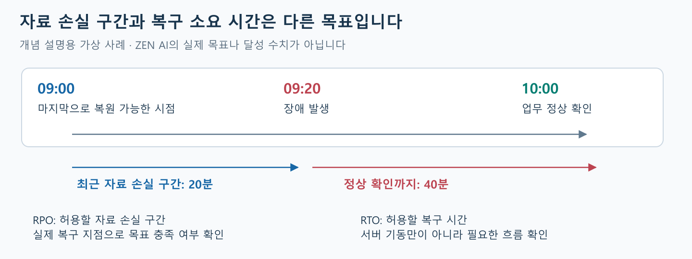
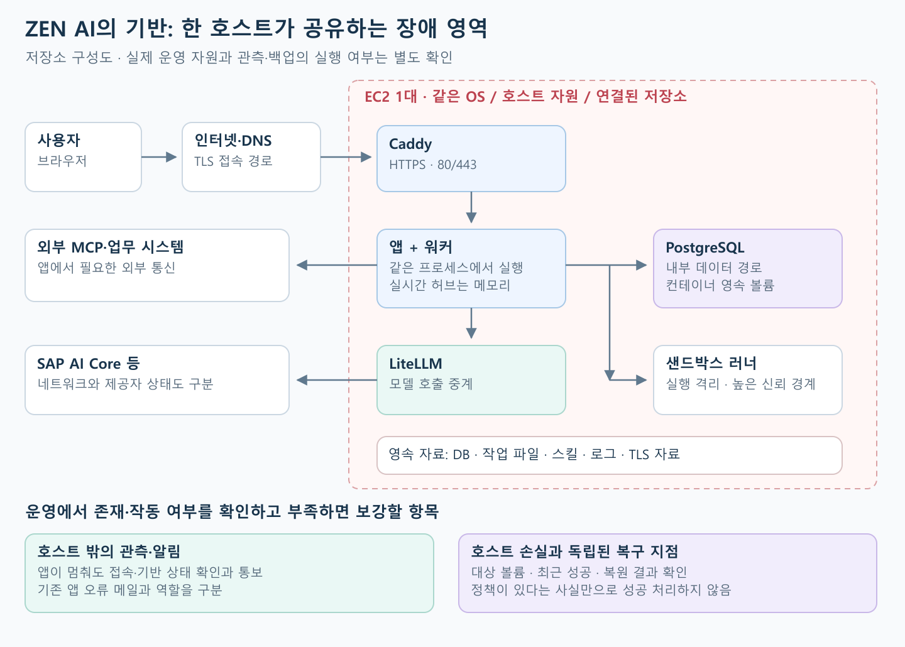
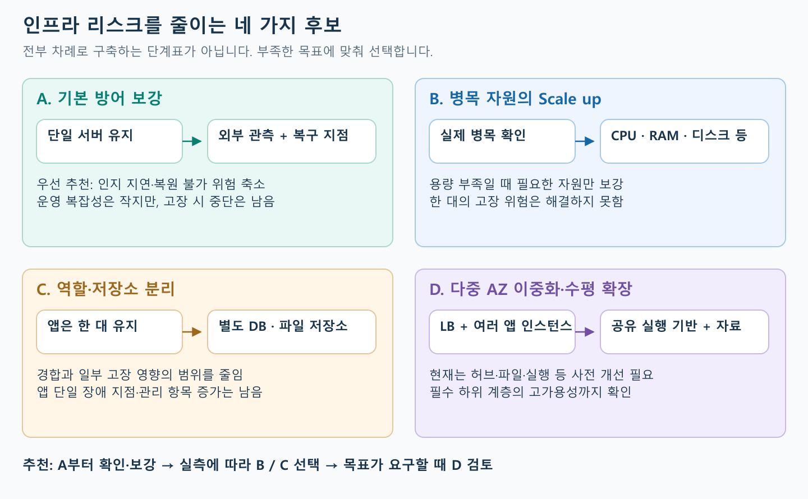

# 인프라 리스크 관리 — 기준과 ZEN AI 청사진

작성·공식 자료 확인: **2026-11-13**

> [!abstract] 먼저 읽을 결론
> **인프라 리스크 관리는 서비스의 실행 기반을 유지하고, 문제가 나도 허용되는 중단·자료 손실·비용 안에서 복구하도록 준비하는 일이다.**
> ZEN AI는 현재 기반을 먼저 확인·보강하고, 실제 병목과 복구 목표에 따라 증설·분리·이중화를 선택한다.

> [!info] 문서의 확인 범위
> **공식 자료와 저장소를 대조한 조사·설계 문서**다. 소스 기준은 `origin/main`의 **`3624cbdd66becc0099ce223d044a121b30c103d6`**이다. 실제 AWS 구성·지표·백업·복원은 운영 실사하지 않았다. 아래 항목은 확인할 대상과 대응 후보다.

**읽는 흐름:** 관리의 의미 → 판단 기준 → ZEN AI에 적용할 점검과 대응 → 상황별 방법과 청사진 → 실행 순서와 기록.

## 1. 인프라 리스크 관리란 무엇인가?

### 1-1. 무엇을 관리하는가?

**용량 부족·고장·통신 단절·보안 문제·자료 손실에 대비하고, 필요한 서비스를 복구하는 과정**이다. 디스크 고갈처럼 예상할 수 있는 문제의 예방도 포함한다.

| 문서 | 중심 질문 |
| --- | --- |
| **기존 사용자 리스크 관리** | 사용자가 작업을 잃거나 중복 수행하지 않고 안전하게 이어갈 수 있는가? |
| **이번 인프라 리스크 관리** | 서비스를 실행하는 기반을 유지하고, 고장 나도 허용 범위 안에서 복구할 수 있는가? |

**서버 복구 뒤에도 중단된 요청의 결과를 확인해야 한다.** 이미 처리된 업무의 중복 실행을 막는 원칙은 [[3. 사용자 리스크 관리 기준과 청사진 후보 (2026-11-09)]]와 연결된다.

### 1-2. 어디까지 다루는가?

- **실행·접속 기반:** CPU·메모리·디스크·OS·Docker·네트워크·DNS·HTTPS·접근 통제.
- **저장·운영 기반:** 영속 저장소·백업·복원·장애 영역·관측·알림·변경·비용.

업무 로직·DB 쿼리와 스키마 개선은 별도 영역이다. **DB의 연결·저장소·백업·가용성은 포함**한다.

EC2에서도 **물리 시설·호스트 기반은 AWS가, 게스트 OS·접근 설정·용량·자료 보호·서비스 복구는 이용 조직이 관리**한다.[^ec2-security]

## 2. 잘 관리되고 있는지 판단하는 기준

관리 범위를 정했으므로, 이제 **어떤 상태를 목표로 삼을지** 정한다.

### 2-1. 무엇을 기준으로 판단하는가?

**“사용자가 필요한 때 서비스를 이용하고, 문제가 나도 허용되는 중단·자료 손실·비용 안에서 복구할 수 있는가?”**를 기준으로 본다.

| 기준 | 판단할 질문 |
| --- | --- |
| **가용성** | 사용자가 실제로 접속하고 필요한 기능을 이용할 수 있는가? |
| **성능·수용량** | 동시 요청이 늘어도 필요한 응답 속도와 오류 수준을 유지하는가? |
| **고장 격리** | 한 구성의 과부하·고장이 다른 구성에 미치는 영향을 줄였는가? |
| **복구 가능성** | 필요한 서비스와 자료를 목표 시간·손실 범위 안에서 실제 복원할 수 있는가? |
| **보안·변경 통제** | 필요한 권한과 통신만 허용하고, 업데이트와 설정 변경을 관리하는가? |
| **관측·운영 지속성** | 앱이 멈춰도 문제를 감지·통보하고 대응할 수 있는가? |
| **비용 적정성** | 줄어드는 위험에 비해 자원·통신·로그·관리 비용이 적절한가? |

### 2-2. 복구 목표와 용량 목표를 구분한다

| 목표 | 쉬운 뜻 | ZEN AI에서 정할 내용 |
| --- | --- | --- |
| **RTO: 복구 시간 목표** | 얼마 안에 다시 이용해야 하는가? | 접속·로그인·필요한 호출의 정상 확인까지 걸리는 시간 |
| **RPO: 복구 시점 목표** | 최근 어느 구간의 손실까지 허용하는가? | 메시지·설정·파일·스킬별 허용 손실 |
| **성능·용량 목표** | 어느 정도의 동시 사용을 감당해야 하는가? | 실행·스트리밍·업로드의 지연·오류·자원 여유 |

**업무가 감당할 중단과 손실에서 목표를 정하고, 현재 구성이 충족하는지 확인한다.** RTO·RPO는 현재 달성한 수치가 아니다.[^dr]

[그림 확대](자료/05-infrastructure-risk-management/03-recovery-objectives.svg) · [Excalidraw 원본](자료/05-infrastructure-risk-management/03-recovery-objectives.excalidraw)

그림은 **09:00 복구 지점 → 09:20 장애 → 10:00 정상화**라는 가상 예시다. 잠재적 손실 구간 **20분**, 복구 소요 **40분**을 나타낸다. 실제 값은 백업 성공 시점과 복원 시험으로 확인한다.[^restore]

## 3. 판단 기준을 ZEN AI의 점검과 대응으로 구체화하기

대주제 2의 기준을 **관리 대상 파악 → 확인할 신호 정리 → 대응 과정 보완**으로 구체화한다. 3-1·3-2·3-3은 이 순서로 이어진다.

### 3-1. 먼저 ZEN AI의 구조를 파악한다

자원과 고장 영향을 공유하는 구성을 파악해 점검 대상을 정한다.

[그림 확대](자료/05-infrastructure-risk-management/01-current-topology.svg) · [Excalidraw 원본](자료/05-infrastructure-risk-management/01-current-topology.excalidraw)

**저장소 구성도**이며, 외부 감시·백업도 운영 확인 대상이다.[^repo-compose]

| 조사한 소스의 구성 | 관리에서 고려할 점 |
| --- | --- |
| **한 EC2에 Caddy·앱·PostgreSQL·LiteLLM 배치** | 호스트 고장이 여러 기능에 함께 영향 |
| **앱 내부에 워커와 실시간 연결·진행 응답 정보 존재**[^repo-runtime] | 재시작은 진행 작업에 영향. 다중 앱에는 응답 전달 준비 필요 |
| **Caddy로 HTTPS·스트리밍 전달, DB는 호스트 내부 접속**[^repo-caddy] | 실제 공개 포트·접근 설정·인증서·연결 제한 확인 |
| **DB·스킬·구동 로그·Caddy 자료는 볼륨, 작업 파일은 호스트에 저장** | 이미지와 함께 저장 자료·EBS도 복구 대상 |
| **재시작 정책·앱 상태 검사 존재** | `unhealthy` 표시만으로 자동 재시작되지는 않음[^docker-restart] |
| **배포 검사·이전 앱 이미지 복구 경로 존재**[^repo-deploy] | 공개 검사는 URL 설정 조건. 서버·디스크·DB 복구는 별도 |
| **로컬 야간 DB 덤프 기본 14일 보관, 런북에 스냅샷·과거 복원 기록 존재**[^repo-backup] | 현재 예약·최신 성공·실제 복원은 별도 확인 |

Docker 로그의 크기 기반 회전은 시간 보존 보장이 없으며 앱 구동 로그와 별개다.[^docker-logs] 컨테이너끼리도 호스트를 공유하고, 러너의 Docker 소켓은 높은 권한과 연결된다.[^docker-security]

### 3-2. 각 대상에서 무엇을 확인할지 정한다

3-1의 구성에 판단 기준을 적용해 **원인을 구분할 신호**를 정한다. 아직 운영의 부족한 부분을 확정한 결과는 아니다.

| 확인 대상 | 함께 볼 신호 |
| --- | --- |
| **외부 접속** | 외부에서 DNS·HTTPS 인증서·접속이 정상인지, 얼마나 지연되는지 |
| **EC2 상태** | AWS 시스템·인스턴스·EBS 관련 상태와 OS 기동 |
| **CPU** | 사용률·부하의 지속 시간, 버스트형 인스턴스라면 CPU credit |
| **메모리** | 여유·swap·메모리 부족에 따른 강제 종료(OOM)·프로그램별 점유 |
| **디스크** | 여유·파일 개수 한도(inode)·증가 속도·읽기와 쓰기 지연 |
| **네트워크** | 송수신량·통신 오류·연결과 인스턴스 한도 초과 여부 |
| **컨테이너** | 종료·반복 재시작·응답 불량(`unhealthy`)·자원 사용 |
| **백업** | 마지막 성공 시각·보호 대상·예약 미실행·실패 여부 |

컨테이너 안의 앱이 종료되면 정책에 따라 재시작을 반복할 수 있고, 종료되지 않은 채 응답만 멈출 수도 있다.

**같은 시각의 여러 지표로 실제 병목을 판단**한다. 디스크 지연에 CPU를, 외부 AI 제공자 지연에 서버를 증설하는 것이 효과적인지 확인해야 한다.

OS 메모리·디스크 여유는 EC2 기본 지표만으로 모두 보이지 않으므로 **CloudWatch Agent 등 추가 수집 설정을 확인**한다.[^metrics]

### 3-3. 확인 결과를 대응 과정으로 연결하고 보완한다

3-2의 조사 결과에서 부족한 부분을 찾아 **관측 → 통보 → 필요한 조치 → 복구 확인**으로 연결한다. 충분한 기존 기능·절차는 활용한다.

| 단계 | 해야 할 일 |
| --- | --- |
| **관측** | 접속 실패·자원 부족·백업 실패 등을 감지 |
| **통보** | 팀이 문제의 증상·지속 시간·확인 위치를 알 수 있도록 알림 |
| **필요한 조치** | 원인·영향·진행 중 작업을 확인하고, 범위와 해제 조건을 정해 조치 |
| **복구 확인** | 접속·저장 자료·문제가 났던 실제 사용 흐름의 정상 여부 확인 |

예를 들어 용량은 수집하지만 부족 알림이 없다면 알림을 보완하고, 이후 조치·정상화 확인까지 점검한다. **수집 중단도 정상으로 간주하지 않는다.**

**앱이 멈춰도 감지·통보할 수 있어야 한다.** 에이전트 오류 메일은 이미 잘 구축되었다는 전제다. 외부 감시·알림 수신도 확인해 기존 구성을 활용하고, 필요하면 CloudWatch Alarm·SNS 등을 검토한다.[^alarms] 외부 접속은 가볍게 확인하고 필요할 때 합성 점검으로 확장한다.[^synthetics]

**복구에는 다음 묶음이 함께 필요하다.**

- **실행 환경:** OS·Docker·앱 이미지·Compose·프록시 설정.
- **접속과 권한:** DNS/IP 전환·HTTPS·인증 정보에 대한 안전한 접근.
- **저장 자료:** DB·스킬·작업 파일·필수 첨부와 복구 시점의 정합성.

같은 디스크의 덤프는 디스크 고장에 취약하다. 스냅샷도 대상 볼륨의 기록 자료이므로 대상 누락과 DB 일관성을 확인한다.[^snapshot] **별도 환경에서 복원해 정상 동작·시간·손실·누락을 확인한다.** 복제본은 백업을, 백업은 즉시 장애 전환을 대신하지 않는다.[^restore]

## 4. 상황별 대응 방법과 인프라 청사진

대응 과정을 **장애 상황에 적용**하고, 위험을 줄일 **인프라 구성**을 비교한다.

### 4-1. 상황에 따라 무엇을 먼저 판단하고 조치하는가?

아래는 **발생 가능한 상황과 대응 후보**다. 모두 ZEN AI에서 실제 발생했다는 뜻은 아니다.

| 발생 상황 | 먼저 확인할 것 | 대응 방향 |
| --- | --- | --- |
| **한 사용자만 접속 불가** | 단말·회사망·DNS와 전체 장애 구분 | 여러 관측으로 영향 경로 확인·조치 |
| **EC2 정상, 전체 접속 불가** | DNS·인증서·Caddy·접근·라우팅 | 최근 변경과 오류로 원인 구성 복구 |
| **CPU 포화·응답 지연** | 자원을 쓰는 프로그램·작업 | 부하 조정 후 증설·역할 분리 검토 |
| **메모리 부족으로 앱 종료** | OOM·메모리 점유·실행 상태 | 기동 복구 후 메모리·자원 배분 검토 |
| **디스크 부족·I/O 지연** | 로그·백업·파일 증가와 저장소 한도 | 자료를 구분해 정리·확장. 일괄 삭제 금지 |
| **대용량 전송 중 전체 지연** | 네트워크·디스크·공유 경로 병목 | 전송량·시간 조정, 경로 분리 검토 |
| **컨테이너 응답 불량** | 의존 서비스·자원·진행 작업 | 영향을 확인해 필요한 범위에서 복구 |
| **서버 자체 고장** | AWS 상태·디스크와 자료 보존 | 서버 복구·교체와 자료 연결·복원 |
| **백업 실패·미실행** | 권한·예약·대상 누락 | 복구 지점 확인 후 원인 보완 |
| **접근 변경 후 통신 단절** | 변경 규칙·경로 | 필요한 통신 복구, 허용·차단 확인 |
| **침해 의심** | 영향 범위·접근 기록 | 격리·증거 보존·권한 점검·안전한 복구 |
| **AZ(가용 영역) 장애** | 같은 AZ의 서버·DB·복구 자원 | 준비된 다른 영역으로 복구, 미준비 시 계획 재평가 |

조치 후 **문제가 났던 흐름으로 정상화를 확인**한다. 접속 장애는 외부 접속을, 저장 장애는 저장·조회를 확인한다. 중단된 요청은 기존 결과를 먼저 확인해 안전하게 재개한다.

### 4-2. 선택할 수 있는 네 가지 청사진

4-1의 개별 대응에서 나아가 **위험을 줄일 전체 구성**을 비교한다.

[그림 확대](자료/05-infrastructure-risk-management/02-blueprint-options.svg) · [Excalidraw 원본](자료/05-infrastructure-risk-management/02-blueprint-options.excalidraw)

| 후보 | 무엇을 바꾸나? | 유리한 상황 | 비용·관리 부담과 한계 |
| --- | --- | --- | --- |
| **A. 단일 서버 기본 방어** | 감시·알림·접근·업데이트·백업·복원 점검과 보완 | 빠른 인지·자료 보호·복구 기반 필요 | **작음.** 서버 전체 고장 시 복구 중단 발생 |
| **B. 필요한 자원 증설** | CPU·메모리·디스크·네트워크 사양 조정 | 특정 자원 부족 확인 | **작음~중간.** 전환 영향·비용 확인. 서버·외부 모델 고장 위험은 유지 |
| **C. 역할·저장소 분리** | 앱 한 대를 유지하고 DB·파일 등 분리 | 자원 경합·자료 관리 분리 필요 | **중간.** 통신·백업 관리 증가. 단일 고장 지점이 남을 수 있음 |
| **D. 다중 AZ 분산·이중화** | 앱·데이터 계층 분산과 장애 전환 | 서버·AZ 장애 시 지속 이용 또는 수평 확장 필요 | **높음.** 앱 사전 개선·하위 계층 장애 대응 필요 |

**기본 방어를 바탕으로 목표에 맞춰 선택**하며, 네 후보를 전부 순서대로 구축하지는 않는다. 비용·난이도는 상대 비교다. DB 분리와 Multi-AZ 이중화도 별개다.[^multi-az]

### 4-3. 왜 ZEN AI는 서버를 여러 대로 바로 늘릴 수 없는가?

후보 D에는 앱 사이 협력이 필요하다. 현재 실시간 연결·진행 응답 정보는 앱 메모리에 있다.[^repo-runtime]

**사용자는 앱 A에 연결 → 실행은 앱 B → 앱 사이 전달 수단이 없으면 실시간 응답 누락 가능.**

같은 DB를 써도 메모리는 자동 공유되지 않는다. 고정 세션만으로 워커 실행 위치까지 해결되지는 않는다.

| 준비할 부분 | 확인할 내용 |
| --- | --- |
| **실시간 전달** | 다른 서버의 응답과 재연결 상태도 전달되는가? |
| **실행 분담·중복 방지** | 워커들이 중복 실행 없이 중단·재개하는가? |
| **자료 접근** | 스킬·작업 파일에 필요한 권한으로 접근하는가? |
| **연결 유지** | 로그인·프록시·LB 제한 시간·배포 중 연결 종료를 처리하는가?[^alb-timeout] |
| **하위 구성** | DB·저장소·중계기도 필요한 장애 대응·AZ 분산을 갖췄는가? |

외부 요청은 앱으로, DB는 필요한 내부 경로로 연결한다.[^security-groups] 위 항목은 **수평 확장 전 도입 조건**이다.

## 5. ZEN AI의 추천 방향과 구체적인 실행 순서

앞의 비교를 토대로 **우선순위와 다음 투자의 판단 근거**를 정한다.

### 5-1. 무엇부터 하는 것이 유리한가?

**A를 먼저 확인·보강 → 측정 결과에 따라 B·C 선택 → 목표상 필요하면 D 또는 다른 복구 구성 검토.**

다중 앱에는 실시간 전달 등의 준비가 필요하다. 기존 AWS·Docker·배포·백업의 실제 작동 범위를 먼저 확인하면 관리 부담을 줄이며 투자할 수 있다.

다만 **실제 복원이 허용 중단 시간보다 오래 걸리면 A만으로 충분하지 않다.** 평상시 처리 용량 부족인지, 고장 후 복구가 오래 걸리는 문제인지 구분해 투자한다.[^dr]

### 5-2. 어떤 순서로 진행하는가?

5-1의 방향을 실제 작업으로 나누면 다음과 같다.

| 순서 | 할 일 | 얻어야 할 결과 |
| --- | --- | --- |
| **1. 구성·목표 확인** | 실제 구성·알림·백업 조사, 중단·손실·부하 목표 설정 | 현재 상태·미확인·목표 차이 |
| **2. 기본 방어 보완** | 관측·알림·접근·업데이트·보관의 부족한 부분 보완 | 앱 중단 인지·조치·해제 절차 |
| **3. 별도 환경 복원** | 이미지·설정·권한·백업으로 복원, 사용 흐름 확인 | 시간·손실·누락·수동 단계와 목표 비교 |
| **4. 병목에 맞춰 조정** | 대표 부하 측정 후 증설·역할 분리 판단 | 동일 부하의 전후 성능·오류·비용 |
| **5. 추가 가용성 설계** | 목표를 못 맞추는 고장 상황의 이중화·복구 검토 | 사전 조건·하위 계층·장애 영역·전환 시험 |

**1~3은 주로 A, 4는 B·C, 5는 D 또는 다른 복구 구성**이다. 복원·부하 측정으로 다음 투자를 결정하고, 새 플랫폼은 효과와 관리 비용을 확인해 도입한다.

### 5-3. 어디까지 기록하고 무엇으로 확인하는가?

각 단계의 판단과 다음 대응에 **필요한 근거를 남긴다.**

| 기록 대상 | 남길 핵심 내용 |
| --- | --- |
| **구성과 변경** | 자원의 역할·사양·장애 영역·연결·저장 위치, 변경 전후와 되돌릴 방법 |
| **상태와 용량** | 같은 시각의 주요 지표·알림·외부 접속 결과·증가 추세 |
| **백업과 복원** | 대상·최근 성공·실패·보관 정책, 복원 결과·소요 시간·누락 자료 |
| **장애 대응** | 증상·영향·판단 근거·실행 조치·정상화와 중단 요청의 후속 확인 |

디스크 부족에는 **증가 원인·조치·이후 저장과 조회 결과**를 남긴다. 비밀값·개인키·환경파일·백업 내용·사용자 대화 원문은 복사하지 않는다.

**보관 기간은 자료별로 정한다.** 허용 손실·업무 요구·조사 기간·비용을 고려해 필요한 복구 지점과 근거가 먼저 사라지지 않게 한다.

검증은 **외부 접속·알림 수신·저장과 복원·동일 부하 비교·문제가 났던 사용 흐름**으로 나눈다. 장애·포화·복원 시험은 별도 환경에서 먼저 진행한다.

> [!todo] 다음 논의를 위해 정할 것
> - 허용 중단 시간·자료 손실·목표 동시 사용 수준은 얼마인가?
> - 현재 감시·알림·백업·복원은 어디까지 실제 확인되어 있는가?
> - DB 외에 스킬·작업 파일 등 어떤 자료를 함께 보호해야 하는가?
>
> 이 답과 운영 실측을 바탕으로 용량·고장 지점·복구 절차 중 부족한 부분을 구분하고, 최종 사양과 구성을 결정한다.

---

### 조사 근거

공식 자료는 **2026-11-13** 확인했다. 아래 외부 링크는 개념·제품 동작의 근거이며 ZEN AI 운영 계정의 설정 증거는 아니다. 저장소 링크는 위 기준 커밋에 고정했다. 런북의 과거 실측은 현재 성공으로 소급하지 않았다.

[^ec2-security]: [AWS — Security in Amazon EC2](https://docs.aws.amazon.com/AWSEC2/latest/UserGuide/ec2-security.html).
[^dr]: [AWS Well-Architected — Plan for Disaster Recovery](https://docs.aws.amazon.com/wellarchitected/latest/reliability-pillar/plan-for-disaster-recovery-dr.html).
[^restore]: [AWS Well-Architected — Perform periodic recovery](https://docs.aws.amazon.com/wellarchitected/latest/framework/rel_backing_up_data_periodic_recovery_testing_data.html).
[^repo-compose]: 저장소 기준 [docker-compose.ec2.yml](https://github.com/zen-compass/zen-ai/blob/3624cbdd66becc0099ce223d044a121b30c103d6/docker-compose.ec2.yml), [docker-compose.prod.yml](https://github.com/zen-compass/zen-ai/blob/3624cbdd66becc0099ce223d044a121b30c103d6/docker-compose.prod.yml).
[^repo-runtime]: 저장소 기준 [hub.ts](https://github.com/zen-compass/zen-ai/blob/3624cbdd66becc0099ce223d044a121b30c103d6/src/lib/realtime/hub.ts), [instrumentation.ts](https://github.com/zen-compass/zen-ai/blob/3624cbdd66becc0099ce223d044a121b30c103d6/src/instrumentation.ts), [EC2 런북](https://github.com/zen-compass/zen-ai/blob/3624cbdd66becc0099ce223d044a121b30c103d6/docs/runbooks/ec2-deploy.md).
[^repo-caddy]: 저장소 기준 [Caddyfile](https://github.com/zen-compass/zen-ai/blob/3624cbdd66becc0099ce223d044a121b30c103d6/Caddyfile), [Caddy — Automatic HTTPS](https://caddyserver.com/docs/automatic-https), [Caddy — reverse_proxy](https://caddyserver.com/docs/caddyfile/directives/reverse_proxy).
[^docker-restart]: [Docker — Start containers automatically](https://docs.docker.com/engine/containers/start-containers-automatically/).
[^docker-logs]: [Docker — JSON File logging driver](https://docs.docker.com/engine/logging/drivers/json-file/).
[^repo-deploy]: 저장소 기준 [deploy.yml](https://github.com/zen-compass/zen-ai/blob/3624cbdd66becc0099ce223d044a121b30c103d6/.github/workflows/deploy.yml).
[^repo-backup]: 저장소 기준 [backup-nightly.sh](https://github.com/zen-compass/zen-ai/blob/3624cbdd66becc0099ce223d044a121b30c103d6/scripts/backup-nightly.sh), [EC2 런북 §8-1](https://github.com/zen-compass/zen-ai/blob/3624cbdd66becc0099ce223d044a121b30c103d6/docs/runbooks/ec2-deploy.md).
[^docker-security]: [Docker — Engine security](https://docs.docker.com/engine/security/).
[^metrics]: [AWS — EC2 status checks](https://docs.aws.amazon.com/AWSEC2/latest/UserGuide/monitoring-system-instance-status-check.html), [AWS — CloudWatch Agent metrics](https://docs.aws.amazon.com/AmazonCloudWatch/latest/monitoring/metrics-collected-by-CloudWatch-agent.html).
[^alarms]: [AWS — CloudWatch alarms](https://docs.aws.amazon.com/AmazonCloudWatch/latest/monitoring/CloudWatch_Alarms.html).
[^synthetics]: [AWS — Synthetic monitoring](https://docs.aws.amazon.com/AmazonCloudWatch/latest/monitoring/CloudWatch_Synthetics_Canaries.html).
[^snapshot]: [AWS — Create EBS snapshots](https://docs.aws.amazon.com/ebs/latest/userguide/ebs-creating-snapshot.html).
[^multi-az]: [AWS — Multi-AZ DB instance deployments](https://docs.aws.amazon.com/AmazonRDS/latest/UserGuide/Concepts.MultiAZSingleStandby.html).
[^alb-timeout]: [AWS — ALB attributes, connection idle timeout](https://docs.aws.amazon.com/elasticloadbalancing/latest/application/edit-load-balancer-attributes.html).
[^security-groups]: [AWS — Restrict network access using security groups](https://docs.aws.amazon.com/prescriptive-guidance/latest/aws-startup-security-baseline/wkld-11.html).
