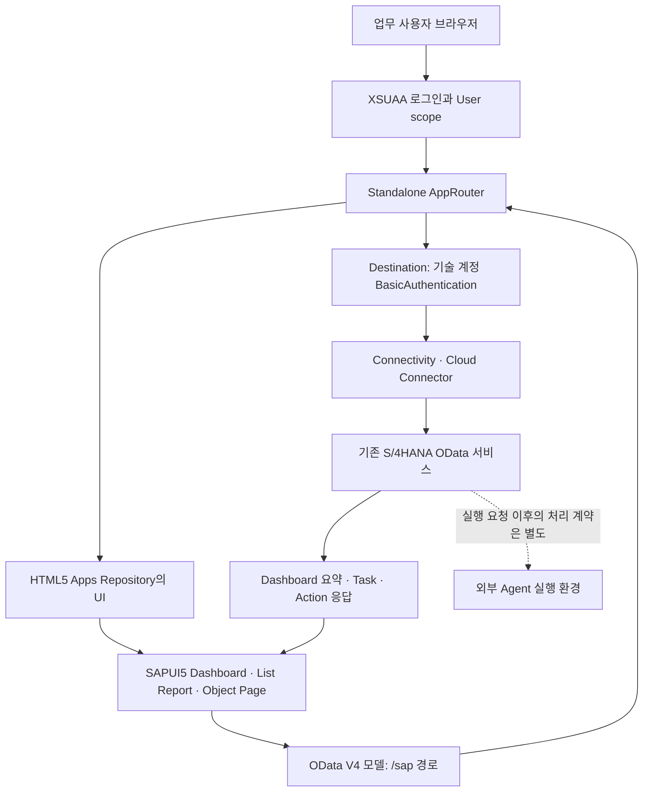

# Fiori 앱 구조와 역할

**이 폴더는 결산 Dashboard의 프런트엔드 소스, BTP 패키징 설정, 인수·배포 안내를 제공한다.** S/4HANA ABAP/CDS 구현이나 외부 Agent 실행 엔진은 포함하지 않는다. 실제 업무 기능은 기존 OData 서비스와 BTP 환경에 의존한다.

관련 문서: [[02. 전체 파일 목록|02 전체 파일 목록]]

## 1. 자료를 읽는 기준

원본 위치는 `03_Fiori_App/`이다. 하위 소스 폴더 이름이 길기 때문에 이 문서에서는 다음을 **소스 루트**라고 부른다.

`03_Fiori_App/APL1.5_ZAPL_FINANCE_1.0.13_Partner_Source_r2_20261015/`

| 자료 | 읽는 목적 |
|---|---|
| `APL1.5_ZAPL_FINANCE_Partner_Guide_20261015.md` | 외부에 제공된 일반 인수·빌드 안내 |
| `APL1.5_ZAPL_FINANCE_Partner_ZIP_Windows_Build_Deploy_Runbook_20261015.md` | Windows에서 ZIP을 빌드하고 기존 BTP 환경에 연결할 때의 상세 절차. 기존 회사 서비스 재사용 배포에서는 이 문서가 내부 일반 가이드보다 우선한다고 명시 |
| 소스 루트 `PARTNER_GUIDE.md` | 패키지 내부의 구조·파일·빌드·배포 전제·검증 기록 |
| 소스 루트 `SOURCE_INFO.json` | 기준 커밋, 버전, 패키징 변경, 과거 검증의 범위와 한계 |
| 상위 `btp-target.json`, `company-test-existing-services.mtaext` | 제공된 환경별 대상 정보와 서비스 이름 매핑. **값은 이 문서에 복사하지 않는다** |

[Windows 빌드·배포 런북 열기](<file:///C:/Users/ericy/github/POC/ASPN/03_Fiori_App/APL1.5_ZAPL_FINANCE_Partner_ZIP_Windows_Build_Deploy_Runbook_20261015.md>)

2026-11-08 읽기 점검에서 **실제 파일 45개**를 확인했다. 소스 ZIP 내부는 40개이고, 해제된 소스 폴더의 40개 파일과 경로·내용이 모두 같았다. 이 일치는 ZIP과 현재 해제본의 비교이며, 원본 Git 커밋 또는 실제 배포본을 이번에 검증했다는 뜻은 아니다.

## 2. 폴더별 역할

| 폴더 | 책임 | 변경 시 함께 확인할 곳 |
|---|---|---|
| `03_Fiori_App/` | ZIP, 전달 문서, 환경별 참고 설정 | 내부 가이드와 외부 런북의 적용 범위 |
| 소스 루트 | MTA 모듈·서비스, XSUAA 권한, 빌드 명령, 인수 정보 | AppRouter 경로, 서비스 바인딩, 앱 버전 |
| `approuter/` | 로그인·scope 확인, HTML5 콘텐츠 제공, `/sap` 요청 전달 | 두 `xs-app.json`, Destination, XSUAA |
| `deployment/` | CF 대상 정보의 참고 형식 | 실제 배포 도구가 이 파일을 자동으로 읽는지 여부 |
| `deployment/destination/` | S/4 연결 Destination 템플릿 | Cloud Connector, 기술 계정, SAP client, 실제 권한 |
| `financial-close-dashboard/` | SAPUI5 빌드 도구와 버전 | UI5 설정 두 개, 하위 잠금 파일 |
| `financial-close-dashboard/webapp/` | 브라우저 진입점, 앱 선언, OData 모델, 화면 라우팅 | 앱 ID, HTML5 저장소 경로, 서비스 metadata |
| `webapp/css/` | 카드·도넛·필터·스크롤 등의 화면 표현 | 실제 화면 크기, 테마, 키보드 접근성 |
| `webapp/ext/dashboard/` | Dashboard 화면·조회·상태·지표·달력·Agent 표시 | 필터 스냅샷, 요약/상세 정합성, 대량 데이터 |
| `webapp/ext/tasklist/` | Dashboard에서 넘어온 조건을 List Report 필터로 적용 | URL query, `TaskInstances` metadata |
| `webapp/i18n/` | 화면 이름·상태·메시지·접근성 문구 | XML/JS가 참조하는 번들 키 |
| `scripts/` | Windows/공통 빌드 진입 및 ZIP 무결성 검사 | Node/MBT/Make, 산출물 경로 |

표의 `webapp/...` 경로는 `financial-close-dashboard/` 아래이다. 현재 `test/`, `localService/`, `node_modules/`, `dist/`, `mta_archives/` 폴더는 제공 소스에 없다.

## 3. 브라우저와 데이터의 흐름

실제 앱 선언은 소스 루트의 `financial-close-dashboard/webapp/manifest.json`, 라우팅은 `approuter/xs-app.json`과 `financial-close-dashboard/webapp/xs-app.json`에서 확인한다.

1. `index.html`이 SAP CDN의 **SAPUI5 1.136.20**을 읽고 `Component.js`가 Fiori Elements `AppComponent`를 시작한다. UI5 전체 런타임은 ZIP에 들어 있지 않다.
2. `manifest.json`의 기본 모델이 `/sap/opu/odata4/sap/zui_cls_dash_o4/srvd/sap/zui_cls_dashboard/0001/`에 연결한다. 서버 연산과 자동 expand/select를 사용한다.
3. `Dashboard.controller.js`는 유효한 URL 조건이 있으면 해당 cycle을, 없으면 `KeyDate` 기준 최신 `DashboardCycles` 한 건을 읽는다.
4. 회사·템플릿·회계연도·회계기간·원장을 필수 조회 문맥으로 검사한다. 입력 중인 `filters>/draft`와 실제 적용한 `filters>/applied`를 분리하고, 조회 시점 조건을 고정한다. 기간은 3자리로 정규화한다.
5. 같은 조건으로 Task 상세, 실행 요약, Agent 요약, Agent 전체 상세를 읽는다. 새 조회 세대 번호를 사용하여 늦게 도착한 이전 조회 결과가 현재 화면을 덮지 않도록 한다.
6. 결과를 `metrics`, `agent`, `tasks`, `timeline`, `dashboard` JSON 모델에 넣고 XML 화면이 바인딩한다. 오류나 요약/상세 불일치에는 별도 경고·오류 상태를 표시한다.
7. 카드·도넛·달력에서 선택하면 조건을 URL query로 보존해 목록 또는 Task 상세로 이동한다. `TaskList.controller.js`가 query를 읽어 List Report 필터를 설정하고 새로 조회한다.

### 화면과 백엔드 접점

| 화면/목적 | 읽는 데이터 또는 설정 |
|---|---|
| 회사·템플릿·담당자 선택 | `CompanyCodes`, `ClosingTemplates`, `Assignees` |
| 고급 선택 항목 | `TaskCategories`, `TaskStatuses`, `ExecutionModes`, `Priorities` |
| 현재 결산 cycle·D-Day | `DashboardCycles` |
| 실행 방식별 수량·자동화 비율 | `DashboardExecutionSummary`, 완전한 Task 상세 |
| Agent 카드 | `DashboardAgentSummary`, `ExecutionMode=AGENT`인 `DashboardTasks` 전체 상세 |
| 우선순위·주의·예정 카드와 Timeline | `DashboardTasks` |
| Task 목록·상세 | Fiori Elements `TaskInstances` List Report/Object Page |
| 업무 action | 서비스 metadata·annotation의 action 계약. `RequestAgentExecution` 관련 UI 설정 포함 |

이는 소스에 드러난 주요 접점이다. 필드·annotation·action까지 포함한 완전한 백엔드 계약은 실제 `$metadata`와 ABAP 구현으로 확인해야 한다.

### 집계와 대량 데이터에서 주의할 점

소스 루트의 `financial-close-dashboard/webapp/ext/dashboard/DashboardMetrics.js`에서 **자동화율은 `SKIPPED`를 제외한 대상 중 `AGENT` 또는 `AUTOMATIC` 수의 비율**이다. 진행률은 전체 raw 수를 분모로 완료 수를 계산한다. 두 비율은 분모가 다르다. 상태별 화면 분류와 Timeline 색은 `TaskSemantics.js`를 공통 기준으로 삼고, 과거 한글 상태 호환은 `LegacyStatusCompatibility.js`가 일부 처리한다.

일반 Task 문맥은 최대 201건을 탐색하여 **200건 초과 여부를 판정하고 Timeline에는 200건까지만** 사용한다. 초과 시 카드용 데이터를 별도 조회하며, 전체 집계를 잘린 200건으로 확정하지 않는다. 반면 Agent 전체 상세는 `AgentTaskLoader.js`가 OData V4의 최종 길이를 기준으로 페이지를 읽는다. `TaskInstanceUuid` 중복, AGENT가 아닌 행, 불안정한 총수, 진행 없는 페이지, 오래된 문맥을 오류로 다루고 binding을 정리한다. 짧은 페이지를 전체 완료로 간주하지 않는다.

## 4. 인증과 업무 권한은 어디에서 결정되는가

**BTP에 로그인한 사람과 S/4에 접속하는 기술 계정은 서로 다른 주체다.** Destination 연결 성공만으로 개인별 업무 권한이 보장되지 않는다.

| 계층 | 이 자료에서 확인한 구성 | 보장하지 않는 것 |
|---|---|---|
| BTP 사용자 접근 | `xs-security.json`에 User/Operator/Admin scope와 Viewer/Operator/Admin role collection 정의 | 실제 사용자에게 collection이 부여되었는지 |
| AppRouter 경로 | `/sap`와 콘텐츠 경로에 XSUAA 인증 및 **User scope** 요구 | 각 쓰기 action별 Operator/Admin 강제 여부 |
| S/4 접속 | Destination 템플릿은 OnPremise + BasicAuthentication, 최소 권한 기술 계정 사용을 안내 | 로그인 사용자의 신원이 S/4에 자동 전달되는지 |
| 업무 데이터·action 권한 | 기존 S/4 서비스 구현과 권한 설정에 의존 | 앱 role collection만으로 회사·담당자별 접근을 차단하는지 |

소스 루트의 `deployment/destination/APL_FIORI_FINANCIAL_CLOSE.template.json`은 기본 인증의 기술 계정 연결이며 `HTML5.ForwardAuthToken`을 추가하지 말라고 명시한다. 템플릿의 설명용 필드와 placeholder는 그대로 가져오는 완성 Destination 설정이 아니다. 실제 계정·암호는 BTP의 승인된 설정에서 관리해야 한다.

따라서 Viewer/Operator/Admin을 구분하려면 **현재 AppRouter의 User scope 통과뿐 아니라 백엔드 action 권한과 개인별 업무 통제 방식까지** 인수해야 한다. 공유 기술 계정으로 호출되는 구성에서는 개인 식별·감사 추적·회사별 제한이 어떤 계약으로 유지되는지 별도 확인이 필요하다. 이 ZIP에 그 구현을 증명하는 ABAP 소스는 없다.

두 route의 `csrfProtection:false`는 원본 동작 유지를 위해 남아 있다. 이는 백엔드 CSRF 검증이 불필요하다는 뜻이 아니다. 쓰기 요청, 세션과 token 정책의 조직 기준 적합성은 대상 환경에서 검증한다.

## 5. RequestAgentExecution과 외부 실행의 경계

`financial-close-dashboard/webapp/manifest.json`은 Object Page의 `RequestAgentExecution` action을 `isAIOperation:true`로 표시한다. 이 파일은 **업무 action의 UI 표시 설정**이며, Agent 실행 엔진 자체가 아니다.

| 단계 | 이 폴더가 담당하는 것 | 별도로 확인할 것 |
|---|---|---|
| 요청 | Fiori Elements가 서비스 metadata/annotation에 맞는 action을 표시·호출하도록 구성 | action 존재, 입력 계약, 호출 권한, CSRF, batch 내부 응답 |
| 요청 접수·업무 상태 변경 | 기존 S/4 OData 서비스의 책임 | ABAP 동작, 중복 요청 방지, 실행 식별자·상태 계약 |
| 외부 실행 | **이 ZIP에 구현 없음** | 어떤 Agent/오케스트레이터가 요청을 인수하고 작업하는지 |
| 결과 반영 | Dashboard는 다시 읽은 상태·요약을 표시 | 결과 저장, 실패·재시도, 완료/검토/승인 단계의 책임 |

현재 webapp에서 외부 실행 URL을 직접 호출하는 `fetch`/`XMLHttpRequest` 구현은 찾지 못했다. `AGENT_RUNNING` 또는 `ExecutionMode=AGENT` 표시가 보인다는 사실만으로 외부 실행의 성공을 증명할 수 없다. 실제 요청→외부 실행→결과 저장→화면 재조회는 별도의 E2E 인수 범위다.

## 6. 빌드와 배포 구성

| 항목 | 확인한 기준 |
|---|---|
| 앱/MTA 버전 | 1.0.13, 소스 패키지 revision 2 |
| 루트 npm 버전 표기 | 1.1.0. 앱 버전과 다르므로 배포 버전 판정은 MTA·manifest도 함께 확인 |
| Node | 24.x |
| UI5 CLI / bestzip | 4.0.70 / 4.0.0 |
| AppRouter | 23.3.0. 제공 기록상 upstream 23.0.0과 차이 있음 |
| MBT | 정확히 1.2.47 + GNU Make 필요 |
| UI5 런타임 | 1.136.20, 최소 UI5 선언 1.136.0 |

소스 루트에서 `npm run build:mta` 또는 Windows `scripts/01-build-release.ps1`을 **인자 없이** 실행하는 구조다. 두 방식 모두 공통 `scripts/build-mta.mjs`로 이어진다. 이 패키지는 원본의 `EvidenceDir` 매개변수나 개발용 검사 스크립트를 제공하지 않는다.

공통 스크립트는 Node major, 승인된 native MBT 절대 경로를 받는 `MBT_PATH`, 정확한 MBT 버전, GNU Make를 먼저 확인한다. native 경로가 없으면 고정 버전 npx MBT를 사용한다. 선행 확인 뒤 해당 과거 MTAR/HTML5 ZIP을 지워 오래된 파일의 오인 성공을 막고, MBT 성공과 새 산출물을 확인한 후 내부 ZIP 검사를 수행한다. **빌드는 배포하지 않는다.** 의존성·UI5 리소스 다운로드가 필요할 수 있다.

| MTA 모듈 | 역할 |
|---|---|
| `financial-close-approuter` | `npm ci --omit=dev`로 런타임 의존성 설치 후 배포 |
| `financial-close-dashboard-ui` | `npm ci --include=dev`, clean UI5 build, HTML5 ZIP 패키징 |
| `financial-close-ui-content` | HTML5 ZIP을 HTML5 app-host에 올릴 콘텐츠 |

MTA의 서비스 리소스는 HTML5 app-host, HTML5 app-runtime, XSUAA, Destination, Connectivity 다섯 종류다. AppRouter는 host를 제외한 runtime 서비스 네 개를 사용하며, app-host는 콘텐츠 모듈의 배포 대상이다.

빌드 산출물은 `financial-close-dashboard/dist/financial-close-dashboard-ui.zip`, `mta_archives/financial-close-dashboard_1.0.13.mtar`이다. 현재 읽은 소스 폴더에는 생성되어 있지 않다.

### 환경별 설정을 읽을 때의 차이

- 소스 루트의 `deployment/btp-target.example.json`은 **참고 작업표**다. 패키지 빌드 스크립트가 읽지 않는다.
- 상위 `03_Fiori_App/btp-target.json`은 환경별 대상 정보를 가진 제공 파일이다. 파일이 있다는 이유만으로 현재 CF target이나 배포 대상이 검증되는 것은 아니다.
- 상위 `03_Fiori_App/company-test-existing-services.mtaext`는 MTA 리소스 다섯 개에 `parameters.service-name` 매핑을 제공한다. **현재 실제 파일에는 `org.cloudfoundry.existing-service`로 바꾸는 `type` 선언이 없다.** 이름에 existing-services가 있어도 모든 리소스를 기존 서비스 타입으로 바꿨다고 해석하면 안 된다.
- 외부 Windows 런북은 승인된 extension을 **배포 시점 `cf deploy ... -e <승인 파일>`**로 전달하도록 안내한다. `build-mta.mjs`에는 extension 입력 인자가 없다. 실제 `type`·service-name·현재 서비스 상태를 대조하고 적용 결과를 확인해야 한다.
- 실제 기존 XSUAA를 existing-service 방식으로 재사용한다면 새 `xs-security.json`이 자동 반영된다고 가정하지 않는다.

이 문서는 설정의 구조만 설명한다. 실제 CF API, org, space, 호스트, 사용자, 암호, 서비스 연결값은 복사하지 않았다.

## 7. 테스트와 검증의 경계

| 구분 | 근거와 해석 |
|---|---|
| 이번 문서 작성에서 확인 | 실제 45개 파일 목록, JSON/YAML/JS/XML/문서의 정적 읽기, ZIP 40개와 해제본 40개의 경로·SHA-256 일치 |
| 패키지에 포함된 자동 검사 | `verify-mta.mjs`: MTAR와 내부 AppRouter/content/HTML5 ZIP의 경계·이름·중복·크기·CRC·필수 파일과 주요 JSON 구문 검사 |
| 자동 검사의 형식 한계 | 일반 ZIP 대상. ZIP64·분할·암호화 ZIP 미지원, 아카이브/전체 확장 크기 512 MiB, 개별 파일 128 MiB 상한 |
| 제공자가 기록한 과거 검증 | `SOURCE_INFO.json`과 가이드의 Linux 전체 MTAR 빌드, 원본 대비 frontend 결과 41개 일치, 손상 ZIP 실패 감지, secret scan 기록 |
| 과거 보안 수치 | 2026-10-15 기록: frontend build 의존성 high 11/moderate 3, AppRouter production 0. 현재 재실행 결과가 아니며 MBT/native/UI5 CDN 전체를 포함하지 않음 |
| 이 패키지에 없는 검사 | 원본 lint/QUnit·metadata fixture·개발 proxy·브라우저 stress 스크립트·ABAP 소스 |
| 이번에 실행하지 않은 것 | npm 설치, UI5/MTAR 빌드, audit, Windows 실행, SSO, CF 배포, 로그인, 실제 S/4 읽기/쓰기, 외부 Agent 실행 |

**빌드 무결성 통과와 업무 동작 통과는 별도다.** 실제 인수에서는 로그인과 role 차이, Destination/Cloud Connector 연결, `$metadata`, Dashboard 필터와 대량 데이터, 요약/상세 불일치 처리, 목록·상세 이동, 쓰기 action/CSRF, Agent 결과 반영, 화면 크기·키보드·테마를 확인해야 한다. OData `$batch`는 바깥 HTTP 200뿐 아니라 내부 응답까지 읽는다.

## 8. 원본 근거로 돌아가기

- [패키지 README](<file:///C:/Users/ericy/github/POC/ASPN/03_Fiori_App/APL1.5_ZAPL_FINANCE_1.0.13_Partner_Source_r2_20261015/README.md>)
- [내부 파트너 안내](<file:///C:/Users/ericy/github/POC/ASPN/03_Fiori_App/APL1.5_ZAPL_FINANCE_1.0.13_Partner_Source_r2_20261015/PARTNER_GUIDE.md>)
- [앱 manifest](<file:///C:/Users/ericy/github/POC/ASPN/03_Fiori_App/APL1.5_ZAPL_FINANCE_1.0.13_Partner_Source_r2_20261015/financial-close-dashboard/webapp/manifest.json>)
- [Dashboard controller](<file:///C:/Users/ericy/github/POC/ASPN/03_Fiori_App/APL1.5_ZAPL_FINANCE_1.0.13_Partner_Source_r2_20261015/financial-close-dashboard/webapp/ext/dashboard/Dashboard.controller.js>)
- [MTA 정의](<file:///C:/Users/ericy/github/POC/ASPN/03_Fiori_App/APL1.5_ZAPL_FINANCE_1.0.13_Partner_Source_r2_20261015/mta.yaml>)

생략한 검증: 실제 빌드·배포·업무 실행은 수행하지 않았다. 남은 위험: 공유 기술 계정의 업무 권한, 기존 서비스 매핑, action/외부 실행 계약은 대상 환경에서 확인해야 한다.
