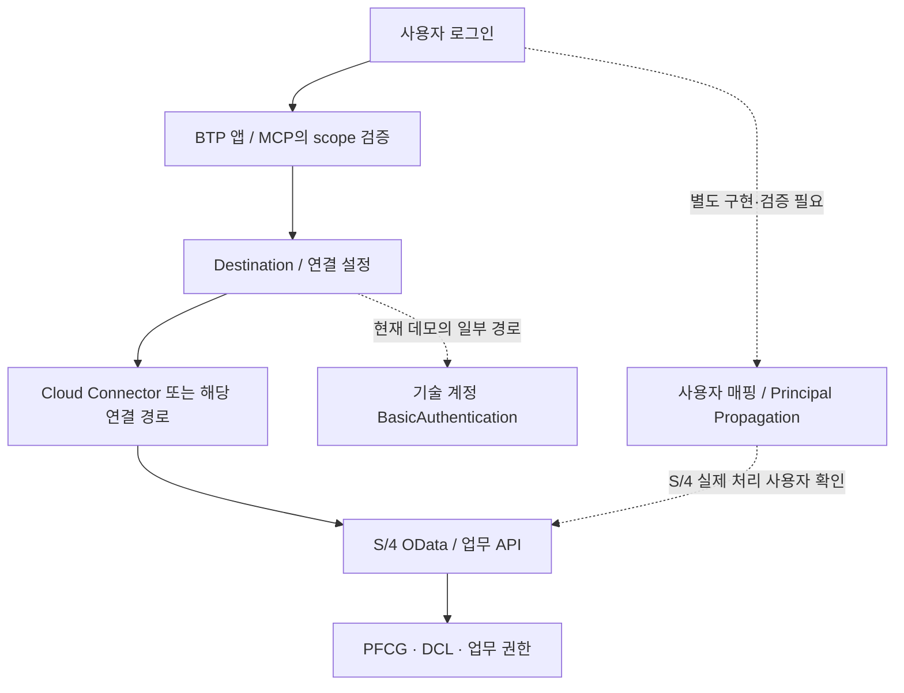

# Destination과 연결 설정의 역할

[[00. 제공 자료 전체 지도|00 제공 자료 전체 지도]] · [[02. 구현 인수인계와 SAP 시스템 이해|02 구현 인수인계와 SAP 시스템 이해]]

**`06_Destination.txt`는 실제 0바이트이며, 배포 설정이 담긴 파일이 아니다.** 긴 영상 약 **60:10–61:00**에서 발표자는 설명을 잊지 않으려 빈 파일만 만들었고 실제 BTP Cockpit 설정을 봐야 한다고 답한다.

## 제공 파일과 실제 설정의 위치

| 항목 | 실제 상태/역할 |
|---|---|
| `ASPN/06_Destination.txt` | 빈 텍스트 파일 1개. Destination 설명용 자리표시자 |
| Fiori Destination 템플릿 | `03_Fiori_App` 내부 `deployment/destination/` 등에서 연결 형식 참고 |
| MCP 회사 프로필 | `04_MCP_on_Kyma/company.yaml` 및 배포본 템플릿에 서비스/연결 매핑 |
| BTP Destination | 실제 대상·인증·프록시·추가 속성을 플랫폼에서 관리 |
| IS Security Material | iFlow가 참조하는 Credential을 IS에 별도 등록 |
| Cloud Connector | 연결할 내부/PCE 시스템, 경로, 인증 전파 등의 플랫폼 설정 |

[빈 원본 파일](<file:///C:/Users/ericy/github/POC/ASPN/06_Destination.txt>)

**소스에 설정 참조가 있다는 것과 플랫폼에 실제 리소스가 준비됐다는 것은 다르다.** 접속 URL·개인 계정·client ID/secret·인증 값은 이 노트에 복제하지 않는다.

## Destination을 쉽게 설명하면

앱에 SAP 주소와 인증 정보를 직접 흩어 놓는 대신, 플랫폼의 **이름 있는 연결 설정**을 참조하게 하는 방식이다. 다만 실제 사용 경로는 Fiori AppRouter, Kyma Transparent Proxy, IS iFlow마다 다를 수 있다.

| 사용 경로 | 설정이 연결하는 것 | 자주 혼동하는 점 |
|---|---|---|
| Fiori `/sap` 요청 | AppRouter/Connectivity에서 S/4 OData로 전달 | UI 로그인과 SAP 업무 사용자는 같지 않을 수 있음 |
| 업무별 Insights | 특정 service_id → connection_id → Destination | 모든 SAP 서비스에 임의 접근하는 만능 연결이 아님 |
| FX/AFAB 결과 보조 조회 | 지정 RequestID의 기존 실행 결과 | 실행 API 자체가 아님 |
| IS Actions | 실행 API와 CSRF token/cookie 왕복 | Security Material·iFlow의 참조도 별도 필요 |

## 연결 경로와 권한 경로를 함께 보기

**네트워크 연결 성공, CSRF 성공, 로그인 성공, 업무 권한 성공은 각각 다른 확인이다.** 영상 **70:00–74:30**의 핵심은 현재 기술 계정 경로와 사용자 전파 미완성을 확인하고, IS 기반 전파·권한 테스트를 PoC 작업으로 다룬다는 점이다.

## 인수 시 확인할 설정 항목

아래는 실환경 검토 때 남길 항목이며, 지금 설정을 변경하라는 실행 절차가 아니다.

| 확인 범주 | 남길 내용 |
|---|---|
| 대상 | 환경·시스템·SAP client·서비스 루트가 어느 PoC를 가리키는지 |
| URL 결합 | Destination이 origin인지 service root인지, 앱이 경로를 중복 추가하지 않는지 |
| 네트워크 | ProxyType, Cloud Connector 매핑, Kyma Transparent Proxy 실제 포트·허용 경로 |
| 인증 | 기술 계정/전파 방식, Secret·Credential 참조, 만료·관리 책임 |
| 사용자 | MCP에서 본 신원과 S/4 실제 처리 사용자의 매핑 |
| 권한 | 역할·회사코드·업무별 허용/거부 사례. 단순 로그인 또는 `who_am_i`만으로 끝내지 않음 |
| 실행 | TEST/실제 처리 권한과 결과 조회 권한, 로그·스풀 접근 |
| 변경 책임 | S/4, BTP, IS, Cloud Connector를 누가 수정·검증할지 |

영상에서 “설정만 바꾸면 된다”는 설명이 있어도, 실제 사용자의 SAP 권한으로 성공/거부되는지 증거가 필요하다. 원본 아키텍처 그림의 화살표만으로 전파 완료를 판단할 수 없다.

관련: [[01. Fiori 앱 구조와 역할|01 Fiori 앱 구조와 역할]] · [[00. Kyma MCP 역할과 구조|00 Kyma MCP 역할과 구조]] · [[01. Integration Suite 실행 구조|01 Integration Suite 실행 구조]] · [[01. RAP 백엔드 구조와 데이터 흐름|01 RAP 백엔드 구조와 데이터 흐름]]

이번에는 파일의 빈 상태와 관련 설정 소스·영상 설명을 확인했다. BTP 로그인·설정 조회·실제 접속·사용자 전파 테스트는 수행하지 않았다.
