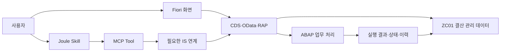

# 시스템과 개발 책임의 변화

## Fiori Copy의 실질적인 의미

**기존 BAIP 환경을 쓰면서 새 ZC01 기반 데이터·서비스에 맞게 앱을 준비하는 작업으로 이해해야 한다.** 별도 신규 환경 전체를 받았다는 답변은 없다. 앱을 실제 복제할지, 서비스 연결을 교체할지, 기존 앱과 병행할지는 추가 협의 대상이다.

위는 책임 구분용 목표 개념도다. 모든 MCP 요청에 IS를 강제하거나 현재 모든 경로가 완성됐음을 뜻하지 않는다. 공유된 D01 검수에서는 기존 조회 경로가 **ZCLS** 테이블 기반임을 확인했다. ZC01 테이블이 있다는 사실과 앱의 이관 완료를 구별해야 한다.

## 신규 기능마다 MCP를 만들 필요는 없다

Teams의 “AI가 쓰는 시나리오가 없다면 굳이 MCP화는 필요없음”이 핵심이다.

| 기능 | 중심 구현 위치 | MCP 노출 판단 |
|---|---|---|
| 결산 업무 조회·공통 완료율 | CDS/OData, 합의한 상태 기준 | Joule이 조회해야 하면 Tool 제공 |
| 상태 갱신·권한·중복 요청 방지 | RAP/ABAP의 서버 검증 | AI 요청 경로에 한해 같은 업무 로직을 호출 |
| 정기 테스트·알림 | 스케줄러·IS 연계와 백엔드 | 정기 실행 자체만으로 MCP가 필수는 아님 |
| Spool 구조화·회계 계산 | ABAP/결정적인 서버 계산 | 계산 결과를 AI가 설명하도록 조회 Tool 제공 가능 |
| 타임라인 위치·화면 표시 | UI5 | 화면 수정만이면 MCP 불필요 |
| 사용자 의도 해석·확인·설명 | Joule Skill | 정해진 도구와 입력 범위 사용 |

11/12 구현모델의 Thin MCP/Fat Backend는 이를 구체화하는 **참고 설계**다. 회계 규칙을 프롬프트에만 두지 않고 GUI·AI가 같은 서버 로직을 사용하도록 하자는 방향이다. 공통 ABAP를 실제 두 경로에 연결해야 동일 동작이 보장된다.

## Kyma·CF·IS 방향을 읽는 법

- 기존 인수본: Kyma의 조회 중심 MCP와 IS의 실행 연계라는 설명이 있다.
- 11/10 보유 실행계획: CF CAP 우선·IS 병행 검증·조건부 전환이라는 경로가 제시된다.
- 이번 Teams: 기존 Kyma MCP 전환 과정에서 IS 담당자가 템플릿을 만들고 이후 신규 MCP 요청에 사용하자는 협업 제안이 나온다.

따라서 **최종 MCP가 정확히 몇 개이고 어디에 남는지는 새 대화만으로 확정할 수 없다.** 조회/실행 책임과 배포 위치를 분리해 Tool별 이전 대상·인증·기능 동등성·운영 경로를 정해야 한다.

개발 순서는 `업무 시나리오·계약 → SAP/OData 및 필요한 iFlow·API → MCP Tool 노출 → Joule 연결 → 결과 재조회·상태 기록·권한 통합 검증`으로 이해하면 된다. iFlow가 MCP 서버를 소비해서 완성되는 구조로 일반화하지 않는다.

관련 기존 설명: [[01. Integration Suite 실행 구조]], [[01. RAP 백엔드 구조와 데이터 흐름]]. 해당 문서의 인계 당시 구조는 역사적 설명으로 유지한다.
