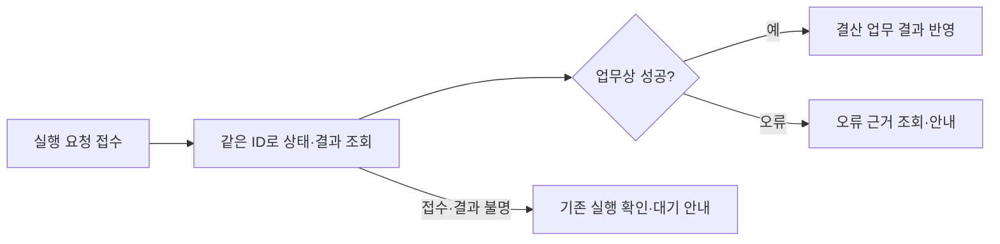

# 시스템과 개발 책임의 변화

갱신: **2026-11-17**. 이 문서는 **인수 구조와 최신 설계 방향의 차이**를 설명한다. 최종 배포 구성도는 아직 확보하지 못했다.

## 1. 현재 담당에서 시작한다

**홍종화 매니저님이 만드는 RAP/ABAP·OData를 염정운 매니저님이 MCP 도구로 제공하고, SAP Korea가 Joule·Skill·IS를 연결한다**는 사용자 설명이 현재 기준이다. Fiori는 차재영 매니저님 담당이다.

[그림 확대](../../99.%20스크린%20샷%20및%20다이어그램/02.%20진행%20맥락/02-담당과-설계-경로.svg)

그림 아래 두 경로는 **서로 다른 문서가 제시한 구상**이다. 함께 직렬 연결됐거나 두 경로가 모두 배포됐다는 뜻은 아니다.

## 2. Kyma·CF·IS의 변화는 문서별로 읽는다

| 시점·자료 | 제시한 방향 | 지금의 해석 |
| --- | --- | --- |
| SAP·ASPN 초기 인수본 | 조회: Kyma Insights MCP / 실행: IS MCP·iFlow | 기존 데모를 이해하는 참고 구조. 여러 재무 예제 전체를 구현하지 않음 |
| ZEN 11/10 실행계획 | CF CAP 우선·IS 병행 검증·조건부 전환 | 후속 협의 전 내부 계획. 11/25 등의 날짜를 현재 약속으로 사용하지 않음 |
| 11/16 **v0.4-S SAP 협의용** | Joule/Skill → SAP IS MCP → S/4, S2 검색에는 CAP 지원 | 받은 시나리오 Excel을 SAP와 기술 협의하기 위한 문서. 신규 Custom MCP 구축 설명 제외 |
| 11/16 **v0.6-Z 내부 수행용** | 기존 Joule의 Connector → **CF에 새 Custom MCP** → S/4·CAP | Kyma 코드 확장·이전을 하지 않는다고 기재. **업무 의미·계약은 참고하되 코드 재사용과 구분** |

v0.6-Z에는 **기존 Joule을 사용하고 JWD를 사용하지 않는다는 내부 방향**도 있다. 원 Excel과 다른 과제의 JWD 표현까지 모두 폐기됐다고 확대하지 않는다. **시나리오별 적용 경로·SAP 연결 수용 여부는 별도 확인**한다.

CF 런타임은 v0.6-Z 표에 ‘확정’이라고 적혀 있다. 그러나 **§12 Custom MCP 설계 자체는 검토안**이며, Node.js·TypeScript·CAP·MCP SDK·전송 방식·SAP 연결 라이브러리는 **D-09 등에서 결정할 후보**다. 폴더 예시를 구현 강제 규칙으로 쓰지 않는다.

## 3. API 계약을 경계로 로직을 나눈다

| 계층 | 이 프로젝트에서 맡길 일 | 필요한 이유 |
| --- | --- | --- |
| **CDS·조회 API** | 업무 마스터·Cycle·실행 상태 결합, 상태·완료·KPI의 공통 정의, 범위 지정 조회 | Fiori와 Joule이 같은 숫자·의미를 사용 |
| **RAP·ABAP** | 권한·업무 조건·상태 변경·중복 방지·실행 결과 저장, Spool 구조화와 회계 계산 | GUI와 AI 요청이 같은 업무 규칙을 적용 |
| **MCP** | 도구 설명·입력 검증·허용된 OData 질의 구성·호출·응답/오류 변환·추적 | AI가 필요한 기능을 고르고 결과를 해석할 계약 제공 |
| **Joule·Skill** | 의도·기간 확인, 도구 호출 순서, 사용자 확인, 결과 설명 | API 호출을 사용자 대화와 연결 |
| **Fiori** | 화면·표시·업무 이동·백엔드 결과 재조회 | 화면과 대화 결과의 일관성 확인 |

11/12 참조모델의 **Thin MCP / Fat Backend**를 최신 명세가 적용한 구상이다. 사용자가 요청하지 않은 모든 백엔드 기능을 MCP화할 필요는 없다.

예를 들어 현황 Excel의 **Cycle → 마스터 → 업무 상태**라는 세 단계는 CDS 조인으로 풀 수 있다. 요약·목록을 `$batch`로 묶는 안도 있다. **한 HTTP 요청이라는 사실이 단일 Entity·단일 SQL이라는 뜻은 아니다.**

## 4. 호출의 성공과 업무 완료를 구분한다

**POST 성공·Job FINISHED·회계 업무 성공·결산 관리 상태 반영은 각각 확인해야 한다.** 통신 timeout이면 기존 실행을 먼저 조회하고, 자동 재POST나 새 ID 실행을 금지하는 방향이다. 명시적 재실행과 동일 요청 재시도는 계약을 나눈다.

조회 응답의 `{summary, rows, links, request_id}`는 제안된 공통 형태다. **부분 조회·권한 없음·Cycle 없음·정상 0건**을 구분한다. 집계도 사용자 허용 범위를 따르게 구현·시험해야 하며, CDS 권한이 자동으로 모든 집계에 적용된다고 가정하지 않는다.

## 5. 인수할 것은 주소와 JSON을 넘는다

MCP 구현자는 **대상 환경·사용자 범위·필드 의미·요청 효과·실행 ID·실패 후 확인 방법**까지 받아야 한다. 보통예금 API의 구체적 예는 [[07. 보통예금 기능과 MCP 인수 기준]], 미결 계약은 [[02. 확정 전달과 미결 사항]].

Fiori Copy는 기존 BAIP/CF 환경에서 신규 ZC01 데이터·서비스에 맞게 앱을 준비하는 맥락이다. 앱 복제·서비스 교체·병행 범위와 기존 데이터 보존은 추가 협의 대상이며, 기존 ZCLS 조회 성공을 ZC01 이관 완료로 바꾸어 적지 않는다.
