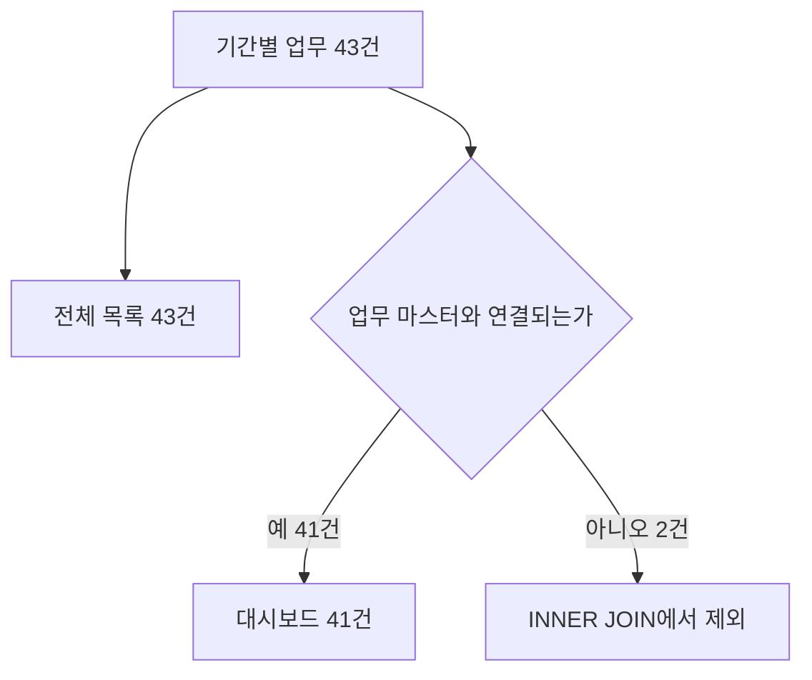

# Fiori 검수 결과와 협의할 기준

**이번에 읽은 것은 공유자의 실제 점검 기록이다. 이 세션에서 SAP를 다시 호출하거나 데이터를 수정하지 않았다.** 원문의 FAIL은 그 점검 조건에서 기대값과 달랐다는 뜻이며, 고객이 모든 항목의 수정을 승인했다는 뜻은 아니다.

| 근거 | 관찰된 사실 | 해석·남은 일 |
|---|---|---|
| R-01, 11/11 | 기본 조회·담당자 필터·일반 목록/상세 이동 일부 PASS | 전체 회귀 통과 아님. 업무 Action·역할 권한·최종 배포는 NOT_RUN |
| D01, 11/11 | DashboardTasks 41 / TaskInstances 43. Config에서 마스터 2개 미조회 | 조인 차이로 2건 제외. 활성 핵심 CDS는 ZCLS 기반 |
| D01 후속 | 1~9월 18건 영향, 그중 16건 완료 상태. 원래 업무 UUID 대응은 미확보 | 무작정 seed 실행·삭제·재생성 금지. 원본과 보존 조건을 먼저 결정 |
| S01, 11/12 | 8월 CASH010이 완료 집계 +1, 미결 Critical +1 | API 입력과 현행 계산 함수에서 재현. Agent 단계 완료와 최종 완료의 의미부터 합의 |
| Dashboard 분석, 11/13 조회 | 6/28~7/4와 겹치는 업무가 6월 조회 37건, 7월 조회 0건 | 달력 표시 시작일과 업무 조회 기간이 다름. 조회 실패는 아님 |
| R-01 D02 | 같은 업무 이력 일반 필터 2건, 연관 경로 0건 | association·키·권한·활성 메타데이터 확인 필요 |
| R-01 D03 | TaskIssues 전체 HTTP 500, 특정 업무 필터 200/0건 | 원인 미확정. 특정 빈 응답 성공으로 정상 판정 불가 |

## 41건과 43건은 서로 다른 데이터 집합

D01에서 정상 마스터 41개는 활성 seed와 대응하지만, 누락된 두 UUID는 확인 가능한 소스·과거 버전·이력·인수 자료에서 원래 업무로 연결되지 않았다. ‘감가상각/외화평가일 것’이라고 추측해 복구하면 안 된다. 기존 ZCLS 복구가 이번 범위인지, 새 ZC01에서만 검수할지도 협의해야 한다.

## 완료율은 상태 문자열만 번역해서 해결되지 않는다

S01의 CASH010 응답은 `Status=에이전트 수행 완료`, `IsCompleted=false`, `IsPriorityOpen=true`였다. UI 일부는 한글을 COMPLETED로 변환하고, 서버와 다른 카드는 원문 기준으로 판단한다. `처리 완료` 2건은 기존 호환 매핑에도 없다.

정할 것은 **저장 코드 → API 상태/완료 여부 → 실행·검토·승인 단계 → KPI 포함 여부 → 버튼 활성 조건 → 표시 문구** 전체다. Agent가 일을 끝냈지만 검토가 남았다면 두 지표가 다를 수 있다. 의도된 구분이라면 지표 이름과 설명을 명확히 해야 하고, 같은 의미의 완료라면 판정을 통일해야 한다.

## 전월 마지막 주 표시와 전월 업무 포함은 다르다

7월을 선택했을 때 달력 시작일이 6/28이어도 OData가 7월 FiscalPeriod와 CycleUuid로 제한되면 6월 업무는 오지 않는다. 해결 여부는 “전월 결산 업무도 보이는 달력”을 원하는지에 달렸다. 캘린더 조회를 넓히더라도 7월 진행률과 다른 카드의 분모를 함께 넓히면 업무 의미가 바뀐다.

## 상세 버튼과 사용자 검색도 범위 확인이 먼저다

- Start/Complete/Review/Approve/Reopen/Request AI Agent와 별도 ✨ 버튼을 이번 시연에 쓰는지 확인한다. 비활성 표시만으로 고장이라고 단정하지 않는다.
- 사용자 Value Help 5개 중 업무 마스터 담당자·승인자 편집 화면은 현재 앱에 없다. 조회 서비스가 있어도 편집 화면까지 있는 것은 아니다.
- F-01 타임라인 상단 이동과 F-02 날짜 검증, F-03~08 연계·상태·권한, F-11~16 추가 화면 후보를 구분한다.
- F-16 실행 조건 설정 화면은 엑셀 1.2.2의 UI5 협업 항목에서 나온다. 시뮬레이션 결과 표시 F-15와 다른 기능이다.
- R-02~04 구조 정리는 내부 계획이며 미착수로 기록돼 있다. 고객 요구사항과 공수를 중복 계산하지 않는다.

검수 완료에는 동일 조건의 API·화면 비교, 신규 ZC01 원천 확인, 승인된 상태·데이터 정답, 업무 Action의 허용/거부, 결과·이력 보존이 필요하다. 현재 문서가 이 전부의 통과를 증명하지는 않는다.
