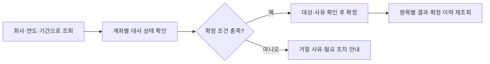

# 보통예금 기능과 MCP 인수 기준

갱신: **2026-11-17** · 원본: 홍종화 매니저님의 `2026-11-17-closing-check-function-spec.xlsx` v1.0.0. 버전 이력의 작성자는 홍종화이며, 마지막 저장자의 이름과 작성자를 구분한다. 원본 링크는 [[06. 자료 목록과 버전 비교]].

> [!abstract] 이 문서가 중요한 이유
> **추상적인 결산 시나리오가 ‘조회할 업무 데이터·확정 Action·거절 사유’가 있는 구체적인 API로 내려왔다.** 염정운 매니저님은 이 계약을 MCP에 옮기되, **문서의 구현·검증 범위와 실제 인수 환경**을 먼저 맞춰야 한다.

## 1. 어떤 업무인가?

**계좌별 장부 잔액과 외부 잔액을 비교하고, 담당자가 점검 결과를 확정하는 업무**다. 결과 한 건의 단위는 **회사·회계연도·기간·House Bank 계좌**다.

| 대사 상태 | 뜻 | 확정 시 의미 |
| --- | --- | --- |
| **MATCHED** | 허용 오차 내에서 일치 | 다른 권한·상태 조건도 통과해야 함 |
| **DIFFERENT** | 차이 존재 | **차이가 있어도 사유를 입력하면 확정 가능** |
| **NOT_RECON** | 외부 잔액을 아직 받지 못함 | 확정 불가. 외부값 0을 ‘잔액 0’이라고 해석하지 않음 |

**대사 상태와 확정 상태는 다르다.** 금액이 일치한다고 자동 확정된 것은 아니며, 차이가 있다고 항상 확정이 금지되는 것도 아니다.

## 2. 어느 환경까지 됐다고 보고됐는가?

| 근거 시점 | 젠데모 | HE4 |
| --- | --- | --- |
| **11/17 10:19 Teams** | 배포 완료 보고 | 아직 배포하지 못함. ‘내일까지’ 이관 예정 |
| **11/17 11:06:54 수정 XLSX** | Client **100**, 회사 **ZEN1**, 리포트·확정 클래스·RAP BO·OData V4 반영 기재 | Client **400**, 회사 **4310·4320**, 리포트·확정 클래스 반영, **RAP BO·OData 미반영** 기재 |

이는 작성자가 보고한 시점별 상태다. **11/18은 당시 이관 목표**이며 완료 증거가 아니다. 과거 시나리오의 회사 `1710`이나 젠데모의 `ZEN1`을 HE4용 MCP에 고정하지 않는다.

## 3. MCP에서 연결할 기능

서비스는 **`ZAPI_C01_CCK_DEPOSIT_O4`**, 주요 Entity는 **`CheckResult`·`Confirmation`**이다. 문서가 설명하는 도구와 API 연결은 다음과 같다.

| 업무 도구 | 백엔드 연결 | MCP가 전달할 핵심 |
| --- | --- | --- |
| `find_check_results` | `GET CheckResult` | 회사·연도·기간 필수, 계좌·대사 상태·확정 상태 등의 조회 조건 |
| `confirm_check_results` | 대상 범위 재확인 → CSRF → `confirmMultiple` | 선택한 UUID와 사유, 항목별 확정·거절 결과 |
| `get_confirmation_history` | `GET Confirmation` 등 | 어떤 결과를 누가 언제 어떤 경로로 확정했는지 |

이는 **XLSX에 기재된 MCP·랩 설명**이다. 이번 정리에서 해당 MCP 소스·배포·호출을 새로 확인하지 않았다.

SAP GUI와 API는 같은 확정 규칙을 사용하도록 설명돼 있다. 다만 `confirmFromSapGui`는 BO 내부의 GUI 전용 Action이며 OData로 노출되지 않는다. 단건 `confirm`도 노출돼 있지만 실행 검증이 없고, `If-Match` 필수 여부는 미검증이다. **문서의 여러 Action을 같은 검증 수준으로 취급하지 않는다.**

## 4. 결과를 올바르게 전달하려면

| 상황·계약 | MCP에서 필요한 처리 방향 |
| --- | --- |
| `confirmMultiple`이 HTTP 200 반환 | **각 항목의 `Confirmed`와 `Message`를 확인**. 전체 성공이라고 답하지 않음 |
| 일부 항목 거절 | 성공·거절 대상과 이유를 나누어 전달. 성공 건까지 일괄 재요청하지 않음 |
| 최종 저장 실패·통신 단절 | 결과가 불명확할 수 있으므로 **기존 상태·이력부터 재조회** |
| 요청의 회사·기간·사용자 | UUID 형식과 대상 범위를 검사하고 서버 권한 적용. `RequestedBy` 입력만으로 권한·행위자를 증명하지 않음 |
| 금액·기간·시각 | 금액·판정은 서버 결과를 보존. 예시 기간은 `'002'` 요청에 `'2'` 응답도 있음. 숫자형 UTC 확정 시각은 계약에 맞게 변환 |

원본의 **다건 확정 요청·응답 예시는 ‘미실행’**이라고 표시돼 있다. 조회 실제 응답, 소스 설명, API 예시를 구분해서 인수·시험한다.

## 5. 인수 완료 전에 필요한 확인

1. **대상 환경:** 실제 사용할 HE4 서비스 URL·바인딩·메타데이터·회사·기간·인증 방식.
2. **정답 데이터:** 일치·차이·미대사·기확정·권한 거절 사례와 기대 결과.
3. **쓰기 계약:** 사용자 확인, 동일 요청·동시 변경·재시도, 항목별 거절과 전체 저장 실패의 의미.
4. **재조회 근거:** 확정 결과와 이력이 실제로 남았는지, 화면과 MCP가 같은 상태를 보는지.
5. **결산 Task 연결:** 11/16 R&R의 1.1.1은 해당 Cycle의 **TR006 완료 반영**을 구상한다. 11/17 계좌 확정 명세만으로 그 연계까지 확인할 수는 없다. 일부 계좌 확정과 전체 결산 Task 완료의 관계, 대상 Cycle·Task 매핑, 반영 주체·조건을 별도로 인수한다.

> [!warning] 현재 기능의 한계
> **시드 데이터 기반이며 실제 펌뱅킹·G/L 잔액 연계는 없다. 확정 취소 기능도 없다.** 따라서 ‘실제 은행 잔액 검증 완료’로 설명할 수 없고, 쓰기 시험의 대상·복구 방법을 먼저 정해야 한다.

이 사례를 일반적인 MCP 설계 원칙과 연결하는 상세 검토는 [[11. RAP와 Joule 담당자에게 필요한 계약]]·[[12. 검증 시나리오와 단계별 실행 계획]]에서 이어간다.
