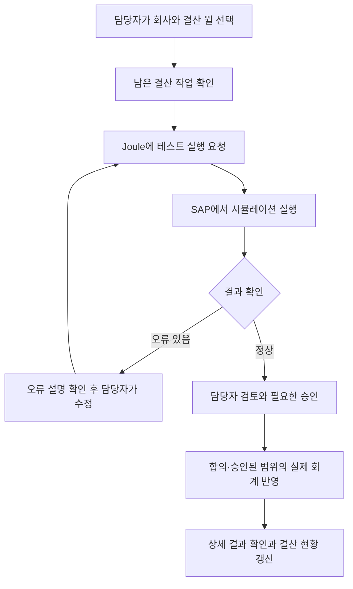

# 처음 읽는 결산과 삼성물산 PoC

회계나 SAP FI를 처음 접하는 팀원이 이 프로젝트의 목적과 업무 흐름을 이해하기 위한 문서다.

**이 PoC는 매달 하는 회계 마감 업무를 SAP와 AI를 연결해서 더 쉽게 확인하고 처리할 수 있는지 시험하는 프로젝트다.** 결산 담당자가 남은 업무를 확인하고, 테스트 실행을 요청하고, 오류와 결과를 검토하는 흐름을 다룬다.

아래 회계 설명과 금액은 이해를 위한 일반적인 예시다. 고객사의 실제 데이터·회계 정책이 아니다. 또한 목표 업무 흐름과 현재 인수 소스에서 확인된 구현은 구분한다. 이 문서 작성 과정에서 SAP/BTP 업무 실행을 새로 검증하지 않았다.

## 1. 결산은 회사의 한 달 또는 한 해 성적표를 확정하는 과정

회사는 매일 물건을 사고, 매출을 올리고, 급여를 지급한다. 이런 거래를 기록하지만, 기록만 모았다고 그달의 이익과 재산 상태가 정확해지는 것은 아니다.

월말에는 다음과 같은 사항을 추가로 확인해야 한다.

- 빠뜨리거나 잘못 기록한 거래가 있는가?
- 장비를 사용한 만큼 비용을 반영했는가?
- 달러 등 외화의 환율이 바뀐 영향을 반영했는가?
- 아직 받거나 지급하지 않은 돈은 얼마인가?
- 필요한 검토와 승인이 끝났는가?

이 작업을 마무리해서 **이번 달 회사가 얼마를 벌었고, 무엇을 얼마나 가지고 있으며, 얼마를 갚아야 하는지** 정리하는 것이 결산이다. 매월 하면 월결산, 회계연도 말에 하면 연말결산이라고 한다.

결산에는 여러 부서의 작업과 확인이 필요하다. 구체적인 순서와 완료 기준은 회사의 업무 및 회계 정책에 따라 달라진다.

## 2. 감가상각은 장비 구입비를 사용하는 기간에 나누어 비용으로 반영하는 것

회사가 **1,200만 원짜리 장비를 구입해서 5년간 사용**한다고 생각해보자.

장비는 구입한 달에만 쓰는 것이 아니라 앞으로 60개월 동안 사용한다. 잔존가치를 0원으로 보고 매월 같은 금액을 반영하는 단순한 예라면 다음과 같다.

> 1,200만 원 ÷ 60개월 = 매월 20만 원

이 매월 20만 원이 **감가상각비**다. 돈을 매월 20만 원씩 추가로 지출한다는 뜻은 아니다. 이미 구입한 장비의 사용분을 회계상 비용으로 기록하는 것이다.

실제 계산은 자산 종류·사용 시작일·내용연수·잔존가치·상각 방법 등에 따라 달라진다.

이번 PoC에서 감가상각은 다음과 같은 요청을 시험하는 대표 업무다.

> “11월 감가상각을 테스트로 실행해줘.”
>
> “오류가 발생한 자산이 있어?”
>
> “결과와 상세 로그를 보여줘.”

레포에서 **AFAB**라는 이름이 보이면 이 프로젝트의 감가상각 실행 경로와 관련된 이름으로 이해하면 된다.

## 3. 외화평가는 외화 금액을 결산일 환율로 다시 평가하는 것

회사가 거래처에서 **1만 달러를 받을 예정**이라고 해보자.

| 시점 | 환율 | 원화로 환산한 받을 돈 |
|---|---:|---:|
| 처음 기록할 때 | 1달러 = 1,300원 | 1,300만 원 |
| 월말 결산할 때 | 1달러 = 1,350원 | 1,350만 원 |

받을 달러는 그대로인데 원화 기준 가치는 **50만 원 증가**했다. 이런 차이를 회계 기준에 따라 반영하는 작업이 외화평가다. 아직 돈을 받지 않았어도 평가 차이가 생길 수 있다.

반대로 달러를 갚아야 하는 상황에서는 같은 환율 상승이 손실 방향으로 작용할 수 있다. 실제 평가 대상과 처리 방법은 고객의 회계 기준·설정을 확인해야 한다.

이번 PoC에서는 다음과 같은 요청과 연결된다.

> “11월 외화평가를 테스트해줘.”
>
> “평가손익이 얼마나 발생했어?”
>
> “지난달과 차이가 큰 이유를 설명해줘.”

레포의 **FCV**는 외화평가와 관련된 이름이다. 다만 지난달·지지난달과 비교하는 확장 분석까지 현재 완성됐다고 확인된 것은 아니다.

## 4. 이 PoC는 결산 담당자를 위한 업무 관리 화면과 대화형 도우미

결산에는 감가상각과 외화평가 외에도 여러 작업이 있다. 그 작업들을 누가, 언제까지, 어떤 순서로 처리하고, 누가 승인해야 하는지 관리해야 한다.

이 시스템에서는 각 작업 하나를 **Task**라고 부른다. 개발 WBS가 개발자의 할 일을 관리한다면, 이 시스템의 Task는 **회계 담당자의 결산 할 일**을 관리한다.

레포의 시드 코드에는 다음과 같은 작업 정의가 있다. 이는 예시 데이터 정의이며 실제 고객 시스템의 현재 작업이나 실행 결과를 뜻하지 않는다.

- 감가상각 실행 및 결과 검토
- 외화평가 실행 및 결과 검토
- GR/IR 미결 항목 검토
- 총계정원장 미결 항목 정리

사용자가 보게 될 결산 현황의 예시는 다음과 같다. 아래 담당자와 상태도 설명용이다.

| 결산 작업 | 담당자 | 상태 |
|---|---|---|
| 감가상각 실행·결과 검토 | 자산 담당자 | 진행 중 |
| 외화평가 실행·결과 검토 | 회계 담당자 | 오류 확인 필요 |
| 미결항목 정리 | 채권·채무 담당자 | 검토 대기 |

그리고 Joule에서 다음처럼 질문하거나 요청할 수 있는 경험을 만들려는 것이다.

> “이번 달 아직 끝나지 않은 결산 작업을 알려줘.”
>
> “오류 난 작업만 정리해줘.”
>
> “외화평가를 테스트하고 결과를 설명해줘.”

## 5. 대표 업무 시나리오

아래는 인수자료와 요구사항을 바탕으로 정리한 **목표 흐름**이다. 모든 단계가 현재 소스에서 연결되어 정상 동작한다는 뜻은 아니다. 실제 기표를 포함할지는 고객과 검수 범위를 별도로 합의해야 한다.

예를 들어 외화평가 테스트에서 오류가 발생했다면, 담당자는 오류 설명과 SAP 결과를 확인하고 필요한 데이터나 설정을 수정한다. 그다음 다시 테스트하여 오류가 해결됐는지 확인한다. AI가 원인을 설명하는 것과 AI가 SAP 설정을 자동 수정하는 것은 서로 다른 기능이다.

### 시뮬레이션과 실제 기표의 차이

| 구분 | 의미 |
|---|---|
| **시뮬레이션·Test Run** | 실제 회계 기록을 반영하기 전에 계산 결과와 오류를 확인하는 시험 |
| **기표·전기** | 회계 처리 결과를 실제 장부에 반영하는 것 |

테스트 모드는 장부를 변경하지 않아야 한다. 다만 이번 인수본에서는 실제 SAP 실행 구현이 충분히 확보되지 않았으므로, 해당 서비스가 이 원칙을 지키는지도 실행 검증이 필요하다.

“AI가 실행했습니다”라고 답변한 것만으로 업무 완료를 판단할 수 없다. **SAP에서 무엇을 실행했는지, 어떤 결과가 나왔는지, 테스트인지 실제 기표인지**까지 확인해야 한다.

## 6. 시스템과 업무 용어

| 용어 | 쉽게 설명하면 |
|---|---|
| **SAP S/4HANA** | 회사의 실제 회계 데이터와 업무 프로그램이 있는 시스템 |
| **FI** | SAP의 재무회계 업무 영역 |
| **Fiori App / UI5** | 사람이 결산 목록·상태·상세 결과를 보는 업무 화면과 그 화면을 만드는 기술 |
| **Joule / JWD** | 자연어로 질문하거나 실행을 요청하는 AI 사용자 화면. 이 프로젝트에서는 Joule Work Desktop을 사용한 인수자료가 있음 |
| **MCP** | AI가 정해진 조회·실행 도구를 사용할 수 있도록 연결하는 규격 |
| **Integration Suite / IS** | 시스템 사이에서 요청과 결과를 전달·연계하는 SAP 서비스 |
| **ABAP / RAP** | SAP 내부 업무 로직과 데이터·서비스를 개발하는 언어 및 개발 방식 |
| **CBO** | 고객 업무에 맞춰 만든 커스텀 업무 객체·프로그램 등. 이 프로젝트의 결과 저장 요구는 관련 Custom Table과 함께 확인해야 함 |
| **Custom Table** | 고객 업무에 필요한 데이터를 저장하도록 별도로 만든 테이블 |
| **전표** | 거래나 회계 처리를 기록하는 전산 문서 |
| **미결항목** | 아직 정산·반제 처리가 끝나지 않은 항목. 받을 돈·지급할 돈 등의 미처리 잔액을 확인할 때 다룸 |
| **Spool** | SAP 프로그램이 만든 출력 결과. 결과표·오류 내역 등을 담을 수 있으며, 모든 로그와 동일한 것은 아님 |
| **Dynamic Link** | AI 답변 등에서 해당 SAP 업무 결과 화면으로 바로 이동하는 링크 |
| **PFCG** | SAP에서 사용자 역할과 권한을 관리할 때 사용하는 기능 |

### 요구사항 문장을 업무 언어로 읽어보기

| 요구사항 | 실제로 원하는 일 |
|---|---|
| Joule 수행 결과를 CBO 테이블에 업데이트 | AI를 통해 실행한 업무가 끝나면 결산 관리 데이터에도 성공·실패와 결과를 기록해 화면 상태를 실제 결과와 맞추기 |
| Spool 기반 대화형 분석 | SAP 실행 결과표를 읽고 “지난달보다 왜 늘었어?” 같은 질문에 근거를 들어 답하기 |
| 시뮬레이션 자동 트리거 | 사람이 매번 요청하지 않아도 정해진 조건이 충족되면 테스트를 시작하고 결과·알림을 처리하기 |
| 결산 결과 Dynamic Link | AI 답변에서 상세 SAP 결과 화면으로 이동하고, 선택한 회사·기간·실행 건이 맞는지 확인하기 |
| 과거 오류 이력 기반 제언 | 비슷한 과거 오류와 조치 사례를 찾아 해결 방법을 제안하기. 자동 수정과는 별도 |
| Excel Activity 업로드 | 엑셀에 적은 결산 작업 목록을 읽어 검증하고 관리 테이블에 등록하기. JWD 방식 지원 여부는 추가 확인 필요 |

이 표는 요구사항의 의미를 설명한 것이며, 현재 모두 구현됐다는 뜻은 아니다.

## 7. FI 컨설턴트는 무엇을 하는 사람인가

FI 컨설턴트는 고객의 재무회계 업무를 이해하고, SAP에서 어떤 설정과 절차로 처리할지 정리하는 사람이다. 이번 PoC에서는 **회계적으로 무엇이 맞는지 정의하고 결과를 검증하는 역할**이 중요하다.

예를 들어 개발자가 외화평가 실행 버튼을 만들 수 있어도 다음 질문에는 업무 전문가의 판단이 필요하다.

- 어떤 회사·기간·계정을 평가해야 하는가?
- 어떤 환율과 평가 기준을 적용해야 하는가?
- 이 오류가 발생하면 어떻게 조치해야 하는가?
- 계산 결과가 회계적으로 맞는가?
- 누가 실제 반영을 승인해야 하는가?

| 역할 | 이 프로젝트에서 맡을 일 |
|---|---|
| FI 컨설턴트·업무 전문가 | 처리 기준, 정상/오류 사례, 예상 결과와 조치 방법 정리 |
| SAP·Fiori·IS·Joule 개발자 | 화면·요청·SAP 실행·결과 저장·AI 응답을 연결하고 구현 |
| QA | 합의된 시험표에 따라 동작·권한·결과 일치를 확인하고 증거 기록 |
| 고객 FI 책임자 | 고객 정책에 맞는 결과인지 확인하고 업무 검수·필요한 승인 수행 |
| PM·기술리드 | 범위·일정·인수자료·외부 의존성과 기술 판단 관리 |

같은 사람이 여러 역할을 맡을 수 있지만, 개발과 검수·리뷰에 필요한 시간은 함께 계산해야 한다.

## 8. 현재 인수 소스와 목표 사이의 차이

| 구분 | 현재 확인한 내용 | 해석할 때 주의할 점 |
|---|---|---|
| 결산 관리 데이터 | 결산 주기·Task·선행관계·상태·Issue 모델이 있음 | 모델이 있다고 실행 순서가 자동으로 강제되는 것은 아님 |
| Fiori 화면 | 대시보드·Task 목록·필터·화면 이동 코드가 있음 | 현재 SAP 환경의 데이터·권한과 실제 연결 검증 필요 |
| Joule 조회 연결 | MCP 조회 구조와 외부 Joule 설정에 의존하는 경로가 있음 | 전달된 소스만으로 Joule 전체 환경을 재현할 수 있는 것은 아님 |
| 감가상각·외화평가 실행 연결 | Integration Suite의 SAP 호출 정의가 있음 | SAP 내부 실행 소스가 추가 인수 대상이므로 실제 업무 성공을 단정할 수 없음 |
| Fiori의 Agent 실행 요청 | 일부 RAP action은 외부 호출 없이 상태를 실행 중으로 바꾸는 임시 처리 | 별도 IS 실행 경로 전체가 Mock이라는 뜻은 아님. 두 경로를 구분해야 함 |
| 결과와 상태 동기화 | 상태·이력 저장 기반이 있음 | SAP의 실제 실행 결과를 정확한 Task에 자동 반영하는 흐름은 미완료·미검증 영역 |
| 자동화·확장 분석 | 고객 요구사항과 일부 기반이 있음 | 자동 트리거·과거 오류 제언·다기간 분석·JWD 업로드의 완료를 확인한 것은 아님 |

우리가 이어서 해야 하는 중요한 일은 **화면에 표시되는 상태와 SAP에서 실제 수행한 업무 결과를 연결하고 검증하는 것**이다. 추가 소스·설정 인수, 안전한 테스트 환경, 회계 정답 데이터, 권한·승인 기준이 함께 필요하다.

## 관련 문서와 근거

- [[01_계획단계/수행과제별_확인사항과_공수|고객 수행과제 12개와 담당 포지션·공수]]
- [[01_계획단계/요구사항과_GAP|요구사항별 현재 구현과 미완료 사항]]
- [[80_산출물/02_기술실사/SAP_Fiori_구현근거|결산 관리 모델·Fiori·실행 요청 및 SAP 인수 공백]]
- [[80_산출물/02_기술실사/MCP_IS_구현근거|MCP 조회·IS의 감가상각/외화평가 호출 구조]]
- [[02_개발단계/인수인계_요청|추가로 받아야 할 자료]]
- [저장소 시스템 아키텍처](<../../../../../Desktop/Project/poc-samsung/docs/architecture.md>)

Task 예시의 소스는 저장소의 `02_RAP/ZAPL_FINANCE/ZAPL_FINANCE/ZAPL_FI_CLOSE/Source Code Library/Classes/ZCL_CLS_SEED_DATA/zcl_cls_seed_data.clas.abap`이다. 감가상각 정의는 354행 부근, 외화평가 정의는 512행 부근에 있다. 시드 정의와 실제 서버의 활성 데이터·동작은 구분한다.

---
[[00_홈|프로젝트 홈]]
