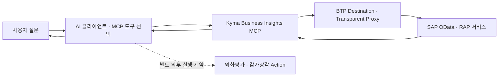
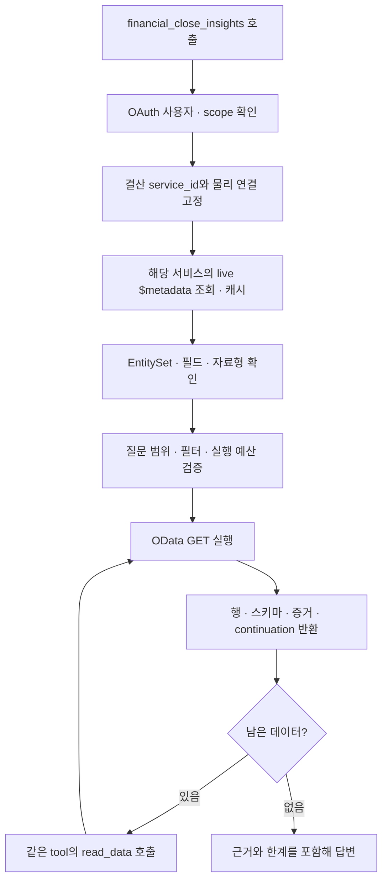
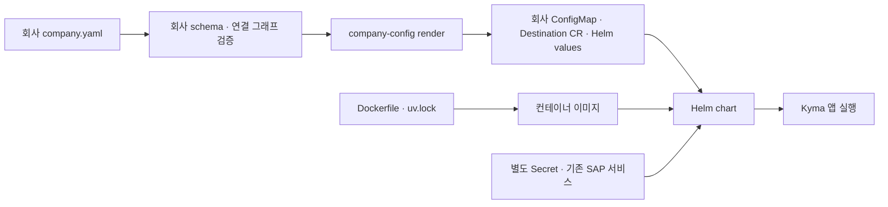

# Kyma MCP 역할과 구조

**`04_MCP_on_Kyma`는 AI 클라이언트가 SAP 업무 데이터를 조회하도록 연결하는 Python MCP 서버 배포 자료다. 결산 프로젝트에서 직접 읽을 부분은 Business Insights MCP의 Financial Close 조회 경로다.** SAP 안에 결산 기능을 만드는 ABAP 소스, 화면 프로젝트, 결산 기표 실행기는 이 배포본의 구성물이 아니다.

> [!info] 먼저 구별할 세 가지
> **Insights는 조회·분석**, **Actions는 별도 승인 기반 변경 기능**, **Kyma는 이를 컨테이너로 실행하는 장소**다. 이 배포본의 Actions 예제는 설비보전 통지 초안이며, 외화평가·감가상각 실행과는 다르다.

- 파일별 찾아보기: [[삼성 결산 업무 AI 자동화 프로젝트/03 제공 자료 구조/04 MCP on Kyma/01 내부 폴더와 파일 역할|01 내부 폴더와 파일 역할]]
- 원본 위치: `C:/Users/ericy/github/POC/ASPN/04_MCP_on_Kyma`
- 소스 루트: `04_MCP_on_Kyma/APL1.5_02_MCP_Distribution_fb08341_20261015/APL1.5_02/` — 아래에서는 **`<소스루트>`**로 표시한다.
- [원본 자료 폴더](<file:///C:/Users/ericy/github/POC/ASPN/04_MCP_on_Kyma>) · [실제 소스 루트](<file:///C:/Users/ericy/github/POC/ASPN/04_MCP_on_Kyma/APL1.5_02_MCP_Distribution_fb08341_20261015/APL1.5_02>)

## 전체 시스템에서의 자리

| 구성 | 쉬운 설명 | 이 자료의 담당 범위 |
|---|---|---|
| AI 클라이언트/JWD | 질문을 받고 적절한 MCP tool을 선택하는 쪽 | 연결·E2E 절차를 안내하지만 클라이언트 자체 구현은 없음 |
| MCP | AI가 호출할 수 있는 도구의 이름·입력·출력 계약 | `server.py`가 공개 도구를 등록 |
| Insights 앱 | 사용자의 권한을 확인하고 안전한 SAP 조회를 조립 | 본 프로젝트의 주 조회 경로 |
| BTP Destination | SAP 접속 대상과 인증을 플랫폼에서 관리 | 회사 설정은 연결 이름을 참조하며 접속 비밀값을 업무 코드에 넣지 않음 |
| Transparent Proxy | Kyma 앱이 Destination을 통해 SAP로 나가는 통로 | 내부 HTTP 연결·네트워크 정책·실제 대상 포트에 영향 |
| SAP OData/RAP | 조회할 업무 데이터와 스키마를 제공 | 이미 SAP에 구현·활성화되어 있어야 함 |
| Kyma | 컨테이너·Service·외부 경로·Secret을 운영하는 Kubernetes 환경 | Dockerfile과 Helm chart 제공 |
| 선택적 SAP AI Core | 질문 해석·응답 설명의 모델 보조 | `ai.enabled`일 때만 앱이 연결. 기본 설정은 비활성 |

**MCP를 빌드한다고 SAP 서비스가 생성되지는 않는다.** SAP 측 구현은 별도의 자료·시스템에서 확인해야 한다.

## 요청 한 번이 처리되는 흐름

| 순서 | 읽을 소스 | 하는 일 |
|---|---|---|
| 1. 프로세스 시작 | `apps/business-insights-mcp/src/apl15_business_insights_mcp/__main__.py` | 설정을 읽고 Uvicorn을 단일 worker로 시작 |
| 2. 실행 요소 조립 | 같은 패키지의 `application.py` | 회사 프로필·카탈로그·정책·OAuth·SAP client·metadata registry·runtime를 연결 |
| 3. 외부 도구 공개 | `server.py` | 서비스별 tool과 health/version 경로 등록 |
| 4. 요청 실행 | `runtime.py`의 `InsightsRuntime` | 인증·권한·operation·서비스 경계를 확인하고 적절한 실행 경로 선택 |
| 5. 계획·조회 | `packages/insights-engine/src/apl15_insights_engine/` | 스키마 검색, 필터 검증, 질의 컴파일, 분석·데이터 전달 |
| 6. 물리 연결 해석 | `packages/company-config/.../resolvers.py` | `service_id → connection_id → Destination`을 설정과 대조 |
| 7. SAP 통신 | `packages/destination-client/`, `packages/s4-client/` | 지정된 프록시 경계로 요청·응답·오류 처리 |

`server.py`는 질문을 처리하는 업무 로직 전체가 아니다. **공개 인터페이스는 server, 실행 조립은 application, 요청 처리와 분기는 runtime, 재사용 로직은 packages**로 나뉜다.

## metadata 기반이라는 뜻

**미리 정해 둔 서비스 안에서 SAP가 실제로 공개한 EntitySet과 필드를 읽어 질의를 만든다는 뜻이다.** 모든 SAP URL에 임의로 접속하거나 LLM이 존재하지 않는 필드를 만들어 쓸 수 있다는 뜻이 아니다.

| 용어 | 이 프로젝트에서의 의미 | 예 |
|---|---|---|
| 서비스 | 하나의 업무 API 경계 | `fin_insights_01_v4` |
| EntitySet | OData가 공개하는 조회 대상 목록 | `OpenItems`, `PendingSupplierInvoices` — 실제 노출 여부는 live metadata로 확인 |
| Property/필드 | 행 안의 항목과 자료형 | 회사코드·회계연도·만기일 등 |
| `$metadata` | API가 어떤 EntitySet·필드를 제공하는지 알려 주는 XML 설명서 | `metadata_parser.py`, `service_schema.py`가 해석 |
| semantic hints | 사용자 업무 표현과 실제 스키마를 연결하는 검색 힌트 | `semantic-hints.yaml` |
| capability restriction | live metadata에서 읽을 수 있는 항목을 추가로 제한하는 규칙 | `service-capabilities.yaml`은 허용 목록이 아니라 **제한만 더하는 정책** |

서비스 선택 이후에는 다른 서비스로 넘어가지 않는다. 안전하게 다룰 수 없는 키·필드형·엔터티는 제외하거나 요청을 막는다. `schema_search.py`는 잠긴 서비스 안의 스키마를 검색하며, `dynamic_planning.py`는 그 스키마를 기준으로 OData 필터와 조회를 검증한다. AI Core를 사용하더라도 모델 출력이 이 경계를 넓히지는 못한다.

`approved.py`, `insights.py`, `query.py`에는 과거 승인 엔터티 카탈로그 방식과 호환되는 코드도 남아 있다. **현재 `application.py`가 조립하는 주 경로는 `service_metadata`와 `DynamicCompanyInsightsPipelineProvider`다.** 파일이 존재한다고 모든 코드가 기본 경로에서 사용되는 것은 아니다.

## 결산 프로젝트에서 필요한 범위

| 결산 질문/기능 | 이 코드에서의 처리 | 이해할 때의 주의점 |
|---|---|---|
| 결산 태스크·cycle·issue 조회 | `financial_close_insights`의 live 스키마 조회 | 실제 필드·권한·데이터는 SAP 확인 필요 |
| 현재 미결 요약 | `closing_source_policy.py`가 `OpenItemSummary`를 우선 고려 | 기간 필터 없는 현재 상태와 과거 기준일 상태를 구별 |
| 미결 상세·기간 제한 | `OpenItems`를 선택하고 요구된 시간 필터 확인 | 요청한 기간을 빼고 전체 현재 미결로 넓혀 답하지 않음 |
| 만기초과 미결 | 명시적 기준일과 `NetDueDate` 조건을 요구 | 전기일은 만기일의 대체값이 아님 |
| 장기 미결 | 일수·전기일 기준·기준일이 명확해야 계획 가능 | 문맥을 추정하여 기간을 만들지 않음 |
| 공급업체 송장 후보 | `PendingSupplierInvoices` 경로 | **후보 조회와 사용자의 My Inbox 확인은 다름** |
| 나의 태스크/송장/수신함 | `required_closing_handoff()`가 사용자 매핑 계약을 요구 | OAuth 로그인만으로 SAP 업무사용자·회사 권한 매핑이 완성되지는 않음 |
| 오늘·이번 달 | 업무 시간대·기준일·회사 범위 계약 요구 | 서버나 모델의 날짜를 회사 결산 기준일로 대신 쓰지 않음 |
| 외화평가·감가상각 실행 | 외부 실행으로 handoff | MCP Insights가 TEST/POST를 수행하지 않음 |
| 기존 FX/AFAB 결과 조회 | 별도 auxiliary connection으로 정확한 RequestID의 `RunSet` GET | 실행 버튼이 아니라 **이미 실행된 요청 결과 읽기** |

### FX/AFAB 보조 조회는 무엇을 증명하는가

`closing_auxiliary.py`는 외화평가(`foreign_currency_valuation`)와 감가상각(`depreciation`)에 대해 코드가 소유하는 경로와 형식 검증을 통과한 RequestID만 사용한다. `runtime.py`는 `financial_close_insights` + `query` 조합으로 이 경로를 제한한다. 보조 연결은 `insights.auxiliary_source_bindings.closing_job_results_v2`로 연결한다.

결과의 `verification_level`은 **`REQUEST_ID_ONLY`**다. 요청 ID 일치·관찰된 상태를 읽지만, 실행 주체의 진위(`provenance_verified`), 업무 범위(`scope_verified`), 실행 모드(`mode_verified`)를 확인했다고 표시하지 않는다. `semantic_complete`도 false다. 완료 상태만 보고 기표 완료·전체 결산 완료라고 결론 내릴 수 없다.

진행 중이면 **같은 ID를 약 60초 후 다시 조회**하도록 반환한다. 이 과정은 반복 실행이 아니다. 로그·스풀 텍스트가 없거나 잘린 경우도 별도 한계로 남긴다.

> [!warning] 구현된 계약과 연결된 실행을 구별
> `closing_workflow.py`에는 실행 영수증 검증·업무사용자 매핑·진행률·C01~C05 증거 구성을 위한 함수가 있다. 현재 앱에서 직접 가져오는 것은 `required_closing_handoff`다. 이 파일 전체를 완성된 결산 워크플로 실행기로 해석하면 안 된다. 파일 설명 자체도 실행기·기표·메일 구현이 없음을 명시한다.

## active·disabled·planned와 검증 상태

| 표시/설정 | 뜻 | 뜻하지 않는 것 |
|---|---|---|
| `state: active` | 서비스 카탈로그에서 활성 업무 서비스로 취급 | 회사 SAP 접속과 업무 인수가 완료되었다는 보증 |
| `state: planned` | 추후 서비스 계약이 준비될 영역 | 즉시 조회 가능한 엔드포인트 |
| `state: disabled` | 서비스는 선언할 수 있지만 활성 집합에서 제외 | 파일이 삭제되거나 구현이 없다는 뜻 |
| `connections.*.enabled` | 물리 연결 사용 여부 | 서비스 lifecycle과 동일한 상태값 |
| `connections.*.critical` | 준비 상태 판정에서 중요하게 다룰 연결 | 업무 중요도 전체 또는 모든 질의의 성공 보증 |
| `actions.capabilities_enabled` | Actions 업무 tool 공개를 결정하는 별도 스위치 | Insights 조회 활성 여부 |
| `validation_state` | 개발·검증 단계 표시 | `state`나 접속 스위치를 대신하지 않음 |

| 서비스 영역 | 카탈로그 상태 | 기본 공개 tool | 본 결산 문서에서의 위치 |
|---|---|---|---|
| Financial Close | active | `financial_close_insights` | **직접 관련** |
| Profitability | active | `profitability_analysis_insights` | 같은 MCP 플랫폼의 다른 업무 영역 |
| Fixed Asset | planned | 없음 | 독립 고정자산 조회 서비스는 준비 전. 결산 AFAB 결과 보조 조회와 별개 |
| Budget | active | `budget_management_insights` | 같은 배포본에 포함된 다른 영역 |
| Treasury | active | `treasury_management_insights` | 같은 배포본에 포함된 다른 영역 |
| Maintenance Actions | 별도 capability 기본 비활성 | 활성화 조건 충족 시 prepare/execute | 실험적·선택적 변경 경로, 결산 실행 경로와 별개 |

`service-sets.yaml`의 active 항목도 `EXTERNAL_VALIDATION_REQUIRED`다. 이는 외부 환경에서 계약·연결·권한을 재확인해야 한다는 뜻이다. `actions.yaml`의 `LOCAL_COMPLETE`는 로컬 구현 단계이며 운영 검증 완료가 아니다. `core/validation.py`에 `ENTERPRISE_VERIFIED` 등 단계가 정의돼 있지만 그것이 현재 모든 서비스의 상태는 아니다.

현재 제공된 바깥쪽 `04_MCP_on_Kyma/company.yaml`과 배포본 템플릿은 서비스별 tool·단일 프로세스 메모리·`jwd_led_read_through` 기본 구조를 사용하며 Actions와 AI는 꺼져 있다. 바깥쪽 파일은 결산 보조 조회 binding과 persistence 설정도 포함한다. **프로필에 값이 있다는 사실은 실제 배포됐다는 증거가 아니다.** 회사 URL·client ID·Secret 참조 값은 이 노트에 옮기지 않는다.

## 전체 데이터·분석 결과를 읽는 법

기본 데이터 전달은 `jwd_led_read_through`다. `query`가 시작하고 `read_data`가 이어 읽는다. 응답의 `dataset_id`, `cursor`, `continuation.has_more`를 보고 **같은 업무 tool**을 다시 호출해야 한다. `next_call`은 응답 데이터이며 MCP가 자동으로 모든 페이지를 호출해 주는 장치가 아니다.

- `preview=true`는 제한된 미리보기다. 전체 모드와 구별한다.
- source를 다 읽음, 패킷을 내보냄, 클라이언트가 모든 값을 받음, 계산에 모든 값을 사용함은 서로 다른 증거다.
- `BOUNDED_SAMPLE`은 행 샘플의 증거이며 모집단 전체의 결론으로 확대하지 않는다.
- 기본 handle·시나리오 문맥은 프로세스 수명과 제한을 따른다. 프로세스 재시작이나 만료 이후에는 새 조회가 필요하다.
- `full_data_execution.py`의 PostgreSQL 기반 경로는 `legacy_postgresql` 선택지다. 기본 경로로 오해하지 않는다.
- `analyze`·시나리오 계산 중에는 CO/수익성 전용 코드도 있다. 모든 계산 기능이 결산 영역의 완성된 계산이라는 뜻은 아니다.

## 설정과 배포 자료의 연결

| 확인할 설정 묶음 | 역할 |
|---|---|
| `environment`, `schema_version` | 환경 구분과 프로필 형식 |
| `runtime.insights/actions` | 포트·상태 저장 모드·replica 수·진단 노출 |
| `oauth.insights/actions`, `oauth.session` | 공개 MCP 자원·IAS 연동·scope·세션 수명·Secret 참조 |
| `kyma` | namespace·Destination Service·Transparent Proxy 배치 정보 |
| `connections` | 물리 연결, 사용 여부, 중요 여부, timeout, 경로 결합 방식 |
| `insights.service_bindings` | 업무 service_id와 물리 연결의 매핑 |
| `insights.auxiliary_source_bindings` | 결산 보조 조회와 별도 연결의 매핑 |
| `actions` | 변경 capability와 승인된 백엔드 연결 |
| `ai` | 선택적 AI Core 사용 여부와 연결 계약 |
| `data_delivery`, `persistence` | 기본 이어 읽기와 선택적 영속 상태 계약 |

`service_root` 모드는 Destination URL이 이미 OData 서비스 루트를 포함하는 방식이다. `origin` 모드는 origin에 승인된 서비스 경로를 합친다. 이를 혼용하면 경로가 중복되거나 누락된다. 실제 URL 값은 프로필 담당자가 관리한다.

배포 이해 순서는 **회사 설정 → 이미지 → 플랫폼 전제조건 → 회사 ConfigMap/Secret/Destination → 실제 Transparent Proxy 포트 → Helm → health/metadata/OAuth/업무 인수**다. 차트의 `templates/destination.yaml`은 설명만 담으며 Destination 리소스를 자동 생성하지 않는다. 차트의 bootstrap ConfigMap과 실제 회사 프로필 ConfigMap도 구별한다.

| 경로/상태 | 확인 범위 |
|---|---|
| `/healthz` | 프로세스가 살아 있는지 |
| `/readyz` | 앱의 중요 metadata 등 준비 조건. 모든 업무 데이터의 정합성 보증 아님 |
| `/version` | 앱 버전·배포 Git SHA·설정 fingerprint 등 |
| `tools/list` | 설정과 정책에 따라 실제 공개된 도구 |
| 실 SAP 질의 | 대상 서비스·권한·업무 데이터·요청 범위가 맞는지 |

기본 메모리 상태에서는 worker/replica를 임의로 늘리면 세션·조회 상태가 나뉠 수 있다. Dockerfile과 Helm이 존재한다는 사실만으로 운영 가용성이나 실제 대상 포트가 입증되는 것은 아니다.

## 원본 안내서와 이번 노트의 확인 범위

[파트너 구조 안내서](<file:///C:/Users/ericy/github/POC/ASPN/04_MCP_on_Kyma/APL1.5_02_PARTNER_GUIDE_20261015.md>)는 소스 구성과 배포 계약을 설명한다. [PowerShell E2E 안내서](<file:///C:/Users/ericy/github/POC/ASPN/04_MCP_on_Kyma/APL1.5_02_PARTNER_ZIP_WINDOWS_POWERSHELL_E2E_GUIDE_fb08341_20261016.md>)는 ZIP 인수부터 배포·영역별 확인·복구까지의 순서와 helper 코드가 들어 있는 운영 자료다. 결산에서는 특히 BLOCK N/O/P를 함께 읽는다.

> [!note] 검증 경계
> 이 노트는 제공된 파일·카탈로그·설정 키·호출 관계를 읽어 작성했다. 테스트·설치·이미지 빌드·클러스터 배포·IAS 로그인·SAP 조회는 수행하지 않았다. 원본 안내서의 780 PASS 등은 당시 작성자가 기록한 이력이며 이번 검토의 실행 결과가 아니다. 안내서가 언급하는 manifest/SBOM/상세 검토서는 현재 이 폴더에 없으므로 존재를 가정하지 않는다.
