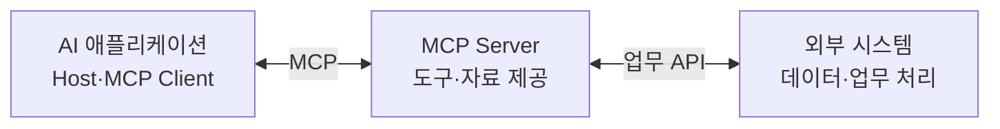
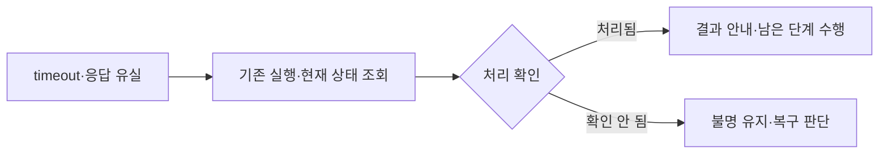

# MCP의 핵심 이해와 원칙적인 설계 방식

**좋은 MCP는 에이전트가 적절한 기능을 선택하고, 안전하게 실행하며, 결과를 정확히 이해하도록 돕는다.** 아래 8가지를 설계의 기준으로 삼는다.

## 1. MCP는 AI와 외부 시스템을 연결하는 표준 규약이다

**어떤 도구·자료가 있고, 어떤 입력으로 사용하며, 어떤 결과를 받는지 공통된 방식으로 전달한다.**

모델은 도구와 인자를 선택하고 Host가 호출한다. MCP 서버에 AI 모델을 넣을 필요는 없다. 같은 규약을 사용해도 기능·인증·실행 방식은 실제 Host·Client·Server의 지원을 확인해야 한다. [MCP 공식 규격](https://modelcontextprotocol.io/specification/2026-07-28)

## 2. 좋은 MCP는 에이전트의 선택과 판단을 돕는다

**모델 판단 → 도구 실행 → 결과 반영이라는 반복 구조의 한계를 고려한다.**

| 에이전트의 지속적인 제약   | 설계에 반영할 것               |
| --------------- | ----------------------- |
| 문맥은 유한함         | 필요한 정보와 근거를 선별해서 반환     |
| 시간·비용에는 한도가 있음  | 불필요한 호출과 대기를 줄임         |
| 도구 선택은 틀릴 수 있음  | 목적·입력·효과를 명확히 설명        |
| 원격 호출은 실패할 수 있음 | 기존 실행과 결과를 다시 확인할 경로 제공 |

도구의 설명과 반환 결과가 다음 판단의 재료가 된다. MCP의 품질은 이 판단을 얼마나 정확하고 효율적으로 돕는지에 달려 있다.

## 3. Tool은 업무 목적과 효과가 명확해야 한다

**언제 쓰고, 무엇을 입력하며, 무엇이 바뀌고, 무엇을 반환하는지 분명해야 한다.**

| 업무 행동 | 결과가 뜻하는 것             |
| ----- | --------------------- |
| 현황 조회 | 지정 범위·시점의 현재 상태       |
| 실행 접수 | 요청을 받았음. 최종 성공은 별도 확인 |
| 결과 확인 | 실제 실행 상태와 업무 결과       |
| 확정·반영 | 선택한 대상에 합의된 상태 변경 수행  |

도구는 업무 목적에 맞게 나누고 필수 범위·실패 뒤 행동까지 설명한다. Tool 하나가 여러 API 호출을 묶을 수도 있다. [Tool 설계 원칙](https://www.anthropic.com/research/writing-tools-for-agents)

## 4. 대화 문맥과 업무 상태와 경험 지식은 나누어 관리한다

**대화가 기억하는 내용과 실제 업무의 현재 사실을 구별한다.**

| 대상 | 보관할 것 | 관리 기준 |
| --- | --- | --- |
| 대화 문맥 | 지금 판단할 요청·도구·필요한 결과 | Host가 관리. MCP는 작은 응답으로 지원 |
| 업무 실행 상태 | 실제 실행 ID·대상·모드·상태·결과 | 대화가 끝나도 조회 가능한 영속 기록 |
| 경험 지식 | 재사용할 오류 조치·적용 조건 | 출처·버전·검토 상태와 함께 보존 |

현재 잔액·권한·상태는 원천에서 확인한다. 사용자의 해결 피드백은 검토할 증거로 다룬다. 기존 업무 기록으로 충족하면 그 저장소를 사용하며, 고객별 실행 기록과 재사용할 지식의 범위를 구분한다.

## 5. 최적화는 필요한 정보를 유지하며 왕복과 데이터를 줄이는 것이다

**모델이 모든 원본을 읽고 조합하는 부담을 줄인다.**

| 방법 | 줄이는 부담 |
| --- | --- |
| 서버·백엔드의 필터·집계·계산 | 불필요한 행·열과 모델의 계산 |
| 요약과 필요한 상세만 반환 | 긴 로그·중간 결과의 문맥 점유 |
| 목적이 명확한 도구 제공 | 여러 도구를 고르고 조합하는 왕복 |
| 페이지·응답 크기·동시성 상한 | 무한 조회·메모리·연결 사용 |

회사·기간·통화·기준시각·부분 결과 여부는 유지한다. 상세가 필요하면 식별자로 다시 읽게 한다. 캐시도 고객·사용자 권한 범위와 현재성을 지켜야 한다.

## 6. 동기와 비동기는 응답 시점과 완료 방식을 맞추는 문제다

**호스트가 소비할 수 있는 형식의 결과를 시간 안에 반환해야 한다.**

| 서버·업무의 방식 | Host와 맞춰야 할 조건 |
| --- | --- |
| 내부 async I/O로 처리 | 짧은 일반 결과를 반환하면 연결 가능 |
| 긴 업무가 끝날 때까지 대기 | 상위 시간 예산을 넘으면 timeout 가능 |
| 접수 결과·실행 ID를 먼저 반환 | 접수와 완료를 구분하고 후속 호출로 상태 조회 |
| Tasks·callback·자동 재개 사용 | 해당 기능과 완료 전달 방식을 양측이 지원해야 함 |

내부 구현의 async 여부만으로 호환성을 판단하지 않는다. 동기식 Host도 접수와 조회를 나누어 호출할 수 있지만, 자동 반복 조회·재개는 별도 지원이 필요하다. 이 문제는 비가역성보다 **실행·완료 계약의 불일치**로 설명하며, 시간 한도는 연결할 Host별로 확인한다.

## 7. 실패했을 때 안전하게 확인하고 복구할 수 있어야 한다

**응답을 못 받았어도 업무는 이미 실행됐을 수 있다.**

변경 요청을 무조건 다시 보내지 않는다. 중복 실행을 막고 부분 성공을 보존한다. 사용자·회사·ID에 대한 실제 권한도 서버와 백엔드에서 검증한다.

## 8. 좋은 설계는 답변과 실제 업무 효과로 평가한다

**도구 호출 성공부터 최종 답변과 실패 후 복구까지 확인한다.**

| 평가 대상 | 확인할 질문 |
| --- | --- |
| 선택 | 올바른 도구·대상·모드를 골랐는가? |
| 효과 | 실제 조회·실행·저장이 의도대로 됐는가? |
| 설명 | 진행·성공·부분·불명을 정확히 전달했는가? |
| 복구 | 오류·중복·재시작 뒤에도 안전하게 이어지는가? |

정확성과 함께 호출 수·응답 크기·지연을 측정한다. 개선 후에도 권한·범위·근거가 유지돼야 한다.

다음: [[02. 삼성물산 결산 AI 프로젝트의 상황과 맥락]]
