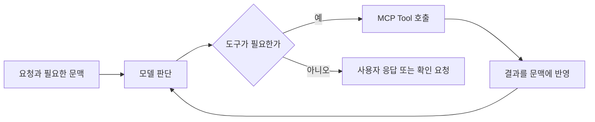

# 에이전트 하네스와 MCP의 책임

## 1. 왜 하네스를 이해해야 Tool을 잘 만드는가?

**LLM이 문장을 만드는 모델이라면, 하네스는 그 모델이 도구를 쓰며 일을 계속할 수 있게 하는 실행 틀**이다. 대화와 지시·도구 목록을 조립하고, 모델 출력에서 Tool 호출을 꺼내 실행하고, 결과를 다음 모델 입력으로 넣으며, 종료·예산·실패·재개를 관리한다. 제품마다 구현과 지원 범위는 다르다.

Tool의 입력 설명이 애매하면 모델은 잘못 고른다. 결과가 너무 길면 이후 판단을 방해한다. 결과가 `done` 한 단어면 무엇이 완료됐는지 오해한다. **MCP 담당자는 하네스를 직접 고치지 못해도, 하네스가 받는 입력과 선택지를 개선할 수 있다.**

## 2. ‘변하지 않는 요소’는 기능보다 판단 기준이다

메모리·코드 실행·자동 압축의 구체적 구현은 계속 바뀐다. 오래 유지할 기준은 **문맥은 유한함, 원격 호출은 실패함, 시간과 비용에는 한도가 있음, 모델 판단은 비결정적임, 업무 결과는 외부 시스템으로 검증해야 함**이다.

| 우리가 직접 결정 | Joule 측 확인·협업 | RAP/업무 측 확인·협업 |
|---|---|---|
| Tool 이름·경계·입력·출력 | 모델·컨텍스트 크기·압축 | 데이터·업무 상태의 정답 |
| 응답 상한·페이지·출처 | Tool discovery·선택 정책 | 권한·회사별 범위 |
| 서버 deadline·제한된 fan-out | 전체 turn 예산·Tool timeout | 장시간 Job·취소·멱등 처리 |
| 오류·재조회 계약·계측 | interrupt·resume·Tasks 지원 | 최종 결과·HIST 반영 |

## 3. 컨텍스트 압축과 메모리를 MCP가 대신하면 안 되는가?

호스트의 대화 전체를 서버가 갖고 있지 않으므로 임의로 대화 압축을 대행할 수 없다. Tool 결과를 요약·페이지화하고 ID로 다시 읽게 하는 것은 가능하다. 반면 “이 Tool이 호출되면 Joule이 과거 대화를 삭제한다”는 식의 보장은 서버가 할 수 없다.

OpenAI Agents API는 하네스와 앱·환경의 책임을 구분하고, Anthropic의 장시간 코딩 실험도 구조화된 인계와 평가를 다룬다. 이는 하네스의 중요성을 뒷받침하지만 **Joule에 같은 기능이 내장됐다는 증거가 아니다**.

## 4. 우리 판단 기준

**도구가 실행됐는가**와 함께 **모델이 어떤 결과를 보고 어떤 다음 행동을 선택했는가**를 시험한다. 다만 제공자가 반환하지 않는 내부 추론을 로그로 요구하지 않는다. 관측 가능한 Tool 선택·인자·응답·시간·상태 전이·최종 사용자 답변이면 상당수 문제를 좁힐 수 있다.

다음: [[03. 최신 연구와 공식 사례에서 얻는 기준]].

## 조사 근거

- [S18 · Agents API Architecture](https://developers.openai.com/api/docs/guides/agents-api/architecture) — OpenAI 공식 문서; 열람일 2026-11-15.
- [S16 · Harness design for long-running apps](https://www.anthropic.com/research/harness-design-long-running-apps) — Anthropic 기술 실험; 2026-03-24.
- [S19 · Harness engineering](https://openai.com/index/harness-engineering/) — OpenAI 기술 사례; 2026-02-11.
