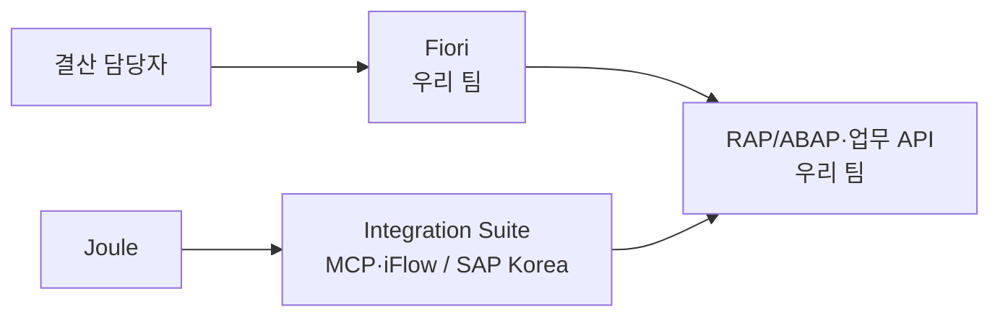
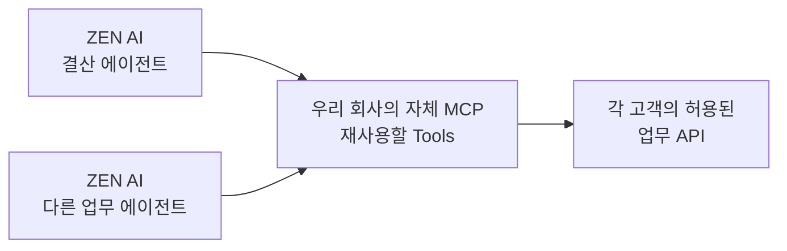

# 삼성물산 결산 AI 프로젝트의 상황과 맥락

**삼성물산 고객 구축과 우리 회사의 자체 MCP 구축은 목적과 수행 주체가 다르다. 이 문서는 고객 프로젝트에서 얻은 경험을 자체 결산 자동화 자산으로 연결하는 맥락을 정리한다.**

정리일 **2026-11-18** · 역할·사업 목적은 **사용자의 최신 회의 공유 기준** · 환경 준비 상태는 **11/17 제공 자료 기준**

## 1. 고객사 구축과 우리 회사의 자산 내재화를 구분한다

**고객사에는 SAP Korea의 Integration Suite 경로를 적용하고, 우리 회사는 별도로 자체 MCP를 설계한다.**

| 구분 | 목적과 구축 범위 |
| --- | --- |
| 삼성물산 고객 프로젝트 | 우리 팀의 Fiori·RAP/ABAP·업무 API + SAP Korea의 Integration Suite 기반 MCP·iFlow |
| 우리 회사의 자체 MCP | Integration Suite 구독 없이 결산 자동화 자산 내재화·향후 고객 활용·ZEN AI 연계 준비 |

사용자 설명에 따르면 SAP Korea는 유료 Integration Suite의 고객 판매를 추진하고, 우리 회사는 결산 로직과 자동화 경험을 향후 사업에 활용하려 한다. 두 활동은 서로 다른 사업 목적을 갖는다.

## 2. 고객사에서는 우리 팀의 API를 SAP Korea가 AI 경로에 연결한다

**우리 팀은 화면과 업무 기능을 제공하고, SAP Korea는 MCP부터 iFlow까지의 고객 연계를 구축한다.**

고객사 환경에서 Fiori를 구축하고 RAP/ABAP으로 API를 제공하는 일은 우리 팀의 필수 범위다. 위 그림은 책임을 설명하는 구조이며 Integration Suite 내부 구성의 상세 배치도는 아니다.

## 3. MCP 담당 역할은 자체 자산 구축을 기준으로 다시 이해한다

**최신 역할 설명을 기준으로 고객 납품 책임과 자체 MCP 설계 책임을 나눈다.**

| 담당 | 역할 |
| --- | --- |
| 반성훈 팀장 | 전체 방향·범위·협의 조율 |
| 홍종화 | RAP·ABAP·CDS·OData |
| 차재영 | Fiori |
| 염정운 | 우리 회사의 자체 MCP 설계·구축과 결산 자동화 자산 내재화 |
| SAP Korea | 고객사의 Integration Suite 기반 MCP·iFlow와 Joule 연계 |

고객 연계는 SAP Korea의 구축 범위이며 염정운의 자체 MCP는 회사 자산 구축 범위다. 고객 API의 업무 의미와 계약은 자체 설계에도 중요한 참고가 된다.

## 4. 자체 MCP의 목적은 결산 자동화 경험을 재사용 가능한 자산으로 만드는 것이다

**기능을 연결한 경험을 업무 의미·도구 계약·복구 방식까지 갖춘 자산으로 축적한다.**

| 현재 필요 | 내재화할 자산 |
| --- | --- |
| 우리 회사에 Integration Suite 구독이 없음 | 별도로 운영할 MCP 구현과 연결 경험 |
| 결산 로직을 향후 회사·고객에게 활용 | 업무 규칙·입출력 의미·검증 기준 |
| 여러 에이전트가 같은 기능을 사용 | 재사용할 Tool과 공통 결과·오류 계약 |
| MCP 설계 경험 축적 | 문맥·성능·상태·권한·복구에 관한 설계 근거 |

재사용할 업무 의미와 고객별 API 주소·인증·회사코드 매핑은 구분한다. 고객 데이터·접속 권한·설정을 그대로 다른 고객에게 가져가는 것으로 해석하지 않는다.

## 5. ZEN AI는 자체 MCP의 향후 활용 대상이다

**재사용할 Tool을 MCP로 제공해 여러 에이전트를 쉽게 구성하는 방향을 목표로 한다.**

사용자 설명에 따르면 ZEN AI는 MCP 서버에 연결해 Tool을 사용하는 구조다. 위 그림은 향후 활용 방향이며, 현재 연결·배포가 완료됐다는 뜻은 아니다. 실제 지원 기능과 실행 한도는 확인해야 한다.

## 6. 재사용의 중심은 결산 업무의 의미와 완료 기준이다

**현황 확인 → TEST → 결과 확인 → 조치·검토 → Task 반영의 의미를 일관되게 정의한다.**

| 개념 | 재사용할 업무 의미 |
| --- | --- |
| 업무 마스터·Cycle | 반복 업무의 정의와 회사·연도·기간별 결산 회차 |
| TaskInstance | 해당 회차의 개별 업무·담당·상태 |
| 실행·결과 | 실제 실행 ID·모드·성공/실패·근거 |
| 반영·검토 | 실행 결과의 Task 반영과 검토·승인 이력 |

Job 종료가 업무 성공이나 최종 결산 완료를 뜻하지는 않는다. 기존 검수의 업무 인스턴스 43건·대시보드 41건 차이와 ‘Agent 완료지만 최종 미완료’ 사례처럼, 조회 범위·마스터 연결·완료 기준을 맞춰야 한다. Fiori와 AI는 같은 백엔드 업무 정의를 사용해야 한다.

## 7. 보통예금은 재사용할 업무 계약을 구체화하는 사례다

**계좌별 대사 상태와 담당자 확정을 구분하는 것이 핵심 자산이다.**

| 대사 상태 | 의미와 확정 조건 |
| --- | --- |
| MATCHED | 허용오차 이내 일치. 아직 미확정일 수 있음 |
| DIFFERENT | 차이 있음. 사유가 있으면 확정 가능 |
| NOT_RECON | 외부 잔액 미수령. 확정 불가, 0을 실제 잔액으로 해석하면 안 됨 |

11/17 보통예금 API v1.0.0은 회사·연도·기간·House Bank 계좌별 결과와 `ResultUUID`를 다룬다. 확정은 검토 기록이며 잔액 수정·기표·전체 Task 완료와 구별한다. 현재는 **시드 데이터 기반·실제 은행/G/L 미연계·확정 취소 없음**이라는 제한이 있다.

## 8. 실행 제약과 준비 상태는 경로별로 확인한다

**Joule의 제약을 자체 MCP 전체의 고정 조건으로 적용하지 않는다.**

| 구분 | 현재 기준과 확인할 것 |
| --- | --- |
| 고객사의 Joule 경로 | 사용자 전달은 동기식 루프·약 1분 제한. 정확한 계층·한도는 SAP 경로에서 확인 |
| 자체 MCP의 ZEN AI 경로 | 전송·인증·응답 한도·후속 조회·자동 재개 지원 확인 필요 |
| 업무 API | 11/17 자료는 젠데모 배포·HE4 RAP/OData 대기를 기재. 이후 실제 준비와 접근 권한 확인 필요 |
| 자체 서버 환경 | 호스팅·SDK·런타임은 현재 확정된 것으로 보지 않음 |

이전 v0.6-Z의 CF Custom MCP·Joule Connector 경로는 당시 내부 제안으로 읽는다. 최신 목적을 기준으로 자체 MCP의 배포·연결 방식을 다시 판단하며, SAP Korea 고객 경로의 연결 승인을 자체 MCP의 필수 인수 조건으로 삼지 않는다.

다음: [[03. 삼성물산 맥락에서 구체화한 MCP 설계 방향]]
