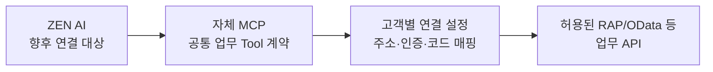
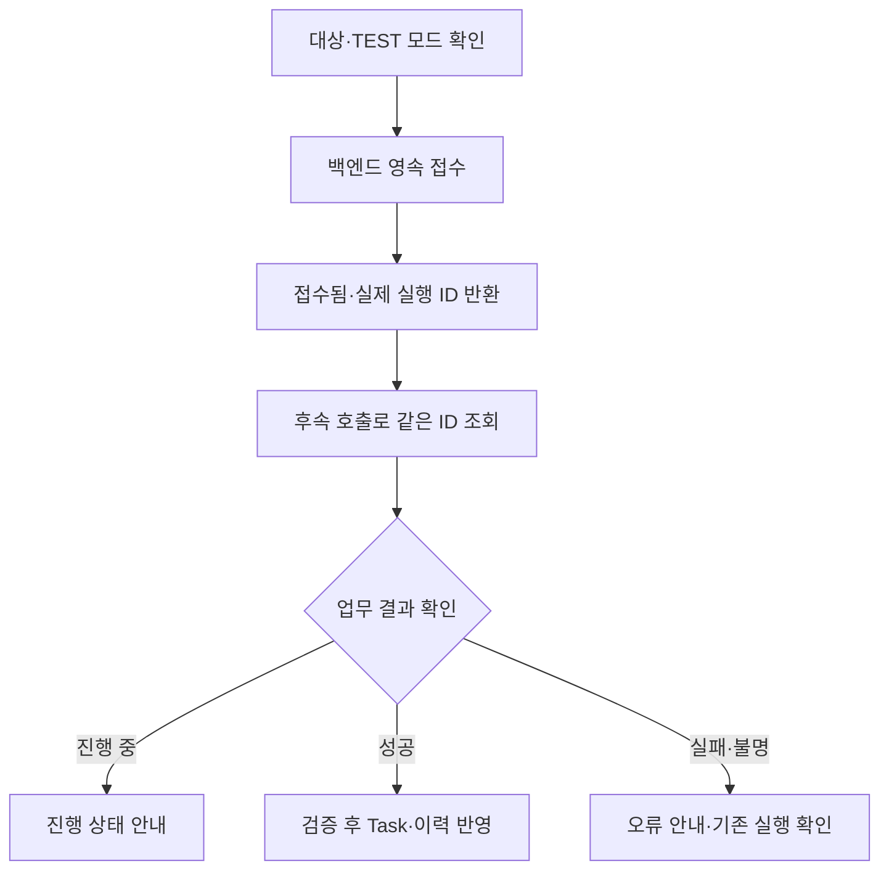

# 삼성물산 맥락에서 구체화한 MCP 설계 방향

**삼성물산 프로젝트에서 배운 결산 업무를 우리 회사의 재사용 가능한 Tool로 내재화한다. 자체 MCP는 향후 ZEN AI 활용을 목표로 설계한다.**

2026-11-18 기준 **자체 MCP 설계 제안** · 서버 환경·ZEN AI 지원 기능·업무 API 접근은 별도 확인 필요

## 1. 자산 내재화라는 목적에서 설계 선택을 도출한다

**공통 업무 계약은 재사용하고 연결 대상별 차이는 분리한다.**

| 현재 필요·관찰 | 설계 선택 | 이유 |
| --- | --- | --- |
| Integration Suite 미구독 | 자체 MCP 구축 | 우리 환경에서 Tool 제공·운영 경험 축적 |
| ZEN AI의 여러 에이전트·향후 고객 활용 | 업무 목적별 공통 Tool 계약 | 에이전트마다 같은 기능을 재구현하지 않음 |
| 화면·조회별 숫자와 완료 판단 차이 | 백엔드의 공통 업무 기준 사용 | 화면과 AI의 정답 일치 |
| 긴 업무·Host별 실행 한도 | 짧은 접수와 실행 ID 조회 | 특정 Host의 긴 대기에 의존하지 않음 |
| 항목별 확정의 일부 성공 | UUID별 결과와 재조회 | 성공 건 재전송 방지 |

업무 정답·권한·상태 변경은 백엔드가 책임지고, MCP는 에이전트가 올바르게 선택·실행·해석할 수 있는 계약을 제공한다.

## 2. Tool은 목적과 효과에 따라 나눈다

**읽기·접수·결과 확인·확정·반영의 의미를 여러 에이전트가 공유하게 한다.**

| 논리 기능 | 필요한 입력·반환 의미 |
| --- | --- |
| 현황 조회 | 회사·기간·Cycle → 집계·목록·기준시각·완전성 |
| TEST 접수 | 대상·TEST 모드 → 접수 여부·실제 실행 ID |
| 실행 결과 조회 | 기존 ID → 상태·업무 결과·오류 근거 |
| 계좌 확정 | 선택 UUID·사유 → 항목별 성공·거절·불명 |
| Task 결과 반영 | 검증한 실행 근거 → 결산 관리 상태·이력 |

이는 논리 구분이며 Tool 개수·이름의 확정은 아니다. 필수 회사·기간을 임의 추정하지 않고, 부분 조회를 전체 결과로 안내하지 않는다. 실제 기표는 TEST와 효과가 다르므로 별도 범위·승인·API 계약을 정한다.

## 3. 업무 계약과 Host·고객별 연결 설정을 구분한다

**업무 의미를 유지하면서 소비하는 Host와 연결할 백엔드를 바꿀 수 있게 한다.**

계약에는 입력 범위·결과 의미·부작용·오류를 담고, 고객별 주소·인증 정보·매핑을 분리한다. 처음부터 범용 프레임워크를 만들 필요는 없다. 우선 ZEN AI의 MCP 버전·전송·인증·시간 한도를 확인한 뒤 호스팅·SDK·런타임을 선택한다.

## 4. 긴 업무는 짧게 접수하고 같은 ID로 확인한다

**한 번의 Tool 응답과 업무의 최종 완료를 분리해 대화가 끝나도 이어갈 수 있게 한다.**

접수·조회 계약을 지원하는 업무부터 적용하고 기존 SAP RequestID·기록으로 충족하면 그 원천을 사용한다. 자동 polling·재개는 ZEN AI 지원을 확인하며, 미지원이면 후속 사용자 요청으로 조회한다. Joule에 연결할 경우에는 그 경로의 시간 한도를 별도로 적용한다.

## 5. 보통예금은 항목별로 확정하고 결과를 확인한다

**사용자가 선택한 계좌와 사유를 UUID로 연결하고 부분 성공을 보존한다.**

| 단계 | MCP의 처리 |
| --- | --- |
| 조회 | 현재 결과·확정자·시각 확인. 이미 있는 정보는 이력 재호출 생략 |
| 선택·확인 | UUID·회사·기간·현재 상태·필요 사유를 대조 |
| 확정 | 신뢰 사용자·권한과 해당 OData의 인증·CSRF를 처리해 `confirmMultiple` 호출 |
| 결과 확인 | HTTP200 안의 UUID별 결과를 매칭. 불명 항목은 상태·이력 재조회 |

성공 건은 다시 보내지 않는다. 조회 후 값이 바뀌는 문제는 **API의 원자적 동시성 계약**을 보완해야 한다. GUI의 오래된 화면 검사가 다건 API에도 적용된다고 가정하지 않는다. 일부 계좌 확정만으로 전체 Task를 완료 처리하지 않는다.

## 6. 작은 응답과 검증된 기억으로 문맥을 관리한다

**에이전트가 기억할 내용과 영속 업무 기록, 재사용할 지식을 나누어 관리한다.**

| 대상 | 적용할 방식 |
| --- | --- |
| 대화 문맥 | Host가 관리. 요약·집계와 필요한 상세 참조만 반환 |
| 업무 실행 상태 | 영속 원천에서 기존 실행 ID·상태·결과 조회 |
| 현재 잔액·권한·상태 | 해당 고객의 원천에서 현재 값 확인 |
| 오류 해결 경험 | 출처·버전·적용 조건을 검토한 사례부터 검색·재사용 |

응답 크기·페이지·동시성에 상한을 두고 초과하면 부분 결과임을 밝힌다. 고객 기록과 일반화한 지식의 저장·접근 범위를 구분한다. 별도 MCP DB·벡터 검색·내부 LLM은 기존 방식으로 해결하지 못하는 필요가 확인될 때 검토한다.

## 7. 고객별 권한과 중복 실행을 통제한다

**공통 Tool을 쓰더라도 고객·사용자·회사별 실행과 데이터 범위를 검증한다.**

| 위험 | 필요한 보호 |
| --- | --- |
| 사용자명·UUID·회사 입력의 위조 | 신뢰 인증 주체와 실제 업무 권한 대조 |
| 고객 간 데이터 혼입 | 실행 ID·결과·로그·캐시의 고객 및 권한 범위 검증 |
| timeout·응답 유실·중복 요청 | 기존 실행·확정 상태 조회와 중복 처리 계약 |
| 늦게 도착한 옛 결과 | 현재 유효 실행·버전 확인 뒤 Task 반영 |

고객 구분은 모델이 입력한 값만 신뢰하지 않고 인증·서버 설정에 연결한다. CSRF 토큰 갱신과 결과 불명 POST 재실행은 구분한다. 결과 저장 뒤 알림이 실패하면 알림을 복구하고 회계 업무를 다시 실행하지 않는다.

## 8. 준비된 API부터 연결하고 실패 상황까지 검증한다

**작은 업무 하나로 계약·백엔드·ZEN AI 연결을 확인한 뒤 재사용 범위를 넓힌다.**

| 순서 | 확인할 것 |
| --- | --- |
| 계약·예시 응답 | 준비된 C1 현황 또는 보통예금의 정답·상태·오류 정의. 미준비 API는 모의 응답으로 계약 확인 |
| 자체 MCP | 도구 설명·입력 검증·정상·0건·부분·유실·중복·동시 변경 |
| 허용된 실제 백엔드 | API·권한 인수 후 Job·확정·Task·이력의 실제 저장 확인 |
| ZEN AI 통합 | 도구 선택·권한 전달·사용자 확인·후속 조회·최종 답변 대조 |
| 재사용 확인 | 다른 에이전트·고객 설정에서도 공통 의미와 데이터 범위 유지 |

Fiori와 같은 조건의 숫자·상태를 비교하고 호출 수·응답 크기·지연을 측정한다. 모의 응답 검증과 실제 연결 완료는 구분한다. 확정 취소가 없는 예금 쓰기는 별도 허용 시험 데이터를 준비한다.

기준: [[01. MCP의 핵심 이해와 원칙적인 설계 방식]] · 상황: [[02. 삼성물산 결산 AI 프로젝트의 상황과 맥락]]
